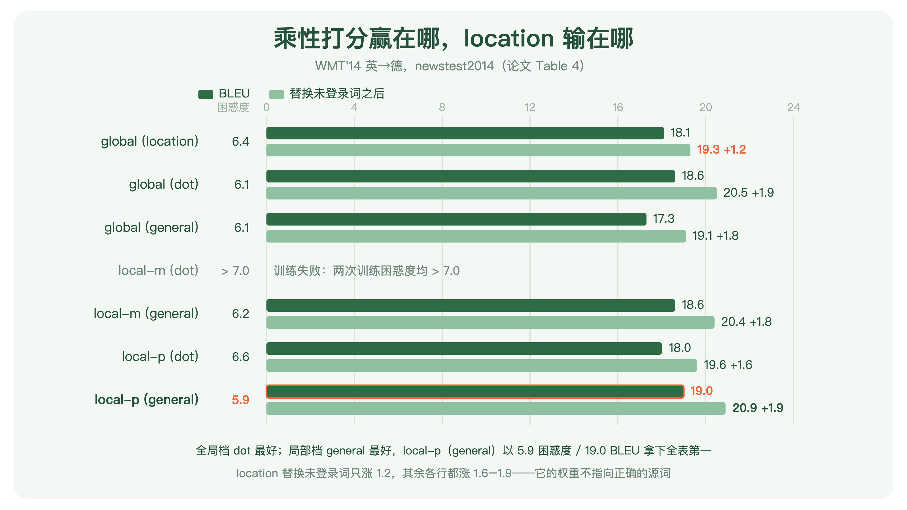
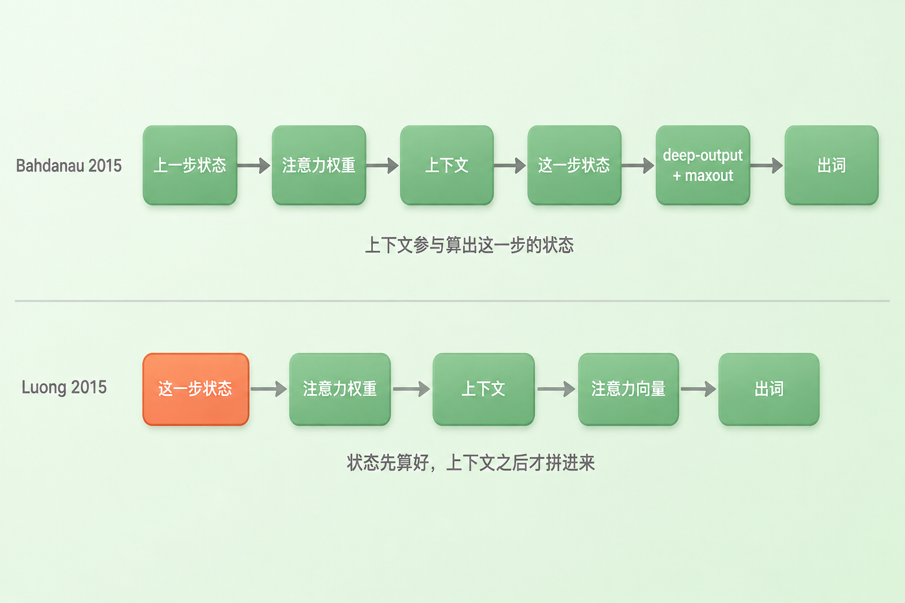
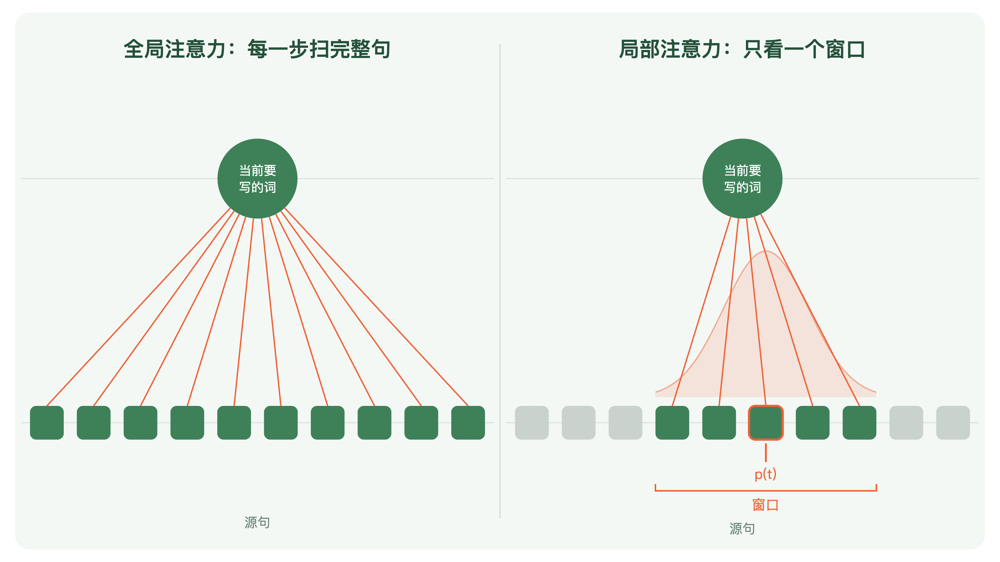
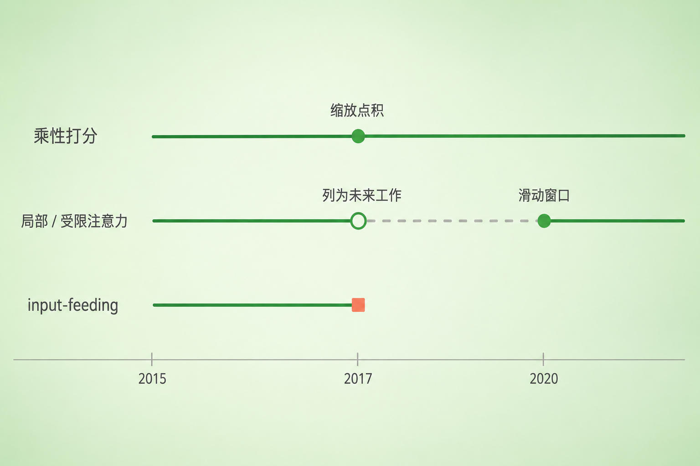

+++
title = "论文里程碑 #18：Effective Approaches to Attention-based Neural Machine Translation"
description = "NMT 注意力的第一次架构消融：乘性打分胜出，而作者自己命名并主推的两项设计都没能成为默认。"
date = 2026-09-09
tags = ["LLM", "论文里程碑", "Attention", "Luong", "机器翻译", "消融实验", "点积注意力"]
categories = ["LLM"]
series = ["论文里程碑"]
showTableOfContents = true
+++



> NMT 注意力的第一次架构消融：乘性打分胜出，而作者自己命名并主推的两项设计都没能成为默认。

## 一、标题里没有新东西

2015 年 8 月 17 日，arXiv 上挂出一篇机器翻译论文：*Effective Approaches to Attention-based Neural Machine Translation*——基于注意力的神经机器翻译，有效的做法。

读一遍标题就会发现，里面没有任何新机制的名字。没有「我们提出 X」，只有「有效的做法」。它要宣布的不是一个发现，是一组比较结果。

上一篇讲的 Bahdanau，通篇最关键的那句主张用的词是「我们猜想」。这一篇不猜想，它做了一张表。

顺带一提：作者名单第一个名字，上一篇结尾刚出现过——Bahdanau 那篇留下的 UNK 欠账，最早的两次偿还里有一次就是他写的。

## 二、时代背景：一份没人拆过的模板

2015 年的神经机器翻译很热闹。大词表、罕见词、源句倒序，几个组在同时往前推，SOTA 每几个月换一次。注意力这个概念也已经在别的地方流行起来——视觉里的注意力模型、语音识别里的帧对齐、图像描述里让解码器每写一个词就去看图的不同区域，本文引言把这几支都列了出来。

但在机器翻译里，情况是另一样。论文引言写得很直白：据我们所知，**没有任何其他工作**探索过基于注意力的 NMT **架构**。

重点在最后那两个字。用 Bahdanau 那套注意力做翻译的人已经有了——同一篇论文的第 2 节就把 Jean 等人那个大词表工作和 Bahdanau、和自己并列，说这三者的共同点是源表示不再只用来初始化解码器，而是一组会在整个翻译过程中被反复查阅的隐状态，「这种做法被称为注意力机制」；Table 1 里也把它当作已有的 NMT 系统列了出来。缺的是另一件事：**没有人把这套注意力本身拆开，比较过它的零件该怎么设计。**

Bahdanau 那篇是一整套一次端上来的：编码器换成双向 RNN，打分用一个带 tanh 的单隐层网络，上下文向量参与算出解码器的下一个状态，出词前还要过一个 deep-output 层加一个 maxout 层。这些成分同时出现、同时生效，论文报告的是它们合在一起的结果。后来者很自然地整套沿用，包括那些谁也说不清是不是必要的部分——因为在这之前，没有人做过这种比较。

> 一份菜谱只有一个人写过，做出来的菜确实好吃。后来的人照着做也做得不错，于是整张配料表就这么传下去——十四样，一样不落，包括那两勺谁也说不清是在提味还是作者手边正好有的东西。

所以这篇论文出现的时机比它的内容更值得注意：**消融来得非常早**，发明之后大约一年，在这套设计还只有一份模板的时候。它不是等领域堆积到看不清了才来清理，是在模板刚立住就开始追问哪一部分是必要的。

真正的障碍是这件事在 2015 年非常贵。论文在实验细节里交代了成本：代码用 MATLAB 写的，跑在单块 Tesla K40 上，每秒处理一千个目标词，**训完一个模型要 7 到 10 天**。把几种打分函数和几种注意范围组合着跑一遍，就是十来个模型、接近一百个 GPU-day；单卡串行下来是三四个月。

所以后面那张表跑得不全，作者写得很直接：受资源所限，我们没法把所有组合都跑一遍。这句话看着像客套，它其实是理解这篇论文分量的关键——后面第四节我们要回来算这笔账。

## 三、论文做了什么

### 3.1 三个论点

**第一，那个带 tanh 的加性网络不是必要的，乘性打分这一族就够用。**

论文比较了四种打分函数（后面 3.2 会拆开讲），结论分两档落下。全局注意力这一档，不带任何参数、直接点乘两个向量的 dot 最好，18.6 BLEU、做完未登录词替换 20.5；中间垫一个可学矩阵的 general 是 17.3 / 19.1；不直接读源侧状态、只从目标状态推权重的 location 是 18.1 / 19.3。局部注意力那一档次序反过来，general 更好。论文自己的总结就是这两句：dot 适合全局，general 适合局部。而全表最好的是 local-p 配 general——困惑度 5.9、BLEU 19.0。

至于 Bahdanau 那种拼接式打分（concat），三种配置的困惑度分别是 6.7、7.1、7.1，全部差于点积的 6.1，没能进正表。

所以胜出的不是某一个函数，是**乘性这一族**：两个向量直接相乘，中间最多垫一个矩阵。加性那条路径在这张表上没有拿到位置。

**这条结论有一处必须说清，而且它牵扯到读哪个版本。** 这篇论文的 arXiv 版与 EMNLP 会议正式版在 concat 这一处并不一致：arXiv v5 的脚注多出一句自陈——高困惑度可能是因为他们把矩阵 \(W_a\) 中对应源侧向量的那一部分简化成了单位阵；会议版的同一条脚注只报了三个困惑度数字，到此为止。两版给出的 concat 公式写法也不同。

这个差别不小。**当年在会场上读到这篇的人，看到的是一个没有附带自陈的结论。** 而按 arXiv 版的说法，跑输的并不是 Bahdanau 的加性打分，是一个被简化过的版本——一个变体同时改了两件事，换了打分族，又换了参数化，它输了，账不该全记在第一件上。作者在正文里的措辞本身也是悬置的：我们的实现没跑出好成绩，还需要更多分析来理解原因。

本文以下的公式与讨论一律按 arXiv v5，因为那一版把话说得更完整。

*图：论文 Table 4 的七行。系统名右侧一列是困惑度（越低越好），条形是替换未登录词前后的 BLEU，浅色条末尾标的是两者的差额。local-m（dot）那一行是空的——作者训了两个模型，困惑度都超过 7.0，没能跑出来。增幅一律按表里两个数字的实际差额标注，因此 local-p（dot）标的是 +1.6，而论文括号里印的是 +1.9。数值取自论文原文*

**第二，注意力这一层可以从解码器的循环里摘出来，挂到出词之前。**

这是本篇最容易被跳过的一条。

Bahdanau 的路径是：拿上一步的解码器状态去算权重，混出上下文向量，**再用这个上下文向量参与算出这一步的新状态**，之后过 deep-output 与 maxout 才出词。注意力嵌在状态更新里面。

Luong 的路径是：先让解码器照常走一步、得到这一步的状态，**然后**才拿它去算权重、混出上下文，把两者拼起来过一层 tanh，直接送 softmax 出词。

论文把这写成「我们的计算路径更简单」，一句带过。但改掉的不只是简单——注意力从「循环网络状态更新里的一个改装件」变成了「循环之上、softmax 之下的一个独立层」。

*图：上面一行是 Bahdanau——上下文向量要参与算出这一步的解码器状态，注意力嵌在循环的状态更新里面，出词前还要过 deep-output 与 maxout。下面一行是 Luong——解码器先照常走一步得到状态，之后才算注意力、把两者拼起来直接出词。注意力从循环内部的改装件，变成了循环之上、softmax 之下的一层*

从今天回看，这一步让注意力第一次呈现出可插拔的模块形态，和后来 Transformer 里注意力与序列建模彻底解耦的设计之间，有明显的结构连续性。这是脉络上的呼应，不是因果上的前提——Transformer 的关键动作是用 self-attention 直接取代循环来做序列建模，那一步并不需要先有人把 cross-attention 挪到状态更新之后。两篇论文之间也没有这样的引用关系。把结构相似读成历史因果，正是这个系列反复要避开的那种追认。

**第三，一个已经调好的非注意力系统，加上注意力还能再涨 5 个 BLEU。**

论文的 Table 1 是一道阶梯：基础系统 11.3，源句倒序 +1.3 到 12.6，加 dropout +1.4 到 14.0，加全局注意力 +2.8 到 16.8，加 input-feeding +1.3 到 18.1，换成局部注意力 +0.9 到 19.0。

从 14.0 到 19.0，整整 5.0 个 BLEU。而 14.0 那一档已经不是裸模型了——它含了 Sutskever 那篇的源句倒序，也含了 dropout，两样当时公认有效的技巧都在里面。注意力是加在一个调好的系统上、又拿到 5 个点。

给这个数字一个坐标：同一张表上，WMT'14 英德的冠军短语系统是 20.7。他们最后用 8 个模型集成加未登录词替换拿到 23.0。换到 newstest2015 上是 25.9，比当时最好的系统高 1.0——不过这一组报的是 NIST BLEU（为了和 WMT 官方口径对得上），和前面那些 tokenized BLEU 不是同一把尺子，不能直接放在一起比。

### 3.2 论文怎么做到的：把机器拆开，一个零件一个零件换

> 上一篇那台机器已经能跑了。这一篇做的事是拆外壳：把里面每个零件卸下来，换成一个更便宜的型号，或者干脆换个原理，看机器还转不转、转得快不快。

在拆之前，先把整条链路摆出来，后面三条线各改哪一环才看得清。每写一个目标词，模型做四件事：①拿这一步的解码器状态 \(h_t\) 去和每个源位置的状态 \(\bar{h}_s\) 打一个分 \(\text{score}(h_t, \bar{h}_s)\)；②把这一整行分数过 softmax，得到一组加起来等于 1 的对齐权重 \(a_t(s)\)；③按这组权重把所有源状态混成一份上下文向量 \(c_t = \sum_s a_t(s)\,\bar{h}_s\)；④把上下文和状态拼起来过一层 tanh，得到注意力向量 \(\tilde{h}_t = \tanh(W_c[c_t; h_t])\)，由它送进 softmax 出词。

四步里，第一步是打分函数要改的，第二三步的求和范围是注意范围要改的，第四步的产物 \(\tilde{h}_t\) 是 input-feeding 要拿去回喂的。

**① 打分函数：相关性到底该怎么算**

打分函数要回答的问题很朴素：解码器现在这个状态，和源句这个位置，有多相关？说到底就是给两个向量算一个相似度分数。

最省事的做法是让它们直接点乘。想留点余地，可以在中间垫一个可学习的矩阵。再讲究一点，把两个向量拼起来送进一个带 tanh 的小网络——那就是 Bahdanau 的做法。

$$
\text{score}(h_t, \bar{h}_s) =
\begin{cases}
h_t^\top \bar{h}_s & \text{dot} \\
h_t^\top W_a \bar{h}_s & \text{general} \\
v_a^\top \tanh\left(W_a [h_t; \bar{h}_s]\right) & \text{concat}
\end{cases}
$$

翻译一下：第一行是两个向量直接点乘，不带任何参数，算完就走；第二行在中间插一个可学的方阵，让模型自己决定「哪些维度之间的匹配才算数」；第三行把两个向量首尾接成一个长向量，送进一个单隐层网络，让网络自己去找相关性的形状——参数最多，表达力也最强。

还有第四个候选，论文管它叫 location，是他们早期尝试的产物：算权重时**不再逐个查看源侧的状态**，只拿目标状态 \(h_t\) 直接推出一整组位置权重。\(h_t\) 当然仍是读过源句之后的状态，所以不能说它对源句一无所知；但具体该看第几个词这件事，它是在不去比对任何一个源位置的情况下做出来的。有点像闭着眼睛报位置。

location 的结局值得单说，因为它给出了一个漂亮的诊断。单看 BLEU，它 18.1，不算差，甚至高过 general 的 17.3。但做未登录词替换时，它只涨了 1.2，而其余各行按表里两个数字的实际差额都在 1.6 到 1.9 之间（顺带一提：local-p（dot）那一行括号里印的增幅是 +1.9，可它自己的两个数字相差 1.6）。

未登录词替换是这么干的：译文里吐出一个 `[UNK]`，就顺着对齐找到它对应的那个源词，先查双语词典有没有译法，有就换成译词；词典里查不到，才把源词原样复制过去。人名地名多半走复制那条路，其余走词典。这个流程要求对齐**真的指向正确的源词**——指错了，词典查的就是另一个词。

location 涨不动，说明它给出的那组权重虽然能让 BLEU 好看，却不是一份可用的对齐。论文自己下的判断也正是这个：这项技术带来的增益，证明我们的注意力模型确实学到了有用的对齐。

作者还另外用对齐错误率（AER）量了一次，结论一致：location 是 0.39，而两个基于内容的模型分别是 0.34 与 0.36；作为参照，专业的 Berkeley 对齐工具是 0.32。

这里有一处记账细节，论文用脚注专门交代过：取对齐时，基于内容的打分函数把这一行权重算给输入词 \(y_{t-1}\)，location 那一档则算给预测词 \(y_t\)。两档比的不完全是同一件事，读这组增益的时候值得记着。

> BLEU 分不出来的差别，一个下游用途替它分出来了。当一个指标涨了却说不清涨在哪儿，去找一个依赖它内部结构的用途，让那个用途来判卷。

**② 注意范围：全句，还是一个窗口**

全局注意力有个明摆着的代价，论文写得比后来很多人都清楚：生成每一个目标词都要给所有源词算一次权重，这很贵，而且**可能让它没法用于更长的序列，比如段落、文档**。

2015 年就写下了「段落、文档」这四个字。

局部注意力是他们给出的解法：每一步先定一个对齐位置 \(p_t\)，只在 \([p_t - D,\ p_t + D]\) 这个窗口里算权重，\(D\) 取 10，窗宽 21 个词。两个变体——local-m 简单粗暴，直接令 \(p_t = t\)，假设源句和译文大致是单调对应的；local-p 用一个小网络预测 \(p_t\)，再在权重上乘一个以 \(p_t\) 为中心的截断高斯，越靠近中心权重越大。

省下来的账是这么算的：全局要给每个目标位置配上每个源位置，代价约 \(T_y \times T_x \times d\)；局部把源侧那一维从整句 \(T_x\) 换成固定的 \(2D+1\)，变成 \(T_y \times (2D+1) \times d\)。句子越长，省得越多。

想法来自图像描述里的 soft 与 hard attention 之争：软的看全图、可导但贵，硬的只挑一块、便宜但不可导，得用强化学习那一套来训。局部注意力是中间态——只看一个窗口，但窗口内部仍是软的，整体仍然可导。

结果 local-p 配 general 打分是全表最好的：困惑度 5.9、BLEU 19.0，两项都是第一。论文的结论是局部赢了。

不过这张表里还有一行不该被略过：**local-m 配 dot 训不出来。** 他们训了两个模型，困惑度都超过 7.0，表格里那两格是空的。七行里唯一一次失败，论文没有给出原因，实验也没有做到能分离出原因的程度——固定窗口、无参数打分，这两件事同时在场，谁是主因无从判断。能确定的只有一句：这组配置在那两次训练里都不稳。

*图：左边是全局——写每一个目标词，都要对全部源词算一遍权重。右边是局部——先预测一个对齐位置 p(t)，只在它两侧各 D 个词、共 2D+1 宽的窗口内计算，窗口外的源词这一步一条线都没有；橙色的丘是以 p(t) 为中心的高斯衰减。论文取 D=10、窗宽 21，图中为便于辨认取 D=2、窗宽 5，源词数量同为示意。窗口左右灰块数量不等，表示 p(t) 由模型预测、不在句子正中*

**③ input-feeding：给注意力接一条自己的记忆**

前两条改的是「这一步怎么看」。第三条改的是「这一步知不知道上一步看过什么」。

在全局和局部两种设计里，每一步的注意力决策都是独立做出的，模型没有任何机制记住自己刚才看过哪儿。翻译里这会出真问题：同一段源文被翻两遍，或者某一段整个被跳过去。

短语系统早就有对策，叫覆盖集（coverage set）——一张表，记录哪些源词已经被译过了。

Luong 的做法是把上一步的注意力向量 \(\tilde{h}_{t-1}\) 拼进下一步的输入。于是「我上一步看了哪儿、从那儿拿到了什么」，成为下一步输入的一部分。效果实打实：Table 1 上 +1.3 BLEU。

代价论文自己也写了，只是当成好处写的：这条连接让网络「在水平和垂直两个方向上都变得非常深」。在 RNN 时代这笔账并不刺眼——解码器本来就沿时间串行，多一条 \(\tilde{h}_{t-1} \to h_t\) 的回馈并不改变它串行的事实。真正让它待不下去的是后面那个时代：当解码器不再有循环、训练时整段并行成为默认，一条跨时间步回喂注意力结果的连接就很难原样保留了。它不是被证伪的，是它依附的那个结构没了。

## 四、它改变了什么

**短期：注意力从一份没人拆过的模板，变成一组可以照着填的选择。**

这篇之后，乘性打分——点积和它带一个矩阵的近亲 general——成为注意力实现里的主流选项之一；把注意力做成出词前的一层、而不是塞进状态更新，也成了常见写法。要注意的是加性打分并没有因此退场：两年后 *Attention Is All You Need* 在介绍打分函数时，仍然把加性与点积并称为「最常用的两种注意力函数」，同年 Britz 等人的大规模消融也还在系统比较这几种方案。这篇改变的是设计空间的形状——它让「该选哪个」变成一个可以查表回答的问题，而不是让别的选项消失。

它还开了一个体裁。两年后那篇 *Massive Exploration of Neural Machine Translation Architectures* 把同样的事情做到了几百个模型的规模，作者里就有 Thang Luong。而 *Attention Is All You Need* 讲加性与点积孰优孰劣时，引的正是那一篇。

**发明权和影响力，得分开算。**

流传最广的说法是「Transformer 的缩放点积注意力直接继承自 Luong 的点积」。查一遍引用会发现事情要绕一点：Transformer 论文里，这篇只出现在引言的一串引文里，被列为「推进循环语言模型与 encoder-decoder 架构的诸多努力」之一。而在讲注意力函数的那一节，加性注意力引的是 Bahdanau，「\(d_k\) 较大时未缩放的点积不如加性」引的是 Britz 那篇 2017 的大消融——**没有为点积引用这一篇。**

准确的说法是：到 2017 年，点积打分已经是一个不需要引用的常识，而它成为常识的过程里，这篇是最关键的一次公开比较。

> 影响大到不需要被引用，和影响小到不值得被引用，在参考文献列表上长得一模一样。

**一个代数上的等价，值得看，但只是代数上的。**

Transformer 不是直接点乘两个隐状态，而是先各过一个投影，再点乘、再除以 \(\sqrt{d_k}\)。把投影代回去：

$$
\frac{q^\top k}{\sqrt{d_k}} = \frac{(W_Q h_t)^\top (W_K \bar{h}_s)}{\sqrt{d_k}} = \frac{h_t^\top \left(W_Q^\top W_K\right) \bar{h}_s}{\sqrt{d_k}}
$$

翻译一下：括号里那一坨的位置，正是本文 general 里的那个 \(W_a\)。所以单个 Transformer 注意力头可以重写成一次 general 打分，只不过它的 \(W_a\) 是两个瘦矩阵相乘得到的——当 \(d_k\) 小于模型维度时，这个乘积的秩至多是 \(d_k\)，是一个低秩的参数化。

这是一个很有启发性的结构等价，读的时候能省不少力气。但它是事后代数，不是文献上的继承：Transformer 并没有说自己选的是 general 的分解版本，多头也不是从这个分解里长出来的——多头的动机是让模型同时关注不同表示子空间的信息。等价关系成立，来源关系不成立，两件事得分开放。

至于那个 \(\sqrt{d_k}\)，Transformer 论文自己给了理由，用不着我们猜：假设 \(q\) 和 \(k\) 的各个分量是均值 0、方差 1 的独立随机变量，那么它们点积的方差就等于 \(d_k\)。维度一大，logits 的幅度跟着变大，softmax 被推进梯度极小的区域，所以要除以 \(\sqrt{d_k}\) 把尺度拉回来。

这篇论文没有这一项，也没有讨论过这个问题。有意思的是，按上面那个论证本身，它反而更该有：这里点乘的是两个 1000 维的 LSTM 隐状态，而 Transformer 每个头的 \(d_k\) 只有 64。为什么当年没在这上面栽跟头，两篇论文都没有回答，这里也不替它们补一个。

**长期：它示范了一种研究习惯，也顺手示范了这种习惯的副作用。**

上一篇示范的是「把中间结构写成可微模块，挂进同一个目标」。这一篇示范的是另一件事：**一个能跑的设计，不等于一个被理解的设计。** 发明之后得有人来做消融，把「哪些成分在起作用」和「哪些只是当时手边正好有」分开。

副作用是这篇自己就演了一遍：**消融表会把一次实验的结果，固化成不再被检查的常识。**

回头看那张 Table 4：七行配置，每个成功的配置只报告一个结果，没有多随机种子的均值与方差；唯一明确说了训练不止一次的，恰恰是失败那一行——local-m 配 dot 训了两个模型，两次困惑度都超过 7.0。作者明说资源不够跑不全所有组合，那一行为什么崩也没有解释。这不是一次完整的析因实验，只是在预算允许的范围内切出来的几个点。就是这样一张表，让「点积优于加性」成了此后十年的默认认知——而其中关于 concat 的那一条，连作者自己的保留意见都没能跟着一起流传：那句「我们把 \(W_a\) 对应源侧的部分设成了单位阵」只写在 arXiv 版的脚注里，会议正式版没有。

证据的强度，和结论被引用的强度，从来不是同一件事。

**这篇论文最反直觉的地方，是它主推的两样都没成为默认。**

标题、摘要、结论里被反复强调的是全局与局部两类方法，作者明确说局部更好；input-feeding 是他们自己命名、自己主推的贡献。今天的主流实现里，这两样都不在。

但「局部」这条得说准，因为它并没有被否决。*Attention Is All You Need* 的那张复杂度对照表里，本来就列着 restricted self-attention 一行——把注意力限制在每个位置周围大小为 \(r\) 的邻域内，代价从 \(N^2 d\) 降到 \(r N d\)，代价是最大路径长度变成 \(N/r\)。论文正文还写着：我们计划在未来的工作中进一步研究这个方向。它是被摆上桌又暂时放下的选项，不是被淘汰的方案。等到长上下文真正成为问题，滑动窗口与各种稀疏注意力把它接了回来——不过那时候要省的是 self-attention 那笔序列跟自己两两相看的账，不是这篇的源句 × 译文那笔。动机延续，账目不同。

input-feeding 就直白得多：它依附的那个逐时间步的解码器循环没有了，它也就没有了。

活下来的，是他们顺手比较出来的一行表格，和一句被写成「我们的计算路径更简单」的重构。

*图：三条设计从 2015 年出发。乘性打分那条一路走到 2017 年成为缩放点积，往后没有断过。局部注意力那条不是在 2017 年被否决——它被写进了 Transformer 自己的复杂度对照表与未来工作，处于搁置状态，直到长上下文时代以滑动窗口的形式重新展开，但那时要省的已是另一笔账。input-feeding 那条到 2017 年终止，因为它依附的解码器循环消失了*

## 五、与主线的接口

把三篇摆在一张表上，这一篇改了什么就清楚了：

| 维度 | Bahdanau 2015 | Luong 2015 | Transformer 2017 |
| --- | --- | --- | --- |
| 打分函数 | 加性：带 tanh 的单隐层网络 | dot / general / concat / location 四选一，实测乘性一族胜出 | 缩放点积，Q 与 K 各带独立投影 |
| 谁当 query / key / value | 解码器状态当 query；源侧 annotation 过一层投影当 key，未投影的当 value | 解码器状态当 query；源侧状态同时充当 key 与 value，两侧都不过投影 | 三者各有独立的可学习投影，多头并行 |
| 注意力站在哪 | 嵌在解码器的状态更新里 | 摘出来，做成出词前的一层 | 独立子层，与 FFN 交替堆叠 |
| 注意范围与代价 | 全句 cross-attention，\(T_y T_x d\) | 全句，或宽 21 个词的窗口（\(T_y (2D{+}1) d\)） | cross-attention 仍是 \(T_y T_x d\)；**新增**的 self-attention 才是 \(N^2 d\)，受限版 \(rNd\) 已列在原论文表里 |
| 跨步记忆 | 上下文进入下一个状态，顺带有覆盖效果 | input-feeding，显式接一条 | 解码器 self-attention 直接看全部历史 |
| 编码器 | 双向 RNN | 单向堆叠 LSTM + 源句倒序 | 无循环，位置编码补顺序 |
| 头数 | 单头 | 单头 | 多头 |

有一行值得多看一眼：这篇的源侧状态**同时当 key 和 value**，两侧都不过投影——拿来算相关性的和被搬走的是同一个向量。Bahdanau 那边至少 key 一侧过了一层投影、value 一侧是裸的，两者同源而不同形。到 Transformer 才三者各自独立投影。所谓「Q/K/V 分家」是分了两步走完的，这一篇正好停在最合并的那一端。

**如果你想深入……**

这篇论文的核心概念对应我们 LLM 系列的「Transformer 架构：训练视角 vs 推理视角」章节：

- **[#20] Attention 在算什么：Q/K/V、Softmax 与 O(N²)** — 讲了为什么要把一个向量拆成 Query / Key / Value 三个角色。对照本篇读特别清楚：这里的 dot 是未缩放、也未分投影的原始版，key 和 value 还是同一个向量，那笔账也还是源句 × 译文那一笔
- **[#21] 多头注意力的现代变体：MHA → MQA/GQA → MLA** — 讲了一个头不够用之后的事。本篇是单头的，同一时刻只能维持一种「该看哪儿」的判断
- **[#51] 上下文长度：内存的诅咒与 Lost in the Middle**（尚未发布）— 局部注意力当年那个「段落和文档就扫不动了」的担忧，在长上下文时代重新成立，只是这次要省的是另一笔账

读完这些，你对 Luong Attention 的理解会从历史印象变成可操作的工程认知。

## 六、收尾

读这篇之前，Luong Attention 大概是一个名字：注意力的一种变体，据说点积那种。

读完之后应该换个看法：它是机器翻译里注意力**架构**的第一次消融，而且来得非常早——那时这套设计还只有一份模板。它没有发明注意力，是把别人的发明拆成可选项，一项一项换掉重跑，然后把结果写成一张表。它最有价值的产出有两个，都不是它自己主推的——一行说明「乘性打分够用、那套加性网络不必要」的表格，和一次把注意力从循环里摘出来、变成可插拔一层的重构。而它郑重命名、反复强调的局部注意力与 input-feeding，都没能成为下一个时代的默认。

还有一层，可能比结论本身更耐用：**发明之后必须有人做消融，但消融表也会把一次实验冻结成常识。** 那张 Table 4 每个成功配置只有一个数、没有方差、跑不全组合、还崩了一行没解释，它却决定了此后十年的默认选择；连作者写在脚注里的保留意见，都只留在 arXiv 那一版上。读到任何一张「A 优于 B」的对照表时，值得先问两句：这是跑了几次的结论，以及作者自己有没有附上什么话，只是没能跟着结论一起流传。

**下一篇**：这篇论文把注意力的每个零件都拆下来称过一遍，唯独有一样东西从头到尾没被消融，甚至没被讨论——优化器。他们用的是最朴素的 SGD：学习率从 1 起步，基础配置训 10 个 epoch、第 5 个之后逐轮减半，带 dropout 的模型改成训 12 个、第 8 个之后才开始减半；梯度范数超过 5 就裁剪回去。什么时候开始减半、减多少、裁在哪里，全是要人一个个试出来的。当时这就是标准手艺，没什么可比较的，因为还没有一个「不用想就能写下去」的默认值。而在这篇挂上 arXiv 之前几个月，ICLR 2015 上出现了一篇论文，它提出的方法宣称能给每个参数自适应地定学习率，默认超参数基本不用调。此后几年，Transformer、BERT、GPT 全都用它，今天你训练任何一个模型，那行代码几乎是闭着眼睛写的。下一篇，我们讲 *Adam: A Method for Stochastic Optimization*。

## 七、参考资料

- 论文原文：[Effective Approaches to Attention-based Neural Machine Translation](https://arxiv.org/abs/1508.04025)（arXiv:1508.04025，v1 挂于 2015 年 8 月 17 日）／ [EMNLP 2015 正式版](https://aclanthology.org/D15-1166/)。**两版在 concat 一处不一致**：arXiv v5 的打分公式写作 \(v_a^\top \tanh(W_a[h_t; \bar{h}_s])\)，脚注并说明把 \(W_a\) 中对应源侧的部分简化成了单位阵；会议版的公式写法不同，该脚注也只报了三个困惑度数字。本文按 arXiv v5
- 作者：Minh-Thang Luong、Hieu Pham、Christopher D. Manning（斯坦福大学计算机科学系）
- 延伸阅读：
    - Bahdanau, D., Cho, K., & Bengio, Y. (2015). *Neural Machine Translation by Jointly Learning to Align and Translate*（[arXiv:1409.0473](https://arxiv.org/abs/1409.0473)）——上一篇，本文全程对标的那一套设计
    - Xu, K. et al. (2015). *Show, Attend and Tell*（[arXiv:1502.03044](https://arxiv.org/abs/1502.03044)）——局部注意力的灵感来源，soft 与 hard attention 的取舍出自这里
    - Luong, M.-T., Sutskever, I., Le, Q. V., Vinyals, O., & Zaremba, W. *Addressing the Rare Word Problem in Neural Machine Translation*（[arXiv:1410.8206](https://arxiv.org/abs/1410.8206)，ACL 2015）——未登录词替换的出处，「先查词典、查不到再原样复制」这个流程写在这篇；也是上一篇结尾提到的两次偿还之一
    - Jean, S., Cho, K., Memisevic, R., & Bengio, Y. *On Using Very Large Target Vocabulary for Neural Machine Translation*（[arXiv:1412.2007](https://arxiv.org/abs/1412.2007)，ACL 2015）——本文对标并超过的那个 SOTA
    - Britz, D., Goldie, A., Luong, M.-T., & Le, Q. V. (2017). *Massive Exploration of Neural Machine Translation Architectures*（[arXiv:1703.03906](https://arxiv.org/abs/1703.03906)）——同一个体裁的放大版，也是 Transformer 论文讲点积缩放时引用的那一篇
    - Vaswani, A. et al. (2017). *Attention Is All You Need*（[arXiv:1706.03762](https://arxiv.org/abs/1706.03762)）——第 3.2.1 节与 Table 1 值得对读：前者是三种打分函数的去向，后者列着 restricted self-attention 那一行
