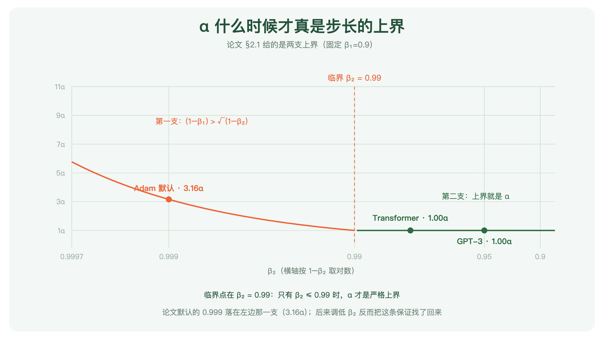
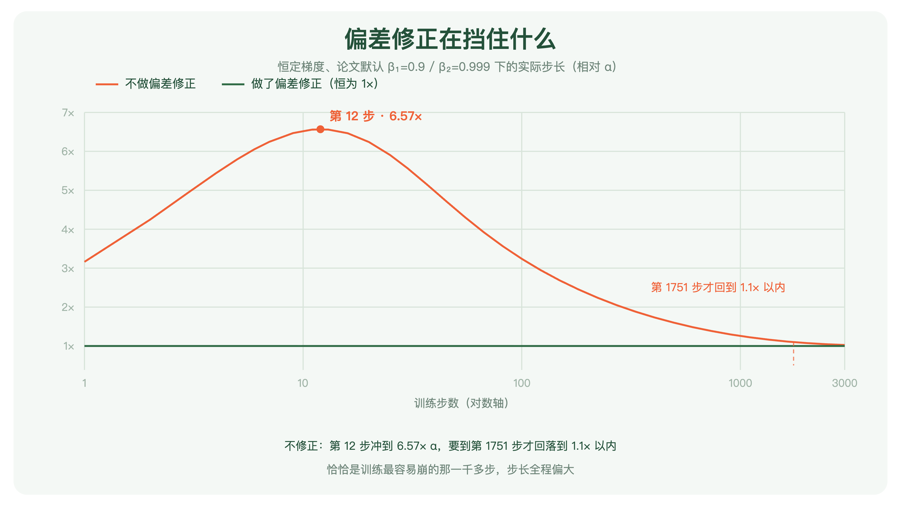

+++
title = "论文里程碑 #19：Adam: A Method for Stochastic Optimization"
description = "它最持久的产出不是一个算法，是四个数字——一组不用想就能写下去的默认值。"
date = 2026-09-16
tags = ["LLM", "论文里程碑", "Adam", "优化器", "学习率", "AdamW", "Kingma"]
categories = ["LLM"]
series = ["论文里程碑"]
showTableOfContents = true
+++



> 它最持久的产出不是一个算法，是四个数字——一组不用想就能写下去的默认值。

## 一、连名字都是别人起的

2014 年 12 月 22 日，arXiv 上挂出一篇优化算法论文：*Adam: A Method for Stochastic Optimization*。

论文最后的致谢里有两句话，很少被引用。第一句：感谢 Ivo Danihelka 和 Tom Schaul **为这个方法起了 Adam 这个名字**。第二句在第一页的脚注里：两位作者贡献相同，**作者顺序由一次 Google Hangout 上的掷硬币决定**。

一个名字是别人取的、署名顺序靠抛硬币定下来的方法，此后十年成了几乎所有深度学习模型的默认起点。今天你打开任何一份训练脚本，那一行 optimizer 多半不需要想。

这篇要讲的就是它凭什么。以及——「不需要想」这四个字，实际能兑现到什么程度。

## 二、时代背景：学习率不是一个数，是一套手艺

上一篇讲 Luong 的时候留了一个尾巴：那篇论文把注意力的每个零件都拆下来称过一遍，唯独优化器从头到尾没被讨论。他们用的是最朴素的 SGD——学习率从 1 起步，基础配置训 10 个 epoch、第 5 个之后逐轮减半，带 dropout 的模型改成训 12 个、第 8 个之后才开始减半，梯度范数超过 5 就裁回去。

这不是他们偷懒，这就是 2014 年的标准做法。当时优化器这件事的状态大致是：

**学习率得自己试。** 试出一个能用的值，再试一套什么时候往下调的时间表。换个模型、换个数据集，两样都得重来。

**不同的层还可能要不同的学习率。** Adam 这篇论文自己在实验节里提到：卷积网络因为权重共享，各层梯度的量级差别很大，实践中常给卷积层单独配一个更小的学习率。

**已有的自适应方法各有各的场景。** AdaGrad（2011）把历史梯度平方全部累加，对稀疏特征很友好，但那个累加是单调增的，学习率会一路衰减到几乎为零；RMSProp 把累加换成滑动平均，解决了衰减到零的问题，但它出自 Hinton 的公开课讲义，从来没有正式发表过。

> 像一间没有标准件的车间。每台机器都能修，但每次都得先量一遍尺寸、再手工车一个螺丝。修得好不好，取决于修的人手上有多少经验。

Adam 要做的，是造出那颗标准螺丝。

## 三、论文做了什么

### 3.1 三个论点

**第一，它的关键想法都不是凭空来的，但组装方式是新的。**

论文引言写得很坦白：本方法的设计目标是**结合两个近期流行方法的优点**——AdaGrad（擅长稀疏梯度）与 RMSProp（擅长在线与非平稳场景）。拿动量那一套记梯度的方向（一阶矩），拿 RMSProp 那一套记梯度的幅度（二阶原始矩），两者都用指数滑动平均。名字也来自这里——Adam 取自 **ada**ptive **m**oment estimation，自适应矩估计。

但要说它「等于 RMSProp 加动量」就不对了，论文第 5 节专门澄清过两处差别：带动量的 RMSProp 是**对已经缩放过的梯度**再加动量，而 Adam 是直接用一阶矩与二阶矩的滑动平均来构造更新；以及，**RMSProp 没有偏差修正项**——这一项在 β₂ 接近 1 时最要紧，缺了它会导致步长过大甚至发散。

所以准确的说法是：零件都是现成的，但把它们组织成一套完整算法的方式是这篇的。而这篇论文的价值，我认为从一开始就不主要在「提出了新东西」上，而在把它调到了一个所有人都能直接抄走的状态。

**第二，它把「每一步实际迈多大」约束在了 α 的量级上，这才让学习率可以预先设定。**

这是 Adam 最容易被跳过、却最关键的一条性质。忽略 ε 的话，一步走出去的实际距离是 \(\Delta_t = \alpha \cdot \hat{m}_t / \sqrt{\hat{v}_t}\)。因为分子分母来自同一批梯度，论文的说法是常见情形下 \(\hat{m}_t / \sqrt{\hat{v}_t} \approx \pm 1\)，于是 \(|\Delta_t| \lessapprox \alpha\)——注意那个符号是**约束于**，不是等于。

**这里要说准，因为很容易被记成「α 就是上界」。** 论文 §2.1 给的其实是**两支**上界，取哪一支要看 β 怎么配：

$$
|\Delta_t| \le
\begin{cases}
\alpha \cdot \dfrac{1-\beta_1}{\sqrt{1-\beta_2}}, & (1-\beta_1) > \sqrt{1-\beta_2} \\[6pt]
\alpha, & \text{otherwise}
\end{cases}
$$

翻译一下：只有在 \(1-\beta_1\) 不大于 \(\sqrt{1-\beta_2}\) 的时候，α 才是严格的上界；否则上界要乘一个大于 1 的系数。而**论文自己的默认值恰好落在前一支**——\(1-\beta_1 = 0.1\)，\(\sqrt{1-\beta_2} = \sqrt{0.001} \approx 0.032\)，所以严格上界是 \(3.16\alpha\) 而不是 α。论文也说了，这个上界只在最极端的稀疏情形下取到（某个梯度除当前这一步外全为零），常见情况会小得多。

还有一层限定：这是**逐坐标**的结论，不是说整个更新向量的范数被 α 罩住。论文把它称作在当前参数周围建立了一个**信赖域**（trust region），但这是一个直觉性的说法，不是最优化里那个标准的信赖域方法。

即便打了这些折扣，这条性质仍然很有分量：**归一化之后，单个坐标的更新量级和 α 挂上了钩**。α 不再是一个需要靠试才知道量级的旋钮，而是一个大致给定了步长尺度的量。

*图：横轴是 β₂（按 1−β₂ 取对数），纵轴是严格上界相对 α 的倍数，固定 β₁=0.9。临界点在 β₂=0.99：只有 β₂ ≤ 0.99 时，α 才是严格上界。论文自己的默认值 0.999 落在左边那一支，上界是 3.16α。有意思的是，后来 Transformer 用的 0.98 与 GPT-3 用的 0.95 都落回了右边那一支——调低 β₂ 顺带把这条干净的保证找了回来*

**第三，也是最持久的一条：它给了四个数字。**

\(\alpha = 0.001\)、\(\beta_1 = 0.9\)、\(\beta_2 = 0.999\)、\(\varepsilon = 10^{-8}\)。

论文把它们写在算法框的说明里，措辞是「对我们测试过的机器学习问题而言的良好默认设置」。这四个数字是这篇论文实际送出去的东西。

**但实验证明到哪一步，得说清楚。** 论文第 6 节开头交代了实验方法：所有方法的超参数——**包括作为对照的那些基线**——都在一个密集网格上搜过，报告的是各自最优设置下的结果。

在这样的条件下，四组实验的结果并不整齐：

- **MNIST 稠密逻辑回归**：Adam 与带 Nesterov 动量的 SGD 收敛情况相似
- **IMDB 稀疏词袋特征**：AdaGrad 大幅领先 SGD，而 Adam 与 AdaGrad 一样快——论文的说法是，Adam 同样能吃到稀疏特征的好处，比带动量的普通 SGD 收敛更快
- **多层网络 + dropout**：论文写的是 Adam 的收敛好于其他方法
- **CIFAR-10 卷积网络**：Adam 相对带动量的 SGD 只有**微弱**改进

所以别把这批实验压成「调好之后两者差不多」——在稀疏特征和部分神经网络实验里，Adam 是占优的。但也别反过来读成「Adam 更强所以流行」：**因为所有方法（包括基线）都调到了各自最优，这批实验测的是「最好对最好」，它没法验证摘要里那句关于默认值的主张**——原话是超参数「通常只需要很少的调整」。

有意思的是，论文在 CNN 那一组给出的辩护，恰好就是本文的主轴。它承认改进微弱，然后补了一句：Adam **会自动为不同层调整学习率的尺度，而不像 SGD 那样要手工挑**。

### 3.2 论文怎么做到的

> 想象你在一片起雾的山坡上往下走，只能感觉到脚下的坡度。你手里有两个小本子：一个记「最近这些步大体在往哪个方向走」，一个记「最近这些步脚下的坡有多陡」。真正迈步的时候，方向用第一个本子，步子的大小用第一个本子的读数除以第二个本子的读数——坡越陡走得越小心，坡越平走得越大方。

拆成三步。

**第一步：两份滑动平均。**

方向那一份是 \(m_t = \beta_1 m_{t-1} + (1-\beta_1) g_t\)，幅度那一份是 \(v_t = \beta_2 v_{t-1} + (1-\beta_2) g_t^2\)。

翻译一下：\(m_t\) 是梯度本身的滑动平均，记的是方向，\(\beta_1 = 0.9\) 意味着它主要看最近十来步；\(v_t\) 是梯度**逐元素平方**的滑动平均，记的是幅度，\(\beta_2 = 0.999\) 意味着它看的窗口长得多。两者都是逐元素算的——所以每一个参数都有自己的一份方向记录和幅度记录，这就是「自适应地为每个参数调整学习率」的字面含义。

*图：左边记方向——最近的梯度平均指向哪儿，五个箭头朝向一致表示方向稳定；右边记幅度——最近梯度平方的平均有多大，五根柱子高低不同表示各参数的梯度量级差别很大。更新时用方向除以幅度的平方根：梯度一直很大的参数被自动缩小步子，梯度一直很小的参数被自动放大步子*

**第二步：把开头那几步的偏差修正掉。**

两个滑动平均都从零开始。这带来一个很实际的问题：第一步之后，\(v_1 = (1-\beta_2) g_1^2\)，也就是真实量级的千分之一。分母被严重低估，步子就会迈得过大。

修正的办法很直接——除以 \(1 - \beta^t\)：

$$
\hat{m}_t = \frac{m_t}{1 - \beta_1^t}, \qquad \hat{v}_t = \frac{v_t}{1 - \beta_2^t}, \qquad \theta_t = \theta_{t-1} - \alpha \cdot \frac{\hat{m}_t}{\sqrt{\hat{v}_t} + \varepsilon}
$$

翻译一下：\(1 - \beta^t\) 正好是「到第 t 步为止，这个滑动平均把权重实际分配出去了多少」——零初始化让前面缺了一截，这个因子量的就是缺口。除掉它，估计值就被拉回正常尺度；t 越大它越接近 1，修正自动淡出。严格说，只有在梯度的矩平稳时这个除法才精确消除偏差；非平稳时会留下一个残差项，它有多大取决于矩变化的快慢与滑动平均记忆窗口是否匹配，论文对此有推导。

这一步看着像个技术细节，代价却不小。把恒定梯度代进去算一遍：不做修正的话，实际步长会在**第 12 步左右达到 α 的 6.57 倍**，而且要走到**第 1751 步**才回落到 1.1 倍以内。也就是说，缺了这三行，前一千多步的步长都是错的——恰恰是训练最容易崩的那一千多步。

这不只是纸上的推算。论文第 6.4 节专门做了这个实验：训练一个变分自编码器，把 β₁ 在 [0, 0.9]、β₂ 在 {0.99, 0.999, 0.9999}、α 在 \(10^{-5}\) 到 \(10^{-1}\) 之间扫一遍，去掉偏差修正之后，**β₂ 越接近 1，训练越不稳定，而且集中发生在最初几个 epoch**。而 β₂ 接近 1 恰恰是应对稀疏梯度所必需的。

顺带一提，论文在第 6.4 节把去掉偏差修正的这个变体称作「**一种**带动量的 RMSProp」。注意那个「一种」——它和常见的 RMSProp 加动量并不完全等价，第 5 节还指出了另一处差别：动量加在哪儿（对已缩放的梯度加，还是先算原始梯度的一阶矩）。但无论如何，这三行不是锦上添花，它是 Adam 与前身的分界线之一。

*图（图中图例已同步标明「忽略 ε」）：横轴是训练步数，纵轴是实际步长相对 α 的倍数。做了偏差修正的那条线恒等于 1（忽略 ε）；不做修正的那条在第 12 步冲到 6.57 倍，之后缓慢回落，到第 1751 步才进入 1.1 倍以内。恒定梯度、论文默认 β 值下的解析计算*

**第三步：让步长自己退火。**

论文把 \(\hat{m}_t / \sqrt{\hat{v}_t}\) 这个比值称作**信噪比**（signal-to-noise ratio）。这个叫法带来一个漂亮的推论：比值小，说明当前这个方向有多大把握是真实梯度的方向、把握不大，于是步子自动变小。

而越接近最优点，梯度的均值越接近零、噪声占比越高，信噪比自然下降。论文的说法是：这构成了一种**自动退火**。

**但这不等于可以不写学习率调度。** 论文的措辞只是「一种形式的自动退火」，从没说它能替代 schedule。反证就在同一篇论文里：第 6 节那个逻辑回归实验，作者自己给 α 加了 \(\alpha_t = \alpha/\sqrt{t}\) 的衰减，理由是要和第 4 节的理论分析对上。后来 Transformer 与 GPT-3 更是把 warmup 和衰减明明白白挂在外面。

准确的说法是：归一化会带来一种内生的步长收缩趋势，它减轻了对调度的依赖，但没有取消它。

## 四、它改变了什么

**短期：它成了那颗标准螺丝。**

此后几年，新论文报告训练设置时，优化器那一栏从「SGD，学习率 X，第 N 轮起衰减」变成了一个词：Adam。它省掉的不是几行代码，是每开一个新项目就要重做一遍的那轮试错。

**它的收敛性证明是错的。**

论文第 4 节给了一个定理，在在线凸优化的框架下证明 Adam 的平均遗憾以 \(O(1/\sqrt{T})\) 收敛。这个定理是它作为一篇 ICLR 论文的分量来源之一。

**但定理管的那个 Adam，不是你写在脚本里的那个 Adam。** 定理 4.1 的前提包括：目标函数是凸的、梯度有界、迭代点之间的距离有界，而且关键地要求 \(\alpha_t = \alpha/\sqrt{t}\)（步长逐步衰减）与 \(\beta_{1,t} = \beta_1 \lambda^{t-1}\)（一阶矩的衰减率也随时间往零走）。实践中大家用的是恒定的 β₁ 和另一套调度，两条都不满足。

2018 年，Reddi、Kale 和 Kumar 的 *On the Convergence of Adam and Beyond* 拿下 ICLR 最佳论文。他们指出，Kingma 与 Ba 的证明**主要问题在于错误地假设了论文式 (3) 定义的** \(\Gamma_t\) **是半正定的**，此外引理 10.3 与 10.4 也有问题。

他们还给了一个具体的反例，简单到可以完整写下来：定义域取 \([-1, 1]\)，目标函数每三步一循环——\(t \bmod 3 = 1\) 时是 \(Cx\)，其余两步是 \(-x\)，其中 \(C > 2\)。取 \(\beta_1 = 0\)、\(\beta_2 = 1/(1+C^2)\)。最优解在 \(x = -1\)，而 Adam 收敛到 \(x = +1\)。

原因不难理解：那个大梯度 \(C\) 每三步才出现一次，而二阶矩的滑动平均把它的影响很快抹平了，于是两次小梯度反而占了上风。他们给出的修法叫 AMSGrad，核心是让二阶矩保留一份「长期记忆」——记住历史上见过的最大值，不允许它变小。

要说清楚这件事的边界：这是**在线凸优化框架下的反例与理论保证问题**，不能直接读成「Adam 在深度网络里通常不收敛」。被推翻的是那条数学保证，不是它的实用性。

**但 AMSGrad 没有取代 Adam。**

这是这段故事里最值得停一下的地方：证明被推翻了，反例摆在那里，修正版也有了——领域照用 Adam。

我认为这说明的不是「理论不重要」，而是一件更具体的事：**那个定理从来就不是 Adam 被采纳的原因。** 大家用它，是因为把默认值抄进脚本就能跑通。定理在被推翻之前，也没多少人真的去检查过它。

**真正被换掉的，是另一处。**

Adam 被广泛修改的地方不是收敛性，是正则化。Loshchilov 与 Hutter 指出：L2 正则和权重衰减这两件事，对 SGD 而言可以通过对衰减系数做一次重参数化而等价，**对 Adam 却不等价**——而常见的深度学习库只实现了 L2 正则，还常常管它叫 weight decay。后果是：历史梯度幅度大的那些权重，被正则的力度反而更小。

把权重衰减从梯度那一路里解耦出来之后——在 AdamW 论文测试的那批图像分类任务上——Adam 与带动量 SGD 的泛化差距被显著缩小，前者终于能和后者竞争。这个结论的适用范围是作者测过的那些任务，不是一条跨任务的普遍保证；但这个版本此后被广泛采用，今天说「大模型用 AdamW」比说「用 Adam」要准确。

**一个今天回看才显形的事：那四个默认值里，被改的恰恰是同一个。**

|  | \(\beta_1\) | \(\beta_2\) | \(\varepsilon\) | 额外的调度 |
| --- | --- | --- | --- | --- |
| Adam 原始默认 | 0.9 | 0.999 | \(10^{-8}\) | 无 |
| Transformer (2017) | 0.9 | **0.98** | \(10^{-9}\) | warmup 4000 步 + 平方根倒数衰减 |
| GPT-3 (2020) | 0.9 | **0.95** | \(10^{-8}\) | warmup + 余弦衰减 + 梯度裁剪 1.0 |

这三份配方里，\(\beta_1\) 都保持 0.9，\(\varepsilon\) 只在小数点位数上挪了一下，而 \(\beta_2\) 被一路调低。

这个数不是随便挑的。\(1/(1-\beta_2)\) 大致就是二阶矩的有效记忆窗口：0.999 对应约 1000 步，0.98 约 50 步，0.95 约 20 步。

调低它是一笔明确的交换：**窗口短，二阶矩能更快跟上梯度尺度的变化，代价是这个估计本身更抖；窗口长，估计平滑，代价是滞后**——很久以前的幅度会继续压着现在的步子。Transformer 与 GPT-3 都选了比 Adam 默认值短得多的窗口，说明在它们的训练配方里，跟得上比估得稳更要紧。

至于「是不是模型越大就该把 β₂ 调得越低」——三个点连不出这条规律，这里只陈述这三份配方各自的选择。

*图：三代设置的对照。β1 恒为 0.9；ε 只在 10⁻⁸ 与 10⁻⁹ 之间挪过一次；而 β2 从 0.999 一路降到 0.95，对应的二阶矩有效记忆窗口从约 1000 步缩到约 20 步。三行的额外调度也一路变长*

而且后两份大模型的配方都还外挂了 warmup——表里 Adam 原始默认那一行是没有的。上一篇结尾我说过「今天你训练任何一个模型，那行代码几乎是闭着眼睛写的」——**这句话要打个折**：闭着眼睛写下去的是 \(\beta_1\) 和 \(\varepsilon\)；\(\beta_2\) 和整套学习率调度，仍然是手艺。

**长期：它改掉的是一个决策该在什么时候做。**

在此之前，优化器是每个项目开头就必须处理的问题——不先把学习率试出来，后面什么都跑不动。在此之后，它变成了一个可以先按默认值放着、等模型和数据都稳定了再回头调的部件。

这是一种很少被正面讨论、但影响极大的贡献：**把一件必须提前做的决策，变成一件可以推迟的决策。** 研究者的注意力是有限的，能推迟的事就等于省下的事。

> 一个领域的默认值，比这个领域的最优解影响更大。最优解只在有人去找它的时候起作用，默认值在所有人不去想它的时候起作用。

## 五、与主线的接口

**如果你想深入……**

这篇论文的核心概念对应我们 LLM 系列的「训练动力学：从『能收敛』到『能泛化』」章节：

- **[#39] 优化器与动量：AdamW 为什么成为默认，以及它在改什么**（尚未发布）— 本篇是它的前传。解耦权重衰减到底在解什么，以及为什么这件事对 Adam 成立、对 SGD 不成立
- **[#38] 学习率与调度：训练是否稳定的第一性因素**（尚未发布）— 本篇解释了为什么光有 Adam 还不够。Transformer 那一行 Adam 后面跟着 warmup 4000 步，不是冗余
- **[#42] 数值稳定与训练崩溃：NaN、loss spike、梯度爆炸背后的物理原因**（尚未发布）— 那个 \(\varepsilon\) 是干什么的，以及为什么 GPT-3 在 Adam 之外还要裁剪梯度范数

读完这些，你对 Adam 的理解会从「默认那一行」变成可操作的工程认知。

## 六、收尾

读这篇之前，Adam 大概是训练脚本里那一行不用想的代码。

读完之后应该换个看法：它是一次组合——动量记方向、RMSProp 记幅度，加上一个把开头一千多步拉回正轨的偏差修正。它的步长归一化性质让 α 的量级变得容易预先估计。而它真正送出去、也真正改变了实践的，是四个数字。

至于那个收敛性定理：三年后被证明是错的，反例简单到能写进一段话，修正版早就有了——而领域继续用 Adam。**那个定理从来就不是它被采纳的原因。**

还有一层，可能比结论本身更耐用：**一个方法能不能普及，往往取决于它的默认值好不好，而不是它的上限高不高。** 原论文并没有证明 Adam 的优势来自更高的调参上限——它那批实验里所有方法都调到了各自最优，测的是最好对最好。它更持久的工程价值在另一头：默认设置往往就能给出一个可以直接用的强起点，把开局的调参成本压到很低。

**下一篇**：Adam 让「步子多大」这件事基本不用想了。但它没解决另一件事——你回头看 Transformer 那一行：Adam，β₂ 改成 0.98，后面还跟着 4000 步的 warmup。为什么用了自适应优化器，训练早期还是那么容易崩？Adam 管的是「每一步迈多大」，而深层网络还有另一个稳不住的地方——每一层的激活值尺度。当时处理这件事的标准件是 BatchNorm，可它的统计量要跨一个 mini-batch 里的样本去算：batch 一小，统计量就不可靠；序列变长，每个时间步该怎么统计也没有干净的答案；推理时还得另存一套全局统计量。这几条恰好都撞在 RNN 和后来的 Transformer 身上。2016 年，有三个人把归一化换了个方向做——不跨样本，改在单个样本内部算。其中第一作者，正是 Adam 这篇论文掷硬币掷输了的那位。下一篇，我们讲 *Layer Normalization*。

## 七、参考资料

- 论文原文：[Adam: A Method for Stochastic Optimization](https://arxiv.org/abs/1412.6980)（arXiv:1412.6980，v1 挂于 2014 年 12 月 22 日，ICLR 2015；本文引用的是持续更新到 2017 年 1 月的 v9）
- 作者：Diederik P. Kingma（阿姆斯特丹大学 / OpenAI）、Jimmy Lei Ba（多伦多大学）
- 延伸阅读：
    - Reddi, S. J., Kale, S., & Kumar, S. (2018). *On the Convergence of Adam and Beyond*（[arXiv:1904.09237](https://arxiv.org/abs/1904.09237)，ICLR 2018 最佳论文）——指出原证明中 \(\Gamma_t\) 半正定的假设不成立，给出反例与 AMSGrad
    - Loshchilov, I. & Hutter, F. (2019). *Decoupled Weight Decay Regularization*（[arXiv:1711.05101](https://arxiv.org/abs/1711.05101)，ICLR 2019）——AdamW 的出处；L2 正则与权重衰减对自适应方法为何不等价
    - Duchi, J., Hazan, E., & Singer, J. (2011). *Adaptive Subgradient Methods for Online Learning and Stochastic Optimization*——AdaGrad，Adam 的两个来源之一
    - Tieleman, T. & Hinton, G. (2012). *RMSProp*（Coursera 课程讲义 6.5）——另一个来源；从未正式发表，却被广泛使用
    - Vaswani, A. et al. (2017). *Attention Is All You Need*（[arXiv:1706.03762](https://arxiv.org/abs/1706.03762)）——第 5.3 节的优化器设置值得逐字读：β₂ 与 ε 都不是 Adam 的默认值
    - Brown, T. et al. (2020). *Language Models are Few-Shot Learners*（[arXiv:2005.14165](https://arxiv.org/abs/2005.14165)）——附录 B 给出 GPT-3 的 Adam 设置与整套调度
