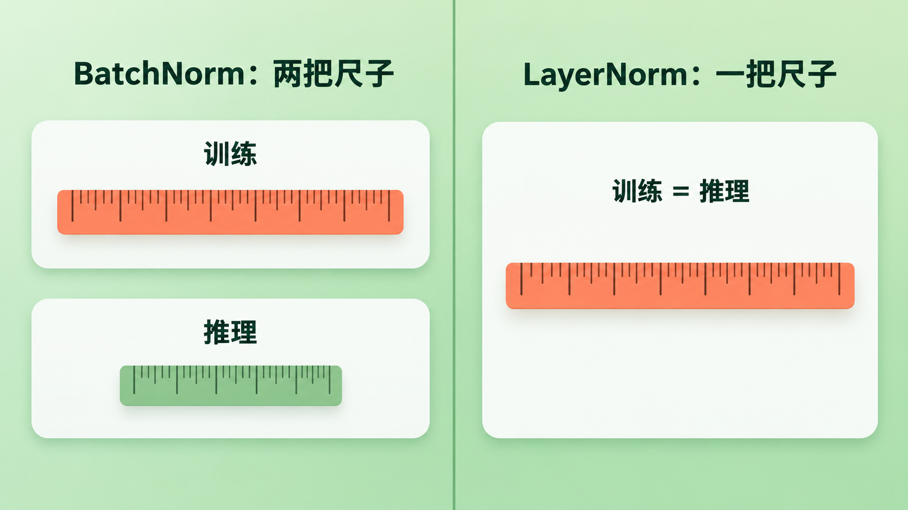
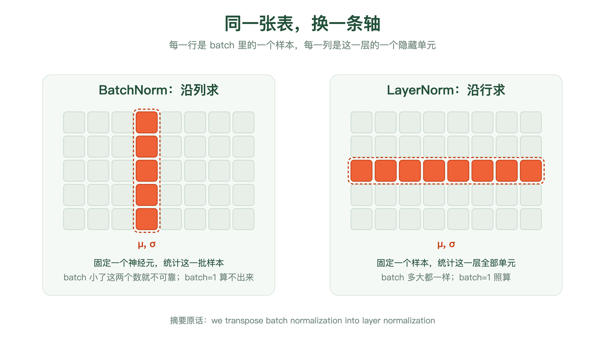
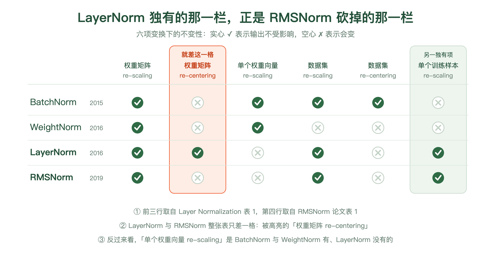
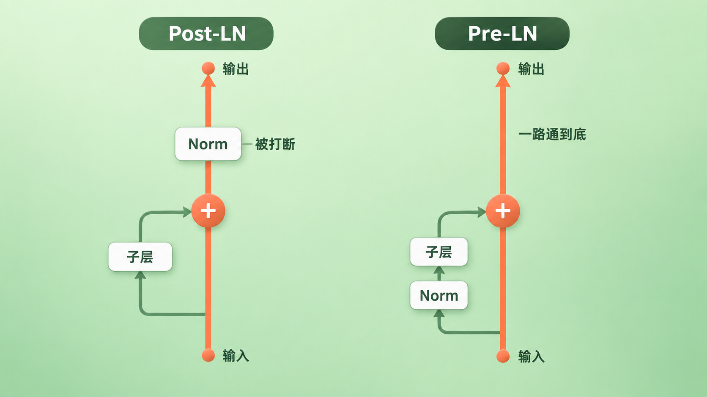

+++
title = "论文里程碑 #20：Layer Normalization"
description = "为循环网络写的一个加速技巧，后来成了标准 Transformer 配方里的承重墙。"
date = 2026-09-20
tags = ["LLM", "论文里程碑", "LayerNorm", "RMSNorm", "归一化", "Pre-LN", "Jimmy Ba"]
categories = ["LLM"]
series = ["论文里程碑"]
showTableOfContents = true
+++



> 为循环网络写的一个加速技巧，后来成了标准 Transformer 配方里的承重墙。

## 一、标题只有两个词

2016 年 7 月 21 日，arXiv 上挂出一篇标题只有两个词的论文：*Layer Normalization*。

第一作者是 Jimmy Lei Ba——上一篇结尾提到的那位，Adam 那次掷硬币掷输了的第二作者。第三作者是 Hinton。

这篇论文通篇没有出现过 Transformer 这个词。它不可能出现，那个架构还要再等十一个月。反复出现的词是 recurrent：循环网络。它想解决的问题也很朴素——训练太慢了，能不能快一点。

这篇论文此后再也没有更新过，只有 arXiv 上的一个 v1，没有会议版本。十年过去，你打开任何一个大模型的实现，每一层里都还有它转出来的那条轴——尽管今天挂在那儿的名字，多半已经不叫 LayerNorm 了。

## 二、时代背景：最好用的那个加速件，恰好用不了

2015 年，BatchNorm 出现。它的做法是：盯住某一个神经元，在一个 mini-batch 的所有样本上求出它的均值和方差，再把它的输入标准化。前馈网络上，光是把这一步加进去，用最朴素的 SGD 也能收敛得快很多。很快它就成了训练加速的标准件。

但它有一个藏得很深的前提：**你得有一批样本可以一起统计。**

这个前提一旦不成立，麻烦是成串的。这篇论文在开头就把它们列了出来：

**第一，统计量取决于今天和你同一批的是谁。** batch 一小，均值和方差就不可靠；在线学习时 batch 可能只有 1，这时均值退化成样本自己、方差退化成零，减完均值再除标准差，出来的是一排零——不是算不出来，是算出来的东西不带任何信息。极大的分布式模型也一样：为了塞进显存，每台机器上分到的 minibatch 必须很小。

**第二，循环网络上没有干净的下手处。** RNN 在每个时间步复用同一套权重，这本来是它的优点。但 BatchNorm 要统计的是激活值的分布，而 Cooijmans 那批人实测发现：LSTM 的激活最终确实会收敛到一个稳态分布，可序列开头那几步有一段明显的**暂态**，统计特性和后面差得很远——把各时间步的统计量平均起来会明显掉点。于是他们的建议是为**每个时间步单独存一套统计量**（被拆开的只有统计量，gain 和 bias 仍然跨时间步共享）。

这条路走得通。测试时遇到比训练里最长句子还长的序列，他们也给了办法：超出的那些步一律复用最后一步的统计量——激活既然已经进了稳态，这么外推是合理的，实验上也验证过可行。所以层归一化论文在这里用的词是 problematic，分寸拿得很准：**不是无解，是凭空多出一整维要维护的状态，外加一个外推假设。**

**第三，训练和推理算的不是同一件事。** 训练时用当前 batch 现算的统计量，推理时没有 batch 可用，得换成训练期间攒下来的 running average。两套数、两条代码路径，也就是两个出错的地方。

> 像老师按「本次考试全班的平均分」给你判等级。你的等级不只取决于你答得怎么样，还取决于今天和你同场考试的是谁。班上人多时这个平均分还算稳，只来了四个人的时候就没什么意义了。而且期末出总评时，用的又是另一把尺子——全校去年的平均分。

*图：BatchNorm 在训练时用当前这批样本现量的尺子，推理时换成一把提前存好的平均尺子；LayerNorm 从头到尾只有一把，因为它的统计量只来自样本自己*

这三条硬伤撞在一起的地方，恰好就是自然语言处理。那里的输入天生变长，翻译和生成天生要一步一步来，而当时最好的序列模型全是循环网络。

所以这不是「BatchNorm 还能再优化一下」的问题。是这个工具的形状，和这个领域的形状对不上。

## 三、论文做了什么

### 3.1 三个论点

**第一，它没有发明新操作，它把统计的方向转了 90 度。**

摘要里用的词是 transpose——我们把 batch normalization **转置**成了 layer normalization。这个词选得很准确。

想象一张表：每一行是一个样本，每一列是这一层里的一个神经元。BatchNorm 沿着**列**求均值和方差——固定一个神经元，看它在这批样本上的表现。LayerNorm 沿着**行**求——固定一个样本，看它在这一层所有神经元上的表现。

同一张表，换一条轴。

一旦这么转，上一节那三条硬伤同时消失：统计量只来自这一个样本，跟 batch 里有谁无关，batch 等于 1 也照算；在 RNN 上只依赖当前时间步的输入，**时间这一维上不需要维护任何状态**，测试句子有多长都不影响；训练和测试做的是完全一样的计算，不需要 running average。

**第二，它不是 BatchNorm 的改良版，是一组不同的权衡。**

这一点论文用了整整一节来论证，方式是列一张不变性对照表：把 BatchNorm、WeightNorm、LayerNorm 三种方法放在六项变换下，看谁对谁免疫。

结论并不是「LayerNorm 全赢」。而是三行各有各的空格：

- **只有 LayerNorm** 对权重矩阵的**整体平移**免疫，也**只有它**对单个训练样本的整体缩放免疫
- **只有 BatchNorm** 对整个数据集的平移免疫
- 而对**单个权重向量**的缩放免疫这一项，BatchNorm 和 WeightNorm 都有，**恰恰 LayerNorm 没有**

为什么会差成这样？论文第 4 节给了根因，这句话很值得单独拎出来：WeightNorm，以及用期望统计量写出来的 BatchNorm，**都等价于把原来那个网络换一种参数化重写一遍**——网络还是同一个网络。而 LayerNorm **不是**原网络的重参数化，它是一个真的不同的函数。不变性不一样，是因为它压根不是同一个东西。

**第三，实验买到的主要是速度，不是质量。**

论文在 6 个任务上做了实验，自述重点在循环网络（第 6 节有 6.1 到 6.7 七个小节，最后那个卷积网络是「初步实验」，不算在这 6 个里面）。挑最能说明问题的几组：

- **图文互检索**（MSCOCO 上的 order-embedding）：收敛到最好的验证模型，只花了基线 **60%** 的时间；caption 检索的 R@1 从 46.6 提到 48.5
- **DRAW 生成 MNIST**：收敛**快了将近一倍**，但训满 200 个 epoch 之后，基线是 82.36 nats、加了 LayerNorm 是 82.09 nats（越低越好）——基本打平
- **手写序列生成**（batch 只有 8、序列长 500、平均每条线约 700 步）：最终的 log likelihood 与基线相当，但**快得多**
- **置换不变的 MNIST 分类**：batch 128 和 batch 4 两种设置下都比 BatchNorm 收敛快，而且**对 batch 大小不敏感**

还有一组特别值得看，因为它测的不是精度而是省心程度。在阅读理解任务上对比 recurrent BatchNorm 时，论文提到：对方必须把 gain 的初始值小心地设成 0.1 才有好结果，而 LayerNorm 用 1.0 反而明显更好。**它对这个初始值不敏感。**（这一组只有验证集结果，论文的脚注里写明了。）

至于卷积网络那一组，作者自己写得很直白：**BatchNorm 更好**。他给的理由是，感受野压在图像边界上的那一大批隐藏单元很少被激活，统计特性和同层其余单元差太远，「层内各单元贡献相近」这个前提在卷积网络上不成立；结尾那句是「我们认为还需要进一步研究」。

所以这篇论文从来没有主张 LayerNorm 全面取代 BatchNorm。它主张的是一个有明确边界的结论：**在循环网络、小 batch、长序列这一带，LayerNorm 更合适。** 这个限定后来被历史抹掉了——不是因为论文错了，是因为整个领域搬到了那一带去。

### 3.2 论文怎么做到的

> 回到那张成绩表：行是一个学生，列是一门科目。BatchNorm 问的是「这门课全班平均多少分」，所以它必须知道今天来了哪些人。LayerNorm 问的是「这个学生自己所有科目平均多少分」，所以它只看这一行，谁都不用管。

*图：同一张（样本 × 神经元）的表，两种归一化只差一条轴。BatchNorm 固定一个神经元、沿整列在 batch 内的样本上求均值方差；LayerNorm 固定一个样本、沿整行在这一层的全部隐藏单元上求*

把这件事写成式子，就是论文的核心：

$$
\mu^l = \frac{1}{H}\sum_{i=1}^{H} a_i^l, \qquad \sigma^l = \sqrt{\frac{1}{H}\sum_{i=1}^{H}\left(a_i^l - \mu^l\right)^2}
$$

翻译一下：\( H \) 是这一层里隐藏单元的个数，\( a_i^l \) 是第 \( l \) 层第 \( i \) 个单元收到的加权输入。这两个数是对**一个样本**、在**这一层的全部单元上**算出来的。同一层里所有单元共用这一对 \( \mu \) 和 \( \sigma \)，而不同的样本各有各的一对——正好和 BatchNorm 反过来。

算完之后的动作很常规：减 \( \mu \)、除 \( \sigma \)，再逐元素乘上一个 gain、加上一个 bias，最后才送进非线性。gain 和 bias 是每个神经元自己的可学习参数，实验里初始化成 1 和 0。

**这里要说准一件事，不然到 Transformer 就会记岔。** 论文说的「一个样本」，在 2016 年的前馈网络里就是一条输入；而今天 Transformer 的输入是一个 \( B \times T \times d \) 的张量——\( B \) 是 batch、\( T \) 是序列长度、\( d \) 是隐藏维度。LayerNorm 在这里是**每一组** \( (b, t) \) **各算各的**：固定住第 \( b \) 条样本的第 \( t \) 个 token，只在它自己那条 \( d \) 维向量内部求均值和方差。**既不跨 batch，也不跨 token。** 一个长度 1000 的序列，一层里就要算 1000 次归一化，每次只看 \( d \) 个数。

所以回头看上面那张图：那一行不是一条句子，是**一个 token**。2016 年那个转置动作，今天的样子就是「每个 token 自己归一化自己」。

这里有两个和你今天写的代码对不上的地方，值得点一下：

**论文的式子里没有 ε。** 你在每个实现里都会看到的那个防除零的 `1e-5`，是后来工程上补的，原论文的公式里干干净净。而且位置值得留意：它加在**方差里、开根号之前**（\( \sqrt{\mathrm{Var}(x) + \varepsilon} \)），不是加在标准差外面——这一点和上一篇 Adam 里那个挂在分母外侧的 ε 正好相反。

**论文管这两个参数叫 g 和 b（gain 和 bias）。** 今天大家写 \( \gamma \) 和 \( \beta \)，那套记号是从 BatchNorm 那边继承过来的。

**用在 RNN 上是这样的**：循环层收到的加权输入是 \( a_t = W_{hh} h_{t-1} + W_{xh} x_t \)，就在这个 \( a_t \) 上按上面那套算出 \( \mu_t \) 和 \( \sigma_t \)，归一化之后再进非线性。关键在于 \( \mu_t \) 和 \( \sigma_t \) **当场就从这一步的输入里算出来**，用完即弃——时间这一维上不留任何状态。recurrent BatchNorm 的 gain 和 bias 其实也跨时间步共享，真正被拆开的是统计量：它得为每个时间步各存一份，再对超出训练长度的部分做外推。这是实现复杂度上整整一个量级的差别。

论文对这里为什么有效给了一个很具体的说法：标准 RNN 里，递归单元收到的加权输入，平均幅度有一种每一步都在放大或者缩小的倾向，累积几百步下去就是梯度爆炸或者消失。而层归一化让这一层对「所有输入同时乘一个数」完全免疫，于是从一个隐状态到下一个隐状态的动力学稳得多。

再往下还有一层，是论文真正用力的地方——也是后来被删掉的那一半的理论来源。

第 5 节把归一化里的 \( \sigma \) 解释成了一个**自动挡的学习率**：把整个权重矩阵放大一倍，模型的输出一个字都不会变（这是表 1 第一栏的内容——对整个权重矩阵的缩放免疫，上面那三行都有），但 \( \sigma \) 会跟着放大一倍；论文的推导说，沿这个方向的曲率会相应缩小（原文写的是缩到二分之一）。结果就是——同样一次参数更新，权重矩阵越大，它的朝向被改动得越少。论文把这称作一种**隐式早停**：学到后面，模型自己慢下来了。

这里有个很容易读岔的地方，值得停一下。第 5 节的推导是对「归一化过的广义线性模型」统一写的，式子里的 \( \mu \) 和 \( \sigma \) 都带着神经元下标 \( i \)。对 BatchNorm 和 WeightNorm 来说这个下标是实的——每个神经元有自己的一份 \( \sigma_i \)，把单个权重向量 \( w_i \) 放大一倍，\( \sigma_i \) 就跟着翻倍，于是输出不变、曲率减半。对 LayerNorm 不是：它的 \( \mu \) 和 \( \sigma \) 由整层一起算，只放大其中一个 \( w_i \)，\( \sigma \) 并不会翻倍，输出也会跟着变。

**所以这条「隐式学习率」的论证用在 LayerNorm 身上，只在「整个权重矩阵一起缩放」这一层成立。** 它和上一节表 1 里那两栏的差别是同一件事的两种说法：对整个矩阵的缩放免疫，让这条论证站得住；对单个权重向量的缩放不免疫，让它没法下放到单个神经元。

还有一层前提要跟着说：这段推导做在**广义线性模型**上，要推广到深度网络，靠的是对 Fisher 信息矩阵做**块对角近似**——一个神经元一块，块与块之间的相互作用被忽略掉。这不是对任意网络的严格结论，是一个有明确前提的解释。

## 四、它改变了什么

**短期：它被一个当时还不存在的架构接走了。**

2017 年，Transformer 把每个子层的输出写成 \( \text{LayerNorm}(x + \text{Sublayer}(x)) \)。原论文并没有解释为什么选 LayerNorm 而不是当时更主流的 BatchNorm——它只是用了，没给理由。但从机制上看，这个选择和 Transformer 的形状咬得很紧：它虽然扔掉了循环，却把序列模型的性质全盘继承了下来——输入天生变长，推理天生逐 token 进行，batch 可以只有 1。第二节那三条硬伤，一条都没少。

这篇 2016 年为循环网络写的论文，恰好把它们一次性解决了。

**第一个错位：它被当作加速器提出，最后成了承重墙。**

原论文的定位从摘要第一句就很清楚——训练太贵，归一化是缩短训练时间的一个办法。它从头到尾谈的是「快多少」。

而 2019 年，RMSNorm 那篇论文在 Transformer 上做了一个原论文没做过的对照实验：把归一化整个去掉。结果不是变慢，是**训练直接失败**。

一个提出时被算作「能快一点」的东西，十年后成了标准配方里拆掉就塌的那一层。中间没有谁专门为它重新做过论证——它是被架构的演化推到那个位置上的。

不过「拆不掉」得说清是在什么意义上。想把它拿走，你得先造点别的顶上。2020 年的 T-Fixup 给出一套带理论依据的初始化方案，让 Transformer 不用 warmup、也不用层归一化就能训，最深一路训到编码器和解码器各 200 层；2025 年的 DyT 更干脆——把整个归一化层换成一个逐元素的 \( \tanh(\alpha x) \)，在视觉和语言模型上都做到了与带归一化的版本相当甚至更好。所以准确的说法是：**在标准配方里它拆不掉；要拆，得连配方一起换。**

顺带一提，T-Fixup 的作者里有 Jimmy Ba——同一个人，先写了这一层，四年后又参与做出了一套不用它也能训的方案。

**长期之一：它论证最用力的那一半，被后来的人删掉了。**

回到那张不变性表。LayerNorm 有、而 BatchNorm 和 WeightNorm 都没有的那一栏，是对权重矩阵**整体平移**的免疫——也就是「减均值」这个动作换来的东西，术语叫 re-centering 不变性。这是论文搬出黎曼几何和 Fisher 信息矩阵去论证的那一半。

2019 年，Zhang 与 Sennrich 提出 RMSNorm，开门见山地说：我们**假设** LayerNorm 里的 re-centering 不变性是可有可无的。他们给的理由很直接——减均值这一步并不降低隐状态或者梯度的方差，那它凭什么是关键。于是把均值整个拿掉，只按均方根缩放：

$$
\bar{a}_i = \frac{a_i}{\text{RMS}(a)} \cdot g_i, \qquad \text{RMS}(a) = \sqrt{\frac{1}{n}\sum_{i=1}^{n} a_i^2}
$$

翻译一下：不再问「这一行的平均值在哪儿」，只问「这一行整体有多大」，然后按这个大小缩回去。少一遍对整行的遍历，少一个要存的统计量，连 bias 也一起省掉了。

结果是：质量与 LayerNorm **相当**，运行时间下降 **7% 到 64%**（差别来自模型和框架）。

这里口径要说准。这是一个**假设加上实验支持**，不是「证明了 re-centering 没用」；那两个百分比量的是**跑得快了多少**，不是**效果好了多少**。作者自己的措辞也很克制：我们假设，我们通过实验表明这个性质对 LayerNorm 的成功并非根本。

但历史站在他们那边。今天主流的开放权重模型——Llama、Qwen、Gemma 这一批——默认用的都是 RMSNorm。

*图：四种归一化在六项变换下的不变性。LayerNorm 相对 BatchNorm 与 WeightNorm 的两个独有项是「权重矩阵 re-centering」与「单样本 re-scaling」；RMSNorm 保留了全部三项 re-scaling 不变性，丢掉的正是 re-centering 那一项。前三行取自 Layer Normalization 表 1，第四行取自 RMSNorm 论文*

我认为这件事的意味不在「论文那节理论白写了」。而在另一层：**一个部件能留下来的，往往不是它被论证得最用力的那一半。**

注意这句话说的是「留下来」，不是「起作用」。到今天为止，没有人证明过 LayerNorm 的收益全部来自 re-scaling；能确定的只是——在 RMSNorm 测过的那批任务、以及此后大量跟着改的架构上，把 re-centering 拿掉，没人感到不便。**理论上最好讲的那一半，和实践上离不开的那一半，不是同一半。**

**长期之二：后来更要紧的问题不是「怎么算」，而是「放哪儿」。**

原始 Transformer 的写法是 \( \text{LayerNorm}(x + \text{Sublayer}(x)) \)：Norm 卡在残差相加**之后**，这叫 Post-LN。它的代价是那条残差主干每过一层就要被归一化处理一次，没有一条从头到尾干净的通路。

2018 到 2019 年间，好几项工作各自把 Norm 挪进了残差分支的入口，写成 \( x + \text{Sublayer}(\text{LayerNorm}(x)) \)，这叫 Pre-LN。主干变成一条从输入直达输出的加法通道，中间不被打断。

Xiong 等人在 2020 年给出了理论解释。他们的定理 1 严格分析的对象很窄：**最后一个 FFN 子层里那个** \( W_2 \) **的梯度范数**。前提也是一套刻意简化的初始化设定——单头注意力、\( W^Q \) 与 \( W^K \) 初始化成零矩阵、输入按高斯分布采样，再加一个关于隐状态范数集中性的假设。在这套设定下，Post-LN 那个梯度的上界是 \( O(d\sqrt{\ln d}) \)——**与层数** \( L \) **无关**；Pre-LN 是 \( O(d\sqrt{\ln d / L}) \)——网络越深，这个界越小。

他们还做了实测对照：从 6 层一路加到 14 层，Post-LN 最后那个 \( W_2 \) 的梯度范数始终停在 1.6 附近不动，Pre-LN 的则随深度一路往下走。

这解释了一个一直被当成玄学的东西：**warmup**。上一篇讲 Adam 的时候，Transformer 那行配置后面挂着 4000 步的 warmup，我说那不是冗余。现在可以把话说完整了——Post-LN 在初始化时输出端的梯度偏大，一上来就用大学习率容易把训练带崩，warmup 是在替这个结构兜底。换成 Pre-LN，梯度在初始化时本来就是温和的：在他们测的那几组任务上（IWSLT14 与 WMT14 翻译、BERT 预训练），warmup 直接去掉，仍能取得相当的结果。

*图：同一个子层的两种接法。Post-LN 把归一化放在残差相加之后，主干上每一层都被它截断一次；Pre-LN 把归一化挪进残差分支的入口，主干从输入一路加到输出，中间不被打断*

三个限定要跟上，不然很容易记岔：

- **Pre-LN 不是 Xiong 等人提出的。** 在他们之前已经有好几项工作在用了，他们做的是解释**为什么可以**，并据此把 warmup 拿掉。
- **定理给的是上界的量级对比，不是「Post-LN 会梯度爆炸」。** 它说的是 Post-LN 那个界不随深度下降，而 Pre-LN 的会。
- **warmup 也不是因为 Adam。** 有工作（RAdam 那篇）把 warmup 归因于 Adam 自适应学习率在早期的方差，而 Xiong 等人发现换成别的优化器，warmup 一样很有用。他们的结论是：Adam 不是 warmup 之所以必要的前提。

还有一点：这件事并没有停在 Pre-LN 上。2025 年仍有工作在重新翻这个问题——比如 Peri-LN，把归一化同时摆在子层的进出两端（原始 Transformer 之后被 Gemma 2 那类「三明治」写法用过的思路），在 30 亿参数量级上测出更平衡的方差增长和更稳的梯度流。**「怎么算」早就收敛了，「放哪儿」至今还是活的。**

**长期之三：它的动机那套说法，后来被动摇过。**

这篇论文在解释 BatchNorm 为什么有用的时候，沿用了当时的通行说法——减少「covariate shift」，也就是前面的层一更新，后面的层看到的输入分布就跟着变。论文自己给这个词打了引号，但第 3 节的出发点确实是它：既然一层输出的变化会让下一层的加权输入高度相关地变化，那把每一层内部的均值和方差按住，就能缓解这个问题。

2018 年，Santurkar 等人对 **BatchNorm** 做了一批针对性实验，结论是：层输入分布的稳定性和 BatchNorm 的成功「关系不大」。它真正在做的事情是让优化面变得明显更平滑——损失和梯度的 Lipschitz 性质都改善了，于是梯度更可预测、可以放心用更大的步子。

口径要卡住：**那篇测的是 BatchNorm，不是 LayerNorm。** 不能因此说 LayerNorm 的解释被证伪了。但它确实动摇了这一整套论述赖以站立的那个前提。

> 这篇论文的三样东西后来各自走散了：机制留下来了，动机的解释被换掉了，理论论证最用力的那一半被删掉了。留下来的那部分，恰恰是最不需要论证的那部分。

## 五、与主线的接口

**如果你想深入……**

这篇论文的核心概念对应我们 LLM 系列的「Transformer 架构：一个 Block 的最小骨架」章节：

- **[#17] 一个 Transformer Block 的「最小骨架」** — 讲了归一化在一个 block 里的位置：两个子层、一条残差主干，每个子层各配一道归一化
- **[#18] 归一化的选择：LayerNorm → RMSNorm，Pre-LN vs Post-LN** — 本篇是它的前传。那一篇把「怎么算」和「放哪儿」两条坐标轴拆开讲透，还带上了 final norm、Gemma 2 的三明治式写法、DeepNorm 这些本篇没展开的分支
- **[#38] 学习率与调度：训练是否稳定的第一性因素**（尚未发布）— warmup 究竟在替什么兜底，以及它和归一化位置的关系

读完这些，你对 Layer Normalization 的理解会从历史印象变成可操作的工程认知。

## 六、收尾

读这篇之前，LayerNorm 大概是模型定义里那一行不用想的代码——和 Adam 是同一类东西。

读完之后应该换个看法：它是一次转置。同一张（样本 × 神经元）的表，BatchNorm 沿列求统计量、LayerNorm 沿行求，仅此而已。这一转让统计量不再取决于「今天和谁分在一组」，于是变长序列、batch 等于 1 的推理、训练与测试计算一致，三件事一起成立——而这三件事恰好是序列模型的全部日常。

还有一层，可能比机制本身更耐用：**一个部件被工程实践坚持保留的，往往不是它当年被论证得最用力的那一半。** 论文花了整整一节黎曼几何，去论证 re-centering 换来的那一栏不变性——那是它相对 BatchNorm 与 WeightNorm 最独特的地方。三年后，RMSNorm 假设这一半可以不要，在他们测过的那批任务上只保留 re-scaling，做到了与 LayerNorm 相当的效果，而且算得更省；此后大量大模型架构沿用了这条路线。

这不等于 re-centering 从来没用过——那个证明没有人做过。它说明的只是：**论文当年最舍得花笔墨的那个性质，不是后来工程上最舍不得丢的那个。**

**下一篇**：把 LayerNorm 的均值拿掉的那两个人里，第二位叫 Rico Sennrich。而在那之前四年，他做过一件形状一模一样的事——拿掉另一个大家以为必需的东西。2015 年的神经机器翻译前面横着一道硬墙：词表。模型只认得三万到五万个词，剩下的一律记成 unk。人名、地名、德语里那些拼起来的复合词、没见过的形态变化，全在墙外，当时的办法是退回去查一本词典。Sennrich 和两位合作者的做法，是把「词」这个单位本身拆掉——借一个原本用来做数据压缩的算法，从字符出发，一遍遍把最常挨在一起出现的相邻单元合并起来，合到规定的次数为止。合出来的东西不一定是词，但任何一个字符串都能被它拼出来。「词表外」这件事，从此不存在了。下一篇，我们讲 *Neural Machine Translation of Rare Words with Subword Units*。

## 七、参考资料

- 论文原文：[Layer Normalization](https://arxiv.org/abs/1607.06450)（arXiv:1607.06450，2016 年 7 月 21 日；只有 v1，没有会议或期刊版本）
- 作者：Jimmy Lei Ba、Jamie Ryan Kiros（多伦多大学）、Geoffrey E. Hinton（多伦多大学 / Google）
- 延伸阅读：
    - Ioffe, S. & Szegedy, C. (2015). *Batch Normalization: Accelerating Deep Network Training by Reducing Internal Covariate Shift*（[arXiv:1502.03167](https://arxiv.org/abs/1502.03167)，ICML 2015）——本文的参照物与出发点
    - Cooijmans, T. et al. (2016). *Recurrent Batch Normalization*（[arXiv:1603.09025](https://arxiv.org/abs/1603.09025)）——本文实验里的主要对照方法。第二节那三条硬伤里的第二条要对着它读：为什么要按时间步分开统计（初始暂态）、超出训练长度怎么外推、以及「gain 初始值必须设成 0.1」那条对比的来源
    - Zhang, B. & Sennrich, R. (2019). *Root Mean Square Layer Normalization*（[arXiv:1910.07467](https://arxiv.org/abs/1910.07467)，NeurIPS 2019）——RMSNorm；砍掉 re-centering 的假设、实验与那 7% 到 64%
    - Xiong, R. et al. (2020). *On Layer Normalization in the Transformer Architecture*（[arXiv:2002.04745](https://arxiv.org/abs/2002.04745)，ICML 2020）——Pre-LN 与 Post-LN 的梯度分析，以及去掉 warmup 的依据
    - Huang, X. S., Pérez, F., Ba, J. & Volkovs, M. (2020). *Improving Transformer Optimization Through Better Initialization*（ICML 2020，T-Fixup）——换一套初始化，warmup 与层归一化都可以不要；作者之一是 LayerNorm 的第一作者
    - Santurkar, S. et al. (2018). *How Does Batch Normalization Help Optimization?*（[arXiv:1805.11604](https://arxiv.org/abs/1805.11604)，NeurIPS 2018）——「内部协变量偏移」这套解释被动摇的地方
    - Kim, J. et al. (2025). *Peri-LN: Revisiting Normalization Layer in the Transformer Architecture*（[arXiv:2502.02732](https://arxiv.org/abs/2502.02732)，ICML 2025）——「放哪儿」这个问题十年后仍在被翻
    - Zhu, J., Chen, X., He, K., LeCun, Y. & Liu, Z. (2025). *Transformers without Normalization*（[arXiv:2503.10622](https://arxiv.org/abs/2503.10622)，CVPR 2025）——用逐元素的 DyT 直接替掉归一化层
