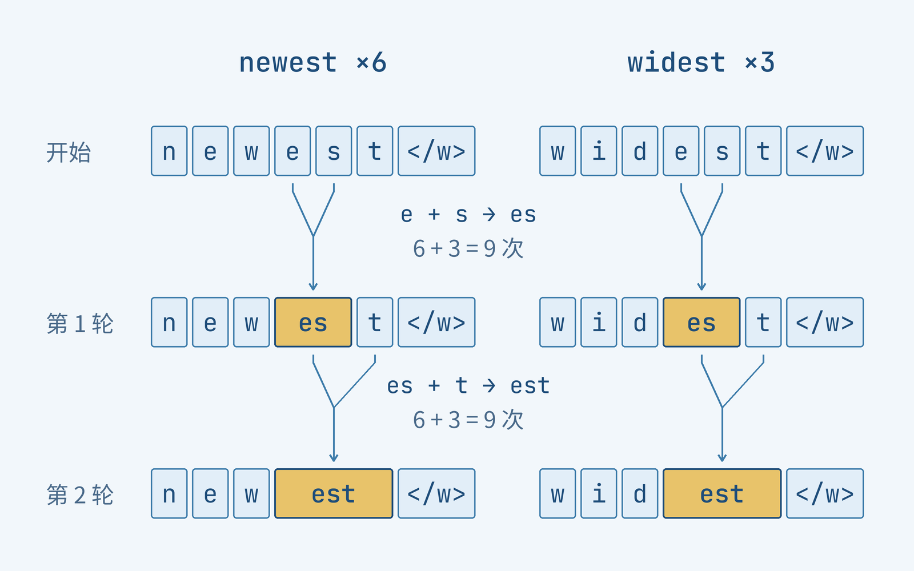
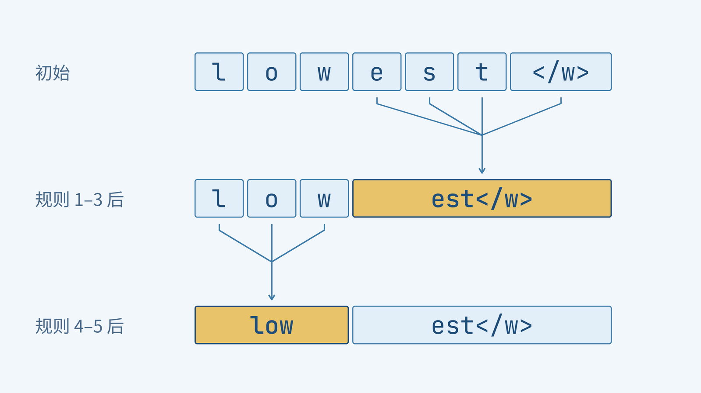
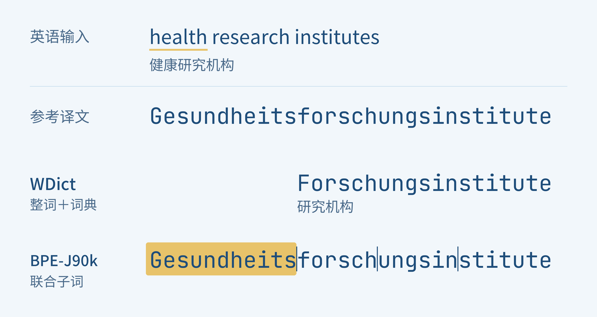
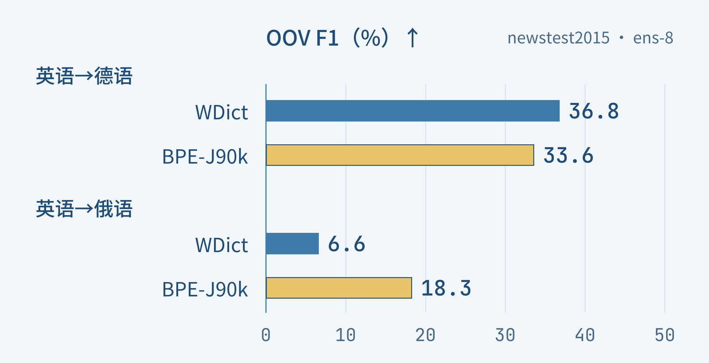

+++
title = "论文里程碑 #21：Neural Machine Translation of Rare Words with Subword Units"
description = "把生词拆成可复用的小单位，翻译模型就有机会用有限词表写出未见过的词。"
date = 2026-10-16
draft = false
tags = ["LLM", "论文里程碑", "BPE", "子词", "神经机器翻译", "罕见词", "OOV"]
categories = ["LLM"]
series = ["论文里程碑"]
showTableOfContents = true
+++

把生词拆成可复用的小单位，翻译模型就有机会用有限词表写出未见过的词。

假如要把“健康研究机构”译成德语，事情可能比逐个查词更麻烦。英语可以写成三个词 `health research institutes`，德语却可以把它们接成一个长词：`Gesundheitsforschungsinstitute`。即使没学过德语，我们也能先抓住这个差别：同一件事，在一种语言里分着说，在另一种语言里可能连着写。

现在让一个每次只能从固定词表中选出一个整词的翻译模型来完成这件事。如果所需的长词没有收进输出词表，它就没有这个选项。外接词典可以帮忙查找，陌生人名有时也能直接照抄，但遇到需要重新组合、变形的词，逐词补救就不那么顺手了。

Sennrich 等人的 *Neural Machine Translation of Rare Words with Subword Units* 正是从这类困难出发：能不能让模型学会使用词内部的材料，把没见过的词也写出来？论文于 2015 年首次公开，发表于 ACL 2016；本文沿着正式版的方法与实验，看看这个后来被广泛使用的想法，当时究竟改变了什么。[原论文](https://aclanthology.org/P16-1162/)

## 词表装不下的时候，可以换一套零件

一个很自然的办法，是把词表扩大。多收一些词，当然能少碰到几次空缺。不过，词表里的每个词都要有相应的模型参数，而新的名字、复合词和词形还会继续出现。甚至一个词已经收进来了，如果训练中只见过寥寥几次，模型也未必学会了怎样使用它。

我们平时读生词，往往不会在这里停住。一个长词整体陌生，其中的字母、词根或词尾却可能很熟悉。既然如此，也可以让模型从字符开始写：只要基本字符齐全，就有机会把长词拼出来。

代价是句子会变长。原本一步选完的词，现在可能需要十几步才能写完；模型也要在更多位置之间传递信息。于是，我们希望留下两种办法各自好用的部分：少见的词允许拆开，经常一起出现的片段则收成一块，不必每次从头逐字母拼写。这些可复用的单位，通常称为**子词**（subword）。

先用一个积木类比想一想这件事。左边每个成品都必须事先备好；右边则保留一些能够重新组合的零件。要做出一种新组合，右边不必先为它增加一个完整模具。

*图 1：从储备完整词块，到复用能够组合的小块。类比示意，块的数量和形状不代表实际词表或真实切分。*

真正需要决定的，是该留下哪些零件。按词根词缀来拆是一条路，但论文采用的 BPE 提供了另一种简单选择：**先从字符出发，让训练语料告诉我们哪些相邻片段最值得合在一起**。

BPE 的英文全称是 Byte Pair Encoding，通常译作字节对编码。名字来自 Gage 的数据压缩算法；这篇论文把它适配到分词任务，实际合并的是字符及其组成的片段。这里的起点仍是字符，后来的字节级分词另有一层覆盖设计。

## 先数一数，谁最常挨在一起

我们用论文 Algorithm 1 给出的四个词和词频来走一遍。空格表示当前单位之间的边界，`</w>` 是一个整体的词尾标记，用来保留“这个词到此结束”的信息；它不是要交给读者看的译文字符。

| 词 | 出现次数 | 初始表示 |
| --- | --- | --- |
| low | 5 | `l o w </w>` |
| lower | 2 | `l o w e r </w>` |
| newest | 6 | `n e w e s t </w>` |
| widest | 3 | `w i d e s t </w>` |

先看 `e` 和 `s`。它们在 `newest` 中相邻，这个词出现 6 次；在 `widest` 中也相邻，贡献另外 3 次。因此，这一对的计数是 **6 + 3 = 9**。我们数的是语料里的出现次数，不能因为它出现在两种词中，就只记作 2。

这时最高频的并不只有它：`s + t` 和 `t + </w>` 也都是 9 次。为了能一起复算，本例约定：并列时按表中从上到下的词序、每个词从左到右的扫描顺序，选择最先遇到的一对。于是，第一轮选中 `e + s`，把所有相应位置合并为 `es`。这个平局约定用于本文演算，并不是 BPE 必须采用的唯一规则。

第一次合并之后，`newest` 变成了 `n e w es t </w>`。请留意中间的 `es`：它已经是一个单位了，接下来要数的是 `es + t`，不再是原来的 `s + t`。**每次合并都会改变相邻关系，所以必须在新的序列上继续计数**。

*图 2：合并一次，相邻的对象就变了。沿 Algorithm 1 的词频演算，第一轮得到 es，第二轮再把 es 与 t 合并；并列按本文约定处理。*

按同样的办法继续，到第五轮可以得到下面这份合并记录：

| 轮次 | 本轮合并 | 加权次数 |
| --- | --- | --- |
| 1 | `e + s → es` | 9 |
| 2 | `es + t → est` | 9 |
| 3 | `est + </w> → est</w>` | 9 |
| 4 | `l + o → lo` | 7 |
| 5 | `lo + w → low` | 7 |

第四轮的 7 来自 `low` 的 5 次和 `lower` 的 2 次；它与 `o + w` 并列时，也沿用刚才的选择约定。真实训练会继续许多轮，这里在第五轮停下，已经足够看到两件事：常用片段逐渐成为可复用的单位，合并的先后顺序也被保存下来。[算法依据：正式版 §3.2、Algorithm 1](https://aclanthology.org/P16-1162.pdf)

BPE 并没有在这几轮里查词典，也没有被告知 `est` 是什么词尾。它只是在当前表示中反复挑选最高频的相邻一对。这种局部选择会形成长短不同的单位，有时恰好符合词根或词缀，有时并不符合。常见的整词也可能最终合成一块；算法不要求每个词都被拆碎。

## 新词来了，照着旧规则拼

现在把训练表收起来，拿一个没有在其中出现过的词：`lowest`。

处理新词时，我们不再统计哪一对最常见，而是使用已经固定的合并规则。先写出字符序列 `l o w e s t </w>`，再按学习得到的优先次序合并当前能匹配的一对：`e + s` 先成为 `es`，随后得到 `est` 和 `est</w>`；另一头的 `l + o` 变成 `lo`，再与 `w` 合成 `low`。最后留下两个单位：`low` 与 `est</w>`。

*图 3：训练中没有 lowest，已有规则仍能把它表示成 low 与 est\</w\>。这是基于前五轮规则的教学应用例；本例只演示表示，不演示翻译。*

这两个单位都能在那份小训练材料中找到用法，组合在一起却能表示一个新的完整词。我们得到了一种很实用的分工：**词表里的单位可以固定，单位组成的词不必事先穷举**。

接下来，翻译模型学习的是这些单位构成的序列。论文使用带注意力的循环神经网络：编码器读取源语言的子词，解码器根据上下文逐步预测目标语言的子词，再通过词尾信息还原词与词之间的空格。相同片段出现在多个词里，便有机会共享学习到的表示和翻译规律。

这里有两个不同的“学习”：BPE 从词频中学习怎样切分；神经网络从双语句对中学习怎样翻译。BPE 本身不会把 `lowest` 译成“最低”，就像给出字母表还不等于教会一门语言。它做的是把原本没有整词入口的对象，变成模型可以继续处理的序列。

这种组合能力也有明确的起点：输入字符必须有可用表示，切出的单位还要在模型词表中有对应项。原文脚注讨论过合并产生的中间片段可能不再单独出现在训练文本中的情况，可通过撤销相应合并继续拆小；完全没收录过的字符则需要额外处理。因此，本文的“未见词”是像 `lowest` 这样由已有材料组成的新词，不是对任意字符都已具备覆盖保证。

## 小块可以复用，句子也不能拆得太长

走完刚才的例子，再看词表大小与序列长度的取舍就更直观了。合并少一些，单位更细，模型往往要读写更多步；合并多一些，常见片段变长，词表也随之增长。论文中的 BPE 用合并次数控制这种取舍，并且不跨越原来的词边界。

作者统计了同一份德语训练语料采用不同表示后的变化：

| 表示方式 | 不同单位数 | 语料中的单位总数 |
| --- | --- | --- |
| 整词 | 约 175 万 | 约 1 亿 |
| 字符 | 约 3 千 | 约 5.5 亿 |
| BPE | 约 6.3 万 | 约 1.12 亿 |

*据正式版 Table 1，BPE 行使用 59,500 次合并。“不同单位数”是语料中的类型数，不等于后面实验中经过筛选的神经网络词表大小。*

这里最值得看的是两列一起怎样变化。字符表示只需要少量基本单位，但整份文本被拉长很多；BPE 则在这组设置下，把单位种类压到远少于整词的规模，同时让序列总量保持在接近整词的长度。它为“可组合”和“不必逐字写完”找到了一个实际可用的位置，而不是证明了某个固定词表大小永远最好。

翻译还有一个单语例子没有显露的问题：输入和输出来自两种语言。如果分别在两侧学习 BPE，同一个名字可能被切在不同地方。原论文中 `Mirzayeva` 的独立切分就是 `Mirz | ayeva`，而对应俄文的片段按拉丁字母转写相当于 `Mir | za | eva`。这一例中，独立切分仍然译对了名字，只是模型需要学会让边界错开的片段相互对应。

论文因此尝试了**联合 BPE**（joint BPE）：把训练集的源语言侧和目标语言侧合起来学习一份规则，让两边更容易采用一致的切分。英俄的字母系统不同，作者先用 ISO-9 把俄文词表转写为拉丁字母来学规则，再把相应规则转回西里尔字母用于俄文。这个过程发生在准备训练数据时；翻译新句子时，仍然使用已经学好的规则。

再看同一个名字：联合方案把英文侧切成 `Mir | za | yeva`，对应俄文的拉丁字母转写仍是 `Mir | za | eva`。现在，开头的 `Mir`、中间的 `za` 和末尾的片段更容易逐段对应，“切分更一致”就有了看得见的变化。[正式版 Table 5、§5.2](https://aclanthology.org/P16-1162.pdf)

联合学习调整的是片段的划分，具体译法仍需模型从双语材料中学习，两侧最终模型词表也不必完全相同。现在可以回到开头，看这些安排是否真的帮上了忙。

## 把开头漏掉的信息找回来

论文 Table 4 记录了 `health research institutes` 的实际翻译输出。先认清其中的词典回退基线 **WDict**：它仍按整词翻译，遇到模型词表外的词，再借助双语词典；找不到对应译法时可以尝试复制源词。

在这个例子里，它输出了 `Forschungsinstitute`，意思是“研究机构”，把“健康”这一部分漏掉了。采用联合 BPE 的系统则给出了 `Gesundheits | forsch | ungsin | stitute`，接起来就是参考译文中的长词。

先只看下面两行输出的开头：我们最初在意的那块信息，是否还在？

*图 4：同一句话，联合 BPE 的输出保留了“健康”这一部分。根据正式版 Table 4 选取 WDict 与 BPE-J90k 的输出重绘；竖线表示子词边界。*

还有一个细节值得停一下。这个切法里的 `ungsin` 并不是我们会在德语课上单独学习的词根，它跨过了更自然的语言学边界。模型却仍然能够在这一例中生成正确的完整译文。子词的用途由整个翻译过程来实现，并不要求每一块都像词典词条那样有独立释义。

能把词拼出来，当然还不等于知道应该拼哪个词。同一张原表的另一个例子中，英语 `asinine` 表示“愚蠢的”，联合 BPE 系统却生成了带有 `Asinin-` 的形式，像是在制造一个借词，未能给出这里所需的德语意思。这个失败很具体：字母可以排出来，语义上的选择仍然可能错。刚才成功的复合词例子说明了组合生成的可能性，接下来还要看看更大范围的结果。

## 改善了罕见词，为什么有一列反而更低

作者在英德和英俄两个翻译方向上做实验，训练材料分别约为 420 万和 260 万双语句对。下面看的是 **newstest2015 上的八模型集成结果**，不是单模型结果。[正式版 §4，Tables 2–3](https://aclanthology.org/P16-1162.pdf)

我们刚才担心的是“译文漏了一个重要的词”。针对这种问题，论文除了看整句得分，还单独统计罕见词有没有译对。这里的罕见词指训练集词频前 50,000 名之外的词；**未见词**（out-of-vocabulary，OOV）则更进一步，指整个训练文本中都没有出现过的词。

两者的表现用 unigram F1 衡量，比较单位是还原后的目标语言整词。一方面看模型写出的相关词有多少与参考译文匹配，另一方面看参考译文中需要出现的相关词找回了多少，再把这两方面合成一个分数。它能帮助我们看见“敢不敢生成”和“生成得对不对”的共同变化，并不等于人工判断的语义正确率。整体翻译表现则用 BLEU 观察译文与参考译文的词组匹配情况；下表各项都是越高越好。

| 翻译方向 | 系统 | BLEU | 罕见词 F1（%） |
| --- | --- | --- | --- |
| 英语→德语 | WDict：整词＋词典回退 | 24.2 | 36.8 |
| 英语→德语 | BPE-60k：两侧独立切分 | 24.5 | 40.9 |
| 英语→德语 | BPE-J90k：联合切分 | 24.7 | 41.8 |
| 英语→俄语 | WDict：整词＋词典回退 | 22.8 | 26.5 |
| 英语→俄语 | BPE-60k：两侧独立切分 | 23.6 | 29.7 |
| 英语→俄语 | BPE-J90k：联合切分 | 24.1 | 29.7 |

*据正式版 Tables 2–3 的 ens-8 与罕见词 F1 列选取。系统名沿用原文，60k、J90k 用来辨认实验配置；联合与独立配置的词表规模也不同，因此两者差值不单独归因为“是否联合”。*

现在回头看我们最初的期待：罕见词能否得到更好的处理？在这两组实验中，独立 BPE 和联合 BPE 的罕见词 F1 都高于词典回退基线。联合 BPE 的整体 BLEU 也分别高出基线 0.5 分和 1.3 分。这支持了论文的核心选择：用子词来表示低频词，能够成为比整词加补救词典更有效的翻译方案。

不过，把观察范围缩到完全未见过的词，两个语言方向出现了很不一样的结果。图中仍比较同一对系统，只换成 OOV 这一类词；先在各自语言内比较两根柱，不把两个测试集混成一次排名。

*图 5：联合 BPE 对未见词的收益随语言方向而变化。newstest2015，八模型集成的 OOV unigram F1；据正式版 Tables 2–3 重绘，越高越好。*

英德方向里，WDict 的 OOV F1 是 36.8%，联合 BPE 是 33.6%。这个结果并不难与前面的机制联系起来：英德共享许多字母和名字的写法，对一部分从未见过的人名，直接照抄就是一个很强的办法。子词模型能够尝试生成新的复合词，却也可能在复制或组合过程中写错。

英俄方向则不同。一个拉丁字母名字往往需要转成西里尔字母，原样复制便不够用了。这里联合 BPE 的 OOV F1 从基线的 6.6% 提高到 18.3%。模型能够学习片段之间的对应，便有机会把一个未见名字转写出来。论文的实例和分析也表明，切分错位会导致多写或漏写字符；联合切分是在缓解这个学习困难，而不是保证音译永不出错。

还有一项结果能帮助我们看清论文真正支持的范围：英德实验中，最高的神经翻译 BLEU 来自“保留 50,000 个常用整词、其余按字符二元组处理”的 C2-50k，得分 25.3，高于联合 BPE 的 24.7。论文验证的是**子词路线可以有效改善罕见词翻译，而 BPE 提供了一种简洁、紧凑的实现方式**；这些结果并不构成 BPE 在所有指标上都最优的证明。

## 有限的词表，留下了组合的空间

回到开头那个德语长词，我们现在能更具体地理解它为什么难，也能理解子词方案改变了哪一步。整词模型需要一个可以直接选出的完整词条；子词模型可以连续生成若干已经学过的单位，再把它们还原成一个完整词。它仍需要训练数据来学习语义与对应关系，但表示方式给了它尝试新组合的空间。

我觉得这项设计最值得记住的地方，是它把一个看似需要不断扩充名单的问题，变成了“怎样选择和复用基本单位”的问题。BPE 用频率来组织这些单位，翻译模型再去学习怎样使用它们。方法朴素，实验也留下了清楚的取舍：更紧凑的词表、更短于逐字符表示的序列，以及随语言和词类变化的翻译收益。

若想继续看“基本单位本身没有覆盖到新字符时怎么办”，主线已经写过字符起点与字节级方案的区别：[主线 #10：BPE 与 Byte-level BPE](/llm/llm_10/)。

这篇的下一步则留在切分本身：同一个词可能有几种都说得通的拆法，训练时为什么始终只给模型看一种？下一篇 Subword Regularization 将沿着这个问题，讨论让切分参与变化的做法。

## 参考资料

- Rico Sennrich, Barry Haddow, Alexandra Birch. [*Neural Machine Translation of Rare Words with Subword Units*](https://aclanthology.org/P16-1162/). ACL 2016，pp. 1715–1725。本文的方法、算法、词频与实验统一采用这一正式版；重点为 §3.2、Algorithm 1、Tables 1–5 与 §5.2。[正式版 PDF](https://aclanthology.org/P16-1162.pdf)
- [arXiv 版本记录](https://arxiv.org/abs/1508.07909)：首次公开于 2015-08-31，用于区分首发时间与正式发表时间。
- Taku Kudo. [*Subword Regularization: Improving Neural Network Translation Models with Multiple Subword Candidates*](https://aclanthology.org/P18-1007/). ACL 2018。仅作为下一篇主题的原作入口，本篇不展开其算法。
