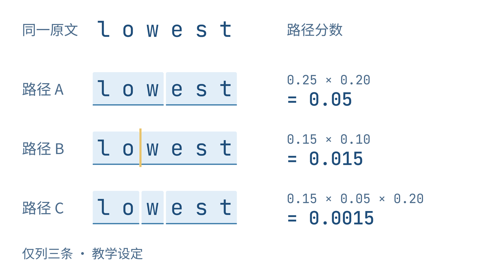
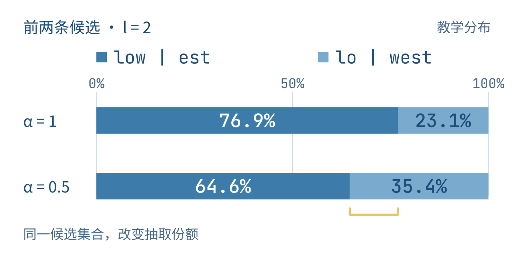
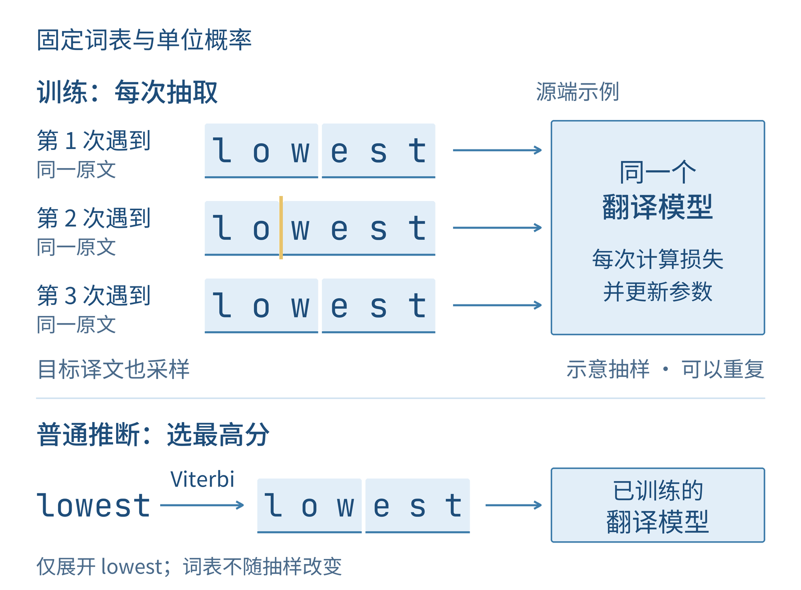
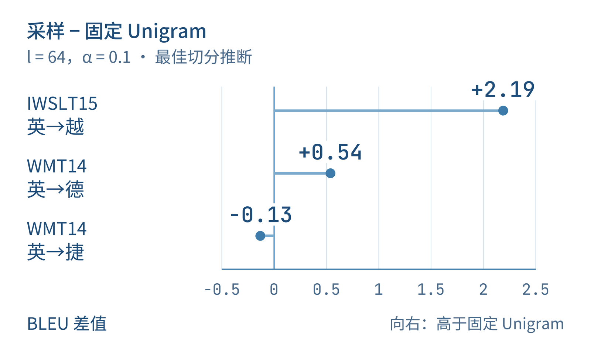

+++
title = "论文里程碑 #22：Subword Regularization: Improving Neural Network Translation Models with Multiple Subword Candidates"
description = "同一段文字可以有多种切分；训练时换着使用，能让翻译模型少依赖某一种固定表示。"
date = 2026-10-28
draft = false
tags = ["LLM", "论文里程碑", "Unigram", "子词正则化", "SentencePiece", "神经机器翻译"]
categories = ["LLM"]
series = ["论文里程碑"]
showTableOfContents = true
+++



同一段文字可以有多种切分；训练时换着使用，能让翻译模型少依赖某一种固定表示。

看到 `lowest`，我们会把它当成一个完整的词。翻译模型接到的却可能是 `low | est`，也可能是 `lo | west`。字母和顺序没有变，送进模型的 token——也就是它逐个处理的单位——已经换了。每个单位对应自己的编号和向量，模型需要沿不同的组合读回同一段文字。

上一篇的 BPE 为罕见词提供了小单位组合的办法。学好合并规则后，它按固定规则切分，便于反复使用。但如果训练始终只给模型看一种组合，其他能够拼回原文的路径就很少有机会参与学习。切分边界本身，也可能成为模型习惯的一部分。

2018 年的 *Subword Regularization: Improving Neural Network Translation Models with Multiple Subword Candidates* 把这件事变成了训练方法：为同一段文字准备多个有概率的切分候选，每次训练时抽取一种。本篇以 ACL 2018 正式版为准，看看这些候选怎样获得分量，又怎样帮助当时的神经机器翻译。

## 先让同一个词有几条路

沿用 `lowest`，先搭一个可以手算的小词表。**以下词表和概率都是教学设定，不是论文训练出来的结果**。 为了看清边界，我们只处理这个单词，省去句子里的空格与特殊符号。

| 词表中的单位 | 单个单位的概率 p |
| --- | --- |
| low | 0.25 |
| est | 0.20 |
| lo | 0.15 |
| west | 0.10 |
| l、o、w、e、s、t | 每个 0.05 |

十个单位的概率加起来是 1。这张表只说明哪些字符串可用、各有多大概率；它没有给 `lowest` 预先指定唯一的边界。

我们可以取出 `low` 和 `est`，也可以取出 `lo` 和 `west`，还可以把后半部分继续拆成单字符。这里“合法”只要求每一块都在词表里，按顺序拼接后恰好还原 `lowest`。`lo | west` 中的 `west` 不承担“西方”的语义，子词也不必正好是语言学上的词根或词缀。

论文采用 **Unigram 子词模型**为这些路径打分。Unigram 可以理解为“一元”：计算切分分数时，每个单位只用自己的概率，不看它前面接了谁。把一种切分记作 x，其中共有 M 个 token，第 i 个记作 xᵢ。路径分数就是各单位概率的乘积：

$$
P(\mathbf{x})=\prod_{i=1}^{M}p(x_i)
$$

拿刚才的两条路试一下：`low | est` 得到 0.25 × 0.20＝0.05；`lo | west` 得到 0.15 × 0.10＝0.015。前一条得分更高。再拆细一些，`lo | w | est` 得到 0.15 × 0.05 × 0.20＝0.0015。我们现在已经能比较不同边界，而不必先判断哪条更像人类习惯的构词法。

先看图 1 中始终对齐的六个字母：每一行都读回同一个词，变化的是把哪些位置合成一块。

*图 1：同一个 lowest，可以沿不同的子词边界读完。这里展示十项教学词表允许的三条路径及其乘积分数，并非全部候选；字母顺序与原文均不变。*

把这些选择按字符位置汇集起来，就得到**切分格**（lattice）：从词首走到词尾，一条完整路径对应一种切分。需要分数最高的一条时，可以用 Viterbi 动态规划，复用各个位置之前已经算好的最佳结果；不用把所有完整路径都列出来，也不用贪心地见到最长片段就取走。

这里的独立假设属于切分模型。它让我们方便地给路径打分；后面的翻译网络仍然要学习上下文。还有一个区别也值得在此看清：0.05 是这条路径的乘积分数，尚不是“面对 lowest 时抽到它的概率”。要变成抽取概率，还得看参与抽取的其他路径有多少分量。

## 这张概率表，先从语料里学出来

刚才我们直接给出了概率。真正使用时，哪些片段该留、各有多大概率，都需要从训练语料中估计。

论文从一张较大的候选词表出发，收进语料里的单字符和高频子串，再逐步裁剪。这样，起初既有长一些的片段，也有把它们拆开的材料。单字符受到保护，保证语料里已收录的字符仍能组成切分；覆盖范围由这些基础字符决定。

先暂时固定词表。假如语料里出现了一次 `lowest`，我们并不知道它应当算作 `low` 与 `est` 各出现一次，还是 `lo` 与 `west` 各出现一次。论文用期望最大化算法（EM）处理这份不确定性：按当前概率，给所有合法路径分配权重，再把每条路径上各单位的出现次数按权重累加。这样，一次出现可以按不同分量支持几种解释。

把整份语料的这种“加权计数”汇总并归一化，就能更新单位概率。新概率又改变下一轮各条路径的权重，于是两步交替进行。**估概率时会考虑多条路径；只留下当前最高分路径来计数，会变成另一种做法**。

概率估得更合适之后，再看哪些词条可以删。判断依据是：移除这个单位，语料在模型下的似然预计会损失多少。损失较小，说明其他组合比较能接替它，就更适合被裁掉。这里要看替代关系，不能只按单位概率从小到大删除。删去一批后，剩余单位需要重新估计概率；如此反复，词表逐渐缩到目标大小。

到这一步，我们得到一张可以复用的词表及概率。它既能选出最高分的切分，也保留了抽取其他路径的可能。接下来训练翻译模型时，词表已经准备好；变化发生在每次取出的切分上。

## 按概率换着切，也要控制变化幅度

如果每次仍然取最高分，刚才的 `lowest` 就会反复变成 `low | est`。子词正则化要做的，是让另一条路径也有机会出现，同时保留模型已经学到的偏好。

为了手算，先只取分数最高的两条候选。它们的分数是 0.05 和 0.015，合计 0.065。各自除以这个总数，抽到的概率就约为 76.9% 和 23.1%。

**这是在前两条候选中抽取的结果**。 我们的小词表实际上允许八条完整路径；如果把八条都纳入，分母也要随之改变。论文把候选规模记作 l，有限 l 表示先找出分数最高的 l 条，再从中采样。

论文还引入一个平滑参数 α，调节采样有多偏向高分路径。把原文 X 的候选切分集合记作 Cₗ(X)，集合中的路径按下面的概率被抽取：

$$
q_\alpha(\mathbf{x}\mid X)=\frac{P(\mathbf{x})^\alpha}{\sum_{\mathbf{z}\in C_l(X)}P(\mathbf{z})^\alpha}
$$

这里 q 表示本次使用的采样分布，分母把候选的权重加起来，使抽取概率总和为 1。α＝1 时，就是刚才的按分数归一化；α＝0.5 时，先对两个分数开平方，再归一化。结果约为 64.6% 与 35.4%，较低分的 `lo | west` 得到了更多机会。

看图 2 时，留意第二条路径所占的份额。原文和词表都没动，只调一个参数，它参与训练的机会就变了。

*图 2：只在前两条候选中采样时，α 从 1 降到 0.5，lo \| west 的抽取概率由约 23.1% 升到 35.4%。这是教学分布，不是翻译质量或实测采样频率。*

在正值范围内，α 越小，分布越平；α 越大，越偏向最高分路径。接近 0 时，会趋向在候选路径间均匀抽取。这个“均匀”针对整条路径，不能换成在每一个字母后面独立抛硬币决定切不切，那会产生不同的分布。

候选很多时，也可以从全部合法切分中采样。论文把这种设定记为 l＝∞，并用前向滤波、后向采样（FFBS）处理切分格：先汇总到达各位置的概率，再从末尾按条件概率往回抽出一条路。这里的“全部”表示没有截取前 l 条；它不要求把指数增长的路径逐条展开。

因此，Viterbi 和采样可以使用同一份词表、同一类切分格，却完成不同任务。前者寻找最高分路径，后者让多条路径按权重轮流出现。论文需要的训练变化就从这里产生。

## 每次更新前，让同一句话换一组边界

把 `lowest` 放回一句训练材料，比如 `the lowest price`。固定切分时，这句话每次出现，模型看到的 token 序列都一样。采用采样后，其中的 `lowest` 这次可能是 `low | est`，下次可能是 `lo | west`；两次也可能恰好抽到同一种。

源语言句子之外，训练数据中的目标译文也可以这样处理。目标文字保持原样，但作为监督答案的 token 序列会变化。翻译模型既有机会学习从不同源端组合读入文字，也有机会学习用不同目标端组合生成文字。

论文在每次参数更新时动态采样，对每个训练句对的源端、目标端各抽一种切分，然后照常计算翻译损失、更新同一套网络参数。它希望模型在这些切分组合上的平均对数概率更好；实际训练靠一次次抽样来近似这件事。一个训练步无需把所有候选全部送进网络。

看图 3，几次训练之间保留下来的是原文、词表与同一个模型，换掉的是这一次进入训练的边界。

*图 3：训练时动态抽取切分，再照常更新同一个翻译模型；普通推断可以取最佳切分后翻译。图中只展开源端 lowest 的教学路径，目标端以文字说明其同样参与采样。*

这个安排让我觉得巧的一点，是扰动之后仍能读回原文。删字或打乱字母会改变文字本身，而 `low | est` 与 `lo | west` 只是改变了模型处理它的单位。模型必须在不同组合下继续完成翻译，因而有机会减轻对某一套边界的依赖。这是方法的设计直觉；它是否真的改善泛化，还需要实验。

采样也有额外计算，序列长度可能跟着变化。所谓增加训练材料的多样性，指的是同一份原文产生了更多表示方式，并没有增加新的句子或知识。

到了实际翻译时，可以先用 Viterbi 选择最佳源端切分，再让模型生成译文。这样，训练探索了多条路，普通推断仍有清楚、固定的入口。论文还试过把多个源端切分分别送去翻译，再比较候选译文的 n-best decoding；这是额外的推断策略。下面先看只用最佳切分进行推断的结果，才能更直接地观察训练采样带来了什么。

## 效果来自词表，还是来自换着切

现在最值得比较的是三种安排：BPE 固定切分、Unigram 固定切分，以及 Unigram 加入训练采样。前两种帮助我们判断更换切分算法的效果；后两种则把注意力放到采样策略上。

论文使用 GNMT 翻译系统，在不同语料规模和语言方向上评测。这里摘出三组结果：约 13.3 万句对的 IWSLT15 英→越、450 万句对的 WMT14 英→德，以及 1500 万句对的 WMT14 英→捷。指标是区分大小写的 BLEU，衡量译文与参考译文的词串匹配情况，分数越高越好。不同测试集的分数只在各自组内比较。

下表都采用最佳源端切分进行推断；采样列统一采用 l＝64、α＝0.1。这样不用在每一行切换到该语种的最好配置。

| 任务 | BPE 固定切分 | Unigram 固定切分 | Unigram＋采样 |
| --- | --- | --- | --- |
| IWSLT15 英→越 | 25.61 | 25.49 | 27.68 |
| WMT14 英→德 | 24.53 | 24.50 | 25.04 |
| WMT14 英→捷 | 25.25 | 25.54 | 25.41 |

*数据取自原论文 Table 2、Table 3（第 72 页），采用 one-best decoding 的对应列。原表中，采样后的英→越、英→德结果相对 BPE 达到其报告的显著性标准；这不等于对所有列间差异都做过同样的检验。*

先看英→越：固定 Unigram 与 BPE 很接近，加入采样后则比固定 Unigram 高了 2.19 个 BLEU 分。这个对照支持的重点是，**多种切分参与训练有价值**。仅凭“Unigram”这个名字，解释不了全部收益。

把目光移到另两组，差异就收窄了。英→德的采样结果比固定 Unigram 高 0.54 分；英→捷反而低了 0.13 分。图 4 把这三个“增加采样前后”的差值放到同一条零基线上，让收益与例外一起出现。

*图 4：相对固定 Unigram，加入训练采样后的 BLEU 变化分别为＋2.19、＋0.54、−0.13 分。据原论文 Table 3 的三组 one-best decoding 结果计算；采样均为 l＝64、α＝0.1。差值展示不同任务中的观察，不构成语料规模的单变量实验。*

这些结果符合论文“在较低资源条件下收益更明显”的总体观察，但三组任务同时改变了语言与数据分布，不能据此断言数据量一增加，收益就必然按某条曲线下降。尤其在英→捷这组里，有无采样的差距很小，没有理由把它讲成稳定的优势。

论文还把训练好的模型用于 Web、专利和搜索查询等域外文本。以 WMT14 英→德模型为例，在 Web 测试集上，BPE 为 22.71，采样系统为 26.02；这里同样使用 l＝64、α＝0.1 和最佳源端切分推断。它提示我们：在标准测试集上差距不大的系统，遇到来源不同的文字时，差异可能更明显。

这组域外结果比较的是 BPE 与加入采样的 Unigram 整套系统，没有单列固定 Unigram，因此不能把 3.31 分全部单独归给采样。结合前面的对照，它为“切分变化有助于应对训练之外的文本分布”提供了补充证据；实验对象仍是这些翻译任务。

变化也有合适的幅度。论文对 α 的实验表明，在全部路径中采样时，把分布压得过平会明显损害结果。我们刚才让低分路径得到更多机会，是有意增加训练变化；继续加大这种变化，并不保证更好。保留有根据的偏好与提供足够的多样性，需要一起考虑。

## 分词从预处理，走进训练过程

回头看 `lowest`，现在已经可以把三个选择分开了：先学出词表和单位概率，再决定这一次取最高分路径还是按概率抽取，最后把得到的 token 序列交给翻译网络。同一张 Unigram 词表，可以服务于固定切分，也可以服务于子词正则化。

这也帮助我们辨认常一起出现的 SentencePiece。它是分词与还原文本的工具，实现中支持包括 BPE、Unigram 在内的算法。这里读的是提出子词正则化方法的论文；同年发表的 SentencePiece 工具论文，进一步讨论直接从原始句子训练、减少语言相关预分词等工程问题。工具名、切分算法和训练时是否采样，分别回答不同的问题。

我更愿意把这篇论文的贡献记成一次训练视角的变化：已经能够拼回原文的另一条路，不必因为没有拿到最高分就一直闲置。让它在训练中适当地出现，可能帮助模型从几种表示中学习同一份内容。低资源与域外翻译的结果使这个想法有了证据，大语料中的例外又提醒我们，这份变化需要与具体任务相配。

如果你想把这些选择放回 tokenizer 的整体设计中，可以继续读 [LLM 主线 #11：Unigram（SentencePiece）](https://wanger.dev/llm/llm_11/)。论文线下一篇转向 **ResNet**：当网络加深以后，连训练集都学得更差，怎样通过结构改变让学习更容易。我们会从输入表示的选择，走向深层网络的优化困难。

## 参考资料

1. Taku Kudo. 2018. [Subword Regularization: Improving Neural Network Translation Models with Multiple Subword Candidates](https://aclanthology.org/P18-1007/). ACL 2018，pp. 66–75。预印本于 2018-04-29 首次公开，正式会议版本发表于同年 7 月；本篇采用后者。方法见 §2–3，主要实验见 §5、Tables 2–4，采样参数讨论见 §5.5、Figure 1。
2. Taku Kudo, John Richardson. 2018. [SentencePiece: A simple and language independent subword tokenizer and detokenizer for Neural Text Processing](https://aclanthology.org/D18-2012/). EMNLP 2018: System Demonstrations，pp. 66–71。仅用于说明工具与算法的身份关系。

