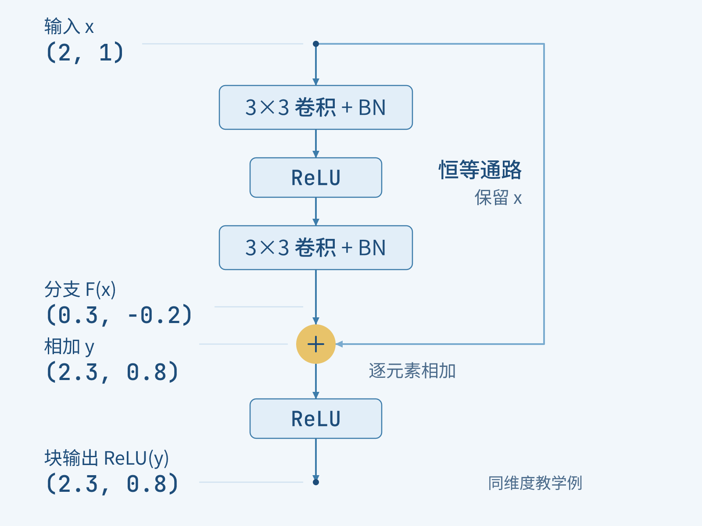
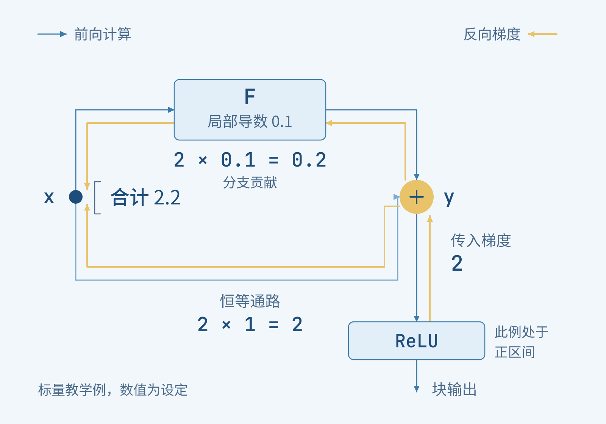
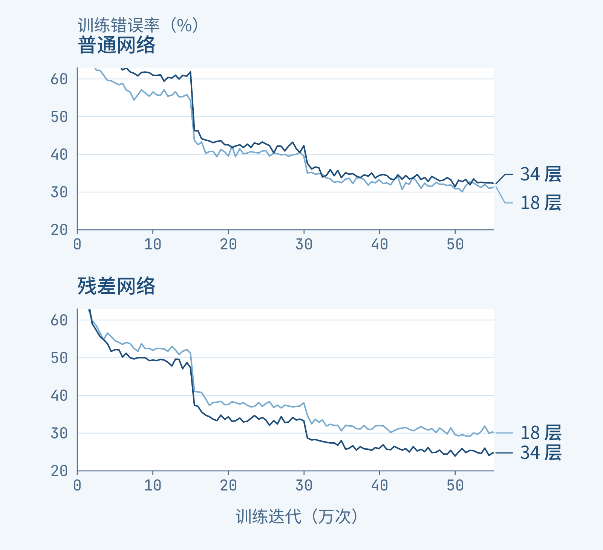

+++
title = "论文里程碑 #23：Deep Residual Learning for Image Recognition"
description = "从训练误差反升的困境，理解残差连接怎样让深网络学会保留与修改，并区分优化改善与泛化收益。"
date = 2026-11-02
draft = false
tags = ["LLM", "论文里程碑", "ResNet", "残差连接", "深度学习", "优化与泛化"]
categories = ["LLM"]
series = ["论文里程碑"]
showTableOfContents = true
+++



> 从训练误差反升的困境，理解残差连接怎样让深网络学会保留与修改。

假设你正在训练一个识别照片的模型。它已经能分辨不少物体，你想让它再多学几层：也许前面发现边缘，后面组合形状，更多层就能做更细的判断。可训练完一看，加深的模型表现反而更差，连反复练习过的训练图片都认错得更多。

这就有些奇怪了。如果新增的层暂时找不到更好的处理方式，至少可以把已有结果原样传下去。一个能容纳更多计算的网络，为什么连这个退路都没学好？

2015 年公开的 *Deep Residual Learning for Image Recognition* 就从这处矛盾出发。何恺明等人提出的残差网络（Residual Network，ResNet），把“保留输入”直接放进结构，让可学习的分支负责在它上面作修改。我们先跟着一份小小的输入，看这个安排究竟改变了什么，再回到论文中的图像识别实验。[原论文，§1–3](https://arxiv.org/pdf/1512.03385v1)

## 更深的网络，连练过的题也做差了

一个图像分类网络会连续处理图片，每一层把收到的表示变成下一份表示。层数更多，意味着可以组合更多次变换；但这些变换的参数仍要通过训练找到。

要判断“加深以后变差”出了什么问题，先把两种错误分开看。**训练误差**看模型在参与学习的图片上认错多少；验证或测试误差看它面对未用于参数学习的图片时表现怎样。过拟合常见的样子是练习题做得很好，换一批题却不行。开头遇到的情况更靠前：深模型连练习题都没做好。

论文把这种随深度增加、训练准确率反而下降的现象称为**退化问题**（degradation problem）。在 ImageNet 上，作者比较了 18 层和 34 层的普通网络，也就是没有残差快捷连接、逐层串联的网络。更深的 34 层网络在训练过程中一直有更高的训练误差。这让问题落到了优化上：更多层提供了更多可能，训练却没能把这些可能变成至少同样好的解。[§4.1，Fig. 4](https://arxiv.org/pdf/1512.03385v1)

熟悉反向传播的读者可能会想到梯度消失。不过，这组普通网络已经使用了合适的初始化和批归一化（Batch Normalization，BN），作者还检查了反向梯度的范数，并未看到信号消失。因此，原论文没有把这里的困难直接归结为梯度消失，而是继续追问：我们交给这些层的学习任务，是否可以换一种组织方式？

先想一个最保守的目标。假如较浅网络已经给出了有用的表示，新增的同维度层只要做到“输入什么，就输出什么”，深网络至少有机会保留原来的效果。这叫**恒等映射**（identity mapping）。这样的解在表达上存在，并不代表从随机参数出发的训练就容易找到它。

## 把“原样保留”变成一条现成的路

我们用一组教学数字把这件事缩小。设某个局部模块收到的表示是两个数 \( (2,1) \)。它们只是方便手算的特征值，不对应论文中的真实图片或测量。

如果这一段最合适的处理恰好是原样保留，普通网络需要让几层变换合起来输出 \( (2,1) \)。其中每一层都参与加工，即使最终想要的是“不变”，也得靠参数配合完成。

换一种安排：输入保留一份，沿一条直接通路送到出口；另一份进入可学习的分支，分支结果再与原输入相加。这样，要输出 \( (2,1) \)，分支只需输出 \( (0,0) \)。

可以把它想成两种修订图案的工作方式。一种从空白纸重新画出完整图案；另一种保留底稿，在透明纸上准备需要增加或抵消的笔画。目标与底稿相同时，第二种方式就有一个很清楚的选择：这一轮不添改动。先看底稿有没有被保留下来，再看需要重新制作的部分在哪里。

*图 1：保留底稿后，可以把学习对象改成需要增减的部分。修订图案的类比示意，空白透明层对应“不作修改”，不代表实际网络中的物件或测量。*

回到 \( (2,1) \)。如果现在希望它变为 \( (2.3,0.8) \)，分支就可以输出 \( (0.3,-0.2) \)：第一项增加一点，第二项减少一点，再与输入逐项相加。

论文把希望学到的整体映射记作 \( H(x) \)，把相对于输入的差额记作 \( F(x)=H(x)-x \)。这里的**残差函数**（residual function）是要学习的表示改动，不是模型预测与真实标签之间的误差。训练仍由最终任务的损失来驱动，不需要给每个中间模块额外标注一份“正确残差”。

真正落实到结构里，关键计算就是：

$$
y=x+F(x;\theta)
$$

\( x \) 是模块输入，\( F \) 是带参数 \( \theta \) 的可学习分支，\( y \) 是两条通路相加后的结果。分支不再独自承担完整输出，而是与已有输入一起组成输出。表达的目标可以相同，寻找参数的方式却变了；论文提出并通过实验检验的，正是这种改写是否更容易优化。

## 一个加号，实际接在什么地方

把类比收起来，看看原始 ResNet 的一个基本块。输入先分成两路：一路经过卷积、BN 和 ReLU 等操作，算出 \( F(x) \)；另一路绕过这些带参数的层，直接把 \( x \) 送到相加处。这条跨过若干层的连接叫**快捷连接**（shortcut connection）。

卷积在邻近位置提取和组合特征；BN 调整训练中数值的尺度；ReLU 则把负值截成零、保留正值。我们不必在这里逐一展开它们，但有一个位置要看清：原论文的基本块在相加之后，还会经过一次 ReLU。所以公式中的 \( y \) 是相加结果，真正送给下一个块的是 \( \mathrm{ReLU}(y) \)。[§3.2–3.4，Fig. 2](https://arxiv.org/pdf/1512.03385v1)

拿刚才的数字沿图走一次。输入 \( (2,1) \) 从同一点分出，分支输出 \( (0.3,-0.2) \)，在加号处得到 \( (2.3,0.8) \)；由于这两个结果都是正数，经过最后的 ReLU 仍然不变。

*图 2：同一个输入分成两路，残差分支算出改动，再与恒等通路逐元素相加。结构据原论文 Fig. 2 和 §3.4 重绘，数字为教学设定；原始块的相加后 ReLU 保留。*

这里的相加是**逐元素相加**：第一项加第一项，第二项加第二项，输出仍是两个数。它没有把两份表示拼成四个数，也没有只挑其中一路往下走。分支在正常前向计算中仍然参与运算。

当分支输出为零、输入又是 ReLU 后的非负表示时，这个原始块可以原样传递输入。若相加结果有负值，最后的 ReLU 就会截断它。因此，原始 ResNet 的“恒等通路”和整个块的输出要分开看：直接通路确实不作变换，整个块还包含分支、相加和激活。

分支也没有被硬性限制只能作很小的修补。刚才选小数，只是为了看清动作；训练可以学到较大的、正负都有的改动。保留输入提供了一个有用的参照点，并没有取消学习新表示的能力。

## 反向传播时，多出来的路有什么用

前向时，两路在加号处汇合。反向传播时，我们从最后的损失往回追：输入稍微改变一点，会让损失怎样变化？这个变化会沿两条依赖关系传回输入——既经过残差分支，也经过那条直接连接。

为了看清这一步，先把一整个向量暂时缩成一个标量，仍用 \( y=x+F(x;\theta) \) 表示相加结果。在这一处，链式法则给出：

$$
\frac{\partial L}{\partial x}=\frac{\partial L}{\partial y}\left(1+\frac{\partial F}{\partial x}\right)
$$

\( L \) 是最终任务的损失；\( \partial L/\partial y \) 表示已经传到相加结果处的梯度。括号里的 \( 1 \) 来自直接的 \( x \)，另一项来自分支 \( F \)。向量情形中，对应的是单位矩阵与分支的雅可比矩阵；我们用标量只为把两路贡献看清。

继续做一个局部教学计算：若传到相加处的梯度为 \( 2 \)，分支在这个位置的导数为 \( 0.1 \)，传回输入的梯度就是 \( 2\times1+2\times0.1=2.2 \)。其中 \( 2 \) 通过恒等通路传回，\( 0.2 \) 来自分支；如果在这个局部计算中去掉直接通路、保持另外两个数不变，就只剩 \( 0.2 \)。这是对加法节点的演示，不是两张真实网络的训练结果。

看图时可以先沿正向箭头找到加号，再沿反向箭头，看这份梯度如何分到两路、最后在输入处汇总。

*图 3：相加节点为梯度提供两条贡献路径。标量教学例中，恒等通路贡献 2，分支贡献 0.2，输入处合计 2.2；梯度数值是局部设定。*

多出这条贡献路径，使梯度不必只依赖分支内部的一连串变换。不过，实际原始块中，梯度到达加号以前还要通过相加后的 ReLU；某个坐标若被截断，对应梯度就可能为零，分支的导数也可能与直接通路的贡献抵消。

所以，这个局部计算解释的是结构怎样改变信息和梯度的路径。它提供了理解残差学习的一条线索；深网络是否更容易训练，仍要由整网实验回答。原论文也没有仅凭一个加号就宣告所有优化困难已经解决。

## 形状不一样时，怎样把输入加回来

刚才两路都是两个数，自然可以逐项相加。在真实图像网络中，一份表示通常是多张特征图：每张图有高、宽，不同通道承载不同的特征响应。网络往深处走，常会缩小空间尺寸、增加通道数。

例如，输入是 \( 56\times56\times64 \)，分支输出变成 \( 28\times28\times128 \)，它们就没法直接对齐相加。这时，快捷连接也需要匹配形状。论文比较了两类做法：一类对空间降采样，并用补零增加通道；另一类用带步幅的 \( 1\times1 \) 卷积作**投影**（projection），把输入变成可与分支相加的尺寸。后者有需要学习的参数。[§3.3、§4.1](https://arxiv.org/pdf/1512.03385v1)

这也让“快捷连接不增加参数”有了明确对象：同形状时的恒等连接不需要新参数；为了对齐形状而使用的投影连接则需要。之后看实验时，我们还会用到这个区别。

继续堆到 50、101、152 层时，作者还要控制计算成本，于是采用**瓶颈块**（bottleneck block）。在论文 Fig. 5 的例子中，输入有 256 个通道，分支先用 \( 1\times1 \) 卷积降到 64 个通道，在这份较窄的表示上做 \( 3\times3 \) 卷积，再用 \( 1\times1 \) 卷积恢复到 256 个通道，与快捷连接相加。

可以把它读成“256 → 64 → 64 → 256”：中间昂贵的空间卷积在较少通道上计算，块两端仍能对齐。这里改变的是分支内部怎样省成本，保留输入再相加的组织方式仍然在。到这一步，我们已经具备回头读实验的结构知识，不需要先记住每一种 ResNet 的完整层数表。

## 回到实验：多出来的层终于派上了用场

现在回到最初那组 18 层与 34 层网络。一个直接的检验是：保留相同深度的普通网络作对照，只把对应结构改成残差连接，训练会有什么变化？

论文的第一组 ImageNet 对照用了不增加参数的快捷连接方案：同形状时原样传递，形状变化处降采样并补零。普通网络与对应深度的残差网络具有相同的参数量，也都使用 BN；所有模型从头训练，而不是把一个已经训好的浅网络复制进去再加层。[§3.4、§4.1](https://arxiv.org/pdf/1512.03385v1)

我们先看训练误差随训练推进的变化。图中每一条线都回答同一件事：此时模型在训练图片上还会错多少。重点看每一组里，34 层的曲线相对 18 层处于哪里。

*图 4：在这组 ImageNet 实验中，普通网络加深后训练误差更高，残差网络加深后训练误差更低。据原论文 Fig. 4 的训练曲线重绘；横轴为训练迭代数，纵轴为训练分类错误率，越低越好。*

普通网络那一组，34 层没有把更多层数转化为更低的训练误差；改用残差结构后，34 层则能把训练误差降得更低。这里最有说服力的变化，是深模型终于更好地完成了训练任务，而不只是未见图片上的某个分数偶然变好。

接着看未参与参数学习的 ImageNet 验证集。下面的 top-1 错误率，就是模型排在第一位的类别猜错的比例。原论文 Table 2 对每张图使用 10 个裁剪视图作评测；它与刚才训练过程图中的曲线是不同的评测记录。

| 网络深度 | 普通网络 top-1 错误率 | ResNet top-1 错误率 |
| --- | --- | --- |
| 18 层 | 27.94% | 27.88% |
| 34 层 | 28.54% | 25.03% |

*数据：原论文 Table 2，ImageNet 验证集，10-crop 评测；错误率越低越好。这里的 ResNet 采用不增加参数的快捷连接方案 A。*

先纵着看普通网络那一列，加深后错误率从 27.94% 升到 28.54%；再看 ResNet 那一列，加深后从 27.88% 降到 25.03%。对于同为 34 层的网络，残差结构低了 3.51 个百分点。

18 层的两种结构最终错误率接近，也很值得保留。它提醒我们，残差连接并非在每一种深度都交付同样幅度的最终收益；这组实验里，更突出的价值出现在普通网络加深后难以优化的地方。论文同时观察到，18 层 ResNet 在训练早期收敛更快。

在后续采用瓶颈块的 ImageNet 实验中，作者继续把网络加深到 152 层，并得到更好的结果。不过，要理解本篇的关键改变，眼前这组匹配深度的对照比单独记住“152 层”更有用：它把增加层数、改变连接以及训练误差的变化放在了一起。

## 能训练到一千多层，仍然不等于越深越好

如果故事停在这里，很容易留下一个过于顺滑的印象：有了残差连接，只管把网络继续摞高就行。论文自己还做了一组更有意思的尝试。

在 CIFAR-10 这个较小的图像分类数据集上，作者把残差网络推进到 110 层和 1202 层。1202 层模型的训练错误率已经低于 0.1%，说明它确实能够把训练图片学得很好；可换到测试图片，它却不如 110 层模型。[§4.2，Fig. 6、Table 6](https://arxiv.org/pdf/1512.03385v1)

| 模型 | 参数量 | CIFAR-10 测试错误率 |
| --- | --- | --- |
| ResNet-110 | 约 170 万 | 5 次运行均值 6.61% ± 0.16%；最佳 6.43% |
| ResNet-1202 | 约 1940 万 | 7.93% |

*数据：原论文 Table 6。两者均使用数据增强；110 层的 ± 为标准差，1202 层这一行未报告同样的重复实验统计。*

这次的症状和开头不同。开头是更深的普通网络连训练集都学得更差；这里则是两张残差网络的训练误差都很低，更大的模型面对测试集却没有占优。作者认为，1202 层网络对这个小数据集可能过大，出现了过拟合，并把更强的正则化留作后续研究。

把这两段证据接起来，ResNet 的贡献就更具体了：它改善了原本妨碍深网络学习的优化困难，使增加深度能够在多组实验中带来收益；至于多大的网络适合某个数据集，仍然要由泛化结果回答。能够学好训练集，让我们有机会继续研究后一个问题，却不会替我们自动选好答案。

## 从图像网络，走到语言模型的一条连接

现在再看开头那份已经有用的表示，新增模块有了更明确的工作方式：接住输入，计算需要怎样改变它，再把两者组合起来。原先只能寄希望于参数重新学出的保留动作，被放进了一条现成的连接。

快捷连接在 ResNet 之前已有研究。原论文的重要推进，是把残差学习组织成可堆叠的深层网络，并用普通与残差结构的对照、不同深度的实验，展示这种组织方式怎样缓解训练退化。它留下的价值既有简单的结构，也有辨认问题的方法：模型变深后效果下降，先看看训练集上发生了什么。

这也是一篇视觉论文出现在 LLM 经典论文系列里的原因。2017 年的 *Attention Is All You Need* 明确引用 ResNet，在注意力与前馈子层外使用残差连接，再在相加后接 LayerNorm。保留下来的是“输入与子层结果相加”的结构思想；卷积、BN 和相加后 ReLU 的整套视觉模块并没有原封不动地搬过去。[Transformer 原论文，§3.1](https://arxiv.org/html/1706.03762v5#S3.SS1)

如果想先看这条连接在现代 decoder-only 模型中处于什么位置，可以继续读 LLM 主线 #17：[一个 Transformer Block 的「最小骨架」](https://wanger.dev/llm/llm_17/)。那里沿 Pre-Norm 的结构看残差流；本系列下一篇 #24 则会回到原始 Transformer，看看注意力、残差连接和归一化怎样组成一套完整的翻译网络。

ResNet 让人记住的加号，背后是一项很实际的设计选择：把已有表示留在手边，让新的计算有一个可以围绕它学习的起点。层数因此更有机会变成可用的能力，而训练和测试两份成绩，仍分别告诉我们这种能力究竟走到了哪里。

## 参考资料

- Kaiming He, Xiangyu Zhang, Shaoqing Ren, Jian Sun. *Deep Residual Learning for Image Recognition*. 本文采用 [arXiv:1512.03385v1](https://arxiv.org/abs/1512.03385v1)，首次公开于 2015-12-10；后发表于 CVPR 2016。机制依据 §3、Fig. 2 与 Fig. 5；训练退化与 ImageNet 对照依据 §4.1、Fig. 4、Table 2；CIFAR-10 深度实验依据 §4.2、Fig. 6、Table 6。本文数值与结构均以 v1 为准。
- Ashish Vaswani, Noam Shazeer, Niki Parmar, Jakob Uszkoreit, Llion Jones, Aidan N. Gomez, Łukasz Kaiser, Illia Polosukhin. *Attention Is All You Need*. [arXiv:1706.03762v5](https://arxiv.org/abs/1706.03762v5)，2017-12-06 版本，NIPS 2017。本文仅用 §3.1 说明残差连接在原始 Transformer 中的采用及归一化位置。
