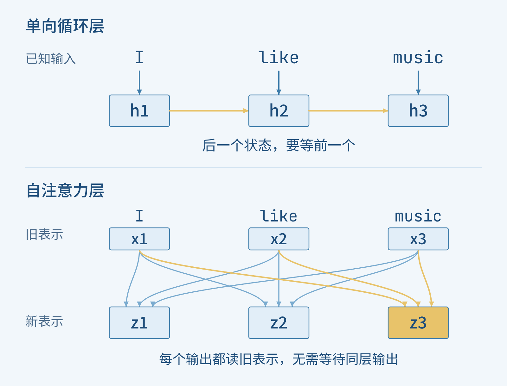
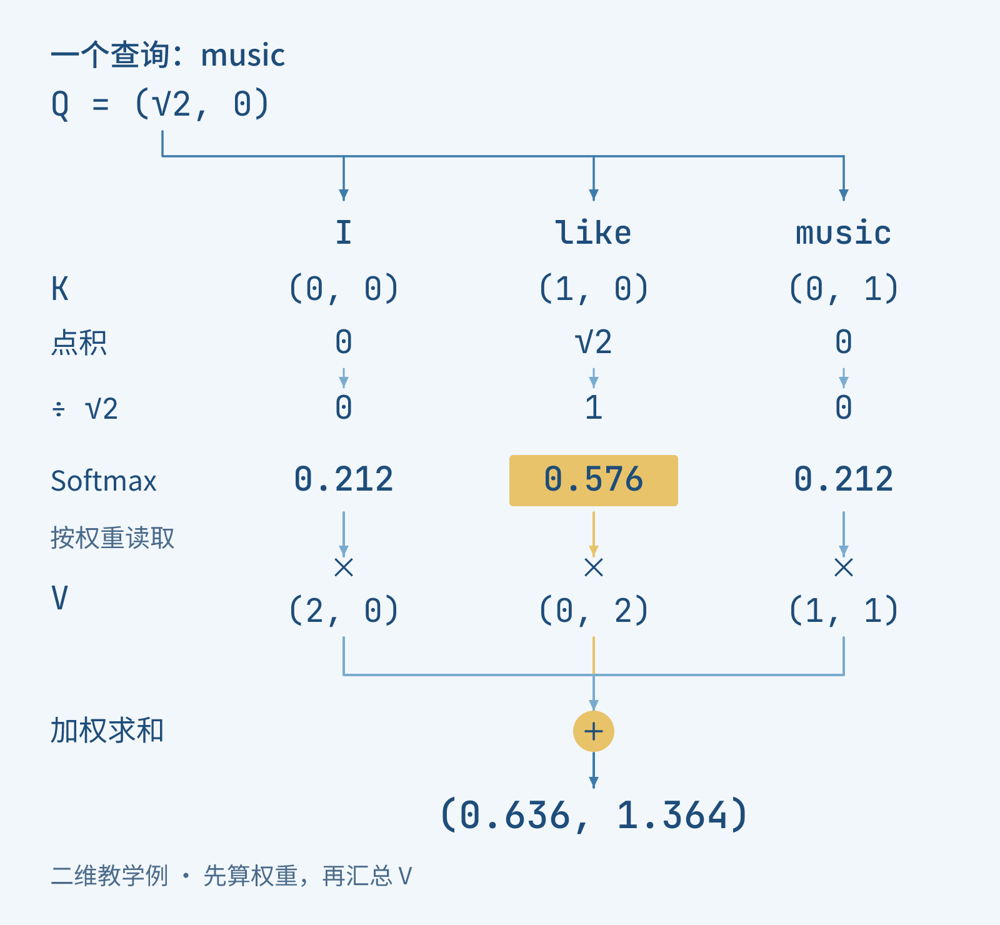
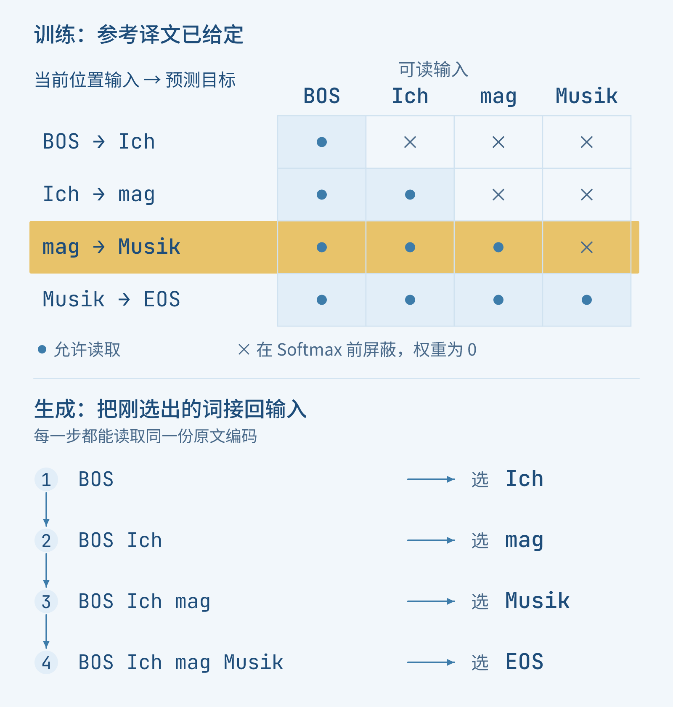
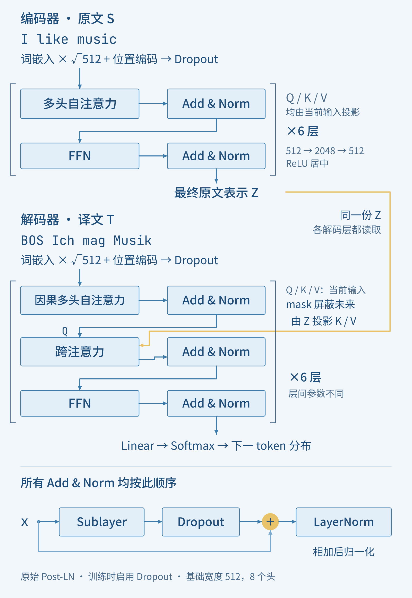
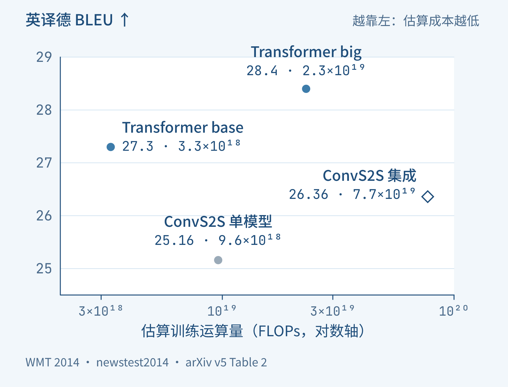

+++
title = "论文里程碑 #24：Attention Is All You Need"
description = "沿一句英德翻译，理解 Transformer 怎样用注意力替代循环等待，并区分训练并行、逐词生成与原始实验的证据。"
date = 2026-11-11
draft = false
tags = ["LLM", "论文里程碑", "Transformer", "注意力机制", "机器翻译"]
categories = ["LLM"]
series = ["论文里程碑"]
showTableOfContents = true
+++



Transformer 让已知序列的各位置并行计算，生成译文时仍逐词推进。

把 “I like music” 译成 “Ich mag Musik”，模型拿到输入时，三个英文词其实已经同时在眼前了。可在循环神经网络（RNN）从左到右计算的一层中，处理 music 时，仍要等 like 位置的状态算完；like 又要等 I。句子再长一些，这条等待链也会跟着延长。

注意力机制已经能帮助翻译模型寻找相关的原文位置。于是，一个值得认真尝试的想法出现了：既然所有输入都在，能不能让每个位置直接去读取需要的信息，而不再沿着循环状态逐站传递？

Vaswani 等人在 2017 年的 *Attention Is All You Need* 中，把这个想法组织成了 Transformer。它保留“先理解原文、再生成译文”的编码器—解码器结构，改变的是内部怎样交流信息。我们沿着这句短译文走一次，看看它拿掉了哪一条等待链，又保留了哪一种顺序。以下按 arXiv v5 解读；例句与小数字都是教学设定，为便于观察，暂把每个词当作一个 token（模型处理的单元），省去子词切分与标点。

## 词都在眼前，为什么还要等？

先把“输入已知”和“计算能否同时进行”分开。训练数据可以提前提供完整句子，但循环层在计算当前位置时，还需要前一位置刚算出的状态。即使三个词同时送到设备上，依赖关系也不会自动消失。

自注意力（self-attention）换了一种安排：这一层的各个输出，都从上一层已经准备好的整排表示中读取信息。music 可以取用 I、like 和自身的信息，I 与 like 也各自做自己的汇总。它们不必等待同一层里别的位置先产出结果。

沿图中的箭头走一遍：上半部需要横着传，下半部的连线都从旧表示指向新表示。

*图 1：循环层沿位置传递状态；自注意力让各位置从同一份已知表示中分别汇总。用三个 token 示意依赖关系，未画完整翻译网络；据原论文 §1、§3.2.3 与 Table 1 提炼。*

这并不要求模型在“一步”里完成全部理解。下一层仍要等上一层的输出；只是同一层内部，各位置不再排成长队。距离较远的两个位置，也能通过一次注意力汇总直接发生联系，而不必沿中间位置逐站走过去。

不过，直接相连只是提供了通路。模型还得决定：对当前这个词，哪些信息值得多读一些？

## 让 music 自己寻找需要的信息

先把每个 token 变成一串可学习的数字，也就是词嵌入（embedding）。进入注意力时，每个位置的表示再经过三组学到的线性变换，得到三个向量：

- **查询 Q（query）**：当前位置用什么线索寻找信息。
- **键 K（key）**：每个可读取的位置提供什么匹配线索。
- **值 V（value）**：真正被取回、参与汇总的信息。

这三份向量不需要人手写语法规则。训练会更新生成它们的参数。名字里的“查询”只是帮助我们区分职责：Q 与 K 决定读多少，V 决定读回什么。同一序列产生 Q、K、V，便是这里的“自”注意力。

拿 music 位置看一次。下面故意把向量压到二维，让我们能核算整步；这些数字不是原模型的实际激活值，也不把两个坐标命名为某种固定语义。

设 music 的查询为 (√2, 0)。I、like、music 的键分别为 (0, 0)、(1, 0)、(0, 1)。把查询与各个键做点积，得到 0、√2、0。查询和键有两个维度，按照论文的方法再除以 √2，分数便成为 0、1、0。

Softmax 把这三个分数转成非负、总和为 1 的权重：先取指数，得到 1、e、1（e 约为 2.718），再各自除以总和。结果约为 0.212、0.576、0.212。现在，like 对这次汇总的贡献最大，但另外两个位置没有消失。

如果三个值向量依次是 (2, 0)、(0, 2)、(1, 1)，按未舍入的权重相加，就得到约 (0.636, 1.364)。这便是本次注意力为 music 位置取回的结果。它仍是一串数字，只是已经混入了这次读取的上下文。

*图 2：先由 Q 与 K 算权重，再用同一组权重汇总 V。图中只展开 music 的一个查询；数字为二维教学设定，输出按未舍入权重计算。据原论文 §3.2.1、式（1）解释。*

把每个位置的查询排成矩阵 Q，把所有键和值分别排成 K、V，同样的步骤就能一起算：

$$
\operatorname{Attention}(Q,K,V)=\operatorname{softmax}\left(\frac{QK^\top}{\sqrt{d_k}}\right)V
$$

这里 dₖ 是查询和键的维度。Q 的每一行是一次查询；QKᵀ 的一行列出了它对所有键的分数，Softmax 在这一行内归一化，最后乘 V 完成汇总。若有 n 个查询、m 个可读位置，分数矩阵就是 n×m；输出仍有 n 行，每个查询得到一份结果。刚才的 music，就是其中一行。

除以 √dₖ 也有具体用处。维度变大时，点积容易变得很大，让 Softmax 的权重过早挤向少数位置，梯度变小。论文用一个简化假设说明尺度：若 Q、K 各分量相互独立、均值为 0、方差为 1，点积的方差会随 dₖ 增长。缩放把这项随维度增长的尺度压下来，使后面的归一化更容易训练。

一次汇总仍可能把不同关系挤在一起。原作的多头注意力（multi-head attention）因此使用多组独立学到的投影，各自完成一次查询与汇总，再把结果拼接起来，经过输出投影形成新的表示。它给同一位置保留了几种不同的信息组合方式。

基础模型使用 8 个头，每个头的 Q、K、V 都是 64 维；8 份值输出拼成 512 维，再映射回模型的 512 维宽度。它不是让八个头各输出一个词再投票。我们也没有预先规定某个头必须管主语、另一个必须管宾语；分工能否形成、怎样形成，要由学习与观察回答。

## 三个词同时读，顺序放在哪里？

把所有位置都摆在面前，带来了另一个需要补上的信息。只凭词本身，模型如何区分谁在前、谁在后？

原作在编码器和解码器底部，都把位置编码加到词嵌入上。两者维度相同，可以逐坐标相加。d\_model 表示模型的向量宽度，基础模型取 512；词嵌入先乘以 √d\_model，再与位置向量相加。这样，进入第一层的每一行同时携带“是什么词”与“处在什么位置”的线索。

论文选择不同频率的正弦和余弦：有的坐标随位置变化得快，有的变化得慢，同一位置在这些波上的数值合成一份位置向量。I、like、music 因此带着不同的位置线索进入网络。即使词完全相同，放在不同位置时，第一层拿到的输入也会不同。

这说明模型不必靠逐词执行来保存词序。位置可以成为输入的一部分，计算仍按整排表示展开。至于正弦、余弦是否唯一合适，后面的原始对照会给我们一个更克制的答案。

读懂原文还只是翻译的一半。接下来，模型要把这些表示变成德文输出；这时，有一种顺序不能随便拿掉。

## 训练时一起练习，生成时仍然接着写

想象我们要生成 “Ich mag Musik”。在写出 mag 之前，模型需要知道自己前面选择了 Ich；换一个开头，后面应接什么也可能改变。原作仍保留这种自回归生成：每一步依据原文和已生成的译文，预测下一个 token。

训练时，参考译文已经给定。我们可以把它错开一位，作为解码器输入与预测目标。用 BOS 表示教学中的起始标记，用 EOS 表示结束标记：

| 目标位置 | 1 | 2 | 3 | 4 |
| --- | --- | --- | --- | --- |
| 解码器输入 | BOS | Ich | mag | Musik |
| 需要预测 | Ich | mag | Musik | EOS |

第三个位置要预测 Musik，输入却只应提供 BOS、Ich、mag。问题是：为了并行计算，第四个输入 Musik 也已经放在同一个批次的张量里了。若第三个位置能直接读第四个位置，它就能偷看到答案。

因果掩码（causal mask）在这里限制读取范围：每个位置只允许看自己及左侧的解码器输入。实现时，在 Softmax 之前把不允许的分数设为负无穷；归一化后，这些位置的权重为 0。加上前面的错位输入，预测目标词时，就只能使用它之前的译文。

先看图中“预测 Musik”的那一行，再看下方真正生成时的箭头。训练时所有题目的输入已经就位，生成时下一个输入还要等上一次选择。

*图 3：错位输入与因果掩码一起避免偷看答案；训练的各目标位置可以并行计算，生成仍逐步使用自己的输出。以同一教学译文示意，据原论文 §3.1、§3.2.3 提炼。*

训练时提供真实前缀，通常称作 teacher forcing。循环模型也会这样训练，但仍需依次计算隐藏状态；Transformer 把这条内部递归拿掉，才使“所有前缀已知”真正能转成按位置并行的矩阵运算。每个位置都预测自己的下一个 token，再用参考答案计算训练损失。

生成时没有参考译文可抄，只能把模型刚选择的输出接回去。因此，**并行的是已知输入下各位置的计算，不是把尚未决定的整句译文同时写出来**。原论文推断时还使用束搜索保留多个候选前缀，但候选仍沿生成步推进。

解码器到这里读到的是译文前缀。英文原文又从哪里进来？它还有第二处注意力，论文称为编码器—解码器注意力，今天常叫跨注意力（cross-attention）。Q 来自解码器当前位置经过前一子层处理后的表示，K、V 则由编码器最终输出变换得到。

于是，在预测 Musik 时，解码器可以依据已经写出的 “Ich mag”，从完整的英文编码中读取相关信息。这里不需要把后面的英文词遮住：翻译开始前，原文已经完整给定。要遮住的是未来译文，而不是尚未“读到”的原文。

## 把这些操作装回一层完整的网络

我们现在有三处注意力：编码器内部读原文，解码器内部读译文前缀，跨注意力让译文位置读取原文。它们使用同一种匹配、加权汇总的操作，区别在于 Q、K、V 来自哪里，以及哪些位置允许相互读取。

但汇总别处的信息之后，每个位置还需要进一步加工自己的结果。逐位置前馈网络（feed-forward network，FFN）承担这一步：基础模型把每行的 512 维向量先变成 2048 维，经过 ReLU，再映射回 512 维。同一层内，各位置使用相同的这套参数；不同层有各自的参数。

因此，注意力负责跨位置的信息混合，FFN 则分别变换已经混合过的各行。这里的“分别”意味着 FFN 不额外读取另一行，并不意味着它拿到的向量里没有上下文。

原作还沿用了残差连接与 LayerNorm。每个注意力或 FFN 子层算出的结果，先经过训练时的 dropout，再与子层输入相加，最后做 LayerNorm：

$$
\begin{aligned}
y={}&\operatorname{LayerNorm}\bigl(x+{}\\
&\operatorname{Dropout}(\operatorname{Sublayer}(x))\bigr)
\end{aligned}
$$

x 是进入当前子层的表示，y 是交给下一子层的结果。残差让原有表示与新算出的改动一起向前走；LayerNorm 在每个位置内部沿特征维度归一化，再做可学习的缩放和平移。原论文把归一化放在相加之后，也就是后来常说的 Post-LN。推断时关闭 dropout。这里要认清的是原作的顺序，它与不少后来的 Pre-Norm 实现不同。

把图中的两条路线各走一次，模型就完整了。先走原文一侧，再从 BOS 进入译文一侧；尤其留意，跨注意力的 K、V 从哪里接过来。

*图 4：原始 Transformer 的三处注意力、FFN 与残差归一化共同构成编码器—解码器。基础模型两侧各堆叠 6 层，跨注意力读取编码器最终输出；据原论文 Fig. 1、§3 与 §5.4 重绘，图中标明训练时的 dropout。*

编码器连续六层，把英文的每个位置变成带上下文的表示；解码器连续六层，一边处理可见的译文前缀，一边读取这份原文。最后，线性映射与 Softmax 把每个译文位置的向量变成词表上的概率，用来预测下一个 token。

回头看，论文标题里的 “Attention Is All You Need” 并不是说模型里只剩一个注意力公式。它拿掉的是序列表示中的循环与卷积路径；位置编码、前馈变换、残差、归一化以及训练目标，仍各自承担必要工作。

## 换掉等待链，翻译真的更好吗？

结构上能并行，并不自动等于译文更好，也不自动保证训练更省。完整自注意力要比较所有位置对：长度翻倍，分数矩阵的格子就变成四倍。原论文讨论的优势有句长与表示维度等条件，不能把短路径理解成没有计算代价。

因此，最值得看的是质量与成本放在一起的结果。论文用 WMT 2014 英译德任务比较翻译系统：训练数据约 450 万句对，共享的 BPE 词表约 3.7 万个 token；测试使用 newstest2014。BLEU 衡量译文与参考译文的匹配程度，分数越高越好，它不是“翻译正确率”。

先看图中同一模型的两个坐标：往上是 BLEU 更高，往左是估算训练运算量更少。ConvS2S 是原有的卷积序列翻译系统，本身也能在训练时并行处理位置；图里还保留了它的多模型集成结果，避免只和较弱的单模型比较。

*图 5：在原论文英译德测试中，Transformer 的完整系统取得了更有利的质量—训练成本组合。四点取自 arXiv v5 Table 2；横轴为作者估算的训练 FLOPs，采用对数刻度，不是实测延迟。ConvS2S 的单模型与集成分别标识。*

Transformer base 得到 27.3 BLEU，big 得到 28.4；ConvS2S 单模型和集成分别为 25.16、26.36。base 的估算训练运算量为 3.3×10¹⁸ FLOPs，低于 ConvS2S 单模型的 9.6×10¹⁸；big 使用 2.3×10¹⁹，也低于该集成的 7.7×10¹⁹，同时高出 2.04 BLEU。

这些是原论文汇集的系统比较。FLOPs 根据训练时长、GPU 数量与估计的持续算力换算，不能直接读成“快了几倍”。原作自己的 base 与 big 都使用 8 张 P100，分别训练约 12 小时与 3.5 天；big 也同时扩大了模型并增加训练步数。结果支持这套架构与训练方案的可行性，不能把所有差距只归给某一个注意力头。Table 2 的 Transformer 结果还使用了检查点参数平均。

再把问题缩小一点：多头到底有没有帮助？

原论文 Table 3 在英译德开发集 newstest2013 上调整头数，同时相应调整每头维度，使总宽度保持 512。以下各行均为约 6500 万参数、训练 10 万步的基础设置，不使用前面主结果的检查点平均：

| 注意力头数 | 每头 Q/K/V 维度 | 开发集 BLEU |
| --- | --- | --- |
| 1 | 512 | 24.9 |
| 4 | 128 | 25.5 |
| 8 | 64 | 25.8 |
| 16 | 32 | 25.8 |
| 32 | 16 | 25.4 |

从 1 个头到 8 个头，提高了 0.9 BLEU；继续增加到 32 个头，反而降到 25.4。这组对照说明，在这份模型与预算里，让多组投影分别汇总是有用的，但头数不是越多越好。它也没有证明每个头恰好学到了一种人类命名的语法关系。

位置编码的对照同样值得留意：把正弦、余弦换成学出来的位置嵌入，开发集 BLEU 从 25.8 变为 25.7。原文将两者描述为接近。作者选择正弦版本的理由之一，是它可能方便处理训练中未遇到的更长序列；这项翻译对照本身并没有证明长序列外推已经解决。

这样读完实验，设计与证据便能对应起来：整套模型在原任务上有竞争力，多头提供了有效的内部选择，而某一种位置编码并不是全部成绩的唯一来源。

## 真正改变的，是信息怎样到达当前位置

再回到 “I like music”。循环层要沿状态链传递信息；Transformer 让各个位置从已知表示中直接选择、汇总，再经过逐位置变换。原文能够并行编码，已知参考译文的训练位置也能并行计算。等到真正写出 “Ich mag Musik”，未来译文仍未知，生成便继续一步接一步。

这篇论文值得记住的，是它把内容相关的信息交流组织成了可堆叠的完整翻译网络，并用原始任务的质量与成本证明这条路线值得走。注意力此前已经存在，位置并行也有卷积模型的探索；这里的新组合，让“按什么顺序排列词”和“按什么顺序计算表示”可以被分别处理。

如果想把训练中的错位与遮挡继续展开，[#19 训练是并行的：Teacher Forcing 与 Causal Mask](/llm/llm_19/)会接着区分几类掩码。下一篇论文则进入 ELMo：模型从整句算出的上下文表示，怎样被其他任务借来使用？它采用的是另一条双向语言模型路线，我们也由此从“怎样搭起网络”，转向“学到的表示怎样迁移”。

## 参考资料

- Ashish Vaswani、Noam Shazeer、Niki Parmar、Jakob Uszkoreit、Llion Jones、Aidan N. Gomez、Łukasz Kaiser、Illia Polosukhin，*Attention Is All You Need*。[arXiv v5 原文](https://arxiv.org/abs/1706.03762v5)；[PDF](https://arxiv.org/pdf/1706.03762v5)。首发 2017-06-12，本文采用 2017-12-06 修订版；发表于 NIPS 2017。结构与计算见 §3、Fig. 1–2；路径与代价见 §4、Table 1；本文翻译与消融数据见 §5–6、Table 2–3。
- [#19 训练是并行的：Teacher Forcing 与 Causal Mask](/llm/llm_19/)，用于继续理解训练位置并行与掩码分工。

