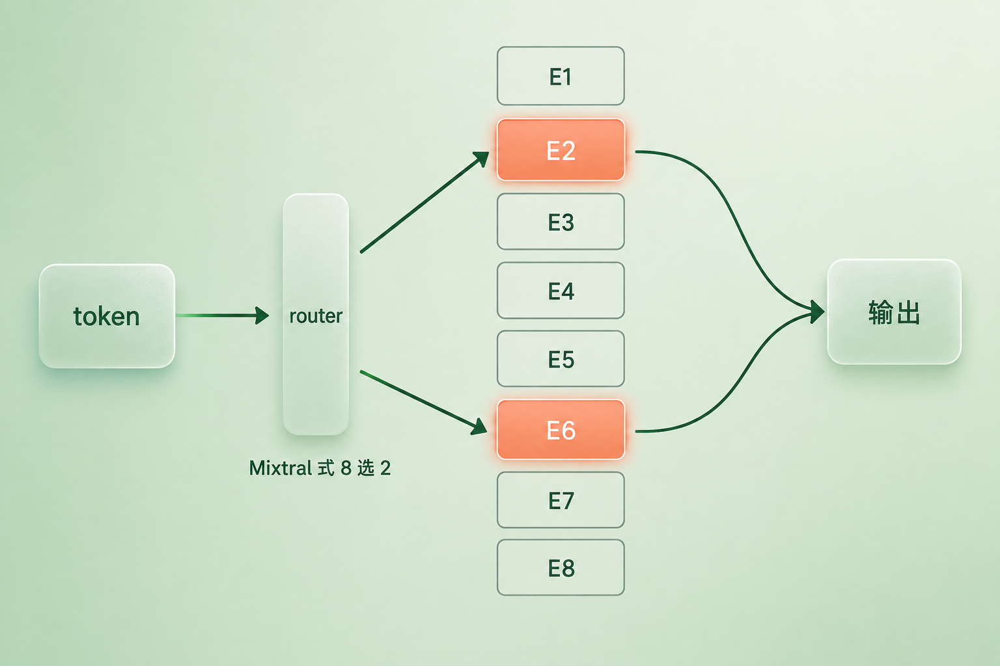
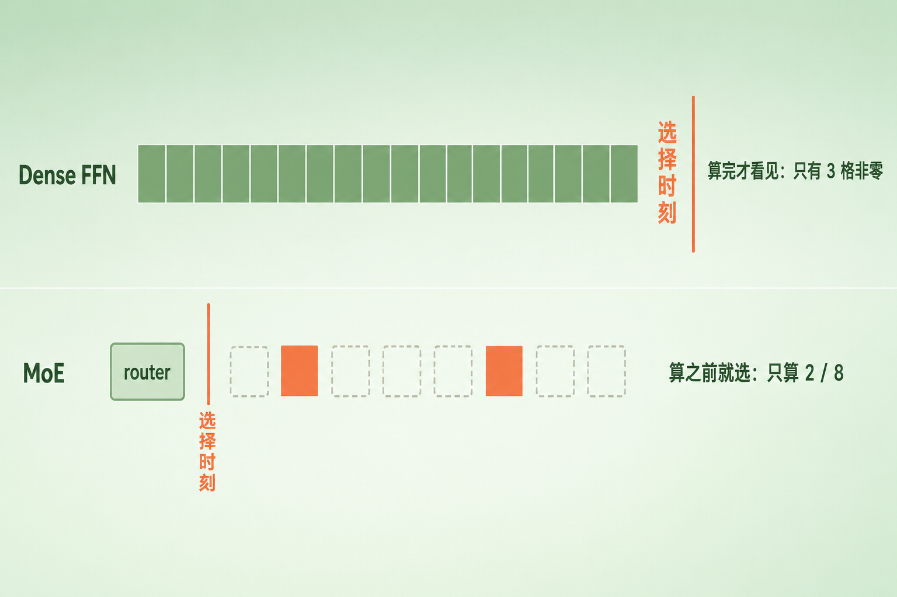
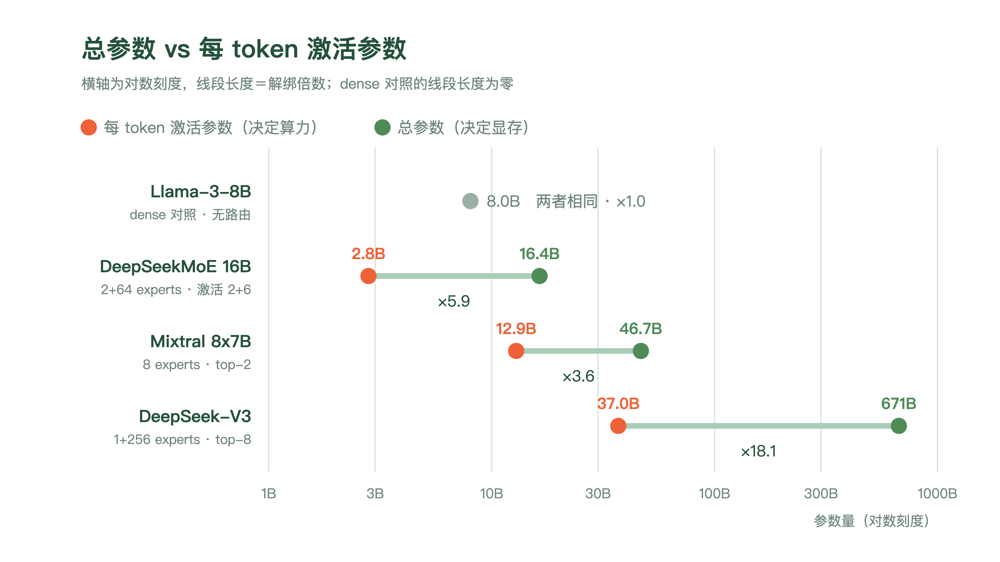
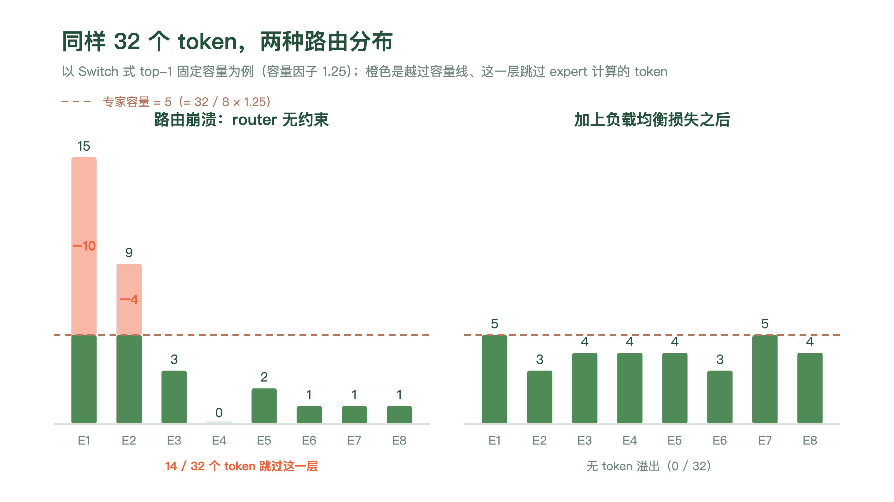

+++
title = "24 MoE（Mixture of Experts）：稀疏激活与路由策略"
description = "MoE 把 FFN 换成一排专家加一个路由器，让参数量和每 token 的算力解绑——但权重存储不跟着解绑。"
date = 2026-09-09
tags = ["LLM", "MoE", "稀疏激活", "路由", "Mixtral", "DeepSeek", "负载均衡"]
categories = ["LLM"]
series = ["主线"]
showTableOfContents = true
+++



> MoE 把 FFN 换成一排专家加一个路由器，让参数量和每 token 的算力解绑——但权重存储不跟着解绑。

> 前置知识提示：读这篇前，建议先了解——一个 Transformer block 由 attention 和 FFN 两个子层交替组成（#17）、FFN 吃掉了经典 block 约三分之二的参数以及它那份「算完才看得见」的稀疏（#23）、decode 每吐一个 token 都要把整套权重搬一遍（#22）。

你去医院看病，挂号台不会把全院的医生都叫来给你看一遍。它只问一句「哪儿不舒服」——这句话花不了三秒，却决定了后面所有的诊疗成本。

这个动作有两个特点：**极便宜**，而且**发生在昂贵的事情之前**。

上一篇拆完 FFN 之后，我们留了一根刺。ReLU 模型的中间层激活平均只有 3.0% 非零（Li et al. 2022 的 Lazy Neuron），也就是说每个 token 真正用上的，只是那张宽表里的一小块。可这份稀疏一分钱算力也省不下来——你得先把 \(W_1 x\) 整个乘出来，才知道哪些位置是零。

分诊台那句话，正是 dense FFN 里缺的东西。

这篇要讲的 MoE（Mixture of Experts，混合专家）干的就是这件事：把一个 FFN 子层换成一排结构相同的 FFN，在它们前面加一个便宜的路由器，让这个路由器在任何一个专家被计算之前，就把该走哪几个定下来。

## 一、条件计算：从「算完才看见」到「算之前就选」

先把上一篇那根刺拔干净，因为它是整篇的起点，也是最容易被含混带过的一句。

「每个 token 只用上 3% 的中间维」和「每个 token 只算 3% 的算力」，是两件完全不同的事。

> 一个人打开一本八百页的字典，为了查一个字，他把八百页从头翻到尾，最后停在第 342 页。你说他「只用了一页」，没错；但你不能说他「只花了一页的时间」。

dense FFN 就是这个人。中间层激活里那些零，是把 \(W_1 x\) 完整算完之后才浮现出来的——稀疏是**结果**，不是**计划**。要真的省下算力，稀疏必须提前发生：在乘法开始之前就知道该跳过哪些，然后根本不去乘。

这个想法叫**条件计算**（conditional computation）：网络的一部分参数，按输入决定要不要参与这一次前向。它在深度学习里被讨论了很久（Bengio et al. 2013 一线），真正在大规模语言模型上跑通、并且拿出说服力的，是 Shazeer et al. 2017 那篇标题就很不客气的 *Outrageously Large Neural Networks: The Sparsely-Gated Mixture-of-Experts Layer*——他们把 MoE 层塞在堆叠的 LSTM 之间，专家数一路扫到 131072，最大做到 1370 亿参数，摘要里写的是「在模型容量上取得超过 1000 倍的提升，而计算效率只有很小的损失」。

顺序上说清楚一件事：Lazy Neuron 是 2022 年的观察，Shazeer 的 MoE 是 2017 年的工作，前者不是后者的动机。把两件事放在一起，是因为它们从两头指向同一个矛盾——用不上的那部分算力，能不能不付。MoE 给的是这个矛盾的答案，不是这个观察的推论。

**记住这条分寸：激活稀疏不等于路由稀疏。** 前者省不下算力，后者才能。MoE 的全部机关，就在于加了一个能**事前**做决定的东西。

### 一个 MoE 层长什么样

结构上的改动比想象中小：把一个 block 里的 FFN 子层，换成 \(N\) 个结构相同、参数各自独立的 FFN，外加一个 router。这 \(N\) 个 FFN 就叫**专家**（expert）。

注意这里是**替换**，不是把原来那个 FFN 的参数预算切碎分给 \(N\) 份。Mixtral 论文自己的说法是「与 Mistral 7B 架构相同，区别在于每一层由 8 个前馈块（即专家）组成」——每个专家的中间宽度 \(d_\text{ff} = 14336\)，和同门 dense 模型的那一个 FFN 一模一样。所以换上 MoE 之后，FFN 那部分的参数直接变成了原来的 8 倍。（把专家本身也切细是另一件事，DeepSeekMoE 的做法留到第四节。）

router 给每个专家打一个分，转成一组权重 \(G(x)\)，输出是这些专家结果的加权和：

$$
y = \sum_{i=1}^{N} G(x)_i \cdot E_i(x)
$$

关键在于 \(G(x)\) 是**稀疏**的——只有少数几个分量非零。分量为零的专家，它的 \(E_i(x)\) 根本不用算。省下来的算力，就是这么来的。

*图：一个 token 进入 MoE 层时发生的事，这里以 Mixtral 式的「8 选 2」为例。它先经过一个很小的 router，router 给八个专家各打一个分，只有分数最高的两个（图中 E2 和 E6）被点亮、真正参与计算，另外六个连碰都没碰。专家数和选几个都是各家自己的取值，8 和 2 不是 MoE 的定义*

这里有三条边界，每一条都容易被写错，值得单独说。

**第一，被换掉的只有 FFN 子层，attention 子层原样不动。** #17 里那张「两个子层交替」的图仍然成立：attention 负责跨位置搬运信息，FFN 负责逐位置加工，MoE 只是把后者换成了「一排 FFN + 一个分诊台」。这也解释了为什么 MoE 和 #21 讲的 MQA/GQA/MLA 是**正交**的两笔账——一个改 FFN，一个改 attention 的 KV 缓存，互不干涉。DeepSeek-V2/V3 两样都用：MLA 管 attention 那一半，MoE 管 FFN 这一半。#21 结尾欠下的那张条子，这里兑现。

**第二，router 的打分本身便宜到可以忽略。** 它就是一个 \(d \times N\) 的线性层：拿残差流上那个 \(d\) 维向量，乘一个矩阵，得到 \(N\) 个分数。每个 token 大约 \(dN\) 次乘加。拿 Mixtral 的数字比一比——\(d = 4096\)、\(N = 8\)，router 是三万多次乘加；而一个专家是 \(3 \times 4096 \times 14336\)，一亿七千多万次。router 的开销在小数点后面好几位，这正是「分诊只花三秒」那句类比的量化版本。

但这句话只覆盖了**打分**。真正在多卡上跑起来之后，路由还要把 token 送到持有对应专家的那张卡、再把结果收回来，这两趟 all-to-all 通信一点也不便宜——DeepSeek-V3 报告里说，跨节点专家并行在没做重叠优化时，计算与通信的比例大约是 1:1。第二节末尾会把这笔账单独列出来。

**第三，不是每一层都换。** 这一点很多介绍会含糊过去。GShard 和 Switch Transformer 都是**每隔一层**把 FFN 换成 MoE 层；DeepSeek-V3 是除了前三层之外全换；Mixtral 才是 32 层全换。所以「MoE 模型的每一层都是 MoE 层」是错的，具体哪几层换、换多少，是各家自己的架构选择。

*图：同一件事——「只用一小部分」——发生的时刻不同。上排 dense FFN：先把整张宽表算完（所有格子全部点亮），之后才看见其中只有 3 个格子非零，红色竖线「选择时刻」落在计算块的右边，算力一分没省。下排 MoE：router 先跑，红色竖线落在计算块的左边，8 个专家里只有 2 个被点亮、另外 6 个从头到尾没被碰过*

小结一句：MoE 没有发明新的计算，它只是把「用哪些参数」这个决定从计算之后挪到了计算之前。这一挪，参数量和算力就断开了。

## 二、参数量和算力解绑：这笔账怎么算

断开之后，需要两个数才能描述一个模型，而不是一个。

- **总参数**（total params，也叫 sparse params）：模型一共有多少参数。它决定这套权重要占多大的存储。
- **激活参数**（active params）：处理一个 token 实际用到多少参数。它决定每个 token 要花多少算力。

dense 模型里这两个数相等，所以大家习惯了只说一个「参数量」。MoE 把它们拆开了。

### 把 Mixtral 的账算一遍

Mixtral 8x7B 是最适合拿来算账的例子，因为名字本身就误导人：8 × 7B 听着像 56B，可它其实是 47B。差的那 9B 去哪了？

按论文 Table 1，Mixtral 的架构参数是 \(d = 4096\)、32 层、\(d_\text{ff} = 14336\)、SwiGLU 三矩阵、32 个 query 头配 8 个 KV 头（GQA）、词表 32000。逐项算：

- 一个专家在一层里：\(3 \times 4096 \times 14336 = 176{,}160{,}768\)
- 全部专家：\(\times 8 \text{ experts} \times 32 \text{ layers} = 45{,}097{,}156{,}608\)，约 45.1B
- attention：每层 \(W_Q\) 和 \(W_O\) 各 \(4096^2\)、\(W_K\) 和 \(W_V\) 各 \(4096 \times 1024\)（KV 头只有 8 个，这是 #21 讲的 GQA），32 层加起来 1,342,177,280，约 1.34B
- embedding 与 LM head：\(32000 \times 4096 \times 2 = 262{,}144{,}000\)
- 剩下的零头：每层一个 \(4096 \times 8\) 的 router 门控矩阵，加上每层两道 RMSNorm 与末层那道 final norm，一共 1,314,816——占总量不到万分之一，但既然这里给的是精确整数，就不能当它不存在

全部加起来 46,702,792,704，也就是 46.7B。**之所以不是 56B，是因为 attention 和 embedding 只有一份、被八个专家共用，被复制成八份的只有 FFN。** 而 FFN 本来就是参数大头（#23 那笔账），所以「8x7B」这个名字，实质上只对 FFN 那一部分成立。

激活参数同理：把「8 个专家」换成「2 个专家」，12,879,925,248，约 12.9B。论文摘要写的是 47B 和 13B，逐项算出来是 46.7B 和 12.9B——两者是同一件事。

*图：总参数与每 token 激活参数的距离。横轴是对数刻度，所以线段长度就是解绑倍数。dense 的 Llama-3-8B 两端重合、长度为零；DeepSeekMoE 16B 是 ×5.9，Mixtral 8x7B 是 ×3.6，DeepSeek-V3 是 671B 对 37B、×18.1*

再看两个更大的例子。DeepSeek-V3 是 671B 总参数、每 token 激活 37B，每个 MoE 层有 1 个共享专家加 256 个路由专家，每 token 从路由专家里挑 8 个。Switch Transformer 走到过更极端的地方：Switch-C 有 2048 个专家、1.6 万亿参数。

GShard 那篇给出的对照最能说明这笔交易的性价比：模型从 37.5B 放大到 600B（16 倍），训练成本只从 6 个 TPU v3 core-year 涨到 22 个（3.6 倍）。参数量和算力，确确实实是两条不同斜率的曲线了。

### 但是，存储没有跟着解绑

这是 MoE 最容易被说漏的一句：**解绑的是每个 token 的 FLOPs，不是这套权重要占的地方。**

那 256 个专家，一个 token 只走了 8 个，另外 248 个在这一步一次都没被算到——但整套权重仍然得在某处待命。你没法预知下一个 token 会挑中谁。671B 参数就是 671B 参数，哪怕每次只用其中 37B。

要说准的是「在某处」这三个字。这不等于每一张卡都得装下全部专家：专家并行（Expert Parallelism）本来就是把不同的专家分散到不同的 GPU 上，DeepSeek-V3 训练时就把每层的路由专家均匀铺在 8 个节点的 64 张卡上；再往外还可以量化，或者把冷门专家卸载到 CPU 内存甚至 SSD，用到时再预取。所以准确的说法是：**集群侧的总权重存储仍然按总参数付账，单卡显存则可以靠切分、量化和卸载压下来。**

顺着这条线还能再往前半步，虽然正题要留到后面几篇。dense 模型跑一批 \(B\) 个 token 时，把一套权重读进来，喂给全部 \(B\) 个 token。MoE 这边，当 batch 足够大、路由又接近均衡、几乎每个专家都被命中时，\(N\) 套专家权重都得读进来，而每一套平均只摊到 \(Bk/N\) 个 token（\(k\) 是每 token 激活的专家数）——同一次权重搬运，能复用它的 token 少了 \(k/N\)，算术强度也就跟着掉下来。batch 小的时候未必每个专家都被命中，账要另算，但方向是一致的：**token 被打散之后，每个专家拿到的有效批量变小了。**

Mixtral 论文开头那句「在低 batch 下推理更快、在大 batch 下吞吐更高」讲的正是这件事的两头。不过同一篇论文自己在几页之后就把话收紧了：激活参数只和理论计算成本成正比，**并没有把显存开销与硬件利用率算进去**；SMoE 层因为路由机制、以及一张卡上跑多个专家时增加的访存，反而带来额外开销，所以它「更适合能跑出较好算术强度的批量负载」。也就是说，前半句是按算力说的，后半句才是它自己认下的真实约束。这笔账的正题在 #26 和第九章。

### 于是有三笔账，不是两笔

到这里可以把整篇的记账方式定下来了。MoE 要同时看三样东西：

| 账目 | 由什么决定 | 正题在哪 |
| --- | --- | --- |
| 权重存储 | 总参数 | 本篇 + 第九章显存算术 |
| 每 token 算力 | 激活参数 | 本篇 + #26 |
| 通信与硬件利用率 | 路由方式与专家并行 | #44.5、第九章 |

前两笔是 MoE 最常被宣传的部分，第三笔是它最常被低估的部分。一个 MoE 模型在论文里的 FLOPs 很好看，落到一个具体集群上跑得快不快，往往取决于第三笔——token 要跨节点搬多远、all-to-all 能不能和计算重叠、负载均不均。本篇只把这笔账挂上号，展开留给后面。

### 一句必须写清参照系的话

「MoE 让推理更便宜」这句话，单独拿出来是没有意义的，因为它没说和谁比。三种比法，三个不同的结论：

- **同样的激活参数规模**下比：MoE 可以更强。DeepSeekMoE 16B 只激活约 2.8B 参数，在 Open LLM Leaderboard 上「大幅超过激活参数量相近的一批模型」——对照组是 OPT 2.7B、Pythia 2.8B、GPT-neo 2.7B、BLOOM 3B 这一档 dense 模型。
- **同样的质量**下比：MoE 可以更省算力。DeepSeekMoE 16B 用约 40% 的计算量，追平了同语料训练的 dense DeepSeek 7B；对 LLaMA2 7B 的表述也是「以约 40% 的计算量达到可比表现」，而后者的激活参数是它的约 2.5 倍。
- **同样的总参数量**下比：dense 是那个**用更多算力换来的上界**。DeepSeekMoE 做过一组严格对照——同样 2B 规模、同样 100B 训练 token，把参数全摊成 16 个恒定激活的共享专家（论文称 Dense×16），每 2K token 要 24.6T FLOPs；而 DeepSeekMoE 只要 4.3T。结果 Pile loss 是 1.806 对 1.808，几乎打平。论文用 "strict upper bound"（严格上界）形容这个 dense 对照，指的正是它——**同总参数下 dense 划出了容量的天花板，但它是拿五六倍的算力换来的，而稀疏架构可以贴着这个天花板跑。**

小结一句：MoE 把「模型多大」和「一次前向多贵」拆成了两个数，代价是存储要按前一个数付账，还多出一笔通信的账。

## 三、路由：怎么选，以及为什么容易选歪

先把话说在前头：下面要讲的每一个机制，都有不止一种实现。三家有代表性的路线放在一起，能省掉后面很多误会。

|  | Mixtral 8x7B | Switch Transformer | DeepSeek-V3 |
| --- | --- | --- | --- |
| 打分 | 线性打分 → 取 top-2 → 只在选中的两个之间 softmax | 同上，只是取 top-1 | 每个专家各过 sigmoid，选中之后再归一化 |
| 选几个 | 8 选 2 | N 选 1（Switch-C 的 N 达 2048） | 256 选 8，另加 1 个恒定激活的共享专家 |
| 均衡手段 | 论文未披露 | 辅助损失，α = 10⁻² | 偏置调节 + 一个系数极小的 sequence-wise 辅助损失 |
| 装不下的 token | 论文未披露容量机制 | 固定容量，超出的跳过这一层 | 声明训练与推理都不丢 |

两个地方值得说明。**「论文未披露」不是「没有」**——Mixtral 的技术报告只讲了架构和评测，没有公开训练时用没用辅助损失、有没有设专家容量；它正文里唯一一次提到 load balancing，说的是专家并行带来的工程挑战，不是自己的训练配方。社区的一些复现实现补了 Switch 式的辅助损失，那是复现者的选择，不能反推原始配方。

另一点是：**这三列都属于「token 选专家」这一族**。还有一族反过来——让每个专家去挑固定数量的 token（Expert Choice，Zhou et al. 2022），讲到路由崩溃时会说明它为什么重要。

这张表最该记住的一点是：**它们没有一个是「MoE 的标准做法」。** 下面每讲一个机制，都会说清它属于哪一列。

### top-k 门控：以 Mixtral 为例

先看最常见的那种。对 \(N\) 个分数取最大的 \(k\) 个，其余置为负无穷，再过一个 softmax 归一化成权重。Mixtral 论文里就写成一行：

$$
G(x) = \mathrm{Softmax}(\mathrm{TopK}(x \cdot W_g))
$$

DeepSeek-V3 换了个算法：它不对全体专家做 softmax，而是让每个专家的亲和度各自过一个 sigmoid，选出 top-K 之后，只在被选中的这几个之间做归一化。所以「先 softmax 再取 top-k」是一类实现，不是 router 的定义。

真正有意思的是 \(k\) 该取多少，以及这个东西为什么天然会跑偏。

### k 是怎么从 4 掉到 1、又涨回 8 的

Shazeer 2017 用的是 **Noisy Top-K**：先算出分数，再往上加一份噪声，噪声的尺度自己也是学出来的：

$$
H(x)_i = (x \cdot W_g)_i + \mathrm{StandardNormal}() \cdot \mathrm{Softplus}((x \cdot W_\text{noise})_i)
$$

加噪声是为了让路由有随机探索、不至于一上来就锁死在几个专家上。他们普通 MoE 层用 \(k = 4\)，层次化 MoE 每一级用 \(k = 2\)。当时论文里有一个**猜想**：\(k\) 必须大于 1，否则 router 学不动——直觉是「你至少得能比较两个专家，才知道哪个更好」。

GShard 接着用 top-2。

然后 Switch Transformer 把 \(k\) 打到了 1，并且直接说这个猜想不成立：这个简化不但保住了模型质量，表现还更好。收益是三条——路由计算更少、每个专家要准备的批大小至少可以砍半、通信实现变简单。

不过 top-1 并不是终点。DeepSeek-V3 走的是完全相反的方向：256 个专家里选 8 个。所以「\(k\) 越小越好」和「Switch 发明了 MoE」一样，都是不该写下的话——Switch 是把这条路简化到极致的那一派，DeepSeek 是把它拆细的那一派，两边现在都活得很好，理由留到第四节。

### 富者愈富：路由崩溃

现在说那个毛病。它和 \(k\) 取多少无关，上面三列都逃不掉——因为它们都是**让 token 去挑专家**。

> 一个新开的美食街，八家店。开业第一天，某家店碰巧多来了几个客人，于是老板有钱多备料、多请人；第二天它的东西就更好，来的人更多。三个月后，八家店里有两家天天排队，另外六家关门。

router 就是这条街。它一开始的偏好几乎是随机的，但只要稍微偏向某几个专家，这几个专家就得到更多训练、变得更强，于是 router 更愿意选它们。这是一个正反馈，终点是少数专家吃掉几乎全部 token，其余的从来没被训练过、白占存储。这个现象有个专门的名字，叫**路由崩溃**（routing collapse）——DeepSeek-V3 引用 Shazeer 2017 时用的就是这个词。

崩溃不只是浪费参数。在专家并行下，每个专家住在某一张卡上，token 要被送到持有它的那张卡去算——负载一旦倾斜，几张卡忙死、其余闲着，整层的速度由最慢那张卡决定。这就是第二节那第三笔账开始咬人的地方。

值得留一句：这是 **token 选专家**（token-choice）这条路线的固有风险，不是所有路由方式的数学必然。把方向反过来——让每个专家去挑固定数量的 token（Expert Choice，Zhou et al. 2022）——负载就由结构本身定死了，论文的说法是「按设计就实现完美负载均衡」，不需要辅助损失。代价是每个 token 被分到的专家数不再固定，有的 token 会被多个专家挑中，有的一个都没有。下面讲的均衡手段，都是为了给 token-choice 打补丁。

### 负载均衡损失：给 router 加一条鞭子

最直接的解法是在语言建模的主损失之外，再加一项惩罚不均衡的辅助损失。Switch Transformer 的形式是：

$$
\mathcal{L}_\text{aux} = \alpha \cdot N \sum_{i=1}^{N} f_i \cdot P_i
$$

其中 \(f_i\) 是这一批 token 里被分给专家 \(i\) 的比例，\(P_i\) 是 router 分给专家 \(i\) 的概率在这一批上的均值。两个向量都想让它接近 \(1/N\)；这个式子在均匀分布时取到最小值。乘一个 \(N\) 是为了让损失的数值不随专家数变化。系数 \(\alpha = 10^{-2}\)，论文从 \(10^{-1}\) 一路扫到 \(10^{-5}\)，\(10^{-2}\) 是那个既压得住不均衡、又不至于盖过主目标的档。

这里有一个容易被跳过、却是全式关键的问题：既然想惩罚不均衡，为什么不直接写 \(\sum f_i^2\)？

因为 \(f_i\) 不可导。它是「有多少个 token 的 argmax 落在专家 \(i\) 上」，一个计数，梯度到这里就断了。\(P_i\) 是 softmax 出来的概率，是可导的。写成 \(f_i \cdot P_i\)，\(f_i\) 只作为一个常数系数出现——哪个专家这一批超载了，就给它对应的那个概率一个更大的下压力度。梯度全部从 \(P\) 那一侧走。

### 专家容量：装不下的 token 会跳过这一层

均衡损失是软的，它只能把分布往均匀里推，不保证推到位。而在 GShard 和 Switch 那套实现里，工程上需要一个硬的保证：分发张量的形状在编译期就定死了，不能这一步某个专家收 3 个、下一步收 300 个。

于是有了**专家容量**（expert capacity）。以 Switch 的 top-1 路由为例：

$$
\text{expert capacity} = \frac{\text{批内 token 总数}}{\text{专家数}} \times \text{capacity factor}
$$

这个分母只在 top-1 下这么干净。GShard 是 top-2，一个 token 会产生最多两次分配，容量是 \(O(N/E)\) 量级，还要再按 group 切一次；换一种路由方式，这个式子就得重写。

容量因子（capacity factor）大于 1，是留给不均衡的缓冲。分配到某个专家的 token 超过容量了怎么办？

**跳过。**

不是排队等下一批，也不是转给别的专家——超出容量的那些 token，这一层就不过 FFN 了，沿着残差流原样走到下一层去。Switch 论文管它们叫 dropped tokens，说得很直白：计算被跳过，token 表示直接经由残差连接送往下一层。

*图：以 Switch 式 top-1 固定容量为例，同样 32 个 token、同一条容量线（容量因子 1.25，容量 = 32 / 8 × 1.25 = 5），两种路由分布的后果。左边是路由崩溃：E1 拿到 15 个、E2 拿到 9 个，E4 一个都没有；越过容量线的橙色部分——E1 超 10 个、E2 超 4 个——这一层跳过 expert 计算，一共 14 / 32。右边是加上负载均衡损失之后：最高的柱子正好贴着容量线，没有 token 溢出*

容量因子调大，溢出少了，但每个专家都要按最坏情况准备缓冲，算力和存储都浪费；调小则相反。Switch 的实验里，容量因子取 1.0 到 1.25 这一档整体最划算。

要紧的是别把这条推广成 MoE 的通性。**丢 token 是「固定容量」这个工程选择的产物，不是稀疏路由的必然结果。** DeepSeek-V3 技术报告里专门有一小节叫 No Token-Dropping：因为均衡策略足够有效，它在整个训练过程中不丢任何 token，推理侧也用专门的部署策略保证不丢。这类做法一般叫 dropless routing。

### 不加辅助损失也能均衡

辅助损失有个隐性代价：它是一股和「把下一个词预测准」毫无关系的梯度，一直混在主目标里。调小了压不住不均衡，调大了伤模型质量。

DeepSeek-V3 换了个思路——既然只是想改变**选择**，为什么要动**梯度**？

它给每个专家配一个偏置 \(b_i\)，加到亲和度分数上参与 top-K 的排序；但门控权重仍然取原始的亲和度，\(b_i\) 不进入这一步。也就是说，\(b_i\) 只影响「选谁」，不影响「选中之后给多大权重」。每个训练步结束时看一眼各专家的负载：超载的把 \(b_i\) 调低一点，欠载的调高一点，调整步长 \(\gamma\) 在前 14.3T token 取 0.001，最后 500B token 降到 0——也就是训练末段索性停掉这个调节，让模型自己收尾。

这个做法叫**无辅助损失的负载均衡**（auxiliary-loss-free load balancing）：均衡靠一个在梯度之外的控制器完成，主损失里干干净净。V3 另外还保留了一个 sequence-wise 的均衡损失，系数 \(\alpha = 10^{-4}\)，用它自己的话说，只是为了避免任何单条序列内部出现极端失衡。

顺带一提，稳定性上还有一个常见的补丁叫 **router z-loss**（ST-MoE，Zoph et al. 2022）：惩罚过大的 router logits。原因很实际——logits 一大，低精度下进指数运算的舍入误差就被放大。ST-MoE 举的例子是：十个 128 的 logit 配一个 128.5 的，bfloat16 上 0.5 的舍入误差就让 softmax 输出变了 36%。它未必改变哪个专家排第一，但门控概率、第二专家的相对权重、以及专家输出的缩放都被搅动了，训练也就跟着不稳。

小结一句：路由是 MoE 里唯一真正新增的机制，也是唯一真正新增的麻烦。学习式的 token-choice 路由天然存在失衡乃至崩溃的风险，所以主流实现都得在「让 router 自由学」和「按住它去均衡」之间选一个折中点——用哪种手段折中，各家并不一样，而换一种路由范式甚至可以让这个问题不出现。

## 四、「专家」到底专在哪

到这里，MoE 的机制已经讲完了。剩下最后一件事，是拆掉一个几乎所有人第一次听到 MoE 都会形成的直觉：这些「专家」，是不是各管一个领域？一个管数学，一个管代码，一个管生物？

这个名字确实是这么来的。它最早出自 Jacobs et al. 1991 的 *Adaptive Mixtures of Local Experts*，那时候的 expert 真的是让不同的子网络去分管输入空间的不同区域。

但现代 MoE 的路由是 **token 级、逐层**的。同一句话里相邻的两个 token 可以被送去不同的专家；同一个 token 在第 5 层和第 20 层，也可以被送去毫不相干的专家。一个 token 走完 32 层，是走出了一条路径，而不是被分进了一个科室。

### Mixtral 自己做了这个实验

Mixtral 论文第 5 节专门测了这件事：在 The Pile 的不同子集上，看专家分配的分布有没有按主题分开。

结论是没有。论文原话是「令人意外的是，我们没有观察到基于主题的专家分配的明显模式」——ArXiv 论文（LaTeX）、生物（PubMed Abstracts）、哲学（PhilPapers）三类文本，在所有层上的专家分布都非常接近。只有 DM Mathematics 略有不同，作者把它归因于该数据集的合成性质和有限的语言覆盖，而不是「有个专家会数学」。

但这**不等于专家没有分工**。同一节里他们观察到了两种别的结构：

一是分工更贴近**语法和表层形式**。Python 代码里的 `self`、缩进 token，英文里的 `Question`，常常被送去同一个专家。论文给 Figure 8 写的图注是：专家的选择「看起来更贴合语法而非领域，在最初和最后几层尤其明显」。

二是**位置局部性**：相邻两个 token 命中同一个首选专家的比例，第 0 层是 13.6%–14.9%，几乎等于随机基线（8 个专家，1/8 = 12.5%）；到第 15 层升到 23.6%–28.4%，第 31 层是 19.7%–26.3%。也就是说，中层和高层的路由带有明显的「跟着上一个 token 走」的惯性。

*图：把 token 按它被分到的首选专家上色，看到的不是「数学 token 一种颜色、代码 token 另一种颜色」。代码里的缩进和 `self` 反复落在同一个专家上，英文里的 `Question` 也是；而两段主题完全不同的文本，用到的颜色种类却差不多。分工确实存在，只是它沿着语法和表层形式切，不沿着领域切*

### DeepSeekMoE：那就把专家切细

Mixtral 那个「专家学不出领域分工」的观察，DeepSeek 团队有一个诊断：不是专家学不会，是**粒度太粗**。八个和原来一样大的 FFN 要覆盖全部知识，每个里面必然塞满了互不相关的东西，还和别的专家大量重复。

他们提了两招（DeepSeekMoE，2024）。

**细粒度专家切分**：把每个专家的 FFN 中间维切成 \(1/m\)，专家数从 \(N\) 变成 \(mN\)，同时把激活数从 \(K\) 提到 \(mK\)。这是全篇唯一一处真的在「切碎」FFN——参数量不变，算力也不变，变的只有**组合数**。论文给的例子很直观：16 个专家取 top-2，可选组合是 \(\binom{16}{2} = 120\) 种；每个专家切成 4 份变成 64 个、取 top-8，可选组合变成 \(\binom{64}{8} = 4{,}426{,}165{,}368\) 种。同样的参数、同样的算力，路由的表达空间涨了七个数量级。

**共享专家隔离**：留出 \(K_s\) 个专家，对每一个 token 都恒定激活，不参与路由。它们专门承接那些人人都要用的公共知识，好让路由专家不必每个都自己学一遍。为了守住算力，路由专家的激活数相应减去 \(K_s\)。

效果是能测出来的。DeepSeekMoE 2B（1 个共享 + 63 个路由，每个专家是标准 FFN 的 0.25 倍）打平了 GShard 2.9B——后者有 1.5 倍的专家参数和算力。放大到 16B（16.4B 总参数、约 2.8B 激活，2 个共享 + 64 个路由，每 token 激活 2 + 6），用约 40% 的计算量追平同语料的 dense DeepSeek 7B。

不过这里也要把话说准：DeepSeekMoE 说的 specialization，指的是**减少专家之间的知识冗余**，用消融来度量——关掉一部分专家，看模型掉多少分；冗余越低，关掉的代价越大。它不是在说「第 7 号专家负责数学」。所以它和 Mixtral 的观察并不矛盾：一个在说「专家之间的分工可以更干净」，一个在说「这份分工不按主题走」。

**「专家」是一个路由目标，不是一个语义模块。** 更接近事实的理解是：FFN 这个位置上现在摆着一排可寻址的参数块——Mixtral 那种是好几份完整的 FFN，DeepSeekMoE 那种是被切细之后的许多小块——而 router 负责在计算之前挑块。名字里的「专家」，是 1991 年留下的历史包袱。

### 顺便说说代价

MoE 不是免费的午餐，除了存储和通信那两笔账，还有两条：

**训练更容易不稳定**。router logits 一大就会放大低精度下的舍入误差，前面说的 router z-loss 就是冲这个来的；ST-MoE 那篇整篇都在写怎么把稀疏模型训稳。

**稀疏模型更容易过拟合**。ST-MoE 在 SuperGLUE 上做过一组很干净的对照：CB 只有 250 条训练样本，ReCORD 超过 10 万条。在小任务上微调时，稀疏模型的训练曲线和验证曲线明显劈叉，dense 模型则没有。参数多、每个参数见到的样本少，这个结果并不意外。也正因为如此，Switch 那篇专门研究了把稀疏模型**蒸馏回 dense**——能保住约 30% 的质量增益，换来大幅缩小的部署体积。（蒸馏的正题留给 #50.5。）

小结一句：专家不是领域专家，是可寻址的参数块。把它切得更细、再留几个常驻的共享块，是 DeepSeekMoE 与 DeepSeek-V3 代表的一条重要路线，但架构远没有收敛到一处：Qwen3 的 MoE 同样用了细粒度专家切分（128 选 8），却明确取消了共享专家——两招是可以拆开用的。

## 收尾

这篇之前，「参数量」在你脑子里大概是一个数：模型有多大，就要多少算力、多少显存，三者绑在一起涨。

现在它是三笔要分开记的账。**总参数决定这套权重要占多大地方，激活参数决定每个 token 要多少算力，而路由方式决定了这些权重散在多少张卡上、token 要跨多远去找它们**——MoE 拆开前两笔，靠的是一个打分便宜到可以忽略的 router，在任何一个专家被计算之前就做出选择；而它拆不开的第三笔，正是让 MoE 在工程上比 dense 难伺候的地方。代价还包括训练更容易不稳、小数据微调更容易过拟合，以及在固定容量那类实现里，每一层都可能有一部分 token 拿不到位置、直接跳过去。

但存储那本账，MoE 只结清了一半。

权重的规模是静态的，算得清楚：671B 就是 671B，不会因为对话变长而继续膨胀。可推理时显存里还有另一样东西，它不随模型大小走，而是随**这次对话有多长**走——你每生成一个 token 它就长一点，而且在这轮对话结束之前删不掉。#22 里我们已经借用过它好几次却一直没正面拆：为什么 decode 每一步只算一个 token，却还能「知道」前面所有内容？下一篇讲 KV Cache。

## 参考资料

- Shazeer et al. (2017). *Outrageously Large Neural Networks: The Sparsely-Gated Mixture-of-Experts Layer*. ICLR 2017. [arXiv:1701.06538](https://arxiv.org/abs/1701.06538) — 条件计算与 Noisy Top-K，MoE 在现代深度学习里的起点
- Lepikhin et al. (2020). *GShard: Scaling Giant Models with Conditional Computation and Automatic Sharding*. [arXiv:2006.16668](https://arxiv.org/abs/2006.16668) — top-2 路由、专家容量与溢出 token
- Fedus, Zoph & Shazeer (2021). *Switch Transformers: Scaling to Trillion Parameter Models with Simple and Efficient Sparsity*. JMLR 23. [arXiv:2101.03961](https://arxiv.org/abs/2101.03961) — top-1 路由、负载均衡损失、蒸馏回 dense
- Zoph et al. (2022). *ST-MoE: Designing Stable and Transferable Sparse Expert Models*. [arXiv:2202.08906](https://arxiv.org/abs/2202.08906) — router z-loss 与稀疏模型的微调过拟合
- Jiang et al. (2024). *Mixtral of Experts*. [arXiv:2401.04088](https://arxiv.org/abs/2401.04088) — 第 5 节的路由分析是本篇第四节的主要依据
- Dai et al. (2024). *DeepSeekMoE: Towards Ultimate Expert Specialization in Mixture-of-Experts Language Models*. [arXiv:2401.06066](https://arxiv.org/abs/2401.06066) — 细粒度专家切分、共享专家隔离与 Dense×16 对照
- DeepSeek-AI (2024). *DeepSeek-V3 Technical Report*. [arXiv:2412.19437](https://arxiv.org/abs/2412.19437) — 无辅助损失的负载均衡、dropless routing 与跨节点专家并行
- Zhou et al. (2022). *Mixture-of-Experts with Expert Choice Routing*. NeurIPS 2022. [arXiv:2202.09368](https://arxiv.org/abs/2202.09368) — 反过来让专家挑 token，按设计实现完美负载均衡
- Qwen Team (2025). *Qwen3 Technical Report*. [arXiv:2505.09388](https://arxiv.org/abs/2505.09388) — 采用细粒度专家切分但取消共享专家的对照
- Jacobs, Jordan, Nowlan & Hinton (1991). *Adaptive Mixtures of Local Experts*. Neural Computation 3(1) — 「专家」这个名字的出处
- 延伸阅读：Hugging Face, [*Mixture of Experts Explained*](https://huggingface.co/blog/moe) — 一篇把上述论文串起来的综述性博客
