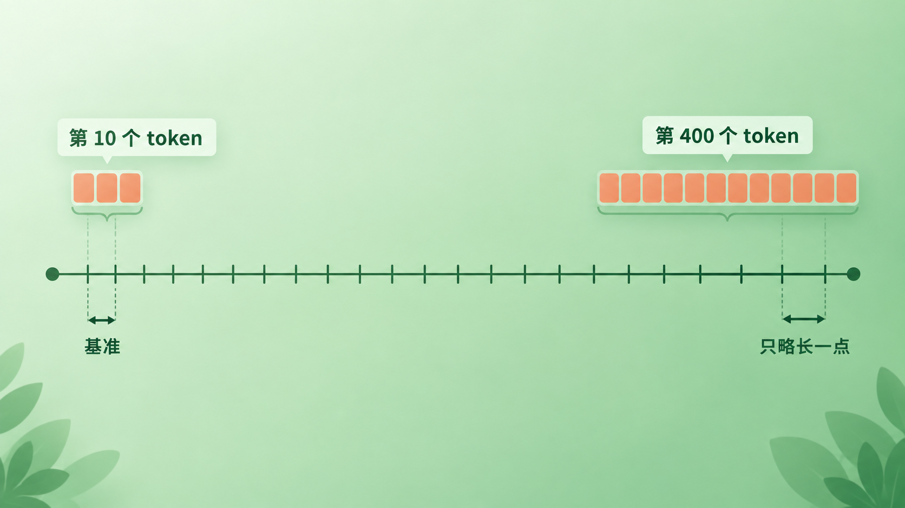
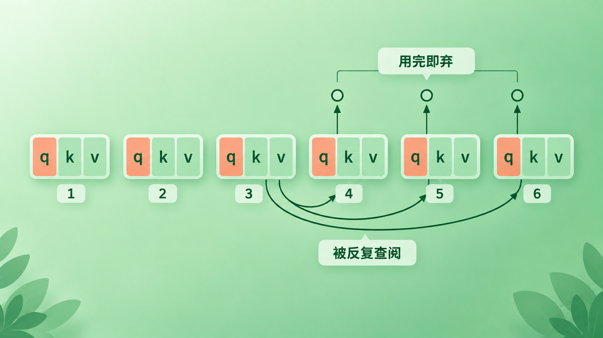
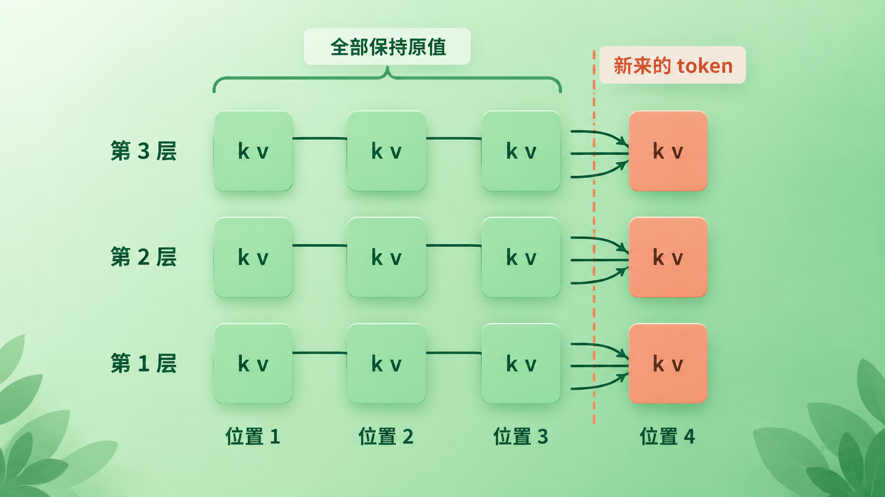
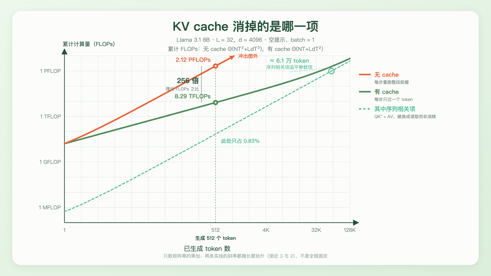
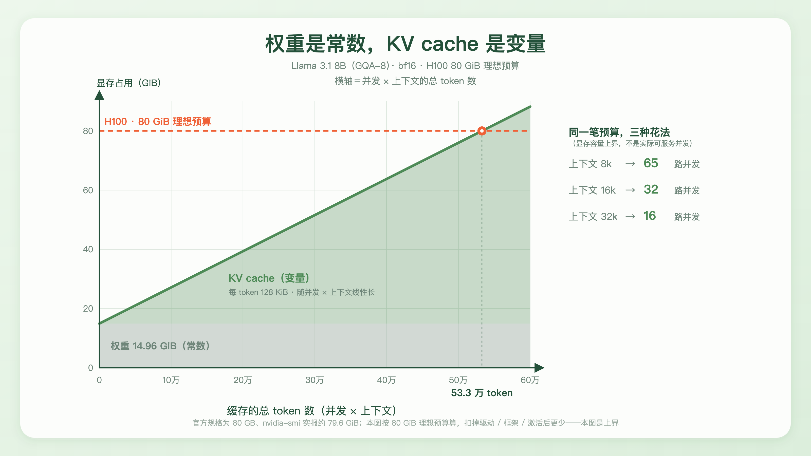

+++
title = "25 KV Cache：增量复用的本质"
description = "KV cache 是一次不改变结果的精确复用：重复计算换成了持续占用。"
date = 2026-09-16
tags = ["LLM", "KV Cache", "推理", "Decode", "显存", "causal mask", "PagedAttention"]
categories = ["LLM"]
series = ["主线"]
showTableOfContents = true
+++





> KV cache 是一次不改变结果的精确复用：重复计算换成了持续占用。

读这篇前，建议了解：causal mask 与训练时的整段并行（第 19 篇）、prefill 与 decode 两阶段（第 22 篇）、KV cache 的尺寸公式（第 21 篇）。

**本篇的讨论范围**：decoder-only 架构、标准的全量因果自注意力、普通自回归解码。滑动窗口注意力、encoder-decoder 的交叉注意力、投机解码这些情形下有些结论要另说，文中会在相关处点名。

## 一句让人起疑的观察

让模型写一段五百字的东西，盯着它一个字一个字往外蹦。第 10 个字和第 100 个字之间，间隔差不多；写到第 400 个字，速度也没有明显掉下去。

（严格说模型吐的是 token 不是字，中文里一个 token 常常是一两个字。下面除了这段体感描述，一律说 token。）

这件事其实很反常。

模型是自回归的——生成第 100 个 token 时，它要以前面 99 个为条件；生成第 400 个时，面对的是一段长四倍的历史。如果每一步都要把前面重新算一遍，第 400 步就该比第 10 步慢四十倍，一段五百字的文章写到后半程会肉眼可见地卡死。

实际上你几乎察觉不到差别。


*图 1（示意图，比例非实测）：同一次生成里，第 400 个 token 的间隔只比第 10 个略长一点——不是完全不变，但远不到「历史长四十倍就慢四十倍」。真实的增幅取决于模型、硬件、batch 大小与 attention kernel，这里只表达「不随历史长度同比增长」*

速度没有按比例塌下去，是因为模型并没有在每一步都把整个前缀**重新前向计算一遍**。前面那些 token 的中间结果已经算好了，留在显存里等着被读。留下来的是每一层的 K 和 V——这就是 KV cache。

这篇要回答的不是「KV cache 是什么」，那句话一行就能说完。要回答的是三个更有意思的问题：**为什么偏偏是 K 和 V 值得存**、**凭什么敢存**、以及**存下来之后，代价长什么样**。

## 一、为什么偏偏是 K 和 V

先看一步 decode 到底在干什么。

第 22 篇里我们把一次推理拆成了两段：prefill 把整段 prompt 一次算完，decode 之后每步只处理一个新 token。现在把镜头推近到 decode 的某一步——第 t 步。

这一步只有一个新 token 进来。它在每一层生成自己的 \(q_t\)、\(k_t\)、\(v_t\)。然后 \(q_t\) 拿去和**全部历史的 K** 做点积，得到一组注意力权重，再用这组权重去加权**全部历史的 V**，得到这一层的输出。

算完之后，\(q_t\) 怎么样了？

它没用了。第 t+1 步用的是 \(q_{t+1}\)——那是下一个 token 自己生成的查询向量。\(q_t\) 在它诞生的那一步就把全部价值兑现完毕，此后再也不会被读到。

\(k_t\) 和 \(v_t\) 完全相反。第 t+1 步要读它，第 t+2 步还要读它，一直到这次生成结束为止，每一步都要读。

> 打个比方：Q 像你临时问出口的一个问题——问完，得到答案，这个问题本身就作废了。K 和 V 像被归档的资料，谁来都可能翻，而且越往后来的人越多。

这就是因果自注意力里的**读写不对称性**：每个位置只当一次提问者，却要当无数次被查阅的资料。



*图 2：第 t 步生成的 q 只在这一步用一次就作废；而位置 3 的 k、v 被第 4、5、6 步反复读取*

不对称从哪来的？从 causal mask。

第 19 篇讲过，训练时要在注意力分数表上盖一张下三角遮罩，让每个位置只能看它左边的东西。这条规则在推理时同样生效，而它有一个直接后果：**老位置会被所有新位置反复读，新位置却影响不到任何老位置**。信息流是单向的，于是「谁值得留下来」这件事也就单向地定了——被未来反复读的那部分值得留，只服务当下的那部分不值得。

（值得缓存的判据其实比 causal mask 更宽一点：只要某组 K/V 会被后续多步反复读、且中途不变，缓存就成立。encoder-decoder 的交叉注意力就是这样——encoder 的 K/V 在整个解码过程里固定，同样会被缓存，而那里并没有 causal mask。本篇只讨论 decoder-only 的自注意力这一种。）

顺着这条标准，另外两个常被问到的问题也就有了答案。

**为什么不缓存 attention 的输出、或者 FFN 的激活？** 因为它们和 Q 是一类的。第 t 步某一层的 attention 输出，只会流进这一层的 FFN，然后继续往上走，走到顶层出 logits，这一步就结束了。第 t+1 步的计算不会回头去读它。用完即弃的东西，存下来只是白占显存。

**为什么训练的时候没有 KV cache？** 因为训练不存在「跨步复用」这回事。第 19 篇里说过，teacher forcing 让整段序列在一次前向里并行流过——所有位置的 K/V 在同一次前向里算出来、在同一次前向里用掉，没有「下一步」需要它们。而且训练要反向传播，得留住的是各层的**激活**（为了算梯度），那是另一件事、另一笔显存账，不要和 KV cache 混。

**小结**：KV cache 存的不是「重要的东西」，而是「会被反复读、且不会再变的东西」。在 decoder-only 自注意力里，这个筛选标准是 causal mask 直接推出来的。

## 二、凭什么敢存：历史 K/V 真的不会变

上一节说 K/V 会被反复读，但这只说明「值得存」，还没说明「能存」。

能不能存，取决于另一件事：位置 3 的 \(k_3\)，在第 4 步算出来是那个值，到了第 40 步还是不是那个值？如果每追加一个 token，前面所有位置的 K/V 都会变一点，那缓存就是错的——你拿旧值去算，结果就偏了。

所以要证明它真的不变。这是全篇唯一一处需要动手论证的地方，而且比看起来微妙一点。

先看单层。真正被写进缓存的键向量，是**位置编码作用之后**的那一个。以 Llama 用的 RoPE 为例：

$$
k_i^{(\ell)} = R(i) \, W_K^{(\ell)} \, x_i^{(\ell)}
$$

其中 \(W_K^{(\ell)}\) 是这一层的键投影，\(R(i)\) 是按位置 i 施加的旋转，\(x_i^{(\ell)}\) 是第 ℓ 层在位置 i 的输入向量。（用可学习绝对位置嵌入的模型没有 \(R(i)\) 这一项，位置信息在最底层就加进了 embedding；两种写法下面的论证都成立。）

这条式子里只有两个东西能让 \(k_i^{(\ell)}\) 发生变化：位置下标 i，和输入 \(x_i^{(\ell)}\)。

位置下标那一半是显然的：位置 3 就是位置 3，后面接多少 token 都不会把它变成位置 4。所以 \(R(i)\) 固定。（反过来说，那些在生成中途重新编号位置的做法——某些长度外推技巧就这么干——恰恰会让已缓存的 K 失效，需要重算。）

剩下的问题就变成：\(x_i^{(\ell)}\) 会不会变？这里要逐层往上推。

- **第 1 层**：输入是位置 i 上那个 token 的 embedding，只跟这个 token 是什么有关。后面追加什么 token，都改不了它。不变。
- **第 ℓ 层**：它的输入是第 ℓ−1 层在位置 i 的输出。而第 17 篇讲过一个 block 的结构——attention 子层跨位置搬信息，FFN 子层逐位置独立加工，残差和归一化都不跨位置。唯一有机会把「别的位置」的信息混进位置 i 的，只有 attention 这一处；而 causal mask 在这里卡死了：位置 i 只能看到 ≤ i 的位置。所以第 ℓ−1 层位置 i 的输出，只由第 ℓ−1 层 ≤ i 的那些输入决定。

把这两条接起来：第 1 层所有位置的输入不变 → 第 1 层位置 i 的输出不变 → 第 2 层位置 i 的输入不变 → …… 一层一层推上去，**每一层、每个已有位置的 K 和 V 都不会因为后面追加了新 token 而改变**。

> 这个结构像一栋只能往上盖、不能改下层的楼。新来的 token 在每一层都只往右边接一格，接上去的那一格能往左看，但左边那些格子看不见它，也就不会被它改写。

两个由此而来的推论值得单独点出来。

**第一，缓存的是每一层各一份，不是只缓存第一层。** 从上面的推导看得很清楚：不变性是逐层成立的，每一层都有自己的一套 K/V 需要留住。一个 32 层的模型，就是 32 份。这也是为什么 KV cache 的尺寸公式里有个 L——它是层数，不是别的。

**第二，用不用缓存，算出来的是同一个东西。** 缓存不是近似、不是采样、不是「差不多够用」。它取的是本来就该等于的那个值，所以数学上结果逐位相同。（工程上还有一点余地：变了 batch 形状或换了算子实现，浮点归约的次序可能不同，末位可能差一点点——但那是浮点运算的通病，跟缓存这件事没关系。）



*图 3：一个三层模型追加第 4 个 token 时的样子。只有第 4 列是新算的，前三列每一层的 K/V 保持原值——所以它们可以被存下来直接用*

一段伪代码把数据依赖关系落到实处（只画 KV 的进出，省略了 norm、残差、位置索引与 attention mask）：

```python
past_k, past_v, logits = prefill(prompt)   # 一次算完 prompt，填好每层的 K/V
cur_token = sample(logits)                 # 第一个新 token 出自 prefill 的最后一个位置
emit(cur_token)

for step in range(max_new_tokens - 1):     # 生成 T 个 token 只需 T−1 次 decode 前向
    x = embed(cur_token)                        # 只送进来一个 token
    for l, layer in enumerate(layers):
        q, k, v = layer.qkv(x)                  # 只算这一个位置的 q/k/v
        past_k[l] = append(past_k[l], k)        # 追加一行，历史原封不动
        past_v[l] = append(past_v[l], v)
        x = layer.attn(q, past_k[l], past_v[l])
        x = layer.ffn(x)
    cur_token = sample(lm_head(x))
    emit(cur_token)
    if cur_token == EOS:
        break
```

第一个 token 是 prefill 顺手采出来的，所以循环只跑 T−1 次——这和第 22 篇算延迟时的口径是同一个。真正要留意的是 `past_k[l]` 从头到尾只有追加、没有任何一行在改写历史。这不是实现上图省事，是上面那条不变性允许的。（真实引擎也不会像这里一样每步做一次拼接——那样会反复复制整块缓存；它们预先分配好空间或者按页写入，第 86 篇会讲。）

**小结**：因为 causal mask 让信息只能从左往右流、位置下标又不会被追加改写，已经算过的 K/V 就被永久钉死了。它们不是「暂时可以复用」，是「永远不会再变」。

## 三、省掉的到底是什么

知道了能存、值得存，接下来是：不存的话，代价有多大？

有一句流传很广的说法：KV cache 把复杂度从 \(O(n^2)\) 降到了 \(O(n)\)。这句话有出处，但直接套到「整段生成」上会把账算错。要说清楚，得把**单步**和**累计**分开看。

先看不缓存时第 t 步要做什么。很多人的第一反应是「重新算一遍前面所有位置的 K/V」。真正的代价比这大：要拿到第 ℓ 层位置 i 的 \(k_i\)，你得先有第 ℓ−1 层位置 i 的输出；要有那个输出，第 ℓ−1 层的 attention 和 FFN 就得为位置 i 完整跑一遍。一层层往下追，结论是——**你必须把整段前缀重新做一次完整的前向传播**。这正是把 `use_cache=False` 打开之后发生的事。

这一次完整前向里有两类开销：**参数矩阵乘**（各层的 Q/K/V/O 投影和 FFN），量级 \(2Nt\)；以及 **attention 自己**（\(QK^\top\) 与 \(AV\) 这两个随序列长度增长的 matmul，下面简称**序列相关项**），t 个位置各看 ≤ t 个位置，量级 \(Ldt^2\)。

开了缓存，两类开销各降一档：参数矩阵乘每步只过一个 token，变成 \(2N\)；序列相关项从「整段的 \(t^2\)」变成「一个 \(q_t\) 对 t 个历史」，变成 \(Ldt\)。

四格摊开：

|  | 单步（第 t 步） | 累计（生成 T 个） |
| --- | --- | --- |
| 无 cache | Θ(Nt + Ldt²) | Θ(NT² + LdT³) |
| 有 cache | Θ(N + Ldt) | Θ(NT + LdT²) |

「\(O(n^2)\) 降到 \(O(n)\)」说的是这张表里**单步的序列相关项**那一格：\(Ldt^2 \to Ldt\)。这个说法本身没错，错在把它当成整段生成的复杂度——**累计下来，无 cache 是三次的，有 cache 是二次的**。缓存把两条曲线各降了一阶，谁都没降到线性。

代入 Llama 3.1 8B（\(L=32\)、\(d=4096\)；算力用常见的 \(2N\) FLOPs/token 粗估模型、\(N\) 取总参数量 8.03B，causal 只算下三角）：生成 512 个 token，不带缓存约 2.12 PFLOPs，带缓存约 8.29 TFLOPs，相差约 **256 倍**。

这些数字是量级估计，不是精确账。严格只数矩阵乘的话，embedding 是查表、不该算进 \(N\)，扣掉之后约 7.5B，绝对值会变成约 1.98 PFLOPs 与 7.75 TFLOPs、序列相关项占约 0.89%、下面那个交点挪到约 5.7 万——但两边同时缩水，**比值仍是约 256 倍**。下文所有数字都按 \(2N\) 这个口径读。

这个 256 倍还是**理论矩阵乘 FLOPs 之比，不是实测的生成速度之比**。无缓存那一侧每步都是大矩阵乘，GPU 算力吃得满；带缓存的 decode 每步只有一行 query，往往卡在访存上，两边的有效 FLOPs/s 差着量级。真实的墙钟差距会比 256 倍小不少——但方向不会反过来，这仍然是「能不能用」和「不能用」的区别。

而在带缓存的那 8.29 TFLOPs 里，序列相关项只占约 **0.83%**，其余全是权重那一遍。这就是为什么在几百个 token 的尺度上，那条二次项根本感觉不出来。



*图 4：Llama 3.1 8B、空提示、batch=1 的累计 FLOPs（按 2N/token 粗估，数字为量级）。生成 512 个 token 时两者相差约 256 倍，而有 cache 那条里的序列相关项只占约 0.83%；两条实线的斜率都随长度抬升（分别渐近 3 与 2），不是全程固定*

它并没有消失，只是被压得很低——而它的斜率比参数项陡。两条线迟早会交叉，交点在

$$
2Ldt^2 = 2Nt \;\Longrightarrow\; t = \frac{N}{Ld} \approx 6.1 \times 10^4
$$

六万多个 token 之后，序列相关项就和参数矩阵乘同一个量级了。

这里的口径要说死：这条等式两边都是 **FLOPs**，比的是「算了多少次乘加」，不是「从显存里搬了多少字节」。所以 6.1 万是一个**数量级估计**，标记的是「这一项开始不能再忽略」，不是硬件上的性能拐点——决定 decode 快慢的是带宽那本账，下一篇才展开。长上下文之所以是个独立难题，稀疏注意力、线性注意力这些方向要动的，正是这一项，那些留到长上下文那一章。

**小结**：缓存把每一步的序列相关项从 \(t^2\) 降到了 \(t\)，累计的总账也随之从三次降到二次。它消掉的是「每步重跑整段前缀」这个大头，不是全部二次项——剩下那一项在几百 token 时占不到 1%，在几万 token 时会变成主角。

## 四、代价的形状：时间换空间

省下来的算力不是白来的，它换成了显存。而这笔显存账的形状，比它的大小更值得琢磨。

先把它写出来。第 21 篇已经推过这条式子，这里直接用：

$$
\text{bytes} = 2 \cdot L \cdot H_{kv} \cdot d_h \cdot b \cdot S \cdot B
$$

开头的 2 是 K 和 V 各一份；L 是层数（第二节推出来的，每层各存一份）；\(H_{kv}\) 是 KV 头数、\(d_h\) 是每个头的宽度；b 是每个数占几个字节；S 是序列长度；B 是并发请求数。

值得注意的是这条式子里**没有**什么：没有 FFN 的宽度，没有词表大小。一个模型可能有八成参数坐在 FFN 里（第 23 篇算过这笔账），但 FFN 一个字节的缓存都不产生。KV cache 只和注意力那一小部分结构有关。

这就引出了本节的核心图景：

> 权重占的显存是**常数**——模型加载完就固定在那里，跟你服务一个人还是一百个人无关。KV cache 是**变量**——它随并发数和上下文长度线性地长。

一张卡的显存被这两样东西瓜分。常数那部分先扣掉，剩下的全归变量。



*图 5：Llama 3.1 8B（GQA-8）在一张 H100 上的显存分配。权重 14.96 GiB 是不动的地基，KV cache 每 token 128 KiB 往上叠；80 GiB 理想预算用完时总共装下约 53.3 万 token，而这 53.3 万是并发 × 上下文——8k 上下文能开 65 路，32k 只能开 16 路*

把数字走一遍。Llama 3.1 8B 用 GQA-8，每个 token 的 KV 是 128 KiB（第 21 篇算过；它和 Llama 3 8B 的 L、d、\(H_{kv}\) 完全相同，只是原生上下文从 8K 扩到了 128K）。bf16 权重是 16.06 GB，也就是 14.96 GiB。一张 H100 按 80 GiB 的理想预算减掉权重，还剩约 65 GiB，能装下约 **53.3 万个 token**。

关键在于这 53.3 万怎么花——它是**并发 × 上下文**的乘积，所以同一笔预算有很多种花法：

- 每个请求 8k 上下文 → 大约 65 路
- 每个请求 16k → 32 路
- 每个请求 32k → 16 路

上下文翻一倍，能装下的请求就少一半。

这三个数是**显存容量上界，不是线上真能开的并发**。真实并发还要受算力、带宽、调度策略和延迟 SLO 的约束；模型多大同样一直在起作用——它决定了权重先占掉多少、每个 token 要算多少、每步要从显存里搬多少。这条换算只是把「显存装不装得下」这一条约束单独拎了出来，而它往往是最先撞上的那一条。它也是很多线上决策的真正来源：为什么长上下文要单独定价、为什么并发一上来就要排队、为什么同一张卡在不同产品形态下的成本差好几倍。

（这个算法给的还是**上界**。H100 的官方规格写的是 80 GB，nvidia-smi 实报约 79.6 GiB，再扣掉驱动、推理框架、临时激活和碎片，真正能拿来放缓存的比这少。）

还有一层代价，不在公式里，在这块显存的**用法**上。

KV cache 是跟着请求走的：prefill 的时候一次性写进去 P 行（P 是 prompt 长度），decode 每步追加一行，请求一结束，整块释放。听上去很干净，但麻烦在于——**你事先不知道它会长到多大**。用户可能生成十个 token，也可能生成两千个。

最省事的做法是按最大长度预留：不管三七二十一，先给每个请求划一块能装 32k 的地。结果是只生成了两百个 token 的请求，也占着 32k 的坑。一批请求里长短不齐，中间就留下一堆填不满的空洞。

这类浪费不是零头，它正是「为什么推理引擎需要一套专门的显存管理」的动因。PagedAttention 把连续的大块换成小页、按需分配，正面解决的就是这个碎片问题。顺着同一条不变性还能再往外走一步：既然历史 K/V 只由前缀决定，那两个请求只要前缀相同，这段缓存就可以**跨请求**复用——这是前缀缓存（prefix caching）。本篇讲的是单个请求内部的复用，跨请求那一层留到第 86 篇。

至于把缓存本身做小的那三条路，第 21 篇已经正面讲完了，这里只对一下它们各自动的是式子里的哪一项：MQA/GQA 减少 KV 头数 \(H_{kv}\)；KV 量化减少每个数占的字节 b；而 MLA 两个都不动——它换掉了缓存的表示形式，把完整 K/V 压成低维潜向量，降的是每个 token 要缓存的宽度。

真正去动 S 的是滑动窗口和 token 淘汰这一类，而它们要分两种情况看：像 Mistral、Gemma 2 这样**原生就用滑动窗口注意力**的模型，窗口之外的历史本来就不参与计算，缓存长到窗口大小就停止增长，这仍然是精确实现；而对一个原本是全量注意力的模型在运行时主动丢弃老 K/V，改掉的是模型本来要算的东西，那才是近似。这也正是本篇开头把作用域限定在「全量因果自注意力」的原因——换了注意力定义，这一节的线性增长结论就要重写。

**小结**：KV cache 把时间成本换成了空间成本，而这个空间是随并发和上下文膨胀的变量。它不只是「多占点显存」，它给一张卡的服务能力划了一条很硬的上界。

## 结尾：从技巧到推论

读这篇之前，KV cache 大概是这么一个印象：推理时的一个加速技巧，把算过的东西存下来别重算，属于「知道就行」的工程细节。

现在它应该换了个位置。

它更像 attention 结构的一个推论，而不是外加的巧思。Q 用完即弃、K/V 被反复查阅，这条不对称性是 causal mask 给的；历史 K/V 永远不变，也是同一条 mask 逐层推出来的。把这两件事摆在一起，缓存就从「一个聪明的做法」变成了「结构本来就允许的做法」。

但要把话说准：它仍然是一种优化，不是计算图里非有不可的状态。显存不够时可以直接关掉（`use_cache=False`）、可以把它量化、换出到主存，或者按策略淘汰一部分——模型照样跑，只是慢，或者不再精确。causal mask 保证的不是「必须缓存」，而是「**缓存不会改变结果**」。这才是它真正给出的那张许可。

代价也换了个位置。它不是「多占点显存」，而是把成本从时间挪到了空间，并且挪过去的那部分是个变量：随并发长、随上下文长。于是在模型、精度和硬件都定下来之后，**显存容量给出的那条并发上界**就落在一个减法上——它只是众多约束里最先撞上的一条，但往往也是最硬的一条。

而这里还留着一个没算完的账。这篇一直在数 FLOPs——算了多少次乘加。可第 22 篇早就提过一句：decode 每步的瓶颈往往不在算力，而在**把权重和缓存从显存里搬出来**这件事上。算力有富余、带宽不够用，这才是 decode 真正的处境；本篇那个 256 倍之所以只能说成「理论 FLOPs 之比」，根子也在这里。

那么训练和推理的成本结构到底差在哪，为什么同一块卡在两种场景下的利用率能差出一个数量级，量化、算子融合、批处理这些手段又分别在改善哪一笔账——下一篇我们把算力和带宽两本账并排摊开来看。

## 参考资料

- Vaswani et al., *Attention Is All You Need*, 2017 — [arXiv:1706.03762](https://arxiv.org/abs/1706.03762)
- Shazeer, *Fast Transformer Decoding: One Write-Head is All You Need*, 2019 — [arXiv:1911.02150](https://arxiv.org/abs/1911.02150)
- Su et al., *RoFormer: Enhanced Transformer with Rotary Position Embedding*, 2021 — [arXiv:2104.09864](https://arxiv.org/abs/2104.09864)
- Pope et al., *Efficiently Scaling Transformer Inference*, 2022 — [arXiv:2211.05102](https://arxiv.org/abs/2211.05102)
- Ainslie et al., *GQA: Training Generalized Multi-Query Transformer Models from Multi-Head Checkpoints*, 2023 — [arXiv:2305.13245](https://arxiv.org/abs/2305.13245)
- Jiang et al., *Mistral 7B*, 2023 — [arXiv:2310.06825](https://arxiv.org/abs/2310.06825)
- Kwon et al., *Efficient Memory Management for Large Language Model Serving with PagedAttention*, 2023 — [arXiv:2309.06180](https://arxiv.org/abs/2309.06180)
- Grattafiori et al., *The Llama 3 Herd of Models*, 2024 — [arXiv:2407.21783](https://arxiv.org/abs/2407.21783)
- Hugging Face Transformers 文档：[Caching](https://huggingface.co/docs/transformers/cache_explanation)
