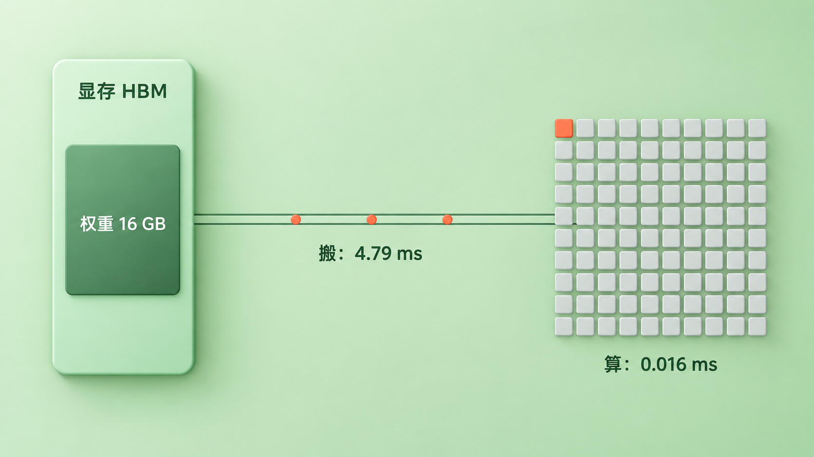
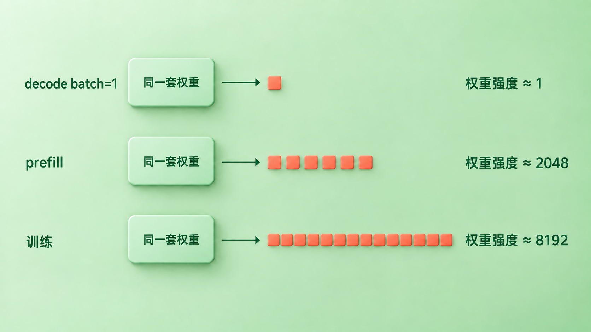
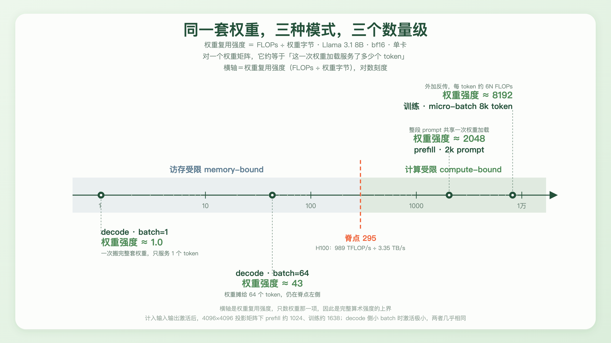
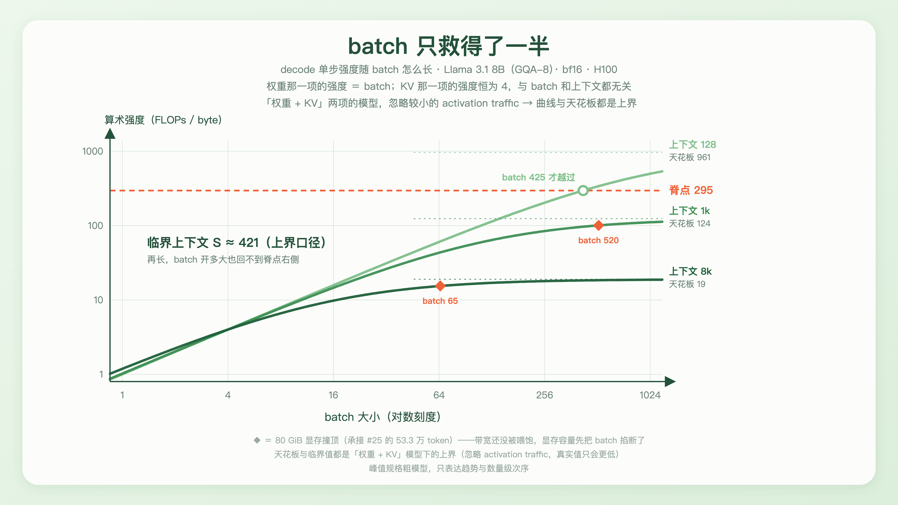
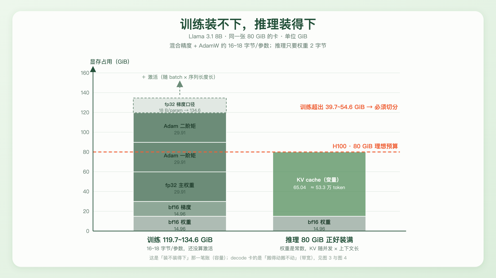

+++
title = "26 训练 vs 推理的成本结构：计算密集 vs 访存密集"
description = "同一套权重，训练时缺的是算力，decode 时缺的是带宽。"
date = 2026-09-20
tags = ["LLM", "推理", "训练", "Roofline", "算术强度", "显存带宽", "量化"]
categories = ["LLM"]
series = ["主线"]
showTableOfContents = true
+++



> 同一套权重，训练时缺的是算力，decode 时缺的是带宽。

读这篇前，建议了解：训练时整段并行（第 19 篇）、prefill 与 decode 两阶段（第 22 篇）、KV cache 的尺寸与显存账（第 25 篇）。

**本篇的口径**：模型一律取 Llama 3.1 8B、bf16 精度、单张 H100。所有数字都按厂商的峰值规格算，忽略 kernel 效率和缓存命中；文中给出的各种「强度」也一律不计 activation traffic，因此都是**上界**——第一节会把这件事说死。它们只用来表达数量级次序，不是实测值。

## 一台在等数据的机器

本地跑一个 8B 模型，让它写点东西。`nvidia-smi` 显示 GPU 利用率 99%，风扇转得很响，屏幕上一秒蹦三十来个 token。

看上去算力已经榨干了，那换张更强的卡应该就能快不少。从 A100 换到 H100，纸面上 bf16 稠密算力从 312 TFLOP/s 涨到 989 TFLOP/s——三倍出头。

生成速度不会跟着涨三倍。按下面要算的那本账，它大致只跟着另一个数字走：显存带宽从 2.04 TB/s 涨到 3.35 TB/s，一点六倍。

因为这台机器大部分时间不是在等着算，是在等着数据到位。

*图 1（示意图，格数非比例）：一步 decode 的两个理论下限——按带宽算要 4.79 ms，按算力算只要 0.016 ms。也就是说在带宽划定的这段时间里，这张卡的峰值算力足够做约 295 个这样的 token，而它只需要做 1 个*

上一篇结尾留了一句没兑现的话：KV cache 那 256 倍只能说成「理论 FLOPs 之比」，因为决定 decode 快慢的从来不只是算了多少次乘加。这一篇把两本账并排摊开——**算多少**，和**搬多少**。

这也是「Transformer 架构」这一章的最后一篇。从第 17 篇的最小骨架开始，我们把一个 block 拆成了归一化、attention、FFN、MoE、KV cache，又分别看了它在训练时怎么整段并行、在推理时怎么逐 token 串行。剩下的问题是：同一套权重、同样这些矩阵乘，为什么换个跑法，贵的地方就完全不一样了。

## 一、一次搬运，能干多少活

先把「贵」这件事拆成两个可以分别计量的量。

一个 kernel 跑起来要做两件事：从显存（HBM）把数据读进计算单元，然后算。这两件事的速度上限是两个独立的硬件指标——峰值算力（每秒多少次浮点运算）和峰值带宽（每秒能搬多少字节）。谁先到顶，谁就是瓶颈。

> 打个比方：GPU 像一个手速极快、但料场在两百米外的工人。他每分钟能拧两千颗螺丝，可每跑一趟料场只能扛回一箱零件。真正决定他一天干多少活的不是手速，而是**每扛一趟能拧多少颗**。

这个「每扛一趟能拧多少颗」在 roofline 模型里叫**算术强度**（arithmetic intensity），定义是：这个 kernel 的浮点运算次数，除以它从 HBM 搬运的**全部**字节数。注意是全部——权重、输入、输出、中间结果，一个都不能漏。

先看其中最大的一项。拿一个权重矩阵来算：设它是 \( n \times m \)，一次前向用它处理 B 个 token，每个数占 b 个字节：

$$
I_W = \frac{2nmB}{nm \cdot b} = \frac{2B}{b}
$$

**n 和 m 全约掉了。** 这个数只跟一件事有关：**这一次把权重搬进来，服务了多少个 token**。bf16 下 b = 2，于是它直接等于 B。下文管它叫**权重复用强度**——它不是完整的算术强度，是只数权重流量时的那一部分。

为什么要单独给它起个名字？因为它足够好用，但又不能当成严格值。把输入 \( X \)（\( B \times n \)）和输出 \( Y \)（\( B \times m \)）也各搬一次算进来：

$$
I = \frac{2nmB}{b\,(nm + Bn + Bm)} = \frac{I_W}{1 + B(n+m)/(nm)}
$$

分母多了一项，所以**权重复用强度是完整算术强度的上界**。差多少取决于 B 和矩阵形状。以 Llama 的 4096×4096 投影矩阵为例：B 很小时两者几乎相同；B = 2048 时完整强度约 1024，只有权重那个读数的一半；B = 8192 时约 1638；而 B 再怎么涨，它也会饱和在 \( nm/(n+m) = 2048 \)，不会无限上升。FFN 那几个矩阵更瘦长（4096×14336），饱和值更高，约 3186。

这条「上界」的性质会贯穿全篇，用法也很清楚：**小 batch 时两者几乎相同**——decode 一步只有 B 个 token 的中间张量，对着十几 GB 的权重可以忽略；**大 batch、大 prefill 和训练时它只是个上界**，真实强度更低，而且跟矩阵形状有关。后面凡是用到它的地方，都会说明一句。

现在给硬件也定一个数。峰值算力除以峰值带宽，得到的是这台机器「要多高的算术强度才配得上它的算力」，roofline 模型里管它叫**脊点**（ridge point）：

$$
I_{\text{ridge}} = \frac{989.4\ \text{TFLOP/s}}{3.35\ \text{TB/s}} \approx 295\ \text{FLOPs/byte}
$$

（H100 SXM 的 bf16 稠密算力。规格表上那个 1979 TFLOPS 带着 sparsity 的星号，是结构化稀疏才有的数字，不能拿来算这本账。）

强度低于脊点，算力再高也用不上，瓶颈在搬运，叫**访存受限**（memory-bound）；高于脊点，带宽够用了，瓶颈在算，叫**计算受限**（compute-bound）。这里要顺手说清一件事：计算受限说的是「谁给性能设了上限」，不是「算力已经跑满了」——一个计算受限的 kernel 照样可能因为 shape、occupancy、流水线气泡而离峰值很远。

把这两个数放一块，就得到一句可以落地的话：bf16 下，一次权重加载要服务几百个 token，这张卡的算力才有机会被用满。具体几百个，得用完整强度去解——同样那个 4096×4096 矩阵，答案是约 **345** 个 token，而不是脊点本身那个 295。

*图 2：三种模式下权重都是同一套、大小一样，区别只在右边——decode（batch=1）一次加载只服务 1 个 token，prefill 服务整段 prompt，训练服务整个 micro-batch*

**小结**：成本不是一个数，是两个——算多少 FLOPs，搬多少字节。它们的比值把所有 kernel 分成了两类，而这个比值的主项，只取决于一次搬运服务了多少 token。

## 二、三种模式，三个数量级

有了这把尺子，把同一套权重的三种跑法摆上去。

**decode（batch=1）。** 每一步只有一个新 token 流过全部 32 层。按第 22 篇用的 2N FLOPs/token 粗估，一步的算力是 \( 2 \times 8.03\text{B} \approx 16.06 \) GFLOP；而要搬的字节是整套 bf16 权重，\( 8.03\text{B} \times 2 = 16.06 \) GB。

两个数字一模一样。这不是巧合——2N 个 FLOPs 和 2N 个字节，本来就是同一个 N 乘以 2，这正是「强度等于 1」的字面意思。

按 H100 的峰值，这一步算的下限是 0.016 ms，搬的下限是 4.79 ms。**295 : 1**，正好是脊点那个数。

（口径沿用第 25 篇：2N FLOPs/token 是粗估，N 取总参数量 8.03B。严格只数矩阵乘的话，embedding 是查表不是稠密矩阵乘，扣掉之后 N 约 7.5B，两边的绝对值都会缩水一点，比值不变。）

**prefill。** prompt 已知，整段一次前向，P 个 token 共享同一次权重加载，于是权重复用强度约等于 P。2k 的 prompt 就是 2048，计入激活后约 1024——两个读数都稳稳在脊点右边，所以第 22 篇那句「prefill 是算力受限的大矩阵乘」成立。

但别把它推广到所有 prompt。按上面那个 4096×4096 矩阵，256 个 token 时完整强度只有 228，还在脊点左边；要到约 345 个 token 才越得过去。**prefill 究竟落在哪一侧，取决于一次前向累计了多少 token、矩阵是什么形状、kernel 怎么实现**——中长 prompt 或者一次攒够足够多 token 时，占主导的那些大 GEMM 通常进入计算受限区域，短 prefill 不一定。

**训练。** 一个 micro-batch 常常是几千到几万个 token 一起过。反向传播让每个 token 的算力从约 2N 涨到约 6N——前向一遍，反传要算两遍（一遍求输入的梯度，一遍求权重的梯度）。同时权重那一侧的流量也从一份变成约三份：前向读一次、反传读一次、再写一次梯度。分子分母一起涨，权重复用强度仍然和 micro-batch 的 token 数同一个量级，落在一千到一万之间；计入激活后会低一截，8k 的 micro-batch 约 1638。两个读数都远在脊点右边。

（AdamW 那一步的参数更新是另一回事：它是逐元素的，每读一个数只做几次运算，强度极低——但它每个优化步才跑一次，摊到整批 token 上占比很小。这也正是 fused optimizer 存在的理由。）

|  | 训练 | prefill | decode（batch=1） |
| --- | --- | --- | --- |
| 一次权重加载服务多少 token | 整个 micro-batch，几千～几万 | 整段 prompt，几百～几万 | 1 |
| 权重复用强度（bf16，上界） | 10³ ～ 10⁴ | ≈ P，2k prompt 时约 2048 | ≈ 1 |
| 计入激活后（4096×4096 矩阵） | 8k micro-batch 约 1638 | 2k prompt 约 1024 | ≈ 1，激活极小、几乎不变 |
| 相对脊点 295 | 远在右侧 | 右侧（短 prefill 未必） | 左侧，差约 300 倍 |
| 谁给性能设上限 | 计算吞吐 | 计算吞吐 | 显存带宽 |
| 显存里最大的一块 | 优化器状态 + 激活 | 权重 + 激活 | 权重 + KV cache |

*图 3：同一套 Llama 3.1 8B 权重，三种跑法的权重复用强度跨了将近四个数量级。脊点 295 把这把尺子切成两半，decode 在左边，prefill 和训练在右边（脚注里同时给出计入激活后的读数）*

**小结**：「算力不够」和「带宽不够」是两种完全不同的缺。同一套权重、同样这些矩阵乘，跑在三种模式下，缺的东西不一样——这就是这一章标题里「训练视角 vs 推理视角」最后落下来的那个差别。

## 三、为什么 batch 只救得了一半

看到「强度 ≈ B」这条结论，第一反应大概是：那把 batch 开到 300 以上不就行了？

方向是对的，但只对了一半。因为 decode 每一步要搬的字节不止权重一项。

decode 的 HBM 流量主要是权重和 KV cache 两项。下面暂时把较小的 activation traffic 放在一边——所以算出来的仍然是一个上界，真实值只会更低。这一点在后面求天花板时还要再拿出来说一次。

**权重是共享的。** 一个 batch 里有多少个请求，它们走的都是同一套权重，读一遍就够。batch 开到 B，分子涨 B 倍，分母不变——这一项的强度就是 B，batch 确实救得了。

**KV cache 是私有的。** 对于一般不共享 prefix 的独立请求，每个请求有自己的历史，谁也借不了谁的。batch 开到 B，要读的 KV 也跟着涨 B 倍。分子分母一起涨，比值纹丝不动。

这一项的强度是多少，可以直接算出来。第 t 步单个序列的 attention 要做 \( QK^\top \) 和 \( AV \) 两个矩阵乘，合计 \( 4 H_q d_h S \) 次乘加；要读的是这条序列的全部 K 和 V，合计 \( 4 H_{kv} d_h S \) 个字节（K、V 各一份，每个数 2 字节）。相除：

$$
I_{\text{KV}} = \frac{4 H_q d_h S}{4 H_{kv} d_h S} = \frac{H_q}{H_{kv}} = G
$$

\( S \) 和 \( d_h \) 全部约掉了。**GQA 的分组数，就是 attention 这一段的算术强度**——与 batch 无关，与上下文长度也无关。MHA 每个 query 头配一个自己的 KV 头，G = 1；Llama 3.1 8B 是 GQA-8，32 个 query 头共享 8 组 KV，G = 4；MQA 全部共享一组，G = 32。

对着脊点 295 看这三个数：**1、4、32**。哪一个都不够。

这给第 21 篇补上了另一半。那一篇讲 MQA/GQA 时，理由是省显存——KV cache 小了，能开更大的 batch、更长的上下文。但 Shazeer 2019 提出 MQA 时给的理由并不是显存装不下，而是增量解码时反复加载 K/V 的**带宽**开销。分组数不只是个压缩比，它同时就是那一段 kernel 的算术强度。

把两项合起来，一步 decode 的强度是：

$$
I(B) = \frac{(2N + 4LdS)\,B}{2N + B \cdot S \cdot c}
$$

\( c \) 是每个 token 的 KV 字节数（Llama 3.1 8B 的 GQA-8 下是 128 KiB，第 21 篇推过）。B 很小的时候分母被 2N 主导，强度约等于 B，加 batch 立竿见影；B 越大，分母里 KV 那一项越占主导，最后收敛到一个天花板 \( (2N + 4LdS)/(S \cdot c) \)。

代进去算：1k 上下文的天花板是 **124**，8k 上下文只有 **19**。都在脊点 295 以下。

这里要把前面放一边的那句话捡回来。上面这个天花板是**上界**，不是真值——原因恰好出在「B 很大」这个极限上：权重那一项被摊没了，可每个 active sequence 每一步还有自己的 hidden state、Q/K/V、FFN 中间量、norm 这些流量，它们和 KV 一样随 B 线性增长，**摊不掉，也就不会从天花板里消失**。把这部分记作每序列每步 \( a \) 个字节，完整一点的写法是 \( I(B) \approx (2N + 4LdS)B / (2N + B S c + B a) \)，于是真实天花板是 \( (2N + 4LdS)/(S c + a) \)，比上面那个数更低。\( a \) 有多大强烈依赖 kernel 融合得怎么样，本篇不去建模它。

不过这个方向对结论是有利的：1k 和 8k 的上界本来就低于脊点，真值只会更低。所以那句话可以放心说——**batch 开到无穷大，这两档上下文的 decode 也回不到计算受限那一侧。**

令上界等于脊点，能解出一个临界上下文：在这个简化模型下 **S ≈ 421**。短于它，batch 加够了还能翻过脊点（128 的上下文要 batch 425）；长于它，怎么攒都没用。这两个数同样是上界口径，真实的临界点比 421 更短。

*图 4：三档上下文下 decode 单步强度随 batch 的变化，按「权重 + KV」两项算，所以曲线与天花板都是上界。1k 和 8k 的天花板（124 和 19）都低于脊点 295；只有 128 这种极短的上下文能在 batch 425 时翻过去。橙色菱形是 80 GiB 显存装不下更多请求的位置——8k 上下文在 batch 65 就撞顶了，那时强度才 15*

还有一层更难受的。第 25 篇算过，一张 80 GiB 的卡扣掉权重，KV cache 最多放约 53.3 万个 token。8k 上下文下，这意味着理论上只装得下 batch 65——而在 batch 65 那个位置，强度才 15。（这还是只算权重加 KV 的容量上界，真实 serving 还要给运行时激活、CUDA workspace、分页元数据留地方，能开的更少。）

> 带宽想要大 batch，显存容量却只给得起小 batch。decode 就卡在这两件事中间。

**小结**：权重那笔账靠攒 batch 就能摊平，KV 那笔账摊不动。想改善它，只能去动 attention 的结构本身（MQA/GQA/MLA）或者降低缓存精度——这正是第 87 篇要展开的方向。

## 四、训练缺的是另一样东西

前三节都在算带宽。轮到训练，账要换一本。

训练里占主导的那些大 GEMM，强度在一千到一万这个量级，稳稳落在计算受限那一侧——给性能设上限的是计算吞吐，不是带宽。但它撞的墙在别处：**显存装不下**。

这里得先把两件容易混的事分开：**计算受限说的是「跑起来之后谁限制速度」，显存容量说的是「能不能装得下」。** 它们不是同一个维度，所以「训练是计算受限的」和「训练被显存卡住」并不矛盾——前者讲速度，后者讲门槛。（顺带提醒：计算受限也不等于算力已经跑满，这和后面那条「GPU 利用率 99% 不等于算力用满」是同一个逻辑。）

推理这一侧不需要梯度，也不需要优化器状态，常驻的主要是权重和 KV cache。KV 那笔账第 25 篇算过了，先看权重：8.03B 参数、bf16，\( 8.03 \times 10^9 \times 2 = 16.06 \) GB，也就是 14.96 GiB。

训练不一样，同一个参数要同时挂着好几份东西。按一种常见的简化口径（ZeRO 论文里那套）：

- **bf16 权重**，2 字节——前向反传用的就是它
- **bf16 梯度**，2 字节——反传算出来的
- **fp32 主权重**，4 字节——bf16 的精度不够承受一次次微小的累加，所以真正被更新的是一份 fp32 副本
- **一阶矩、二阶矩**，各 4 字节——AdamW 要为每个参数记住梯度的滑动平均和平方的滑动平均

加起来每个参数 **16 字节**，8.03B 就是 128.5 GB，折合 119.7 GiB。

但 16 这个数不是通用值，各家训练栈的选择不一样。比如 Megatron Core 常见的 BF16 配置就不省梯度那一份，直接存 fp32 梯度，于是变成 2 + 4 + 4 + 4 + 4 = **18 字节**，8.03B 是 144.5 GB、134.6 GiB。所以实际区间是 **16~18 字节/参数**，对应推理那 16.06 GB 的 **8 到 9 倍**。

而这还没算激活。反向传播要用到前向的中间结果，所以每一层的输出都得先留着。这部分随 batch 大小和序列长度线性增长——**前提是用了 FlashAttention 这类不把完整** \( S \times S \) **注意力矩阵物化到 HBM 的实现**；朴素 attention 如果把那张分数表存下来，还会多出一块随序列长度平方增长的中间量。怎么用重算把激活换掉，是第 44 篇的事。

*图 5：Llama 3.1 8B 在一张 80 GiB 卡上的两本显存账。训练那根柱子 119.7 GiB（16 字节口径），换成 fp32 梯度是 134.6 GiB，两种口径都捅穿了 80 GiB——而且都还没算激活；推理那根 14.96 GiB 权重加 65.04 GiB 的 KV cache，正好装满。两根柱子最下面那一段是同一份 bf16 权重*

于是同一张 H100：拿来做推理绰绰有余，权重占掉 14.96 GiB，剩下的六十多 GiB 全归 KV cache；拿来训练，连权重加优化器状态都放不进去，必须把模型或者优化器状态切到多张卡上——怎么切是第 44 篇和第 44.5 篇的事。

这里还要把一个中文里极容易混的东西说清楚。

**训练撞的是显存容量，decode 撞的是显存带宽。** 一个是「装不下」，一个是「搬不动」。两件事都会被说成「显存不够」，但它们是两个独立的硬件指标，优化手段也完全不同：容量不够就切分、换出、压缩；带宽不够就得减少搬运的字节数，或者让同一次搬运服务更多 token。

第 25 篇算的是容量那一本——一张卡能装下多少 token 的缓存。这一篇前三节算的是带宽那一本——一步要搬多少字节。而在 decode 里，它们恰好互相掣肘：容量逼着你用小 batch，带宽求着你用大 batch。

**小结**：训练是「算得动但装不下」，decode 是「装得下但搬不动」。同一套权重，两种跑法，撞的是两堵不同的墙。

## 五、这套框架能解释什么

有了强度这把尺子，推理工程里那几件最常见的事就各自归位了。

**推理侧的权重量化。** decode 一步的时间下限约等于「权重字节数 ÷ 带宽」。把 bf16 换成 int4，权重字节掉到四分之一，这个下限也就跟着掉到大约四分之一。注意收益是从哪来的——**不是算得快了**（算力本来就有大把富余），**是搬得少了**；顺带地，权重那一项的强度从 B 变成 4B，离脊点近了四倍。但这是理想模型的上限，真实加速通常拿不到完整的四倍：KV cache 和激活的流量没跟着变小，反量化本身要花时间，kernel 也有自己的开销。至于该先压哪儿——第 23 篇算过，SwiGLU 加 GQA 之后约八成参数坐在 FFN 里，那也就是八成的搬运量。具体算法留给第 90、91 篇。

**训练侧的低精度走的是另一条路。** 训练在计算受限那一侧，省字节确实救不了它——但低精度还有一条完全不同的收益路径：**它直接抬高峰值算力**。H100 的 FP8 稠密峰值是 bf16 的两倍，NVIDIA 自家 Transformer Engine 的示例里，切到 FP8 之后单层能拿到接近两倍的加速。

这一段要小心别把 roofline 只算一半。换成 FP8 之后，**脊点和 kernel 自己的强度是一起动的**：算力翻倍把脊点从 295 推到约 590，而参与计算的 operand 从 2 字节变成 1 字节，又把强度里那个 \( 2B/b \) 翻了一倍。两个数同方向同倍数移动，相对位置甚至可能几乎不变。最终落在哪一侧，取决于实际有多少张量真的用了低精度、以及 kernel 怎么实现——真实的 Transformer Engine 还涉及 FP8 的缩放因子、部分保持高精度的张量、输出 dtype 等等，NVIDIA 的文档也强调 FP8 的加速强烈依赖 GEMM 形状和量化开销。

要记住的结论只有一条：**低精度在训练和推理两侧都可能带来收益，但机制不同**——推理侧压的是分母（搬的字节），训练侧抬的是分子那一头的上限（算力峰值）。也正因为机制不同，weight-only INT4 推理量化和 FP8 混合精度训练最好别统称成「量化」。

**批处理与连续批处理。** 把多个请求同一步的那一行 query 叠成矩阵，分母（权重字节）不变，分子涨 B 倍。这是整个推理系统里最便宜的一笔收益——直到撞上 KV cache 的显存墙，或者撞上上一节那条 KV 强度天花板。留给第 88 篇。

**算子融合。** RMSNorm、SwiGLU 里的逐元素相乘、RoPE 的旋转——这些层每读一个数只做几次运算，强度天生就是个位数，纯粹是搬运。把它们融进相邻的 kernel，中间结果不再往 HBM 里写一趟再读回来，省下的全是纯搬运时间。留给第 89 篇。

**FlashAttention 是同一个目标、不同的机制，而且不要把它的收益说过头。** 它不再把那张 \( S \times S \) 的注意力分数表写进 HBM，而是按块（tile）计算、在片上累加，于是**显存占用**从随序列长度平方增长降回线性，HBM 读写量也大幅减少——减少的幅度与片上 SRAM 有多大成比例。但**它并没有把 attention 的 I/O 复杂度变成线性**：严格的分析给出的是 \( \Theta(S^2 d^2 / M) \)（\( M \) 是可用的片上 SRAM），固定硬件下仍然带着 \( S^2 \) 那一项，计算量也一点没少。所以它和普通的算子融合放在一起讲会串味：一个省的是「小张量反复往返」，一个省的是「大中间矩阵根本不该落地」。

**KV cache 的设计。** MQA/GQA 减少 KV 头数、MLA 换一种缓存表示、KV 量化降低每个数的字节数——这三条同时买到两样东西：显存容量（能开更大 batch）和显存带宽（每步少读一些）。这是为什么第 21 篇和第 87 篇看起来在讲同一件事，其实各占一本账。

最后还有一条反向的认知，值得单独说。

**「GPU 利用率 99%」不等于算力被用满了。** `nvidia-smi` 里那个 utilization，官方定义是「采样窗口内至少有一个 kernel 在 GPU 上执行的时间占比」。它只说明 kernel 几乎一直在跑，既不说明算力接近满载，也不说明显存总线在忙——显存那边是另一个独立指标。对访存受限的 decode 来说，kernel 可以持续运行，同时大部分周期都受数据供给限制。

顺着这一点，前面那个 295 也得读准：4.79 ms 和 0.016 ms 是两个**理论下限**的比值，说的是「带宽划出的这段时间里，峰值算力足够做 295 个这样的 token」，不是「Tensor Core 有 99.7% 的墙钟时间完全空着」——计算和访存是重叠进行的。

真正该看的是另外两个指标：**MFU**（Model FLOPs Utilization），实际有效算力占峰值算力的比例；**MBU**（Model Bandwidth Utilization），实际带宽占峰值带宽的比例。decode 时常见的情形是 MFU 只有百分之几、MBU 却有七八成——这不是没调优，恰恰说明这张卡在它该到顶的那个维度上已经到顶了。这时候再去优化算力，一点用都没有。这两个指标怎么测、roofline 怎么完整地画出来，是第 83 篇的事。

**小结**：量化、批处理、算子融合、KV 设计——这几件事看上去在改不同的东西，其实都在动同一个比值：让一次搬运服务更多的 token、让同样的活少搬一点字节，或者换一种精度、把脊点和强度一起挪动。

## 结尾：从一个坐标变成两个

读这一章之前，衡量一个模型贵不贵，大概只有一个坐标：它有多少参数。参数多，就慢，就贵。

现在应该是两个了。一个是**算多少**——多少次浮点乘加；一个是**搬多少**——多少字节要从显存过一遍。参数量只同时影响了这两个数的大小，却决定不了哪一个先到顶。真正决定这件事的，是它们的比值，而这个比值的主项，只取决于一次搬运服务了多少个 token。

同一个 Transformer block，训练时一次流过几千个 token，落在计算受限一侧；prefill 一次流过整段 prompt，通常也落在那一侧；decode 一次只流过一个，强度掉到 1，于是同样一块卡、同样一套权重，算力大把富余却派不上用场。这不是实现没写好，是自回归这件事本身的形状——第 22 篇说的「串行的根源在自回归，不是 Transformer 的锅」，到这里落到了硬件上。

这一章从「一个 block 长什么样」开始，到「同一个 block 在两种模式下贵在哪里」结束。后面第九章那一整章的推理系统工程——PagedAttention、MLA、连续批处理、PD 分离、量化、投机解码——几乎全部长在这条缝上：要么让一次搬运服务更多 token，要么让同样的活少搬一些字节。

还要补一句边界：本篇全程限定在**单张卡**上，数的是算力与 HBM 这两本账。一旦进入多卡训练，还有第三本——卡间通信。all-reduce、reduce-scatter、all-gather 走的是 NVLink 或者网络，它有自己的一条屋顶线，而且常常是大规模训练真正的限制项。那属于第 44.5 篇的地盘。

不过算力和带宽摆平了，也只是让这台机器跑得动。它究竟学成什么样，取决于当初喂进去的是什么。下一章我们换一个完全不同的视角，从数据这一侧重新看这件事：一堆爬下来的网页，是怎么变成能用来训练的语料的。

## 参考资料

- Williams, Waterman & Patterson, *Roofline: An Insightful Visual Performance Model for Multicore Architectures*, CACM 2009 — [DOI:10.1145/1498765.1498785](https://doi.org/10.1145/1498765.1498785)
- Shazeer, *Fast Transformer Decoding: One Write-Head is All You Need*, 2019 — [arXiv:1911.02150](https://arxiv.org/abs/1911.02150)
- Rajbhandari et al., *ZeRO: Memory Optimizations Toward Training Trillion Parameter Models*, 2019 — [arXiv:1910.02054](https://arxiv.org/abs/1910.02054)
- Kaplan et al., *Scaling Laws for Neural Language Models*, 2020 — [arXiv:2001.08361](https://arxiv.org/abs/2001.08361)
- Chowdhery et al., *PaLM: Scaling Language Modeling with Pathways*, 2022 — [arXiv:2204.02311](https://arxiv.org/abs/2204.02311)（MFU 的定义出处）
- Dao et al., *FlashAttention: Fast and Memory-Efficient Exact Attention with IO-Awareness*, 2022 — [arXiv:2205.14135](https://arxiv.org/abs/2205.14135)
- Pope et al., *Efficiently Scaling Transformer Inference*, 2022 — [arXiv:2211.05102](https://arxiv.org/abs/2211.05102)
- Micikevicius et al., *FP8 Formats for Deep Learning*, 2022 — [arXiv:2209.05433](https://arxiv.org/abs/2209.05433)
- Ainslie et al., *GQA: Training Generalized Multi-Query Transformer Models from Multi-Head Checkpoints*, 2023 — [arXiv:2305.13245](https://arxiv.org/abs/2305.13245)
- Grattafiori et al., *The Llama 3 Herd of Models*, 2024 — [arXiv:2407.21783](https://arxiv.org/abs/2407.21783)
- NVIDIA, *H100 Tensor Core GPU Datasheet* — [nvidia.com](https://resources.nvidia.com/en-us-hopper-architecture/nvidia-h100-datasheet)
- NVIDIA, *Megatron Core 分布式优化器文档*（BF16 训练各档显存口径）— [docs.nvidia.com](https://docs.nvidia.com/megatron-core/developer-guide/latest/user-guide/features/dist_optimizer.html)
- NVIDIA, *Transformer Engine 低精度训练加速文档*（FP8 加速与 GEMM 形状的依赖）— [docs.nvidia.com](https://docs.nvidia.com/deeplearning/transformer-engine/user-guide/features/low_precision_training/speedups.html)
