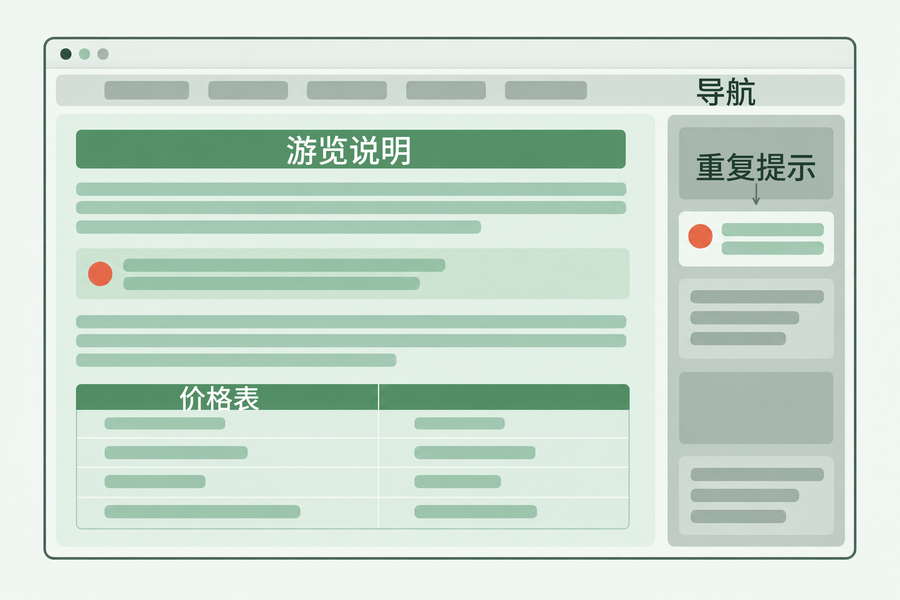
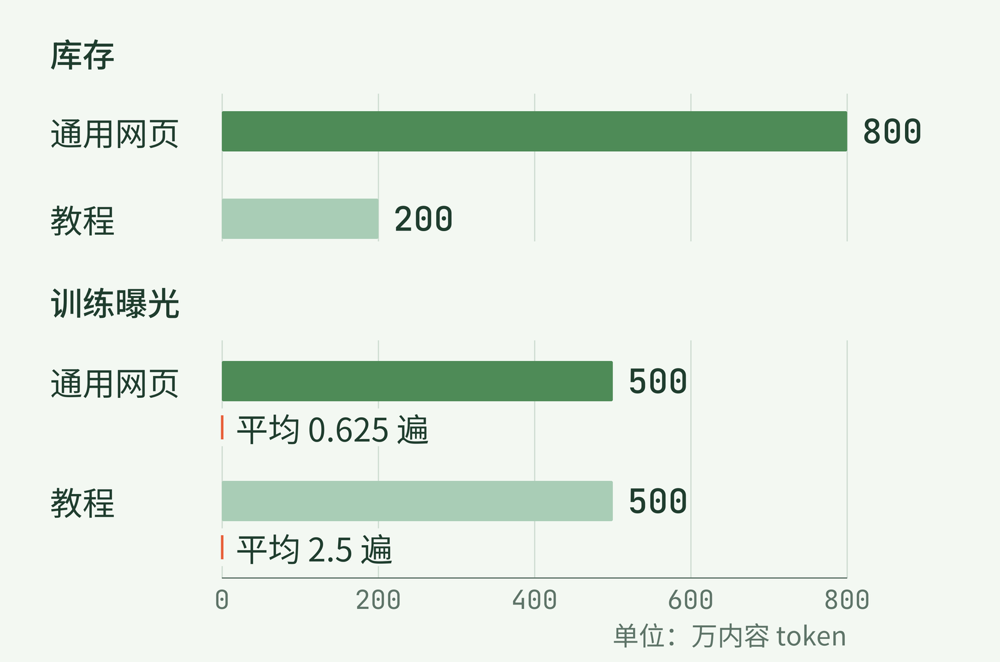
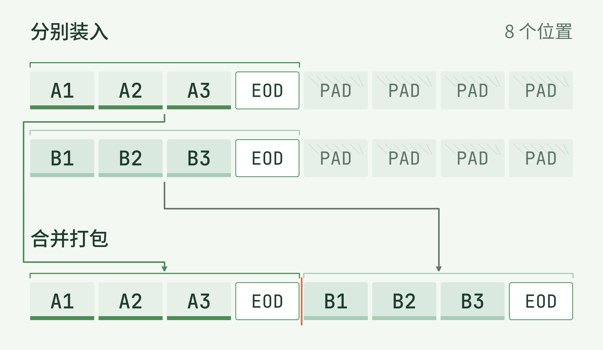
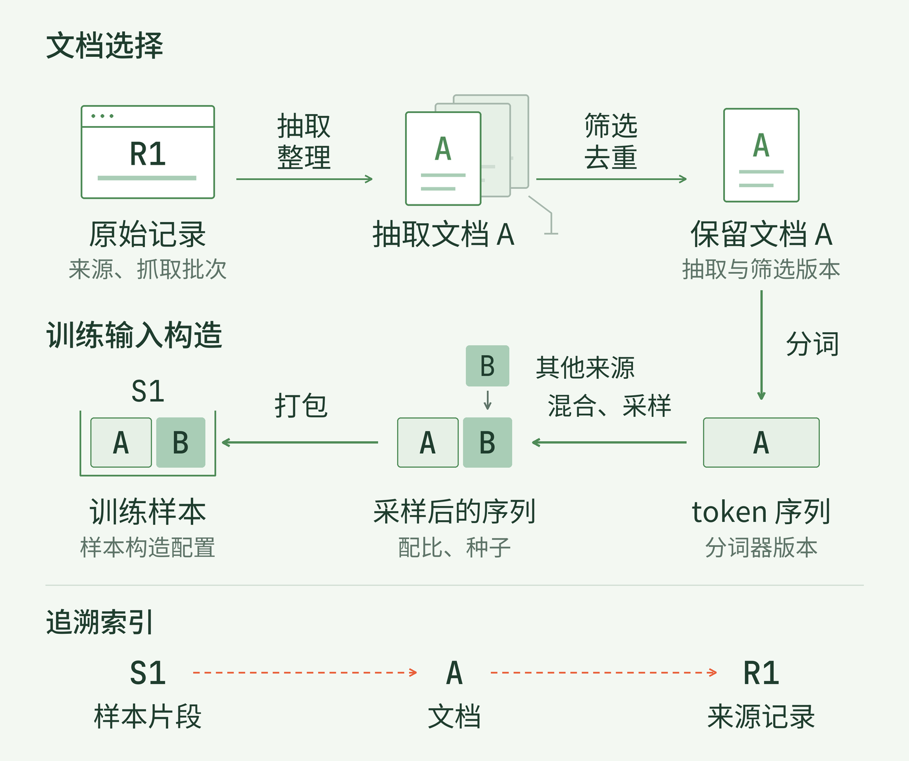

+++
title = "27 数据工程全景：原始资料怎样成为训练样本"
description = "一份网页要经过内容选择与输入构造，才成为模型读到的样本；语料留存量与训练曝光是两笔账。"
date = 2026-10-19
draft = false
tags = ["LLM", "训练数据", "数据工程", "语料策展", "采样", "Packing", "数据血缘"]
categories = ["LLM"]
series = ["主线"]
showTableOfContents = true
+++



一份网页要经过内容选择与输入构造，才成为模型读到的样本；语料留存量与训练曝光是两笔账。

看到模型训练了“几万亿个 token”，我们很容易把它想成读过一座巨大的图书馆。可如果其中一份材料来自网页，模型究竟读到了什么？是浏览器里那篇文章，还是连导航菜单、购票按钮和反复出现的提示一起读了进去？

设想一张“山间植物园游览说明”网页。中间写着开放时间，下面有成人票和学生票的价格表；上方是网站导航，侧栏又转载了一遍“雨天部分步道关闭”的提示。这里的植物园、文字和价格都是教学设定。我们就跟着这张网页走一趟，看看它怎样成为训练输入。

上一篇讨论了训练和推理的资源开销。这一章把目光转向那些计算处理的材料：它们从哪里来，怎样被选择，又以什么样子进入模型。本篇先把过程走通，后面再逐项研究怎样做好其中的选择。

## 一、先把网页变成一份值得保留的文档

我们阅读网页时，通常不会把“首页、游览指南、联系我们”与开放时间混为一谈。版式帮我们做了判断：哪一块是导航，哪一块是文章，票种与价格又怎样对应。

抓取程序收到的却是服务器返回的内容及相关记录。以 Common Crawl 为例，WARC 文件保存抓取记录，其中的网页响应可以包含 HTTP 头和 HTML；WET 文件则提供已经抽出的纯文本。它们处在处理过程的不同位置，拿到 WET 就已经继承了一次抽取结果。[Common Crawl 格式说明](https://commoncrawl.org/get-started)

本文把抓取到的这一份材料称为**原始记录**（raw record）。先记住它来自哪个地址、何时抓取、属于哪批数据，再来处理正文。地址相同也未必是同一份内容：植物园下个月可能改价，只留网址就无法确定当时读到哪张价格表。

现在看这张网页。需要留下的是游览说明及其内部关系，导航和文章不能受到同样的待遇。

*图 1：正文和价格表属于同一份游览说明，导航与侧栏提示需要另作判断。网页为情境示意，区域面积不代表真实网页的内容比例。*

**正文抽取**（text extraction）就在做这件事：从页面中找出要使用的内容，并把它转成后续能够处理的表达。对这份材料，我们希望得到的文档大致是：

> 山间植物园游览说明 开放时间：9:00—17:00。 票种｜价格 成人票｜40 元 学生票｜20 元 雨天部分步道关闭。

这段文字已经与原始 HTML 不同了。导航消失，票种仍和价格排在同一行，正文里的雨天提示保留一次。如果只抽出“成人票 学生票 40 20”，字还在，哪种票对应哪个价格却要靠猜。抽取需要选择内容，也需要保住理解内容的线索。

经过抽取和必要的格式整理，我们得到一份**文档**（document）：一条有正文、文档 ID 和来源信息的数据记录。价格表可以写成上面这样的逐行文本，也可以保留为 Markdown 表格；关键是后续读到的文本仍能表达对应关系。具体格式怎样选择，后面的抽取专题会展开。

文档可读，还不等于它应该进入训练。假设我们正在准备中文通用文本语料，接下来就要检查语言是否符合目标、抽取是否只剩乱码或按钮文字、是否混入大量模板内容。这是**质量过滤**（quality filtering）要处理的判断。过滤规则会改变留下哪些文本，因此“格式整齐”只能提供一种线索，无法单独证明内容有用。

重复又是另一件事。刚才的侧栏提示是同一页内部的重复；如果另一个网站把整篇游览说明原样转载，两个文档即使都通顺，也可能给同一段内容增加训练机会。**去重**（deduplication）会在选定范围内查找重复或近似内容，再决定保留哪些。只处理整篇重复，未必能清掉段落重复；只比较这一批网页，也看不到上一批里的副本。这里先记住它改变了什么，算法和保留策略留给去重专题。

用于最终评测的题目及答案还需要另行隔离，来源和允许用途也要有记录。这些检查各有目的，不能由“质量合格”一项代替。对于我们的游览说明，假定这些检查均已通过，它才进入本次训练可选的文档池。

把这几步合起来，就是**语料策展**（data curation）：围绕训练目标组织、处理并选择材料。真实流水线可以在不同位置安排过滤，并不需要把每种操作只做一遍。FineWeb 的 2024 年首版配方就从 WARC 抽取文本，经过基础过滤、每个抓取快照内的去重，再应用选定的 C4 规则与自定义过滤。它最终报告约 15 万亿 token 的英文网页语料。这个数字是特定版本的语料规模；我们的中文例子只是说明处理角色，不照搬它的筛选阈值。[FineWeb v1，§3.2–3.7](https://arxiv.org/html/2406.17557v1)

到这里，我们知道哪些文档可以用。可“放进可用语料库”和“已经被模型读过”，中间还隔着一段路。

## 二、库里有多少，与训练读多少

模型不能直接拿中文段落做矩阵运算。选好的文本需要经过**分词器**（tokenizer），变成 token ID 序列。token 是分词器使用的文本单位，可能对应一个字、一个词的一部分或其他片段；它与字符数、网页数都不是固定换算关系。换一个分词器，同一份游览说明可能得到不同的序列长度。

于是，眼前多了第三种对象：**token 序列**。它仍对应那份文档，但内容已经变成模型词表里的编号。文档 ID 与所用分词器版本需要一起留下，后面才知道这些编号表示什么、来自哪里。

有了序列，训练程序仍要决定先读谁、读多少。语料来自多个来源时，这一步通常涉及**数据混合**（data mixing）与**采样**（sampling）：为不同来源安排份额，再按相应规则取出材料。分词和采样可以在不同系统里以不同顺序实现；这里先用统一的 token 口径，看看份额怎样改变实际输入。

假设清理完成后有两类语料。包含植物园页面的通用网页共 800 万 token，另一类教程共 200 万 token，均按同一个分词器统计。我们准备训练 1,000 万个内容 token，暂不把分隔符和补位计入这笔账。这些都是教学数字。

如果按库存比例安排，网页得到 800 万的训练份额，教程得到 200 万。两边平均都相当于读一遍。现在把份额改成各一半：训练需要从网页里读 500 万，从教程里也读 500 万。库存没有变，教程的训练机会却增加了。

*图 2：库存仍是网页 800 万、教程 200 万 token；训练各取 500 万时，两类内容的平均曝光分别为 0.625 遍和 2.5 遍。教学设定，仅统计内容 token。*

教程库只有 200 万个内容 token，想贡献 500 万次 token 输入，就需要重复使用其中的材料。在这笔账里，它平均贡献 2.5 遍；网页库贡献的量则只有库存的 0.625 倍。这里的“遍”是整体平均，具体哪一篇被读到几次，还取决于抽样、遍历和打乱规则。

这一点可以写成一个很短的关系。用 D 表示某类语料的库存 token 数，T 表示训练实际从这一类读入的 token 总数，二者采用相同计数口径，D 大于零，则平均曝光次数 E 为：

$$
E=\frac{T}{D}
$$

把教程的数字代进去，就是 500 万除以 200 万，得到 2.5。这个比值帮助我们描述训练经历，不能独自判断训练效果。反复读一份教程可能让其中的表达获得更多学习机会，也会占去阅读其他材料的预算。

真实配方也会分开报告这些信息。LLaMA 第一代论文的 Table 1 中，Wikipedia 与 GitHub 的采样占比同为 4.5%，但在其 1.4 万亿训练 token 设置下，两者报告的遍历次数分别是 2.45 和 0.64。相同的训练份额，落到不同大小的来源上，会形成不同的重复程度。[LLaMA v1，Table 1](https://arxiv.org/html/2302.13971v1)

现在再看植物园那份文档：它通过筛选，说明它取得了进入训练的资格；究竟有没有被选到、选了几次，要看训练这一轮的采样记录。只给一份语料库的大小，还不能还原模型的阅读经历。

## 三、选中的文档还要装成训练样本

即使已经选好这次读哪些内容，文档也不会自然地长成模型需要的长度。有些游览说明很短，有些教程很长；训练程序需要把它们组织成能够送进模型的序列。

先用一个缩小的例子看清这个动作。把植物园文档记为 A，另一份文档记为 B。为了画得下，假定它们各只有三个内容 token，分别用 A1、A2、A3 和 B1、B2、B3 代表。这些只是位置代号，并非前面中文的实际分词结果。再给每份文档末尾加一个结束标记 EOD（end of document），每份就占四个位置。

如果一个输入序列有八个位置，让 A、B 各占一条，剩下的位置便需要**补位**（padding）。在这个固定长度的教学安排里，两条序列总共十六个位置，只有八个位置装了文档内容和结束标记。

也可以把两份短文档装进同一个序列。这叫**打包**（packing）。先看空位是怎样被填上的：

*图 3：两份各占四个位置的文档，可以从两条带补位的序列装入同一条八位置序列。每份文档含三个内容 token 和一个 EOD，PAD 表示补位；这里只展示输入布局。*

打包后的序列里，A 和 B 都还在，但“一条输入就是一篇文章”的对应关系已经变了。更长的文档也可能被切成几个片段，进入不同序列。怎样切，会影响一次输入中能够保留多少上下文。

还要留意图中那条文档边界。EOD 是告诉模型“文档在这里结束”的一个标记，它本身不会替程序设置注意力规则。B 中各输入位置能否读取前面的 A，需要由**注意力掩码**（attention mask）等机制决定：允许读取，A 就在这些位置的可见上下文中；隔离开，B 中各输入位置计算表示时，就不再读取 A 的内容。

训练还要另行确定每个输入位置要预测什么、哪些位置的预测参与计分。对常见的自回归语言建模，目标来自后续 token；补位等位置是否计入损失，则由相应规则决定。因此，一份完整的**训练样本**（training sample）不仅是 token 排成一行，还包括任务所需的预测目标、可见范围及计分信息。框架可以提前存好这些信息，也可以在读取数据时构造。

这些并非只存在于示意图中的选择。Megatron Core 的 GPT 数据集配置就把文档结束处的注意力重置、位置编号重置和损失处理列成独立选项。它们需要分别设定，不能由“已经 packing”一句话代替。[Megatron Core 0.19.0：GPTDatasetConfig](https://docs.nvidia.com/megatron-core/developer-guide/0.19.0/apidocs/core/core.datasets.gpt_dataset.html)

本篇先走到能够认出这些选择的位置。具体的切片方式、掩码和位置编号怎样配合，留给 #34 长度与 Packing。眼下已经能看清：文档决定我们拥有哪份内容，样本决定这次训练怎样呈现它。

## 四、把来源与版本接回整张地图

走到训练样本，再回头找最初的网页，事情就具体多了。样本里某一段来自文档 A，A 来自植物园页面的某次抓取；它通过哪些筛选、用了哪个分词器，又因为怎样的采样安排进入这次训练，都应该有对应记录。

把过程分成两层，便容易认路。第一层是**文档选择**：从原始记录中抽取、整理和筛选可用材料。第二层是**训练输入构造**：把选定材料编码、安排曝光，再组织成训练样本。前一层回答“哪些内容可以用”，后一层继续回答“模型这次读哪些、怎样读”。

*图 4：原始记录、文档、token 序列和训练样本是四种对象。两层处理改变内容及其呈现方式，来源标识与处理版本把它们连接起来。*

这张地图还有一条不进入模型文本的线：**数据血缘**（data lineage），也就是一份派生数据来自哪些输入、经过哪些处理的关系。来源地址和抓取批次说明材料从哪里来；抽取、筛选、分词与样本构造的版本，说明这一版输入怎样形成。

回到价格表。假如后来发现成人票的“40 元”在抽取时丢了，只有最终 token 文件，定位问题会很吃力。若能从样本片段找到文档 A，再找到原始记录 R1，就可以对照原表与抽取结果，判断错误发生在哪一步。原始材料仍可访问、处理配置也保存完整时，才有条件重新生成受影响的结果。

实际记录不一定为每个 token 复制一遍网址。可以给文档分配稳定 ID，用清单记录来源与处理版本，再为样本保存文档 ID 和片段位置。Megatron Core 的实现便分别维护文档索引、样本起点的文档索引与偏移，以及打乱索引。这提供了一种从样本位置找回文档的方式；原始网址等来源信息还需要数据准备环节继续连接。[Megatron Core 0.19.0：数据集索引说明](https://docs.nvidia.com/megatron-core/developer-guide/0.19.0/apidocs/core/core.datasets.gpt_dataset.html)

记录这些关系需要存储和维护成本；原始材料是否保留、保留多久，也应按来源与用途安排。这里先把“能追到哪一步”纳入流程设计，具体的访问、保留和删除处理由本章最后的数据生命周期专题展开。

现在再看到“训练了多少 token”，我们就能把最初那个模糊的问题拆开了。植物园网页有没有进入可用语料，要看抽取和筛选；它在训练中出现多少，要看采样曝光；价格表与上下文以什么形状被模型读到，还要看分词和样本构造。沿着这条路径，那个总量数字才逐渐有了内容。

还有一件事，光靠流程完整并不能回答：如果我们改了一条过滤规则，留下的材料就更适合训练了吗？下一篇 #28《怎样判断数据更好：版本、预算与对照实验》，就从一次具体改动出发，看看怎样比较，才知道收益来自哪里。

## 参考资料

- [Common Crawl：Get Started](https://commoncrawl.org/get-started)，WARC、WAT、WET 格式说明；用于区分原始抓取记录与已抽取文本。
- [Penedo 等：The FineWeb Datasets，arXiv v1（2024）](https://arxiv.org/html/2406.17557v1)，§3.2–3.7；本文仅引用首版的处理路径与语料规模，不以当前仓库规模替换历史数字。
- [Touvron 等：LLaMA，arXiv v1（2023）](https://arxiv.org/html/2302.13971v1)，§2.1、Table 1；采样占比与遍历次数对应论文说明的 1.4 万亿训练 token 设置。
- [NVIDIA：Megatron Core 0.19.0 GPT 数据集文档](https://docs.nvidia.com/megatron-core/developer-guide/0.19.0/apidocs/core/core.datasets.gpt_dataset.html)，GPTDatasetConfig 与文档、样本、打乱索引；用于核对样本构造的独立配置及索引关系。
