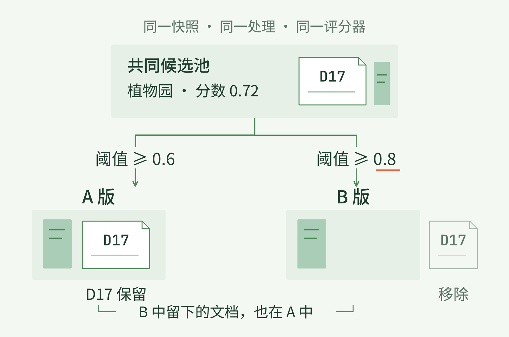
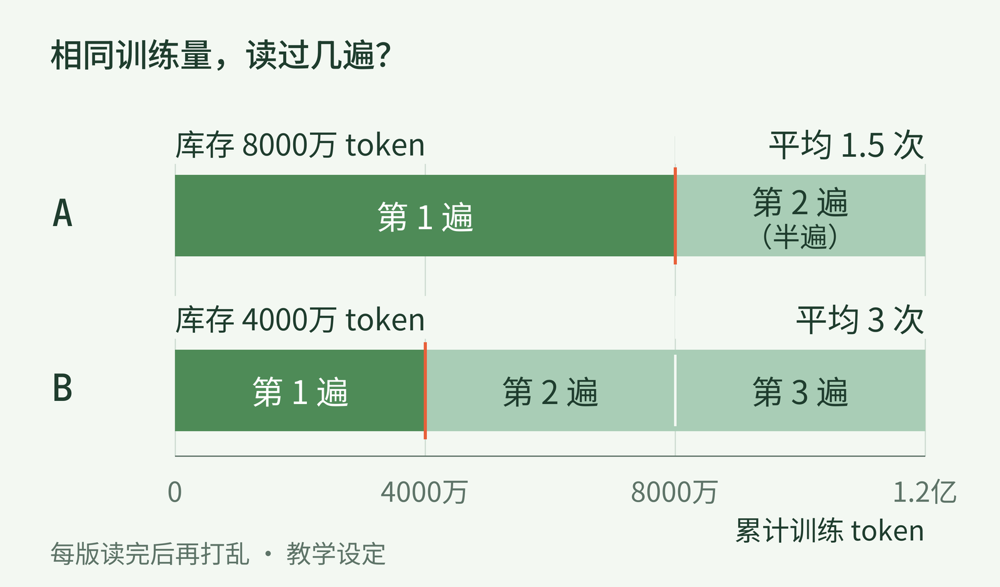
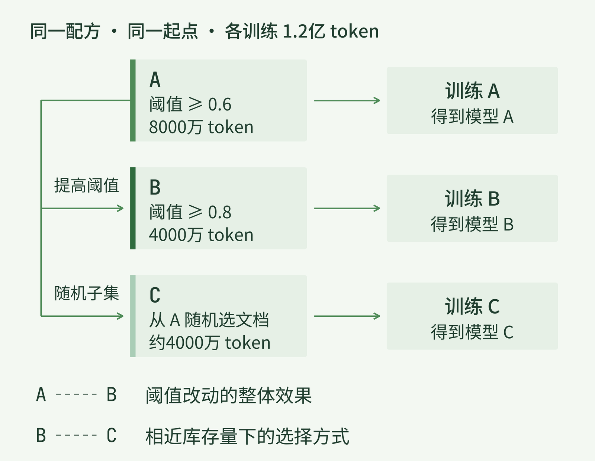
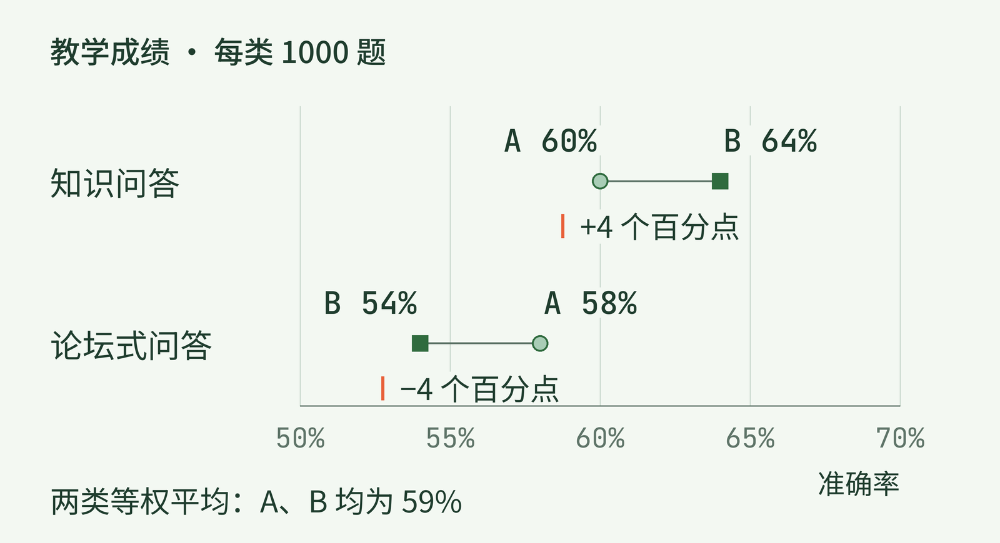

+++
title = "28 怎样判断数据更好：版本、预算与对照实验"
description = "沿一次过滤阈值的改动，分清数据版本、训练预算与成绩变化，判断收益来自哪里，又付出了什么。"
date = 2026-10-31
draft = false
tags = ["LLM", "训练数据", "数据版本", "对照实验", "消融实验"]
categories = ["LLM"]
series = ["主线"]
showTableOfContents = true
+++



沿一次过滤阈值的改动，分清数据版本、训练预算与成绩变化，判断收益来自哪里，又付出了什么。

假设你给训练资料加了一道更严格的筛选：原来留下的大量网页被删掉，模型训练后的某项分数反而提高了。看起来很像一个好消息——材料少了，成绩还更好。

可回头一看，两次实验用的网页不是同一批，训练步数也不一样。这时，“筛得更严格”只是几件变化中的一件。即使分数没有算错，我们也还不知道，究竟是哪一步帮了忙。

上一篇沿着一张植物园网页，走过了抽取、筛选和训练样本构造。本篇接着改其中一处：固定一个已经给文档打好分的评分器，只把保留阈值从 0.6 提到 0.8。评分、阈值以及后面的语料规模和成绩，都是帮助推演的教学设定，不是真实模型实验。我们要弄明白的是，怎样比较，才有理由把观察到的差别接回这次改动。

## 一、先让“只改了一个地方”可以被核对

仍看那份植物园游览说明。它已经去掉导航，保留了开放时间和价格表。在这次设定里，评分器给它 0.72 分。A 版保留分数不低于 0.6 的文档，它能留下；B 版要求不低于 0.8，它便被移除了。

这里的 0.72 只是这个评分器按自身判据给出的分数，不是“内容有 72% 的概率正确”。我们暂时不讨论评分器怎样训练，也不预先承认它一定懂得什么材料最有用。恰恰要通过后面的比较，看看按它筛选会带来什么。

为了只研究阈值，先把输入固定住：同一份原始网页快照，经过同一版抽取和去重，得到共同的候选文档池。评分器的版本和输出也固定。A、B 从这里分开，后续不再给 B 换一套去重规则或补进新的来源。这样，植物园文档为何消失，就有了可核对的原因。

*图 1：同一份候选文档经过两个阈值，得到 A、B 两版语料。植物园文档的分数不变，改变的是它能否留下；B 是 A 的子集。教学设定。*

但只把两个文件夹命名为“旧版”和“新版”，还不够。一个月后再打开它们，文件名并不能告诉我们当时用了哪批网页，也不能保证里面的文件没有被替换。

更可靠的做法，是给每版数据留一份**数据清单**（manifest）：指向原始快照和文档 ID，记录处理代码、配置、评分器与分词器版本，并保存输出文件的校验值。校验值像内容指纹，帮助确认今天拿到的文件与当时是否一致；它并不证明内容正确，也不能替代文件本身。

在 A、B 之间，还要留下一份能够打开的差异：哪些文档保留、哪些被删，分别涉及多少 token，以及哪些来源或内容类型变少了。再抽几份被删的材料读一读。若一批短小但有用的问答都被移走，单看“删除了多少”很难发现这一点。此处看到的是选择结果，后面才检验它对模型有什么影响。

这种记录可以继续连到模型和评测。DataComp-LM 的官方实现就用关联的 JSON 记录数据、训练模型和评测结果，使一次成绩能够追到所用的数据版本。我们不必照搬它的文件格式，但需要保住这条对应关系。[DCLM：实验记录](https://github.com/mlfoundations/dclm#workflow-overview-and-exp-data)

现在，“B 比 A 更严格”有了具体含义：同一批文档、同一个评分器，提高阈值后删去了这些材料。接下来还得决定，这两版数据各给模型读多少。

## 二、同样训练一次，可能读了不同数量的材料

按同一个分词器和计数规则，假定 A 最终有 8000 万个可用 token，B 有 4000 万个。这里的 token 数是准备好供训练读取的非补位位置，结束标记是否计入也采用同一规则；它不是文档篇数，更不代表所有内容在语义上互不重复。

如果各把库存读一遍，A 就给模型提供了 8000 万个 token，B 只有 4000 万个。两边都叫“一轮”，模型得到的训练机会却不同。这样的比较可以回答“各自只读一遍会怎样”，但不能用来声称：在同样的训练 token 预算下，B 更好。

先选一个明确的问题：**都让模型读 1.2 亿个 token，提高阈值后的版本是否更有用**？ 重复读到的 token 也计入这 1.2 亿。模型、序列长度和样本构造等设置保持一致，padding 不拿来凑这个数；哪些位置参加损失计算，也按同一规则处理并记录实际计数。

这个安排带来一个容易漏看的变化。我们假定每版数据先打乱、遍历，读完库存后再打乱并继续，直到用满预算。A 读完一遍还要再读半遍，B 则需要读三遍。把两条阅读经历并排，就能看到“同样多”发生在哪一处。

*图 2：两版都消耗 1.2 亿个训练 token，A 的库存被平均读取 1.5 次，B 被读取 3 次。相同曝光总量，不代表相同的内容覆盖或重复程度。教学设定。*

把训练实际消耗量记为 T，语料库存量记为 U，两者都按刚才相同的 token 口径计算。库存中每个位置获得的平均曝光次数 R，可以写成：

$$
R=\frac{T}{U}
$$

A 对应 1.2 亿除以 8000 万，得到 1.5；B 对应 1.2 亿除以 4000 万，得到 3。A 中具体某个位置可能读过一次，也可能读过两次，1.5 是所有位置的平均。若改用带权采样，不同来源的重复程度还会不一样；这个总比值不会告诉我们哪一篇读得最多。

多读几遍可能帮助模型学会某些表达，也可能让有限预算不断花在相近内容上。仅凭 1.5 和 3，不能宣布谁更好。它们告诉我们：提高阈值不仅改变了“留下谁”，也改变了固定预算下这些材料被反复读取的程度。

这时再说“公平比较”，就得先说清要固定什么。下面三种问题各有用途：

| 固定的条件 | 主要想回答什么 | 还需要记录什么 |
| --- | --- | --- |
| 相同训练 token 数 | 给定同样多的阅读机会，哪版材料更有效？ | 保留量、重复程度和实际计算成本 |
| 相同训练计算量 | 花同样的训练 FLOPs，哪套安排得到更好的结果？ | 实际训练 token、模型和序列形状 |
| 相同原始资料 | 从同一批来源出发，各种处理方案留下什么、能得到什么结果？ | 处理成本，以及另行约定的训练预算 |

这三行可以组合。本例同时固定了原始资料和训练 token 数。若只固定原始网页，A、B 后面各训练多久仍可以不同；若只固定 token 数，却一边用短序列、一边用很长的序列，计算量也未必相同。

训练 FLOPs 是计算工作量，GPU 小时则还受硬件和实际运行效率影响。比较端到端成本时，也别把抽取、评分、去重和读取数据的开销漏掉。本例评分器没换，已有分数能够复用，提高阈值不需要重新给全部文档打分；换成新的评分器时，这笔成本就可能重新出现。

FineWeb 论文报告，给其 15 万亿 token 的数据应用教育性分类器，需要约 6000 H100 GPU 小时。这不是本例的成本，也不是所有过滤方法的通用价格，只说明“训练前的选择”本身也可能消耗可观资源。[FineWeb，§4](https://papers.nips.cc/paper_files/paper/2024/file/370df50ccfdf8bde18f8f9c2d9151bda-Paper-Datasets_and_Benchmarks_Track.pdf)

预算已经说清，我们才可以把 A、B 交给模型，观察提高阈值这一整项决策的效果。

## 三、让两次训练只在该不同的地方不同

给 A 配一个小模型，给 B 配一个大模型，即使两边都读了 1.2 亿个 token，也很难判断差别来自数据还是模型。为了接住前面的问题，两边需要同样的架构、参数规模和分词器；一对实验从同一份初始化权重开始，若是继续预训练，则从同一个检查点开始。

接着固定训练配方：优化器、学习率日程、每次更新消耗的 token 数，以及序列长度、打包、注意力与损失掩码的处理。这里不需要把整套配置抄进文章，但要能从运行记录找到它们。否则，一个版本读三遍、另一个版本读一遍半时，如果学习率又按各自的轮数安排，模型经历的更新过程也会跟着改变。

在这些条件下，A 与 B 的对照能够检验：**把阈值从 0.6 提到 0.8，在这套训练安排中带来的整体变化**。 其中包括文档组成、库存量和重复曝光的变化。它们都是这次筛选的后果，不该在成绩提高后只留下“单篇内容更优”这一种解释。

如果我们还想判断“按分数挑选”是否比“仅缩小库存、增加重复”更有帮助，就可以再增加一组有针对性的对照。从 A 随机选取文档，构成保留量接近 B 的 C；抽样规则提前确定，记录实际 token 数及来源构成，不为凑出好成绩反复挑子集。C 也训练同样的 1.2 亿个 token。

现在，A 与 B 比较完整的阈值改动；B 与 C 则是在近似库存量下，比较按分数选择和随机选择。三组各在回答什么，可以沿下面的分支看清。

*图 3：A 与 B 检验提高阈值的整体影响；增加随机子集 C，可进一步比较相近库存量下的选择方式。三组使用相同训练配方和 1.2 亿 token 预算，不预设谁胜出。*

C 并不能一下子把“纯粹质量”测出来。它仍可能与 B 有不同的主题和来源分布，换一个随机子集也可能得到不同结果。它的价值在于把原先笼统的猜测变成更窄的问题：在保留量相近时，按照这个评分器挑材料，是否比随机保留更有帮助？

这就是**消融实验**（ablation study）的用处：拿掉或替换一个具体处理，再看结果怎样变。如果同时换了过滤器、去重方式和采样权重，A、B 只能说明这一整包改动的效果；要把收益分给其中某一步，就需要补回能区分它们的实验。不同步骤还可能相互影响，一步在当前基线下有效，不等于换一套流程也有同样贡献。

FineWeb 的数据消融提供了真实参照：同一比较中的模型配置一致，训练 token 数相同，再在同一组任务上评测；每个数据版本使用两组不同的数据抽样与初始化种子训练，并比较平均成绩。这些安排把模型、训练量和评测对象放在稳定的基线上，让数据差异更容易辨认。[FineWeb，§3.1](https://papers.nips.cc/paper_files/paper/2024/file/370df50ccfdf8bde18f8f9c2d9151bda-Paper-Datasets_and_Benchmarks_Track.pdf)

我们的例子也应保存初始化、数据顺序和子集抽样所用的随机种子。相同种子方便复现，不会自动让不同语料产生相同样本顺序，也不能消除随机波动。条件允许时换种子重复比较，看看收益是否稳定；一次很小的领先，先当作值得复查的信号。

## 四、换一套材料读分数，也看看失去了什么

训练结束后，先别用“B 在自己的训练资料上错得更少”宣布胜利。B 可能留下了更容易预测的表达，又把它们读了更多遍；A、B 各自的训练 loss 面对的对象不同，不能直接充当同一把尺子。

需要提前留出一批用于判断效果的材料。它们不进入训练，也不用于训练评分器；A、B 用同样的题目、提示、输出规则和计分方式接受检查。如果比较语言建模的平均 loss，就要在同一份保留文本、同一分词与计分口径上计算；若比较问答表现，则要把实际任务中的成功与失败看出来。

调阈值时可以用开发集观察方向。一旦反复看某批题目的成绩来选择阈值，这批题目就参与了方案选择，不能再把它当作最后一次独立检验。最终测试材料应与这种选择隔开，相关重复也要检查；更细的数据污染处理留给 #32。测试信息会影响方案选择这一原则，在 scikit-learn 的数据泄漏说明中也有明确讨论。[数据泄漏与测试集隔离](https://scikit-learn.org/stable/common_pitfalls.html#data-leakage)

为了看看分数怎样影响判断，我们暂时放下尚未运行的实验，读一组**专门构造的示意成绩**。假定预先确定了两类测试，各 1000 题：知识问答关心事实性问题，论坛式问答关心较口语化的提问。两类都按同一套预先固定的逐题对错规则统计准确率。

A 在知识问答中答对 600 题，B 答对 640 题；论坛式问答中，A 答对 580 题，B 只答对 540 题。把两种变化画在同一条百分比尺度上，最初那个“分数提高了”的好消息就有了另一面。

*图 4：示意成绩中，B 的知识问答准确率提高 4 个百分点，论坛式问答下降 4 个百分点；两类等权平均都为 59%。收益与退化需要一起看。非真实实验结果。*

知识问答从 60% 到 64%，提高的是 4 个百分点。这个差别确实存在于示意数字里，但论坛式问答从 58% 降到了 54%。若两类等权平均，A、B 都是 59%；只报平均值，又会把读者真正关心的取舍抹平。

因此，“数据更好”总要接上目标。若我们的产品主要处理知识问答，B 的方向可能值得继续验证；如果论坛式表达也是必须服务的输入，这个退化就不能藏进平均分里。哪些能力优先、哪些退化不能接受，应在看到成绩前先定下来，而不是看到哪项上涨，就临时宣布那项最重要。

接着回看第一节保存的差异材料：被移除的文档里，是否少了许多口语问答？这可以提出一个解释，但单凭来源变化和成绩一起出现，还不能确认原因。前面的随机子集 C、进一步有针对性的对照，以及重复训练的结果，才有机会继续区分这些解释。统计上怎样判断小差距是否可靠，留给 #52 展开。

小模型上的试验适合筛掉在当前预算下明显无效的方案；准备换到更大的模型或更长的训练预算时，还要确认原来的方向是否保留。预算拉长，B 中有限材料会被读更多遍，最初有用的筛选力度未必仍然合适。对照结果回答的是已经运行的设定，不能自动替其他规模作决定。

回到开头那次“筛掉很多、分数更高”的观察，我们现在可以把结论写得更具体：哪批材料经过哪一处改动，在怎样的模型与预算下，改善了什么任务，哪些地方退步，以及多花了多少处理成本。这样得到的结论，也许没有一句“数据质量提升了”响亮，却能让下一次实验知道从哪里继续。

下一篇 #29《抽取与格式：怎样保留文档的可学习结构》会回到更早的一步：同一张网页在变成训练文本时，表格的行列和代码的缩进究竟留下了多少。届时，我们就可以用这里建立的对照，判断一次格式处理究竟帮助了模型什么。

## 参考资料

- [Penedo 等，The FineWeb Datasets，NeurIPS 2024 论文版本](https://papers.nips.cc/paper_files/paper/2024/file/370df50ccfdf8bde18f8f9c2d9151bda-Paper-Datasets_and_Benchmarks_Track.pdf)：§3.1 的控制实验、随机抽样与初始化；§4 的教育性分类器应用成本。用于对照方法与处理成本的真实参照。
- [DataComp-LM 官方代码仓库](https://github.com/mlfoundations/dclm#workflow-overview-and-exp-data)：Workflow Overview and Exp Data；数据、模型与评测记录的关联。访问于2026-10-31。
- [scikit-learn：Common pitfalls，§12.2 Data leakage](https://scikit-learn.org/stable/common_pitfalls.html#data-leakage)：测试信息参与训练或方案选择会使效果估计偏乐观。用于说明训练、方案选择与最终测试之间的信息隔离。访问于2026-10-31。

