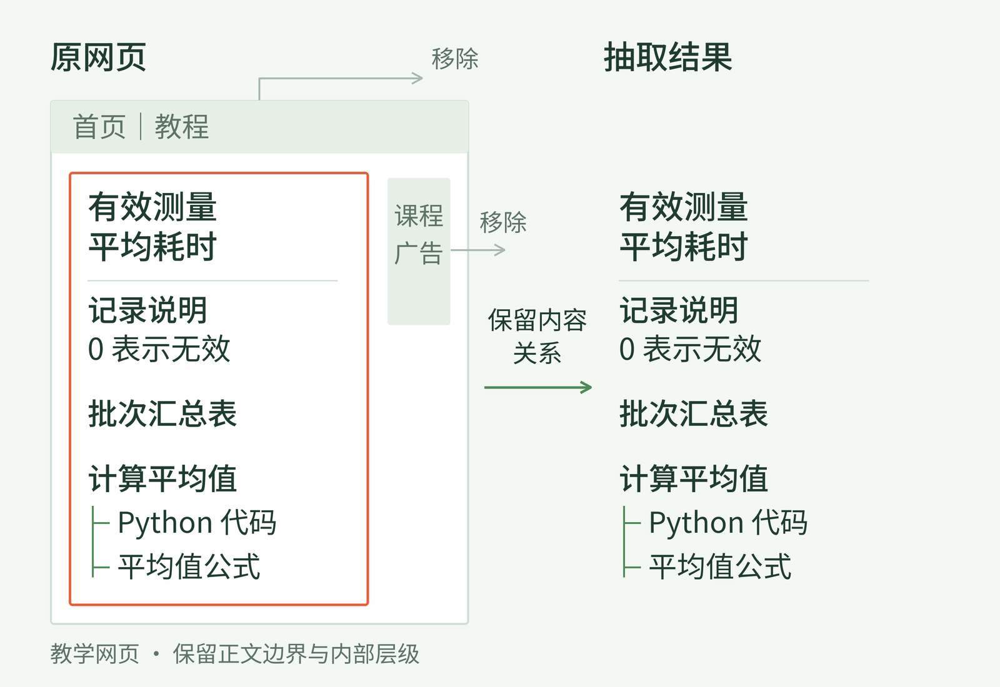
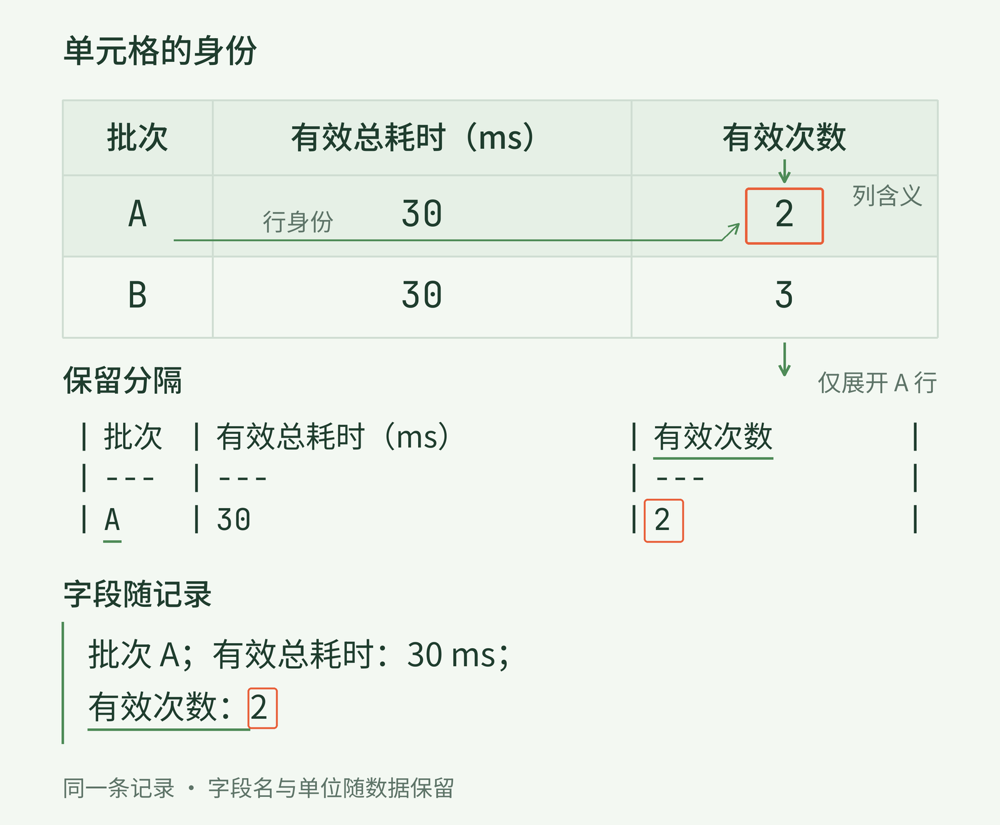
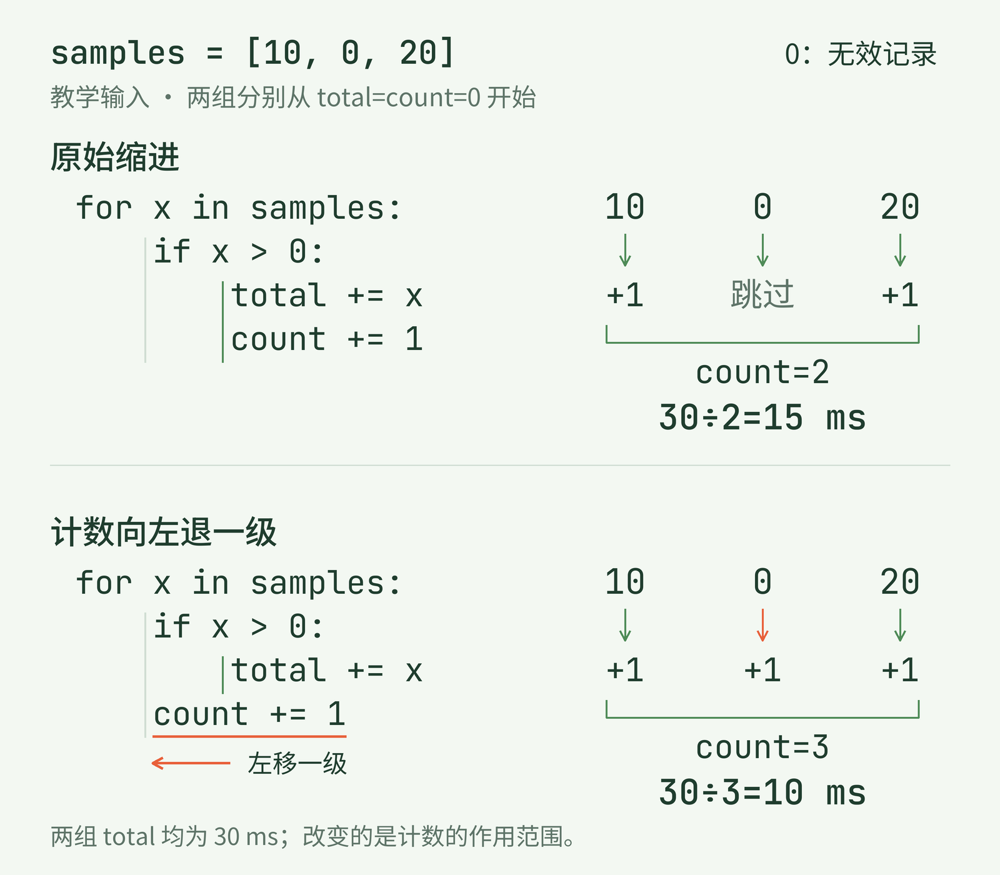
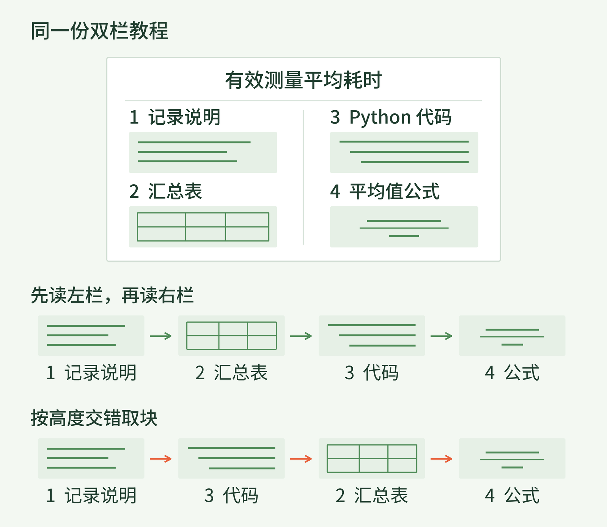

+++
title = "29 抽取与格式：怎样保留文档的可学习结构"
description = "把文档转成训练文本，既要留下内容，也要保住行列、层级和顺序所表达的关系。"
date = 2026-11-04
draft = false
tags = ["LLM", "训练数据", "文档抽取", "格式规范化"]
categories = ["LLM"]
series = ["主线"]
showTableOfContents = true
+++





把文档转成训练文本，既要留下内容，也要保住行列、层级和顺序所表达的关系。

你可能遇到过这样的情况：从网页或 PDF 复制一段内容，粘贴到纯文本编辑器里。字和数字似乎都在，可表格挤成了一串，代码的缩进不见了，公式里的分母也不知道去了哪里。

人还可以切回原页面，看看那个数字原来在哪一列。如果训练流程只把抽取后的文字交给语言模型，原页面的线条、位置和字号就不会一同进入输入。模型能依据的，是我们最终留下的那串内容。

上一篇讨论了怎样比较一次数据改动。本篇回到改动本身，换一份更适合观察结构的材料：一篇“计算有效测量平均耗时”的教程，里面有说明、对照表、Python 代码和公式。教程、数值和损坏情形都是教学设定。我们一起看看，把它转成文本时，什么可以简化，什么一旦丢掉，就改变了它原来在说的事。

## 一、先找到正文，再保住正文里的关系

这篇教程的网页上方有菜单，右侧有课程广告，中间才是文章。文章标题下面，先解释怎样判断一次测量有效，再给出两批记录的汇总表，最后用代码和公式计算平均值。

一种很直接的办法，是把页面里的文字全部接起来。它确实能捞出许多字符，菜单里的“首页”、广告里的“立即报名”也会跟着进来。更麻烦的是，如果段落之间没有留下分隔，广告就可能接在一句技术解释后面，成为训练文本中的邻居。

**正文抽取**（main content extraction）首先要判断哪些区域属于我们要保留的文章。网页的 HTML 通常提供标题、段落、表格等标签，抽取器可以结合这些结构，以及文字密度、链接分布等线索作出选择。这里处理的是“这段内容属于哪里”，还没有回答“这篇文章值不值得训练”。

把菜单和广告去掉后，先别急着把剩余内容压成一长行。教程中“0 表示无效记录”这句话要留在数据解释附近，“计算平均值”要继续统领后面的代码和公式。标题的字号可以消失，标题与正文的关系却需要换一种方式留下。

看图时可以先沿中间的正文区域向下读，再看右边抽取出的顺序：那些留下来的部分，是否仍然能接成同一篇教程？


*图 1：抽取先分清正文与页面杂项，再把正文中的标题、说明、表格和计算部分按关系保留下来。教学网页示意。*

这也是为什么抽取器里的选择值得认真记录。例如 Trafilatura 分别提供表格、评论和格式相关选项，也提供偏重少带杂项或少漏正文的策略。选项控制的保留范围不同，不能只记一个“已抽取”，就认为两次得到的是同一份内容。[Trafilatura 官方文档](https://trafilatura.readthedocs.io/en/latest/usage-python.html)

对于只接收文本 token 的训练流程，结构必须体现在实际送入的字符、分隔或专门标记中。后面的分词器会处理这些输入，却不能保证还原已经删去的表头或缩进。保留工作，需要发生在这些关系仍能从原文中查到的时候。

## 二、表格变成一串文字后，数字还属于谁

教程把两批测量汇总成了下面这张表。这里“总耗时”只统计有效测量；A 批的原始记录是 10、0、20 毫秒，B 批是 5、10、15 毫秒。教程约定大于 0 的记录有效，0 是无效记录的占位值，不代表一次真正的零耗时测量。

| 批次 | 有效总耗时（ms） | 有效次数 |
| --- | --- | --- |
| A | 30 | 2 |
| B | 30 | 3 |

先看 A 这一行。30 的意思是总共花了 30 毫秒，2 的意思是其中有两次有效测量。因此，平均耗时是 15 毫秒。B 的总耗时同样是 30 毫秒，却来自三次有效测量，平均是 10 毫秒。

现在设想，抽取时只依次留下各单元格文字，行列分隔全部变成普通空格：

```txt
批次 有效总耗时（ms） 有效次数 A 30 2 B 30 3
```

这张小表还可以靠猜测重新配对，因为我们刚刚看过原表，也知道每行应该有三列。换成带空单元格、跨行表头或单元格内有长句的表格，猜测就不可靠了。字符都在，关系也可能不完整。

把行列组织改写成顺序文本，叫作**表格序列化**（table serialization）。一个直接办法是使用 Markdown 表格：换行区分记录，竖线区分单元格，表头说明每列的身份。

```txt
| 批次 | 有效总耗时（ms） | 有效次数 |
| --- | --- | --- |
| A | 30 | 2 |
| B | 30 | 3 |
```

这里的线条并没有被装进文本里；留下的是能够表达行列关系的符号。以 GitHub Flavored Markdown 为例，表格有明确的表头行、分隔行和单元格规则，单元格里的字面竖线还需要转义。[GFM 表格规范](https://github.github.com/gfm/#tables-extension-)

还有一种更啰嗦、却容易逐条阅读的写法：“批次 A；有效总耗时：30 ms；有效次数：2。”给 B 也写一行，数字的身份就跟着每条记录走了。代价是列名不断重复；遇到宽表时，文本会明显变长。

把目光放回 A 行的那个 2。它在原表中靠位置与“有效次数”相连；转成文本后，这条联系靠什么继续存在？



*图 2：表格序列化要让一个数值继续带着行身份、列含义和必要单位。两种文字表示都保留 A 批的“30 ms、2 次”，表达长度不同。*

真正复杂的表格，常常需要先理清表头，再决定怎样写。例如两个“第一季度”分别隶属不同年份，只保留“第一季度”就分不清；可以把年份与季度一起写成完整列名。遇到合并单元格，要按原表确定它覆盖哪些记录。空白也应保留其位置和已知含义，不能为了让表格整齐，擅自填成 0。

到这里，格式选择的标准开始变得具体：换一种写法后，我们还认不认得这个数值是谁的、量的是什么。至于哪种写法更有利于模型学习，还要结合训练目标和对照实验判断，单凭表格更漂亮得不出结论。

## 三、空格和分数线，也在参与解释

表格用行列位置组织数字，代码则可能用缩进组织动作。教程给 A 批计算平均值时，用的是这段 Python：

```py
samples = [10, 0, 20]
total = count = 0
for x in samples:
    if x > 0:
        total += x
        count += 1
mean = total / count
print(mean)  # 15.0
```

先不用追着每个符号读。它依次查看三条记录，遇到大于 0 的数，就把耗时加进总数，同时把有效次数加一。10 和 20 通过条件，0 没通过；最后得到总耗时 30、有效次数 2，输出 15.0 毫秒。这里使用的是教程固定的样本，已有有效记录；通用程序还需要处理没有有效记录时不能直接相除的情况。

注意两条累加语句的左缘。它们处在同一缩进层级，都归 `if x > 0` 管。如果抽取时让 `count += 1` 向左退一级，变成下面这样，其余代码保持不变：

```py
for x in samples:
    if x > 0:
        total += x
    count += 1
```

这段程序仍然能运行。可计数现在归循环管，每读到一条记录就加一，连那个无效的 0 也算进去了。总耗时还是 30，次数变成 3，结果就从 15.0 变成了 10.0。

Python 用行首缩进决定语句分组，这是语言语法的一部分。[Python 语言参考：缩进](https://docs.python.org/3/reference/lexical_analysis.html#indentation) 在这段代码中，少几个空格改变了分母；因此，“能解析”只能检查一部分损坏，“能运行”也不等于保留了原来的行为。

沿图中的缩进引导线看一次，再看同一个 0 在两种程序里是否会增加计数，变化就更容易抓住。



*图 3：只把计数语句向左退一级，0 就会进入计数。两段程序都能运行，但 A 批的结果从 30÷2＝15 变成 30÷3＝10。单位为毫秒。*

这时再看教程里的公式，会发现它和代码讲的是同一件事。把有效记录记作 t₁ 到 tₙ，n 是有效次数，且 n 大于 0；平均耗时 μ 就是把这些记录加起来，再除以有效次数：

$$
\mu=\frac{1}{n}\sum_{i=1}^{n}t_i
$$

对 A 批来说，有效记录为 10 和 20 毫秒，n＝2，所以 μ＝15 毫秒。分数线说明“整份总和除以 n”，上下标说明“加的是哪几项”。如果只留下 `μ 1 n Σ ti`，字符看起来不少，运算关系却已经没有表达完整。

把公式写成 LaTeX 文本，可以显式保留这些关系，例如 `\mu=\frac{1}{n}\sum_{i=1}^{n}t_i`；这个简单平均值也可以写成“有效总耗时 / 有效次数”。无论选哪种，都要把它与附近的符号定义一起保留。只留公式、删掉“n 是有效次数”，仍然会失去理解分母所需的信息。

因此，不能给所有内容套同一条“去掉多余空白”的规则。普通段落里因排版产生的折行可以合并；代码的换行、行首缩进和字符串中的空格则要按代码内容处理。公式若原本只是一张图片，也不会因为输出文件叫 Markdown 就自动变成公式文字，需要专门识别并核查。无法确认的符号要保留问题记录或回到原件，不能凭一句看似顺畅的解释把缺失部分补成事实。

## 四、选定格式以后，仍要回到原件检查

同一篇教程还可能被排成双栏 PDF。左栏先放记录说明和汇总表，右栏接着给出代码与公式。人看到页面，知道应该先读完左栏，再进入右栏；一个只按纵坐标从上往下排列文字的程序，却可能在左右栏之间来回跳。

设想记录说明后面突然接了一半代码，再跳回表格，最后才出现说明的下半句。每个局部都识别得不错，拼起来仍然不是原来的教程。这里还需要恢复**阅读顺序**（reading order）。

PDF 中的文字常以页面位置来呈现，表格也可能只是一组按坐标摆放的文本。抽取器需要依据可用结构和版面线索恢复关系；对只有扫描图像的页面，还要先通过光学字符识别（OCR）取得文字。pypdf 的官方说明专门讨论了表格、公式和线性阅读顺序的困难，也说明普通文本抽取不能直接识别图片里的文字。[pypdf：为什么文本抽取困难](https://pypdf.readthedocs.io/en/stable/user/extract-text.html#why-text-extraction-is-hard)

在这张简化页面上，先用手指沿左栏向下，再移到右栏。对照另一条横穿两栏的路径，可以看见：排列规则看起来很整齐，依然可能接错内容。



*图 4：这份双栏教程应先读完左栏，再读右栏。按页面高度交错取块，会把“说明—表格—代码—公式”改成另一种顺序。教学版面示意。*

读到这里，再问“最后存成什么格式”，就有了判断依据。主要由连续段落组成的文章，可以用带清楚段落边界的纯文本。含标题、列表、代码和简单表格的教程，可以用 Markdown，把层级和分隔直接写出来。复杂合并表头或需要记录块位置的材料，可以先保留 HTML 或带类型、顺序的结构化记录，再按训练需求生成文本。

这些方式没有一条适合所有材料的排名。纯文本也能通过明确字段保留关系，Markdown 则只是提供了一套常见约定；更丰富的标记能表达更多结构，也可能带来冗余。即使中间保存了 JSON，训练端若只读取其中的正文字符串，其他字段也不会自动成为模型的输入。

对于这篇教程，一个可检查的做法，是先分出标题、段落、表格、代码和公式，再为不同内容应用转换规则。段落处理排版折行，表格保留单元格对应，代码保留作用范围，公式保留运算关系。最后把它们按确定的顺序接回去。**格式规范化**（format normalization）应当使表示更一致，同时保住这些含义；它需要知道自己正在处理哪一类内容。

转换完成后，我们可以先不看文件大小，而是重新回答原文中的几个具体问题：

| 回到原件核对什么 | 本教程中应能找到的依据 |
| --- | --- |
| 数字还对应正确的对象吗 | A 批总耗时 30 ms、有效次数 2；B 批总耗时 30 ms、有效次数 3 |
| 定义与使用处还连得上吗 | 0 表示无效；公式中的 n 是有效次数 |
| 代码行为保住了吗 | A 批代码排除 0，输出 15.0；计数没有移出条件 |
| 各部分还按原意衔接吗 | 记录说明之后是表格，再进入代码和公式；菜单广告未混入 |

这张表是本例的验收问题，换一类材料，就应换成那类材料真正承载意义的关系。检查也不能只挑最规整的页面：表格、代码、公式和多栏版面要分别抽样，才容易看见通用规则在哪一类内容上失效。解析通过、字符保留很多，都不能替代与原件的对照。

如果后来修改抽取器或转换规则，保留原始快照、工具与规则版本、输出之间的对应关系，以及遇到的缺失或识别失败，便能查到变化发生在哪里。再按上一篇的方法做训练对照，才能进一步判断这种转换对目标能力的影响。关系保留检查告诉我们“材料有没有被改坏”，模型实验回答“这种表示是否更适合当前训练”，两者各自提供证据。

回头看开头那次复制粘贴，令人困惑的地方已经清楚了：有些信息写在字里，有些信息藏在字与字的排列关系中。抽取工作的完成标准，是让读者和后续程序仍能辨认那张表、那段计算与那些定义，而不只是看见一份成功保存的文本。

材料还原清楚以后，另一个判断才真正摆到面前：一篇结构完整、语句流畅的教程，是否值得进入训练？下一篇 #30 会继续讨论质量过滤，看看筛掉什么、保留什么，又会怎样改变模型接触到的内容。

## 参考资料

- [Trafilatura：Python usage](https://trafilatura.readthedocs.io/en/latest/usage-python.html)：正文抽取、输出格式，以及表格、评论、格式选项和抽取取舍。
- [GitHub Flavored Markdown Spec §4.10](https://github.github.com/gfm/#tables-extension-)：表格的行、单元格、表头与转义规则。
- [Python Language Reference §2.1.8](https://docs.python.org/3/reference/lexical_analysis.html#indentation)：缩进如何确定语句分组。
- [pypdf：Extract Text from a PDF](https://pypdf.readthedocs.io/en/stable/user/extract-text.html)：PDF 文本抽取、结构恢复与扫描页的边界。
- 系列前文：[#27 数据工程全景：原始资料怎样成为训练样本](/llm/llm_27/)；[#28 怎样判断数据更好：版本、预算与对照实验](/llm/llm_28/)。
