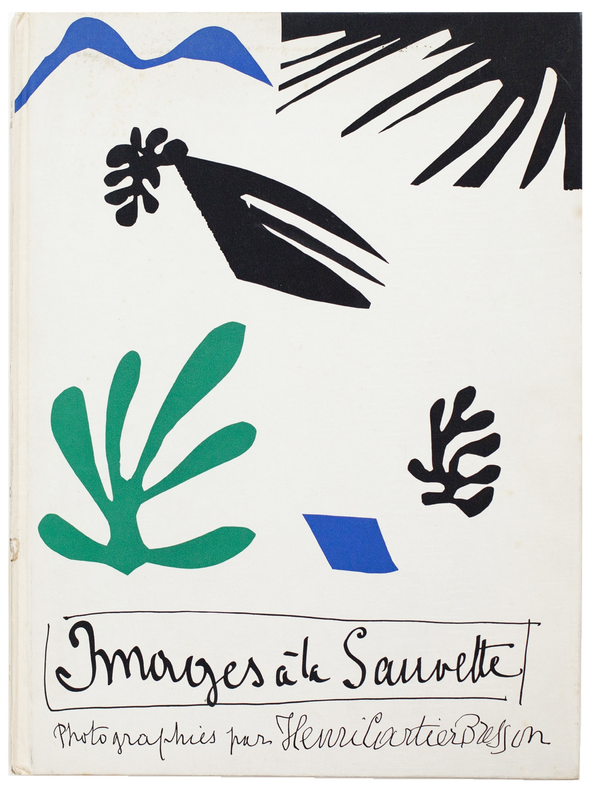
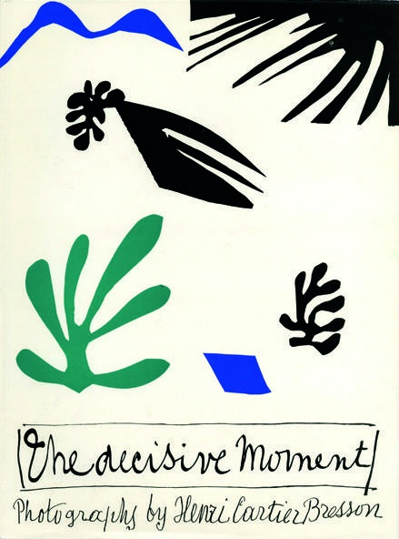
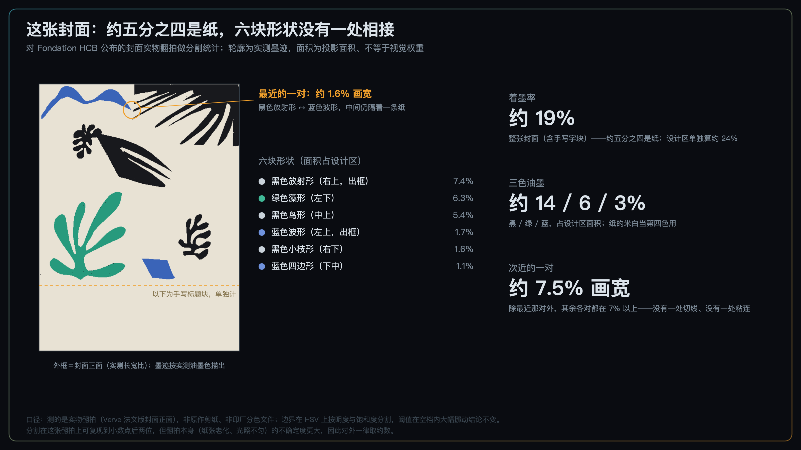
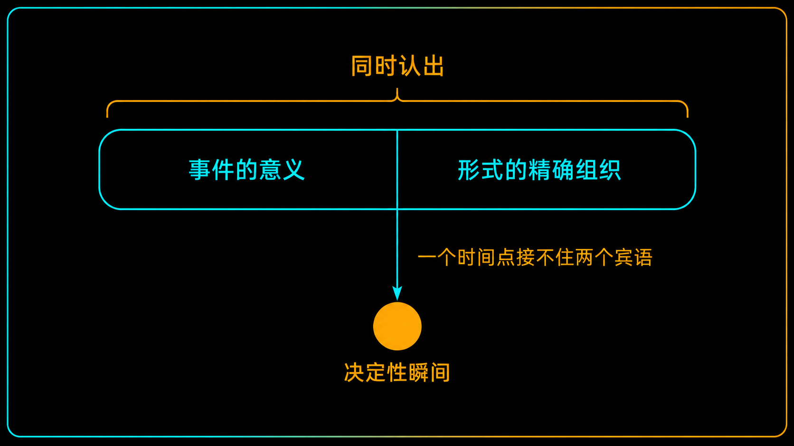
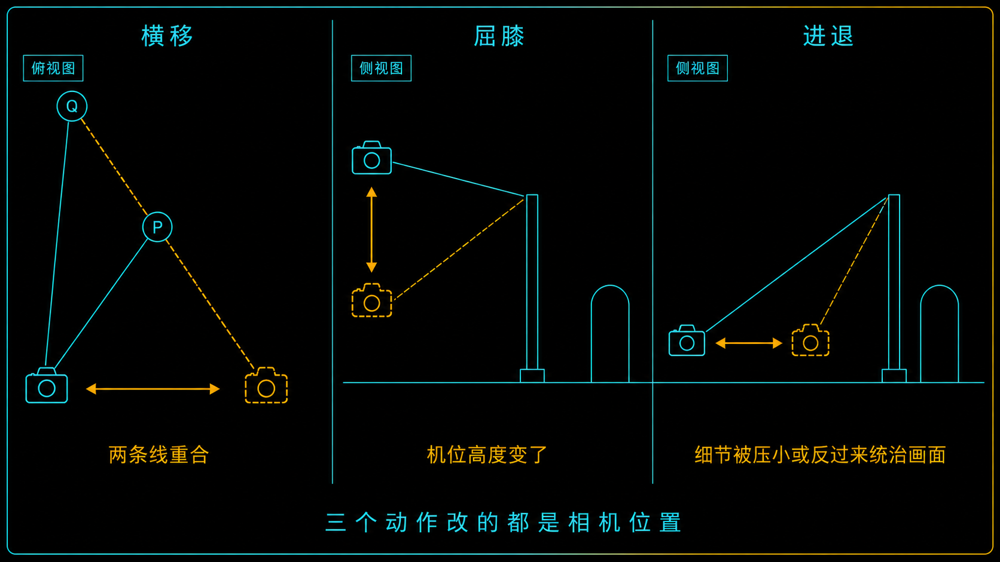
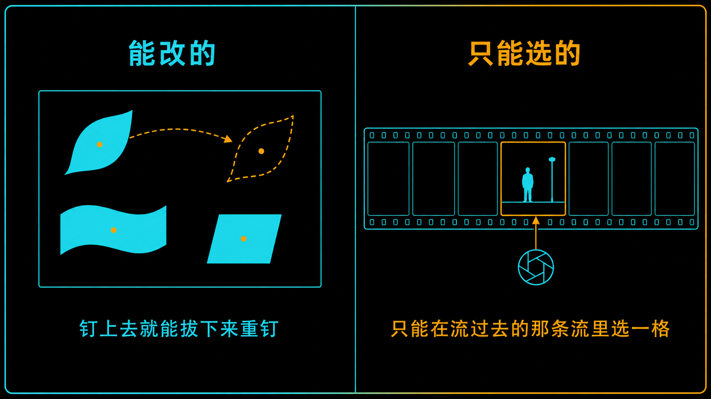

+++
title = "经典作品拆解 #18：The Decisive Moment 封面"
description = "《决定性瞬间》的书名是出版社取的，封面上没有照片——它把一句「同时认出两样东西」，压成了一个时间点。"
date = 2026-09-09
tags = ["摄影", "经典作品", "摄影史", "布列松", "马蒂斯", "决定性瞬间", "构图"]
categories = ["摄影"]
series = ["经典作品拆解"]
showTableOfContents = true
+++

> 《决定性瞬间》的书名是出版社取的，封面上没有照片——它把一句「同时认出两样东西」，压成了一个时间点。

## 一、这本书最有名的地方，可能是它的名字

上一篇我们看的是 *Dali Atomicus*（达利与原子）——霍尔斯曼把三只猫、一桶水和一个人同时扔进空中二十八次，造出了一个现实里根本不存在的瞬间。

几乎在同一时期，另一个人在给自己的第一本画册写引言，里面有这么一句：

> 我们既不该在拍摄时操纵现实，也不该在暗房里操纵结果。这些把戏，长着眼睛的人都看得出来。

写这句话的人是亨利·卡蒂埃-布列松。1952 年 10 月，他的画册在巴黎和纽约同时出版。法文版叫 *Images à la sauvette*，美国版叫 *The Decisive Moment*（决定性瞬间）。

七十多年后，「决定性瞬间」成了这一行里被引用得最多的说法之一。而这四个字有两件事，绝大多数引用它的人都不知道：

**第一，这个书名不是布列松取的。** 是纽约那家出版社挑的。

**第二，这本书的封面上，没有一张照片。** 封面是马蒂斯的一张剪纸。

这两件事听起来像掌故。但把它们放在一起看，会看到一件更值得说的事。

先说清楚我**不**打算论证什么：我不会说「后来的人只顾追时机、把形式忘了」。恰恰相反，形式从来没被忘记——七十年里无数人在模仿布列松那种几何上的完美平衡，模仿得过头了都。

真正被压掉的，是那个词组承载不了的东西：**布列松给摄影下的那句定义，说的是「同时认出」两样彼此分不开的东西；而「决定性瞬间」是一个时间词，它只能指向一个点。** 于是那句话被压扁了——形式从一套按下快门之前用身体做出来的动作，慢慢变成了一种在成片上被鉴赏的属性。

而马蒂斯那张封面，恰好是「形式作为一件手上活儿」的一个标本。

## 二、三个人、两个书名、一张剪纸

这本书的起点不是布列松，是他的出版人 Tériade——艺术杂志 *Verve* 的创办人。两人 1930 年代就认识，布列松后来把他称作自己的引路人。他们本来想在三十年代做一本关于大城市底层街区的书，拉上了 Brassaï、Bill Brandt 几个人，这个计划最后没做成。

二十年后，布列松刚从亚洲回来——印度、中国、印尼，一走三年。这本书才真正启动。

法文书名是他和妹夫、电影史家 Georges Sadoul 一起琢磨出来的：*à la sauvette*，指的是街头那些没有执照的小贩，摊子随时能收，官员一来撒腿就跑。布列松自己说，这个词的意思跟他抓照片的方式非常接近。

**注意这个书名在说什么：它说的是姿态和方式——偷偷地、快速地、见势不妙就走。它一个字都没提「时刻」。**

至于「决定性瞬间」，本来只是引言前面的一句题词，出自德·雷斯枢机主教 1717 年初版的《回忆录》：「世上没有任何事物没有它的决定性瞬间。」按布列松基金会的记载，是 Tériade 在 1952 年提议把这句话放上去的。

然后美国那边出了岔子。Simon & Schuster 的 Richard Simon 不想用法文书名的直译——基金会的说法很直白：直译「完全可行」，但他想要一个更有冲击力的。他从题词里挑走了那四个字。布列松接受了。

**接下来是这件事最好的一个细节：马蒂斯把这个新书名，手写在了他为封面做的那张剪纸下面。**

*图：法文版 Images à la sauvette 封面。马蒂斯的剪纸用黑、绿、蓝三色印在前后封上，标题与署名是他的手写体。本文的测量只针对正面。图片来源：Fondation Henri Cartier-Bresson，2017 年「Images à la Sauvette」展览新闻资料，© Henri Cartier-Bresson / Magnum Photos。*

*图：美国版封面。同一件剪纸，同样的六块形状、同样的位置——只有底下那行手写的字换了。图片来源：Fondation Henri Cartier-Bresson，2017 年展览新闻资料，© Henri Cartier-Bresson / Magnum Photos。*

把这两张放在一起看，这篇文章的论点其实已经讲完了：**画面没变，字变了。而后来征服了整个行业的，是那行字。**

马蒂斯这边的情况也值得交代一句，因为它待会儿有用。1952 年的马蒂斯八十二岁，1941 年那场大手术之后行动能力严重受限，长时间卧床或坐在轮椅上。剪纸（gouache découpée）在这几年成了越来越适合他工作状态的方式——但它不只是身体的替代方案，MoMA 的说法是，这也是他几十年来对「线与色」这个老问题的一次最终推进；他并没有因此停止绘画和素描。做法是：助手先把整张纸用水粉刷成实色，他用剪刀直接从颜色里裁出形状，再用大头针把这些形状钉在纸板或墙上，一遍遍地挪，直到位置对了才定下来。他管这个叫「用剪刀画画」。

顺带一提，这本书第 69 页上就有马蒂斯本人——1944 年布列松在旺斯给他拍的，他和他的模特 Micaela Avogadro 在一起。做封面的人，也在书里被拍过。

## 三、技术拆解

### 3.1 这张封面在做什么

**第一，一本讲抓拍的书，封面上没有一个瞬间。**

正面六块形状，全部是静止的、没有时间的：一个放射状的黑块、一个像鸟的黑块、一株绿色的藻、一小枝黑色的珊瑚、一道蓝色的波、一个蓝色的小四边形。画面里唯一带一点「动」的暗示，只是那个鸟形的朝向。没有人、没有街、没有一个正要落地的脚。

**第二，负空间不是余料，是主结构。**

这不是印象。我把基金会公布的封面翻拍图做了一遍分割统计：整张封面（连手写字块一起算）着墨率**约 19%**——**约五分之四的面积是空白的纸**。只看剪纸那部分（占画面高度的约 75%），着墨率也只有**约 24%**，其中黑约 14%、绿约 6%、蓝约 3%。

三种油墨，加上纸本身的米白当第四个颜色，就是全部。

**第三，六块形状之间，没有一处相接。**

同一份统计里，我把六块形状两两之间的最小距离都量了一遍。最近的一对是右上那个黑色放射形和左上那道蓝色波形，它们之间隔着**约 1.6% 的画面宽度**——很窄，但确实隔着一条纸。次近的一对（绿藻和黑鸟）已经隔开了约 7.5%，其余各对更远。

也就是说：**每一块形状，周围都留着一圈完整的纸。没有一处切线，没有一处粘连。**

*图：对封面翻拍图做的分割统计。轮廓是实测墨迹（不是外接矩形——三块形状的外接矩形彼此重叠，用矩形画会正好否掉「没有一处相接」这句话）。测量口径见下。*

上面这几个数字，口径必须交代清楚，否则它们比没有还糟：

- 测的是**基金会公布的实物翻拍**（法文版封面正面），不是马蒂斯的原作剪纸，也不是印厂的分色文件；
- 这本书七十多年了，纸已经发黄，翻拍也有轻微的光照不匀；
- 边界是在 HSV 上按明度和饱和度分的——三种油墨和纸在这两个维度上隔着很大的空档，所以阈值在空档里怎么挪，结论都不变（这条我跑过）；
- 「剪纸区」和下面的手写字块是分开算的；
- 分割本身在这张翻拍上可以复现到小数点后两位，**但那是分割的精度，不是这本书的精度**——翻拍件的不确定度大得多，所以上面一律写约数；
- **面积是投影面积，不等于视觉权重。** 这一点在主线 #2-2 和 #2-7 里会展开讲：一块小而高反差的东西，可以比一块大而低反差的东西更抢眼。

带着这三条论点回头看封面，会发现一件有点讽刺的事：**这张封面上没有内容，只剩下形式。** 没有事件、没有人物、没有故事，剩下的全是形状怎么摆、彼此隔多远、哪几块出框哪几块不出框（右上的放射形和左上的波形被画面边缘切掉，其余四块完整地待在框内）。

而「形式」在布列松那里到底指什么，他自己写过。

### 3.2 它是怎么做到的

**（一）那句被引用了七十年的定义，其实有两半**

1952 年英文版引言的最后一页，布列松才正面给摄影下了一次定义——整篇引言里也只有这一处：

> To me, photography is the simultaneous recognition, in a fraction of a second, of the significance of an event as well as of a precise organization of forms which give that event its proper expression.

> （对我来说，摄影是在几分之一秒里**同时**认出两样东西：一个事件的意义，以及赋予这个事件恰当表达的、精确的形式组织。）

这句话有**两个并列的宾语**。不是「一个瞬间」，是「意义」和「形式组织」，而且是「同时认出」。

之后他先谈了一段内在世界与外在世界如何相互塑造，最后才收到形式上——下面这几句就是全篇引言的结尾：

> But this takes care only of the content of the picture. For me, content cannot be separated from form. By form, I mean a rigorous organization of the interplay of surfaces, lines, and values. It is in this organization alone that our conceptions and emotions become concrete and communicable. In photography, visual organization can stem only from a developed instinct.

> （但这只管到了照片的内容。对我来说，内容和形式分不开。我说的形式，指的是面、线、影调三者相互作用的严密组织。只有在这种组织里，我们的想法和情绪才会变得具体、可以传达。而在摄影里，视觉上的组织只能来自一种养成的直觉。）

**全书引言的最后一个词是「直觉」，而且是「养成的」直觉。** 这句后面会用到。

关于那个词组本身，有两个可以自己去核的事实：

**其一，这句定义里没有出现 "decisive moment"。** 全篇引言里，除了书名和题词，正文另有两处用到它——一处在讲肖像，一处在讲构图。两处都不是在下定义。

**其二，讲构图那一处，恰恰是把它和几何绑在一起说的**：

> ……if the shutter was released at the decisive moment, you have instinctively fixed a geometric pattern without which the photograph would have been both formless and lifeless.

> （……如果快门是在决定性瞬间按下的，你就已经凭直觉固定住了一个几何图式；没有它，这张照片会既无形也无生气。）

这一句对我的论证是个麻烦，所以更要摆出来：**在布列松自己的用法里，「时刻」和「形式」根本不是两件事——按对了那一下，几何就同时被固定住了。** 他压根没打算把它们分开。

*图：那句定义里并列的两个宾语，以及「同时认出」这个连接词。书名只能指向一个时间点，接不住这个结构。*

那么被压掉的到底是什么？

是「同时」两个字，和「分不开」这个断言。一句关于**两样东西怎样一起被认出**的话，换成了一个只能指向**一个时间点**的词组。定义里那个动词——「认出」——需要一个人在场做判断；而「瞬间」是一个可以脱离人而存在的时刻。传播的时候，前者会掉，后者会留。

关于题词还有一句技术性的提醒：那句德·雷斯的话在英文世界有不止一个译法（"There is nothing in this world without a decisive moment" 和 "There is nothing in this world which does not have its decisive moment" 都能见到）。本文引的英文一律以 1952 年 Simon & Schuster 版引言为准；哪一版都不是「唯一正确」的译法。

**（二）形式那一半，是可以动手的**

前面那句「视觉上的组织只能来自一种养成的直觉」，听起来像是把话说死了：直觉，那还怎么学？

但布列松在同一篇引言的「构图」一节里，给了三个具体到可以马上去做的动作：

> A photographer can bring coincidence of line simply by moving his head a fraction of a millimeter. He can modify perspectives by a slight bending of the knees. By placing the camera closer to or farther from the subject, he draws a detail — and it can be subordinated, or he can be tyrannized by it.

> （摄影师只要把头挪动零点几毫米，就能让两条线重合。稍微屈一下膝，就能改变透视。把相机放得离被摄体更近或更远，他就把某个细节「画」了出来——这个细节可以被压成从属的，也可以反过来统治他。）

三个动作，三件事：

| 动作 | 改变了什么 | 用来解决 |
| --- | --- | --- |
| 头横着挪一点点 | 前后两个物体在画面上的相对位置 | 线的重合、切线粘连 |
| 屈膝（或垫脚） | 机位高度 | 前后景的遮挡关系、背景的线落在主体的哪个位置 |
| 往前一步或往后一步 | 拍摄距离，也就是各物体之间的比例关系 | 某个细节是从属还是喧宾夺主 |

**「养成的直觉」不是天生的直觉。** 这三个动作就是养的过程——练到不用想，才配叫直觉。

这里有一个术语要说准，因为它是本账号的全局口径：**这三条改的全都是相机的位置，而透视只由相机位置和拍摄距离决定。** 完整的说法是：**在机位不变时**，换焦距只改变视场和放大率，不改变画面里物体之间的比例关系。实际拍摄里之所以常有人觉得「长焦压缩了空间」，是因为换上长焦之后，为了让主体保持同样大小，人往往同时后退了——透视的变化来自那次后退，不来自镜头。布列松写的是「屈膝」和「靠近或远离」，不是「换镜头」——他这句话本身就是这条口径的一个干净例子。

*图：布列松给的三个动作，改的都是相机的位置——横移、升降、进退。*

二十年后，Sheila Turner-Seed 在巴黎对他做了一次长访谈。他已经六十多岁了，说的还是同一件事：

> 我只被一件事困扰，就是视觉上的快感。对我来说最大的快乐是几何——也就是结构。⋯⋯好照片和平庸照片之间的差别，是几毫米的问题——很小很小的差别，但它是决定性的。

「几毫米的问题」和 1952 年那句「把头挪动零点几毫米」，隔了二十年，是同一句话。

但同一段里他还说了一句，不能一起漏掉：

> You can't go shooting for structure, for shapes, for patterns and all this.

> （你不能为了结构、形状、图案这些东西出门去拍。）

他不是在教人满街找几何。这句限定跟前面那句同等重要——去掉它，「几何」就变成了一种可以生产的套路，而那正是后来大量模仿者掉进去的坑。

**（三）马蒂斯能反复挪，布列松只能选一次**

现在把这本书封里封外的两个人放在一起看，会看到同一件事的两种做法。

**马蒂斯的做法是可以反悔的。** 助手把纸刷成实色，他剪出形状，然后用大头针钉上去——钉上去就意味着可以拔下来重钉。这个位置不对，往左挪两厘米；这块太抢，换一块小的。前面量出来的那些数字——五分之四是纸、六块之间一处不相接、最近的一对隔着约 1.6%——是这种反复调整的**结果**，不是一次到位的运气。

**布列松的做法不能反悔。** 他手上是一台徕卡，面前是一条正在流动的街。他能做的只有那三个动作，而且要在按下快门之前做完。

更狠的是，他给自己又加了一条：

> If you start cutting or cropping a good photograph, it means death to the geometrically correct interplay of proportions.

> （你一旦开始裁一张好照片，就等于杀死了那些几何上正确的比例关系。）

*图：同一件事的两种做法——一边可以反复挪到对为止，一边只能在流动里选一格。*

这句「不裁」很容易被读成一条教条，所以要把它的边界说清楚——**而且是用他自己在同一篇文章里写的话来说清楚。**

首先，他并不是「拍完就是成品」。同一篇引言的最后一节讲的正是他和杂志的关系，他把自己交出去的东西叫做**原材料**：

> We are, however, dependent on printing, since it is to the illustrated magazines that we, as artisans, deliver raw material.

> （不过我们依赖印刷，因为我们这些手艺人是把原材料交给画报的。）

照片进了编辑部之后会发生什么，他也写得明明白白：编辑要从一个专题的三十来张里做选择，版式师则「**常常不得不裁掉一张照片、只留下最重要的那一块**」，因为对版式师来说，整个页面或整个跨页的统一性高于一切。而他对好的版式师是感激的——那一段的原话是，摄影师对于一个能把作品呈现得漂亮、又保住整个故事分量的版式师，「怎么感激都不为过」。

其次，他自己也裁过。这条系列后面会专门拆的那张 *Behind the Gare Saint-Lazare*（圣拉扎尔站后面）就是：他隔着工地木栅栏的板缝往外拍，而板缝比他的镜头窄——用他自己的话说，「**这就是为什么这张照片左边被切掉了**」。这里裁掉的是被木板挡住的那一条，不是重新构图。

所以「不裁」的准确范围是：**他要求自己在取景那一刻就把比例关系解决掉，不指望回头靠裁切重新构图。** 这是一条针对自己的纪律，不是一条针对出版流程的禁令，也不是一条不能有例外的教条。

那么和我们主线的冲突怎么算？

摄影主线 #2-15 讲的是「裁切是二次调度」——裁切能重新分配注意力预算、改写观看路径，是一个正当的、有时甚至必要的工具。布列松那句话，字面上正好否掉它。

**我不认为这是谁对谁错的问题，这是约束不同。**

这里要先澄清一个常见误解：暗房时代本来就能裁，放大机上想怎么裁怎么裁。所以「不裁」对布列松从来不是技术上的必要，**它一直是一条自选的工作纪律**——一旦允许自己回来再裁，取景那一秒的判断就会松掉。收益是判断力，代价是废片。

今天变的不是可不可能，是**成本**。高像素和非破坏性的数字工作流，让事后重新构图变得极其便宜、而且随时可以反悔（顺便说一句，「非破坏性」指的是原始文件不被改写，不是说裁切没有代价——裁掉的像素和画幅是实打实少掉的）。便宜的问题在于：绝大多数人默认选了「以后再说」，于是那一秒的判断永远没被训练过。

顺着这个逻辑，还有一句常被拿来打我们脸的话：

> I hope we will never see the day when photo shops sell little schema grills to clamp onto our viewfinders; and the Golden Rule will never be found etched on our ground glass.

> （我希望永远不要看到那一天：照相器材店开始卖夹在取景器上的构图网格，黄金分割被刻在我们的对焦屏上。）

我们整个模块 2 在做的事——把构图拆成可诊断、可调参的工具箱——听起来正是他反对的。

但把上下文读全就会发现，他反对的是**在取景那一秒用几何分析代替直觉**。同一节里他自己写得很清楚：

> 任何几何分析、任何把画面还原成图式的做法，就其性质而言，只能在照片已经拍完、冲好、放大之后进行——而且那时它也只能用作一次「事后验尸」。

**「事后验尸」（post-mortem）——这正是我们在做的那一半，而且是他明确许可的那一半。** 工具用在拍前的练习和拍后的复盘，不用在按快门的那一秒。这不是替我们找补，这是他自己划的那条线。而这条线，跟他那句「视觉组织只能来自养成的直觉」是同一个意思：**分析是养直觉的手段，不是直觉的替代品。**

## 四、它在摄影史里的位置

短期的影响是压倒性的。Capa 说这本书是「摄影师的圣经」。Eggleston 说「真正让我震动的第一本书，是布列松那本」。Dennis Hopper 说有人给他看了这本书，「它改变了我的人生和我的摄影」。

书本身也确实是划时代的制作：约 14.5 × 10.5 英寸的大开本，Draeger 兄弟的照相凹版印刷，126 幅照片排在 62 张图版上，24×36 的小底片被放到那么大的纸上去，本身就是一种宣言。全书以 1947 年 Magnum 成立为界分成前后两部分——前半是那个更私人的布列松，后半是转向纪实的那个。

长期的影响就复杂多了。

**一个出版社取的书名，统治了一门手艺七十年。** 布列松基金会艺术总监 Agnès Sire 对这场误读有过一段很准的描述：问题在于这个词组「变成了一种标准，好像只存在一个正确的时刻，就是一切在几何上恰好各就各位的那一刻」；而「许多摄影师因为试图模仿那种平衡而走岔了路，常常丢掉的是欲望的冲动、面对一个要留住的瞬间时那种个人的不安」。1980 年代，评论家 Alain Bergala 在给 Depardon 的《Correspondance New-Yorkaise》写的文章里，干脆提出「弱时刻」（temps faible）作为它的反命题——这条线索转述自 Sire 的同一篇文章。

请注意这段描述里的东西：**走岔了路的人，不是不管形式了，而是太管形式了。** 他们盯着的是「一切各就各位」这个成品状态——一种可以在别人的照片上认出来、然后去模仿的样子。

这正是我说「压扁」的意思。在原话里，形式是**动词性**的：面、线、影调被组织起来，靠的是挪头、屈膝、进退，靠的是养成的直觉，而且和事件的意义同时被认出。压成一个时间点之后，形式变成了**名词性**的：一种在成片上被鉴赏、被比对、被模仿的属性。

**能练的是前者，能模仿的是后者。而绝大多数人只接触到了后者。**

有三件事我不想顺手说过头。

**第一，布列松没有否认过这个说法。** 他接受了这个书名，1970 年代还在用「几何」这套话讲同一件事——说他「反对决定性瞬间」是没有依据的。

**第二，Richard Simon 也不是罪人。** 他做的是一个出版商该做的商业判断，而且这个判断从销量上看完全正确。一个词组被简化，通常不是因为有人想简化它，而是因为简化版更好传。

**第三，时机并不是「只能靠运气」。** 事件会不会发生，你控制不了；但什么时候按下去，是可以练的——布列松自己就写过怎么跟着一个人走进取景框、怎么等、怎么判断这个场景会不会再散射出新的东西，也写过别像机关枪一样乱扫。我下面给的练习法把形式和时机分开，是**练习时的拆解**，不是说真实拍摄时它们分先后。按他的定义，它们是同时发生的。

马蒂斯那张剪纸倒是一直摆在最外面。七十年里，「形式的精确组织」就贴在这本书的封面上——而且是以它本来的样子：一件被反复挪动、直到位置对了才定下来的手上活儿。

## 五、与主线的接口

**如果你想深入……**

这张封面的核心决策对应我们摄影主线的「构图几何与注意力预算」模块：

- **#2-5 形状优先：大形（Massing）决定生死** — 讲了为什么形状先于内容被读到，以及眯眼法怎么用。这张封面是这条法则的极端样本：它只有大形，没有内容。
- **#2-12 负空间：不是留白，是「隔离缓冲带」** — 讲了形状之间那一圈空为什么是结构而不是余料。封面上六块形状两两之间一处不相接，最近的也隔着约 1.6% 画宽。
- **#2-11 视觉 Bug 图鉴：切线与粘连** — 讲了两个形状一旦相接就会被读成一个。反过来看这张封面，就明白它为什么一眼能数清是六块。
- **#2-15 裁切（Crop）是二次调度** — 讲了裁切如何重新分配注意力预算。布列松的「不裁」是这一篇的对照面：同一个问题，在不同约束下的两种解法。

读完这些，你对《决定性瞬间》的理解会从「一句名言」变成可操作的拍摄认知。

## 六、对今天的启示

**第一，用「先摆框、再等人」当练习法——注意，是练习法。**

真实拍摄里，事件的意义和形式的组织是同时被认出来的，这是布列松定义里的原话，也是他一辈子的说法。但**练习的时候可以把它们拆开**，就像练琴时把左右手分开练一样。

具体做法：找一个形式上已经成立的框——线是干净的、边缘没有杂物出框、大形分得开——然后站住不动，等人走进来。**同一个框拍 3 到 5 张**，让人物落在不同的位置、动作停在不同的阶段。回家把这几张排在一起看：框没变，变的只有人在哪儿、动作到了哪一步。你会非常直观地看到「事件」和「形式」是怎么互相咬合的——哪一张两边同时对上了，哪一张只对上了一边。

这么练的好处不是照片一定更好，而是**你按快门的时候知道自己在等什么**。练熟了，这一步就不再有先后，而是同时完成的一个判断——那时候它才配叫直觉。

**第二，几何分析放到复盘时做。**

这是布列松自己许可的用法：照片拍完、导进电脑之后，挑一张出来，在上面描一遍大形和四条边，问三件事——视线的入口在哪里？有没有两个东西粘成了一块？有没有什么把视线从边缘带出画面？

拍的时候不要想这些。想这些的时间应该在拍之前的练习里，和拍之后的复盘里。

**第三，给自己设一段「不裁」的练习期。**

不是从此不许裁——那是把一条自选的纪律当成教条，而且他自己也有例外。是**暂时把训练轮卸掉**：接下来一个月，拍的照片一张都不裁，逼自己在取景那一秒做完所有决定。一个月后再把裁切捡回来，你会发现自己需要裁的次数少了很多。

## 七、读完之后

读这篇之前，「决定性瞬间」大概是一句关于时机的格言：等，等到一切恰好，按下去。

读完之后应该变成这样：**它原本是一句关于两样东西如何被同时认出的话，而流传下来的是一个只能指向一个时间点的词。** 完整的那句是「同时认出事件的意义，和赋予它恰当表达的、精确的形式组织」——而且他紧接着说，这两者分不开，而形式的组织只能来自一种养成的直觉。

事件会不会发生，你管不着。但「养成」这两个字，是留给你的。

下一篇我们回到霍尔斯曼。

布列松把「不操纵」写成了给自己的一条纪律，而在上一篇里已经露过一面的霍尔斯曼，把「操纵」变成了一套可以对任何人重复的方法——他请每一个被拍的人跳一下。他的理由是：人跳起来的那一瞬间，没空再维持脸上那张表情。

**#19 Halsman's Jump Photos（跳跃照片系列）**——从五十年代起，一个又一个名人在他的镜头前跳了起来。

## 八、参考资料

**作品与出版**

- Fondation Henri Cartier-Bresson — *Images à la Sauvette / The Decisive Moment* 出版页：[https://www.henricartierbresson.org/en/publications/henri-cartier-bresson-the-decisive-moment/](https://www.henricartierbresson.org/en/publications/henri-cartier-bresson-the-decisive-moment/)
- Fondation Henri Cartier-Bresson — 2017 年「Images à la Sauvette」展览新闻资料（PDF，含两版封面图、成书经过、引言节选，以及 Agnès Sire 关于「决定性瞬间」之误读的文章片段）：[https://www.henricartierbresson.org/wp-content/uploads/2016/12/Press-Kit-Images-a%CC%80-la-Sauvette-FHCB-GB.pdf](https://www.henricartierbresson.org/wp-content/uploads/2016/12/Press-Kit-Images-a%CC%80-la-Sauvette-FHCB-GB.pdf)
- 《L'influx》（里昂市立图书馆）关于马蒂斯这张封面的专文：[https://www.linflux.com/art/focale/images-a-sauvette-henri-cartier-bresson-couverture-dhenri-matisse/](https://www.linflux.com/art/focale/images-a-sauvette-henri-cartier-bresson-couverture-dhenri-matisse/)
- MoMA「Henri Matisse: The Cut-Outs」（2014）关于剪纸工作方法、以及剪纸在马蒂斯创作中位置的说明：[https://www.moma.org/interactives/exhibitions/2014/matisse/the-cut-outs.html](https://www.moma.org/interactives/exhibitions/2014/matisse/the-cut-outs.html)
- Nelson-Atkins Museum of Art 藏 *Behind the Gare Saint-Lazare* 条目，含布列松关于「隔着木板缝拍、左边因此被切掉」的自述：[https://art.nelson-atkins.org/objects/47855/behind-the-gare-st-lazare](https://art.nelson-atkins.org/objects/47855/behind-the-gare-st-lazare) 。这张照片是本系列后面单独一篇的题目，这里只借用「他自己也裁过、以及为什么裁」这一个事实。

**原始文本**

- 本文所引英文一律出自 *The Decisive Moment*（Simon & Schuster / Éditions Verve, 1952）布列松引言。全文转录可参见：[https://digitalphoto1sva.wordpress.com/wp-content/uploads/2013/09/cartierbresson_the-decisive-moment.pdf](https://digitalphoto1sva.wordpress.com/wp-content/uploads/2013/09/cartierbresson_the-decisive-moment.pdf) （关键段落已与基金会新闻资料中的官方节选逐句核对一致；「decisive moment」在正文中的两处出现，以及「事后验尸」「版式师常常不得不裁」「交给画报的是原材料」等引文，都可以在这份全文里直接检索）
- Sheila Turner-Seed 在巴黎对布列松的访谈，原始素材藏于纽约国际摄影中心（ICP）。**采访年份有两种记载**：ICP 与 2013 年《纽约时报》Lens 博客整理刊出的版本标为 1971 年，Aperture 2017 年《Henri Cartier-Bresson: Interviews and Conversations, 1951–1998》则标为 1973 年。本文因此只写「二十年后」，不选边。「几何就是结构」「几毫米的问题」两段出自这次访谈。

**摄影师**

亨利·卡蒂埃-布列松（Henri Cartier-Bresson，1908–2004），生于法国塞纳-马恩省尚特卢，早年随 André Lhote 学画，1930 年代初买下第一台徕卡（此后以 50 mm 标准镜头为主，但也用过 35 mm、90 mm 等焦段）。给让·雷诺阿当过助理（《乡村一日》《游戏规则》），1937–1938 年拍过关于西班牙内战的纪录片，1940 年 6 月被德军俘虏、第三次尝试才在 1943 年逃脱。1947 年与 Capa、Chim、Rodger、Vandivert 共同创办马格南图片社。1974 年结束与马格南的日常合作，此后专注于绘画。2000 年起与妻子 Martine Franck、女儿 Mélanie 筹划成立基金会，2002 年获法国政府公益认定，2003 年基金会在巴黎开幕；2004 年 8 月 3 日在普罗旺斯的蒙茹斯坦去世。

**延伸阅读**

- *Henri Cartier-Bresson: The Decisive Moment*，Steidl 2014 年复刻版，附 Clément Chéroux（时任蓬皮杜中心策展人）关于这本书成书史的长文小册。
- Martin Parr & Gerry Badger, *The Photobook: A History*——按转述，这本书在其中被列为最重要、最有影响力的摄影画册之一（原书评语未经本文逐字核对）。
