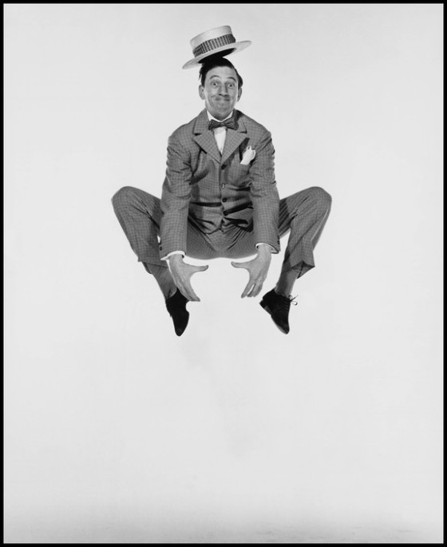
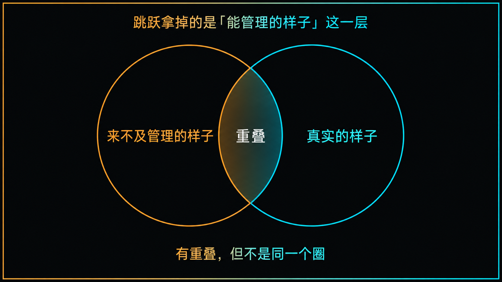
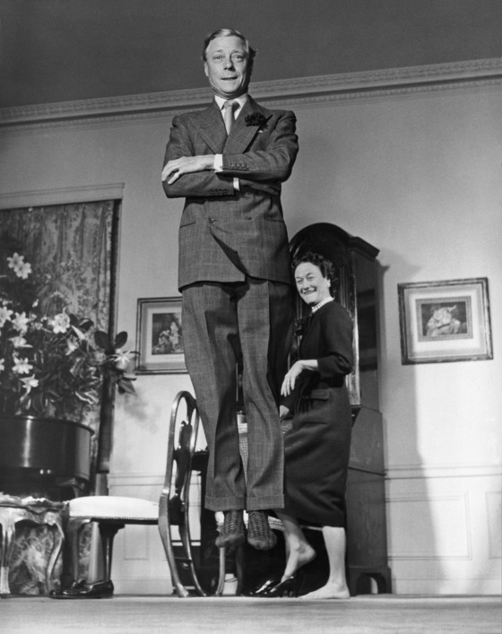
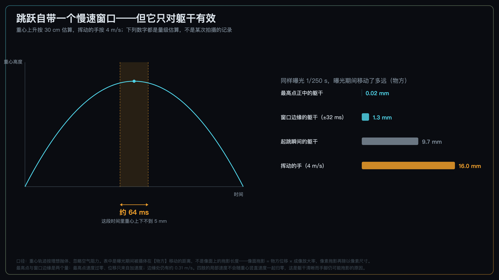
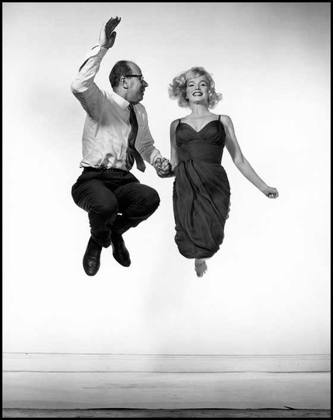
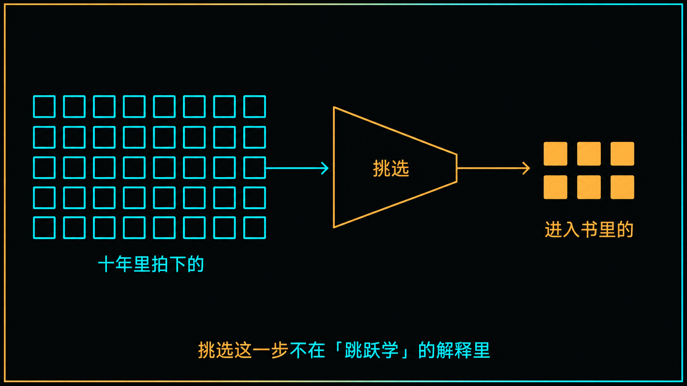

+++
title = "经典作品拆解 #19：Halsman's Jump Photos（跳跃照片系列）"
description = "「跳起来」拍到的不是真实的你，是来不及管理的你——而这已经够用了。"
date = 2026-09-16
tags = ["摄影", "经典作品", "摄影史", "Philippe Halsman", "肖像", "jumpology", "凝固运动"]
categories = ["摄影"]
series = ["经典作品拆解"]
showTableOfContents = true
+++

> 「跳起来」拍到的不是真实的你，是来不及管理的你——而这已经够用了。

## 一、「穿着高跟鞋也要跳吗？」

这套做法有个前史。1950 年，霍尔斯曼受 NBC 委托给一批喜剧演员拍照——米尔顿·伯利、格劳乔·马克斯、鲍勃·霍普、露西尔·鲍尔这些人。他注意到，有几个人会自发地跳起来，而且是带着角色跳的。

真正把它变成固定动作，是在福特那次之后。霍尔斯曼要给福特家族拍全家像，为福特汽车公司的五十周年。

这里有个年份上的小分歧，先摆出来：**这场拍摄通常被记为 1952 年**，源头是霍尔斯曼自己的叙述；**而福特汽车公司创立于 1903 年，五十周年落在 1953 年**（那年六月办了周年庆典，也铸了纪念章）。两个年份对不上，我没能找到足以定论的一手材料，所以并陈在这里，不替它编解释。

不管是哪一年，那种拍摄你能想象：一屋子体面人，每个人都端着，谁也不肯先松下来。

拍完之后，他做了一件当时看起来近乎失礼的事：他请福特夫人跳一下。

她的回答被记了下来：

> 「穿着高跟鞋？」

她还是跳了。而在此后的六年里，霍尔斯曼把这句话放进了几乎每一场肖像拍摄的最后——不管对面坐的是国务卿、诺贝尔奖得主、公爵夫人还是好莱坞明星，拍完正式的部分，他会说：请你跳一下。

1959 年，这些照片结集成书，叫《Philippe Halsman's Jump Book》。书里附了一篇他写的文章，题目叫「jumpology」——跳跃学。

这套做法的名气，几乎全部建立在他给出的那个解释上：**人在跳跃时无法维持伪装，面具会掉下来，真实的自我显露出来。**

*图：霍尔斯曼跳跃系列中的一张。请注意两件事——脸不在任何一个稳定的表情上，以及四肢的姿态成了画面里的主要信息。原作 © Philippe Halsman Archive / Magnum Photos。*

这句话被引用了六十多年。我认为它有一半是对的，而错的那一半恰好是它最出名的那一半。

## 二、他自己写的那句，比流传的那句准确

先把他的原话完整摆出来。霍尔斯曼对跳跃的机制解释是这样的：

> In a jump, the subject, in a sudden burst of energy, overcomes gravity. He cannot simultaneously control his expressions, his facial and his limb muscles. The mask falls. The real self becomes visible.

> （在一次跳跃里，被摄者用一股突然爆发的力量克服重力。他没法同时控制自己的表情、面部肌肉和四肢肌肉。面具掉了下来。真实的自我变得可见。）

这段话有四句。**前两句在讲机制，后两句是结论。而这两截的可靠程度不一样。**

「他没法同时控制表情、面部肌肉和四肢肌肉」——注意这句话的结构：它说的不是「跳跃让人变真诚」，而是**一个人能同时顾上的事情是有限的**。维持一个表情不是免费的，它需要持续分一部分注意力去照看；而起跳、腾空、准备落地这一整套动作，会把注意力更多地拉到动作本身上去。

**这是一个直觉上合理的解释，但它没有被现代实验直接验证过。** 心理学里的双任务研究确实支持「注意资源有限、同时做两件事会互相干扰」，但干扰有多大取决于任务性质、熟练程度和注意策略——熟练的动作可以高度自动化，并不必然把「管理表情」这件事挤掉。所以下面我会一直把「控制力预算」当作**一个解释现场现象的工作模型**来用，而不是当作关于大脑如何分配肌肉控制的已证实定律。它好用，但它是个比喻。

这里借的是我们主线 #2-1 那个结构：注意力有预算，占满了就分不出来。#2-1 讲的是**看照片的人**的注意力，这里换成了**被拍的人**的运动控制——两者不是一回事，但都是「总量有限、会被占满」这个形状。

问题出在后两句。从「他没法同时控制」到「真实的自我变得可见」，中间跳过了一步。

**我认为，一个人来不及管理自己的样子，和这个人真实的样子，不是一回事。**

来不及管理，得到的是一个没有被编辑过的瞬间。它可能刚好接近这个人平时的样子，也可能只是一次生理反应的定格——一个正在担心自己会不会摔倒的人，脸上出现的是「担心摔倒」，不是「真实的自我」。

*图：跳跃拿掉的是「能管理的样子」这一层，露出来的是「来不及管理的样子」。它和「真实的样子」有重叠，但不是同一个圈。*

这个区别听起来像抠字眼，但它决定了你怎么用这个方法。**如果你以为跳跃能让你看见一个人真实的样子，你会把拍到的表情当成人格证据去解读；如果你知道拍到的只是一个来不及管理的瞬间，你会把它当成素材——一个别处拿不到的、没有被表演过的素材。**

后者才是这套方法真正给你的东西。而它已经足够好了。

还有一件事得说清楚，而且要说得比通常的版本更准一点：**「jumpology」的表达形式明显带着戏仿和自嘲，但它的核心信念，霍尔斯曼本人并不完全是在开玩笑。**

Jump Book 里那篇文章的腔调确实是仿学术的——他一本正经地宣布跳跃学是一门新科学，然后给出诸如「跳跃的人类可以分成两类：一类拼命想跳得尽量高，另一类根本不在乎」这样的「研究结论」。任何人读原文都能看出这层玩笑。

但玩笑之下那个主张是当真的。他明确写过，跳跃者身上的每一个元素——手臂、腿、身体的位置、脸上的表情——都透露出确定的性格特征；这套东西在他那里是一种「心理肖像」的方法，不只是一个拍照的花招。

**所以我不打算用「那只是个玩笑」来替他开脱。** 他真的认为跳跃能透露性格，而我认为这一步推不出来。这样反而更清楚：我不是在跟一个被误读的说法较劲，是在跟他本人的主张较劲。

至于**表达形式**被当成了学术结论——那确实和上一篇是同一件事：《决定性瞬间》那个书名是出版社取的，而更好传的简化版最终盖过了原话。区别在于，上一篇里被盖过的是作者本人更准确的表述，这一篇里被盖过的，是「这只是一个观察，不是一条定律」这层分寸。

## 三、技术拆解

### 3.1 这些照片在做什么

把同一个人的两种状态放在一起看，**变的到底是什么**。

正式肖像里，一个人的脸是被持续维持的：嘴角的位置、下巴的角度、眼睛睁开的程度，都在一个稳定的设定上。这个设定可以很自然，也可以很僵，但它是**被持有的**——像举着一个杯子，需要一直用力。

跳跃帧里，那只手松了。不是变成了另一个表情，而是那个持有的动作断了一下。所以你看到的往往不是一个「更真诚的表情」，而是**一个没有被固定住的脸**——嘴可能张着，眼睛可能眯着，五官处在两个状态之间。

*图：这一帧是个例外，而例外本身有信息量——人已经离地，手臂却还抱着，脸也没散，看上去几乎和一张站着的正式肖像没什么差别。跳跃拿走的是控制力预算的一部分，不是全部；对一个一辈子都在被拍照的人，它几乎拿不走什么。这一点第四节还会回来。原作 © Philippe Halsman Archive / Magnum Photos。*

同时，身体接管了画面。四肢的姿态成了主要信息：有人把腿收得整整齐齐，有人手脚全开，有人跳起来的高度只够脚跟离地一厘米。霍尔斯曼那句「分两类」的玩笑，观察是准的——**人对「被要求做一件没有标准答案的事」的反应确实不一样**。至于这种反应能不能推出性格，那是另一回事——霍尔斯曼本人认真做过这种推断，而我认为这种推断缺乏足够依据。

### 3.2 它是怎么做到的

**（一）跳跃自带一个竖直慢速窗口——但它只消掉重心的竖直平移**

这是本篇最实用的一部分，也是很多人没意识到的。

上上篇讲 *Dalí Atomicus* 时我们算过一笔账：凝固运动靠的不是快门刻度盘上的数字，而是**有效曝光时间**——闪光主导曝光时，有效曝光时间约等于闪光持续时间。那是靠光把一切冻住。

跳跃这件事不一样。它自己送了你一个窗口。

抛体运动在最高点速度过零。一个重心上升 30 厘米的跳跃，起跳速度约 2.4 m/s，总滞空约 495 毫秒。而在最高点附近，重心几乎是停住的：

**约 64 毫秒之内，重心上下移动不到 5 毫米。**

*图：左边是重心高度随时间的抛物线，最高点附近那条带就是竖直慢速窗口（它只消掉重心的竖直平移）。右边是同一曝光时间下四处的物方位移对照（注意最高点正中与窗口边缘是两个量，相差六十多倍）。数值口径见下。*

这就是为什么这类照片在那个年代能拍清楚，而不需要把闪光压到极短。

但接下来是关键的一句，也是这张图真正要说的事：

**这个窗口只消掉一个分量。**

最高点归零的是**重心竖直平移**——这一项是全身共享的，手也吃到了。问题在于，身上任意一点的速度是三样东西叠加起来的：重心平移、躯干转动、关节运动。最高点只管住第一项，后两项照旧。

躯干离重心近、关节运动小，所以第一项一没了，它基本就稳了。而手在挥、腿在蹬，后两项本来就大——窗口对它们几乎不解决问题。

同样 1/250 秒的曝光，被摄体在这段时间里各自移动了多远：

- 最高点正中的躯干：约 **0.02 毫米**（速度过零，位移只来自加速度）
- 慢速窗口边缘（距最高点 ±32 毫秒）的躯干：约 **1.3 毫米**
- 起跳瞬间的躯干：约 **9.7 毫米**——是窗口边缘的约 8 倍
- 挥动的手（按 4 m/s 估算）：约 **16 毫米**——是窗口边缘的十几倍

换句话说，**整个 64 毫秒的窗口里，躯干由重心竖直平移造成的位移都很小**（最坏也就 1.3 毫米，正中更是只有它的六十分之一），而手在同一时刻已经跑出十几毫米。

要不要把 1.3 毫米叫「够干净」，还得看放大率和最终输出尺寸——同样的物方位移，拍半身和拍全身在画面上完全不是一回事。

*图：可以拿这张自己验一遍上面那笔账——甩起来的手臂、交握的手、飞起来的裙摆，边缘都是干净的。可按刚才那组数字，手在 1/250 秒里要划过十几毫米，本该拖出一条尾巴。它没有拖——这说明除了躯干那个慢速窗口，他还动了另一个旋钮。是哪一个，下一节说。原作 © Philippe Halsman Archive / Magnum Photos。*

所以「凝固一次跳跃」其实是**两个问题**：

> 躯干靠时机，四肢靠曝光时间。

等到最高点，你就省下了**竖直平移**造成的那部分模糊——但这不等于躯干一定清晰。水平漂移、身体转动、相机抖动、对焦不准都还在，最高点一个都管不了。而手脚的局部速度更是从头到尾都在。

所以这两件事不能互相替代：**时机帮你消掉的是一个特定的分量，其余的还得靠曝光时间和别的手段**。很多人跳拍失败就卡在这儿——以为「等最高点」是万能的，结果躯干是稳的，甩出去的手糊成一片。

这几个数字的口径必须说清楚：

- 重心轨迹按理想抛体算，忽略空气阻力；
- 「起跳高度」指的是**重心**上升的高度（普通人大约 0.2–0.4 米），不是脚离地的高度，也不是摸高；
- 手速 4 m/s 是人手挥摆的量级估算；
- 上面那几个毫米数是**被摄体在真实空间里移动的距离（物方位移）＝速度 × 曝光时间**，**不是**底片或传感器上的拖影长度。两者的换算是：像面拖影 ＝ 物方位移 × 成像放大率；要换成像素数，再除以像素尺寸。所以 16 毫米指的是手在空中划过了 16 毫米，不是「传感器上糊了 16 毫米」——这几个数只能用来比较相对量级；
- **以上全部是量级估算，不是霍尔斯曼某次拍摄的记录。**

**（二）跳跃系列用的是什么，和他一般肖像用的不是一回事**

先把器材说准，因为这里很容易把几套东西混成一套。

按霍尔斯曼档案馆的年表：**1936 年**他设计过一台 9×12 厘米的双镜头反光机，请一位细木匠做出来；**1947 年**又做了改进的 4×5 版本，三台原型机，叫 Halsman-Fairchild。这是他做一般肖像时用的家伙。

**但跳跃系列不是用它拍的。** 展览研究资料记载，这套照片用的是**禄来（Rolleiflex）加电子闪光灯**——他自己说，唯一的限制是天花板的高度。

这个区别不是掉书袋，它正好把上面那笔账补完了。前面说「躯干靠时机、四肢靠曝光时间」，而**霍尔斯曼两样都做了**：等最高点，是时机；电子闪光灯把有效曝光时间压到远短于快门刻度，是曝光时间。这也回到了 #17 的那笔账——闪光主导曝光时，有效曝光时间约等于闪光持续时间。他不是靠运气拿到清晰的手脚，是靠灯。

技术之外还有一层，是他对现场关系的处理。**下面这段说的是他一般肖像的工作方式，不是跳跃系列的器材**——注意他提到了对焦布，那是大画幅相机才有的东西：

> The camera I have constructed for myself is a very important part of my technique. My head is covered by the focusing cloth, I am looking at the subject through the lens. From the sitter's point of view, the camera's lifeless mechanism suddenly becomes almost alive.

> （我为自己造的这台相机是我技术里非常重要的一部分。我的头被对焦布罩着，我透过镜头看着被摄者。从被摄者的角度看，相机那套没有生命的机械忽然变得几乎是活的。）

他这段话里真正有用的不是器材，是**他意识到自己在被摄者眼里是什么**。头埋在对焦布下面，人看不见你的脸，只看见一个机器——而这台机器忽然「活了」。他是在管理被摄者的心理状态，跟「请你跳一下」是同一套操作的两半。

**（三）还有一层，是编辑**

这是对「跳跃揭示真实」最直接的反驳，而且它就在这本书本身里。

从 1950 年 NBC 那次意外，到 1959 年成书，前后跨了十年；而把「请你跳一下」变成每场必做的收尾动作，是福特之后那六年。两个时间尺度说的是两件事，别混用。

关于数量，不同来源给的数字略有出入，但那多半是**版本和统计口径不同**，不是什么悬案：Magnum 现在的页面写 191 张黑白照片，2015 年 Damiani 版标 194 幅图，展览资料则谨慎地写「一百七十余幅肖像」。而霍尔斯曼档案馆的年表说的是另一件事——**1950 到 1959 年间，有两百多位名人为他跳过**。

注意这两个数不是同一个量：**跳过的人数**（两百多）和**进了书的照片数**（一百七十到一百九十几），差出来的那部分正是重点。

本文的论证不依赖精确张数。就算跳跃真的让每个人露出了「真实的自我」，你在书里看到的也不是那个真实自我——**你看到的是霍尔斯曼认为值得放进书里的那些**。挑选这一步，本身就是一次强力的编辑。

*图：跳跃产生的是一批素材（1950–59 年间两百多位名人跳过）；进入书里的是被挑过的那一部分（图中方块数量为示意，不是实数）。挑选这一步不在「jumpology」的解释里。*

这一层不在 jumpology 的解释里。而它恰恰是这套照片好看的一大原因。

## 四、它在摄影史里的位置

短期的影响很直接：它把名人肖像里那种正装、正襟、正面的默认套路撞开了一个口子。在此之前，给一位大法官或者一位公爵夫人拍照，图片的样子是可以预测的。霍尔斯曼证明了这些人也可以在半空中出现，而且这么做不但没有冒犯，反而让读者觉得亲近。

长期的影响更大，但也更需要小心地说。

**今天大量「让被摄者动起来」的指令，用的是同一套逻辑。**「走两步」「转过来的时候看我」「跟旁边的人说句话」「把这个递给他」——这些都不是要拍那个动作，而是要拍动作占住控制力之后剩下的那个人。这套逻辑今天是人像摄影的常识。我不打算把它们都算成霍尔斯曼的直接后代——让人动起来这件事他不是第一个做的，运动摄影影响肖像的线索比他早——但把它固化成一句人人可下达的指令、并且做成一整本书，是他的贡献。

但另一半也得说：**跳起来同样可以被表演。**

一个方法一旦流行，被摄者就学会了。今天你让一个常上镜的人跳，他跳出来的多半是一个准备好的姿势——那份「控制力被占满」的前提已经不成立了，因为这个跳法他练过。方法本身没有变，变的是对面的人对它的熟悉程度。这不是霍尔斯曼的问题，是所有有效方法的宿命。

**我的看法是：这套做法真正的贡献，不是「揭示真实」，而是把一个不可控的条件，变成了一条可以对任何人下达的指令。**

在此之前，想拍到一个人卸下防备的样子，常见的路子是靠时间和关系——跟对方待得够久，或者刚好赶上他松懈的那一刻。霍尔斯曼做的事，是找到了一个**不依赖运气也不依赖交情**的办法：一句话，任何人都能听懂，任何人做起来都会产生同样的物理后果。

这正好接上前面两篇。#17 里我们说过，二十几次投掷不是笨，是这类问题的理性成本——他把随机的东西一个个固定下来。#18 里我们说过，形式的组织可以训练，时机不能。这一篇说的是第三件事：**有些看起来只能靠运气的东西，可以被改造成一个流程。**

三篇加起来是同一种思路：**把不可控的部分尽量挪到可控的一侧。**

## 五、与主线的接口

**如果你想深入……**

这套做法的核心决策对应我们摄影主线的几个模块：

- **镜头与成像·三分法诊断运动糊** — 讲了一张糊掉的照片到底是被摄体动了、相机抖了还是对焦跑了，以及怎么分辨。跳拍里躯干清晰而手脚拖影，是最典型的「被摄体运动」案例。
- **#2-1 构图的本质：注意力预算的调度** — 讲了注意力是有预算的，占满了就分不出来。本篇的「控制力预算」是同一个结构，换到了运动控制上。
- **叙事与编辑·Deviation 分类学** — 讲了一张照片里「偏离常规」的东西如何变成信息。跳跃帧里那个没被固定住的脸，就是一次可控的偏离。

读完这些，你对跳跃照片的理解会从「一个有趣的花招」变成可操作的现场方法。

## 六、对今天的启示

**第一，给被摄者一个占用控制力的任务——不一定是跳。**

跳跃只是这套逻辑的一个实例，而且今天已经被用滥了。真正可迁移的是那个原理：**找一件需要对方分神去做的事。**

倒数三个数、从门口走过来、把手里的东西递给旁边的人、回答一个需要想一下才能答的问题——这些都能占住那部分「维持表情」的控制力。任务不需要激烈，只需要**真的需要投入**。如果只是形式上摆个「在做事」的样子，效果往往会打折——不是因为假装不费力（假装同样占注意力），而是因为被摄者的注意力仍然主要挂在「我现在看起来怎么样」上。**关键不在动作真假，在于它有没有真的把注意力从自我监控上挪开。**

**第二，别把拍到的东西当成「真实」。**

你拿到的是一个没有被管理过的瞬间，这是一份别处拿不到的素材。但它不是这个人的人格证据。看到一张跳跃照片里某人表情狼狈，不能推出他这个人狼狈——只能推出在被拍下的那个瞬间，他大概没有像静态摆拍时那样持续管理自己的表情。

（顺带说一句：前面那个 64 毫秒是**抛体运动的窗口**，由「重心距最高点不超过 5 毫米」这个阈值算出来的，它跟一个人能维持多久表情没有任何关系。别把这两个时间尺度混用——我差点自己就混了。）

这个分寸看起来无关紧要，但它决定了你会不会拿照片去论证一些照片撑不起的事。

**第三，技术上把两件事分开解决。**

躯干靠时机：等最高点。这一步不花钱，只要你按快门的时候心里知道自己在等什么。

四肢靠曝光时间：要手脚也干净，就得把**有效曝光时间**压下去。给个起点范围而不是唯一解——

- **自然光下想连手脚一起凝住**：从 1/800–1/2000 s 起步试；只要求躯干稳、允许手脚带一点动感，可以放宽到 1/250–1/500 s。
- **用闪光**：重点不是同步快门那个数字，而是**把环境光压到明显低于闪光**，让有效曝光时间由闪光持续时间接管（这正是霍尔斯曼那盏电子闪光灯在做的事，也是 #17 那笔账）。看灯的规格要看 **t.1 闪光持续时间**，不是只看同步速度。

验收的时候不要看参数表，**先看手脚的边缘**：指尖、鞋跟、飞起来的衣角有没有拖出尾巴。

但诊断不要一步到位——糊了先按主线那套**三分法**分家：是被摄体运动、相机抖动，还是对焦不准？只有确认是被摄体运动之后，「躯干稳而手糊」才说明曝光时间不够。**反过来推是不成立的**：躯干糊不一定是时机没等到，也可能是你自己手抖或者焦点跑了。

## 七、读完之后

读这篇之前，「跳起来」大概是一个关于真诚的说法：让人跳，面具就会掉，真实的自我就露出来了。

读完之后应该变成这样：**跳跃把注意力更多地拉向动作本身，拿到的是一个来不及管理的瞬间**（这是一个解释现场的工作模型，不是已证实的生理定律）。它和「真实」有重叠，但不是同一件事。而对拍照的人来说，这个区别不是坏消息——**因为「真实」不可得，而「来不及管理」可以用一句话稳定地做出来。**

霍尔斯曼真正留下的不是一套关于人格的理论，是一条指令。理论是他半开玩笑写的，指令是认真的。

下一篇我们离开摄影棚。

霍尔斯曼的做法是在一个可控的房间里，用一句话制造出一个不可控的瞬间。而罗伯特·弗兰克做的事正好相反：他把一台相机装进车里，在美国跑了两年，什么都不控制——不摆布、不打光、不要求任何人做任何事。他带回来的照片里全是「毛病」：糊的、歪的、颗粒粗得看不清脸的。

然后他把它们排成了一本书，而那些毛病成了这本书的语言。

**#20 The Americans（美国人）**——一本出版时被美国摄影界骂惨了的书，后来改变了所有人对「一张照片可以是什么样」的认知。

## 八、参考资料

**作品与出版**

- Magnum Photos — Philippe Halsman: Jump 专题页，含 Jump Book 的介绍、收录数量与霍尔斯曼本人关于跳跃的原话：[https://www.magnumphotos.com/arts-culture/philippe-halsman-jump-book/](https://www.magnumphotos.com/arts-culture/philippe-halsman-jump-book/)
- Philippe Halsman Archive 官网（作品浏览与授权说明）。霍尔斯曼的照片全部在版权保护期内，转载需另行申请：[https://www.philippehalsman.com/](https://www.philippehalsman.com/)
- 《Philippe Halsman's Jump Book》，1959 年初版；后有复刻本流通，书中附霍尔斯曼所写的「jumpology」一文——那篇仿学术文章的语气本身就是理解这套做法的关键。

**关于起源与语境**

- Smithsonian Magazine，"When He Said 'Jump…'"：记载 jumpology 起于 1952 年拍摄福特家族之后，以及 Mrs. Edsel Ford 那句「With my high heels?」；并明确指出他是「in the mock-academic text」里声称这些是跳跃学研究。[https://www.smithsonianmag.com/arts-culture/when-he-said-jump-130897523/](https://www.smithsonianmag.com/arts-culture/when-he-said-jump-130897523/)

**数值来源**

- 本文所有关于滞空、慢速窗口与拖影长度的数字，均由抛体运动公式算出并经自校验。它们是量级估算，不是霍尔斯曼任何一次拍摄的记录。

**摄影师**

菲利普·霍尔斯曼（Philippe Halsman，1906–1979），生于拉脱维亚里加。1930 年代在巴黎建立肖像摄影事业，1940 年在爱因斯坦等人协助下取得赴美签证。到美国后成为最多产的杂志封面摄影师之一，为《生活》拍摄的封面数量在同代人中名列前茅。1951 年受马格南创始人之邀成为「contributing member」，由马格南代理其作品在美国境外的发行，这一安排延续至今。与萨尔瓦多·达利的长期合作贯穿他的整个职业生涯，*Dalí Atomicus*（1948）即出自这一合作，本系列 #17 已单独拆解。

**延伸阅读**

- *Philippe Halsman's Jump Book*，复刻版（Damiani / Abrams 等版本流通中），可看到成书时的排布与那篇 jumpology 原文。
- 本系列 #17《Dalí Atomicus》——同一位摄影师，讲的是他怎么把一个现实里不存在的瞬间造出来，以及「有效曝光时间」这笔账。
