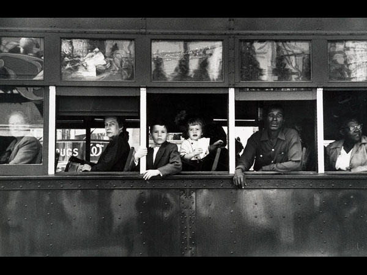
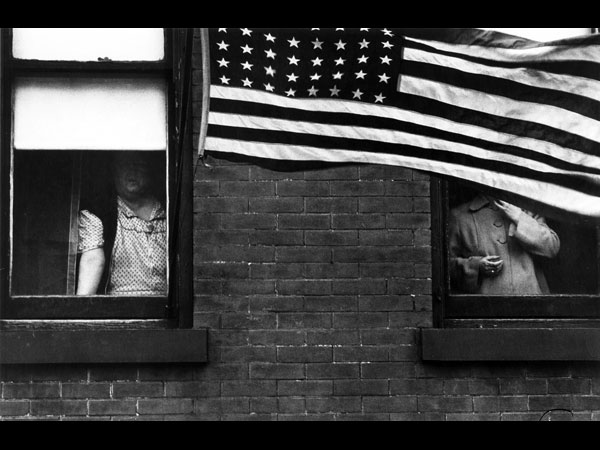
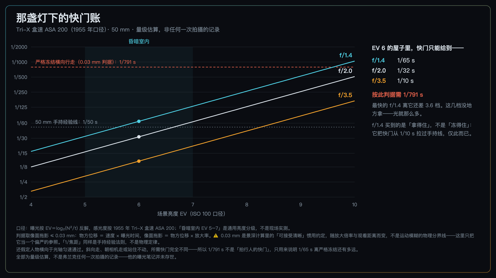
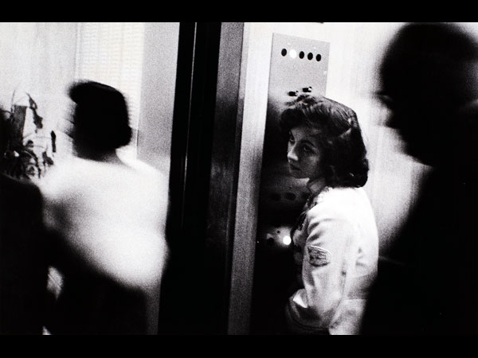
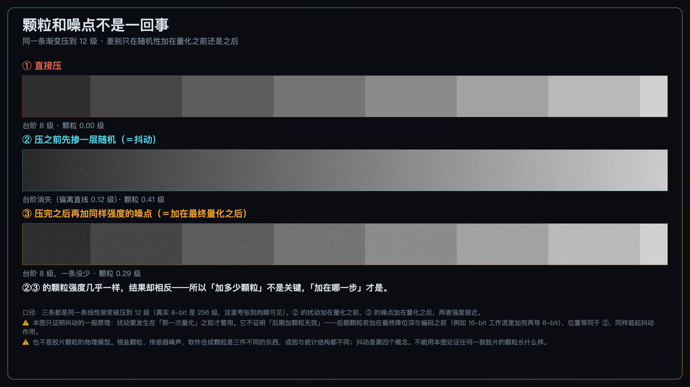
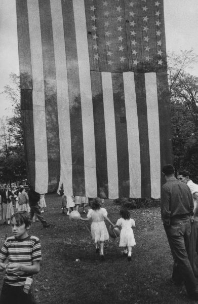
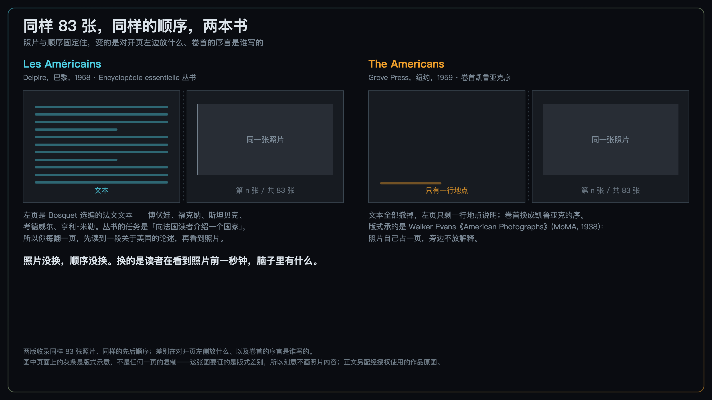

+++
title = "经典作品拆解 #20：The Americans 系列（美国人）"
description = "那些糊和颗粒是条件交出来的账单；他做的选择不是制造它们，是不把它们排除出去。"
date = 2026-09-20
tags = ["摄影", "经典作品", "摄影史", "Robert Frank", "摄影书", "编辑", "颗粒"]
categories = ["摄影"]
series = ["经典作品拆解"]
showTableOfContents = true
+++

> 那些糊和颗粒是条件交出来的账单；他做的选择不是制造它们，是不把它们排除出去。

## 一、「衣着邋遢，口音是外国的」

1955 年 11 月 7 日，阿肯色州麦基希（McGehee）。大约两点，一辆挂纽约牌照的旧福特被拦下来，车里塞满箱子、行李，还有一堆相机。

拦车的是州警布朗中尉。他在报告里写，这个人衣着邋遢、头发凌乱、口音是外国的，车上东西多得可疑。他那天还得赶去德莫特办事，就先把人关进麦基希的市监狱，等自己回来再查。

被关进去的人叫罗伯特·弗兰克（Robert Frank），瑞士人，再过两天满三十一岁，到美国八年，刚拿到古根海姆基金会的奖金，正在给一本还没有名字的书拍照片。

这本书 1959 年在美国印出来，实际上市已经是 1960 年 1 月。四个月后，《大众摄影》（*Popular Photography*）杂志用一整组编辑评论把它骂了一遍。其中几句后来成了这本书最有名的介绍词——说它「毁于怨恨、苦涩和狭隘的偏见，就像书里许多照片毁于毫无意义的模糊、颗粒、脏兮兮的曝光、醉汉般的地平线，以及全面的草率」。另一句更狠，说这是「一首写给病人的悲伤的诗」。

骂得不算冤枉。那些毛病确实在——模糊、颗粒、歪斜、暗得看不清脸，一路翻下去，一样不少。

所以真正的问题不是「它们在不在」，而是：**它们是从哪儿来的，以及弗兰克对它们做了什么。**

*图：Trolley — New Orleans（新奥尔良的有轨电车，1955）。1959 年美国版的护封用的就是这张，它也是全书最常被单独抽出来讨论的一张。这件事本身有点反讽——本篇要讲的恰恰是：把任何一张从那 83 张的顺序里拎出来单看，你会漏掉什么。原作 © Robert Frank，courtesy Pace Gallery。*

上一篇结尾我写过一句话：弗兰克把相机装进车里跑了两年，什么都不控制。

这句话只对一半。

## 二、作品背景

**「用微型相机，在美国自由地拍」**

1954 年秋天，弗兰克写了一份古根海姆基金会的奖金申请。提案摘要只有两句：

> To photograph freely throughout the United States, using the miniature camera exclusively. The making of a broad, voluminous picture record of things American, past and present.

> （在全美国自由地拍摄，只用微型相机。为美国的事物——过去的和现在的——做一份宽广、大量的影像记录。）

「微型相机」（miniature camera）在 1950 年代指的就是 35 mm。这一句里已经埋好了后面所有的技术账。

申请书的正文里还有一句，我认为它才是这本书真正的说明书：

> 我说的是那些就在那儿的东西，随处可见——**容易找到，不容易挑选和解读。**

> （I speak of the things that are there, anywhere and everywhere — easily found, not easily selected and interpreted.）

写下这句话的时候他一张照片都还没拍。

建议他去申请、并且替他写推荐的是沃克·埃文斯（Walker Evans）；爱德华·斯泰肯（Edward Steichen）和《时尚芭莎》的艺术总监布罗多维奇（Alexey Brodovitch）也写了。基金会 1955 年批了，1956 年续了一次。他 1955 年春天上路，1956 年回到纽约，开车横穿美国的那一程大约持续了一年，拍了 767 卷胶卷；整个项目从拍摄、补拍到编辑成书则拖了好几年。（行程常被记作九个月、三十个州、一万多英里，不过这组数字多来自后来的展览与拍卖资料，我没有找到能逐项核实的一手记录。）

**一台老机身，一枚快镜头**

瑞士相机博物馆（Musée suisse de l'appareil photographique，沃韦）藏着他那台机器：一台 1934 年起生产的 Leica III，机身编号 132545，配一枚 50 mm f/1.4 Nikkor，镜头编号 331845。博物馆的记录说，这就是他拍《美国人》用的那台；1960 年代初他把它送给了朋友 Dadi Wirz。

这个搭配在当年不常见。机身是二十年前的设计，镜头却是那个年代极少数的大光圈——朝鲜战争前后，尼康镜头因《生活》战地摄影师的使用迅速建立起声誉，50 mm f/1.4 在当时的美国测试里也受到特别关注。

**这套已知器材组合里，最显眼的性能取向就是进光量。** 这不是趣闻，是后面那笔账的第一项。

胶片是 Tri-X。这款胶片 1954 年才出 35 mm 版，他上路的时候它刚上市一年。这里有个必须先说清的坑：**当年盒上印的是 ASA 200，不是今天的 400。** 1960 年 ASA 标准改版，去掉了原先留的一档安全系数，同一款乳剂的标称速度就从 200 跳到了 400。胶片没变快，尺子换了。用今天的 400 去反推他当年的快门，会整整算快一档。

## 三、技术拆解

### 3.1 这张照片在做什么

**论点一：它把技术缺陷做成了一种贯穿全书的口音。**

这里要先说清一件事，免得把话讲过头：**书里并不是八十三张都糊、都歪、都暗。** 有相当一部分是稳的、清楚的。真正发生的是——这些「毛病」在书里反复出现，而且出现在他自己挑出来、排进去的位置上。一张照片糊了是失误；同一类处理在八十三张的跨度里被一次次留下来，那就不再是失误，是一个被选出来的声音。

证据就在开篇第一张。

*图：Parade — Hoboken, New Jersey（霍博肯的游行，1955），《美国人》全书的第一张。两扇窗、两个人，两张脸都没给你——而且是用两种不同的方式：左窗那位站在拉下一半的窗帘后面，整张脸落进阴影，五官读不出来；右窗那位抬着手，脑袋被垂下来的国旗齐齐切掉。原作 © Robert Frank，courtesy Pace Gallery。*

单看这一张，最自然的评价是「摄影师没拍到脸」。但翻完整本书你会发现，脸被挡住、被切掉、被压进暗部的照片一遍遍出现——那就不是没拍到。

而且注意这两扇窗不是同一个毛病：一个是曝光落下去了，一个是前景挡住了。它们在书里是同一种语气，机制却不同——这正是「口音」和「失误」的区别。失误随机分布，口音会用不同的手段反复说同一件事。

**论点二：意义的载体从单张挪到了相邻关系。**

这本书里很多张单独拿出来都算不上好照片。它们的分量来自位置：前一张是什么、后一张是什么、这一段从哪张开始。同一张照片放在不同的邻居中间，说的话是不一样的。这一条到 3.2 会有一个可以直接验证的例子。

**论点三：「有一个人在那儿」这件事，被留在了画面里。**

地平线是歪的，取景常常是从车窗里、从人群缝里、从柜台另一侧过来的，主体经常被前景挡掉一块。弗兰克自己在一篇短文里写过，他的照片「不是事先计划或构图的」——那篇文字发在《U.S. Camera Annual 1958》上，同期还登了埃文斯写他的文章和他古根海姆时期的三十八张照片。我认为这些痕迹一致地在提示同一件事：**有一个正在移动的人站在那儿，他来不及端平相机，也没有要求任何人配合。** 这是一种视角纪律——摄影机是谁、站在哪儿、有没有介入，在这本书里始终是同一个答案。

### 3.2 它是怎么做到的

**（a）那盏灯下的快门账**

弗兰克要拍的东西——夜里的餐馆、电梯、酒吧、公路边的柜台、殡仪馆——都在一个共同的条件下：光不够。

那问题来了：光不够的时候，1955 年的一台相机能给你什么？

*图 1：横轴是场景亮度，纵轴是能给到的快门。三条线是三档光圈，都按 1955 年 Tri-X 的盒速 ASA 200 算。红色虚线是一个偏严的参照——把 3 m 外横向走过的人压进 0.03 mm 判据所需的快门；那条弥散圆是景深计算的惯用约定，不是运动模糊的物理分界线，换个放大倍率就变。全部为量级估算，不是弗兰克任何一次拍摄的记录——他的曝光笔记并未存世*

一个昏暗的室内大约落在 EV 5 到 7 之间（这是通用的亮度分级，不是现场实测）。取中间的 EV 6 来算：

- f/3.5（当年那枚常见的 Elmar 标头）：**1/10 s**。手持基本没法用。
- f/2：**1/32 s**。勉强。
- f/1.4：**1/65 s**。能拿住了。

这就是那枚 Nikkor 的全部意义：它把快门从 1/10 s 拉到 1/65 s，刚好越过 50 mm 的手持经验线（1/50 s，经验法则，不是物理定律）。**它买到的是「拿得住」，不是「冻得住」。**

这两件事差多远，可以算。沿用上一篇建立的那条换算链——

> 物方位移 ＝ 被摄体速度 × 曝光时间；像面拖影 ＝ 物方位移 × 成像放大率

3 m 外一个正常走动的人，横向速度约 1.4 m/s，50 mm 镜头的放大率约 0.017。1/65 s 的曝光里，他在真实空间中走了约 21 mm，落到底片上是 **0.36 mm 的拖影**。

这条拖影算不算「糊」，得先有个判据。这里取 0.03 mm——也就是 35 mm 景深计算里惯用的那个可接受弥散圆。**要强调的是，它是个约定，不是物理分界线**：它随放大倍率和观看距离变，印成小图和放成大幅，同一条拖影的观感完全不同。拿它当判据，只是因为它偏严、好比较。

按这个判据，0.36 mm 是它的十二倍，占画面短边的 1.5%；要压进去，需要 **1/791 s**。

这个数也别当成「拍行人的快门」——它还假定了人横向于镜头匀速走过。斜着走、朝你走、或者干脆站住不动，需要的快门完全不同。

所以这笔账真正说明的只有一件事：**在 EV 6 这样的屋子里，即使把镜头开到 f/1.4，离严格冻结一个横向走动的人也还差约三点六档。而这三点六档没地方拿——光就那么多。**

在那种光线下，糊有很硬的物理成本；它不需要被追求，条件本身就会把它交出来。

账算完了，再看这张：

*图：Elevator — Miami Beach（迈阿密海滩的电梯，1955）。电梯女孩相对清楚，她两边的人糊成一片——凯鲁亚克在序里管他们叫「blurred demons」（糊掉的鬼魂）。同一次曝光里，相对静止的人留得下，动起来的人留不下——这张照片让你看见的是上面那笔账背后的同一种机制。但它的实际快门没有记录，前面那三点六档不能直接套到这张头上。原作 © Robert Frank，courtesy Pace Gallery。*

**（b）颗粒从哪儿来，以及它和噪点不是一回事**

账单还有第二项。在不加人工光、不换胶片、还要手持拍的这几个前提下，曝光上主要只剩三条路，而且三条都有代价：

1. **开大光圈**——那枚 f/1.4 已经是当年能拿到的极限之一（**具体某张照片用的是几档，没有记录，这里不作断言**）。代价是对焦容错骤降：还按 3 m、50 mm、0.03 mm 那套判据算，f/1.4 的景深是 2.86 m 到 3.16 m，**前后加起来不到三十厘米**——被摄者往前或往后走一步就出界了。这类早期高速标头全开时也更容易暴露边缘像差。
2. **放慢快门**——上面算过了，在那个示例条件下，慢到能拿住的极限也还差三档多。
3. **按更高的曝光指数拍、延长显影**（也就是推片）——代价是曲线斜率被抬起来：反差变硬、颗粒变粗，而暗部里本来就没曝上的信息，显影是变不出来的。

这里必须说清一件事：**弗兰克的冲洗记录没有存世，我没法说他推了多少、推没推。** 成品里的高反差和明显颗粒，和推片之后的视觉结果是相容的——但相容不等于证明。欠曝、药水配方与时间、放大倍率、相纸号数、烧放、复制和印刷，每一环都能造出同样的观感。所以这一项只能停在「可能」，不能写成他做过。

于是就有了那句最常被问的问题：我今天想拍出那种感觉，在后期加一层颗粒行不行？

答案是「看你加在哪一步」，而这一步差在哪儿，是可以量出来的。

*图 2：三条完全相同的灰阶渐变，都被压到 12 级。① 直接压，出现台阶；② 在压之前掺一层随机扰动，台阶消失、换来一层颗粒；③ 压完之后再加同样强度的噪点，颗粒有了，台阶一条没少。②③ 的颗粒强度几乎一样（0.41 级 vs 0.29 级），结果却相反——差别在扰动加在那一次量化之前还是之后，不在前期还是后期*

这就是**抖动**（dithering），而它给出的结论只有一条，得说准：**随机性要发生在造成台阶的那一次量化之前，才能把台阶换成颗粒。**

这条结论有两个方向都不能推过头。

**一个方向**：它不等于「后期加颗粒没用」。关键从来不是「前期还是后期」，是「在不在那一次量化之前」。如果你在 16-bit 的工程文件里加完颗粒再导出 8-bit，那层颗粒的位置等同于图中的 ②，照样起抖动作用。真正没用的是在已经出现台阶的成品上再盖一层噪点——那就是图中的 ③。

**另一个方向**：银盐颗粒并不是「为了对抗量化而存在的抖动」。它是乳剂的物理结构，跟数字量化是两个问题。真要说它和后期贴上去的一层有什么根本不同，更可靠的说法是：**银盐颗粒和影像是一起生成的、随曝光量变化**，亮部暗部的颗粒表现不一样；而软件生成的颗粒通常是均匀盖在整幅上的，跟画面内容无关。

所以「银盐颗粒 / 传感器噪声 / 软件合成颗粒 / 抖动」是四件不同的事，别压成一条链。图 2 能证的只是第四件。

（一句边界：图 2 是数字链路上的演示，不是银盐颗粒的物理模型。）

**（c）他控制的东西一点也不少，只是不在快门那一侧**

现在回到开头那句被我说对了一半的话。

767 卷胶卷，两万七千多次曝光。他从中放出大约一千张 8×10 英寸的工作样片，**按主题分组**，用订书钉钉在公寓墙上，或者干脆摊在地板上，然后开始排顺序。

这个排法花了一年多，而且留下了刻度：1957 年冬春，他先定出一个**九十二张**的初步序列，做了一本 8×9⅝ 英寸的小样书；到六月初收成**八十五张**；六月底到七月在巴黎跟德尔皮尔谈出版，最终定在 **八十三张**。

从两万七千到八十三，三百多比一；而最后那四十来天里砸掉的九张，是在已经成形的序列上一张张拿掉的。

印放上他也没打算客气。按国家美术馆《Looking In》那本研究图录的整理，他把反差压得极硬，裁切幅度也很大——同一张底片在不同时期被裁成过不同的样子，图录里专门收了这些版本的对照。

**换句话说：他放弃的是对现场的控制，换来的是对成书的控制。** 不摆布、不打光、不要求任何人做任何事，这些是真的；但从两万七千次曝光里挑出八十三张、再决定它们的先后，这是另一种强度的干预，而且他干得非常狠。

顺序不是随手排的。学界常见的读法是，全书分成四段，每段以一张带美国国旗的照片开头——国旗是这本书里最明确的母题，在完全不同的语境里反复出现：霍博肯游行时把一颗头齐齐切掉的那面，独立日那面大得像一堵墙、旧到透光的（*Fourth of July — Jay, New York*）。同一个符号，每出现一次意思就被换掉一点。它既是分段标记，也是这本书的计数器。

顺带说一句能看出他多在意这个母题的事：那面旗他不是只拍了一次——1956 年 7 月 4 日，他专程回了一趟杰伊，把同一面旗又拍了一遍。

*图：Fourth of July — Jay, New York（纽约州杰伊的独立日，1954）。一面巨大的国旗竖着挂下来，占掉画面上三分之二；它旧得透光，能看见后面的树，旗面上还有几块补过的深色方块。底下是在草地上过节的人，两个穿白裙的小女孩正朝它走过去。同一面旗，在霍博肯是把一颗头切掉的东西，在这里是一堵比所有人都高的墙——旗没变，它在画面里占的位置变了，读法就跟着变。原作 © Robert Frank，courtesy Pace Gallery。*

到这里，「什么都不控制」这句话可以正式作废了。他只是把控制挪到了别的地方。

**（d）同样 83 张，两本书**

这本书还留下了一个几乎是自然实验的证据。

*图 3：1958 年 Delpire 版与 1959 年 Grove 版收录同样 83 张照片、同样的先后顺序；变化集中在对开页左侧放什么、卷首的序言是谁写的。图中页面上的灰条是版式示意，不是任何一页的复制*

1958 年 5 月 15 日，Draeger Frères 印完了这本书；同年 11 月，罗贝尔·德尔皮尔（Robert Delpire）正式发行，书名叫 *Les Américains*，是他那套《Encyclopédie essentielle》丛书的第五号——那套书的任务是向法国读者介绍一个个国家。所以每一个对开页，左边是 Alain Bosquet 选编的法文文本：博伏娃、福克纳、斯坦贝克、考德威尔、亨利·米勒。你每翻一页，先读到一段关于美国的论述，然后才看到照片。

美国版 1959 年末由 Grove Press 印出，1960 年 1 月 15 日正式发行。同样 83 张，同样的顺序，但文本全部撤掉了，只在卷首放了凯鲁亚克的序——就是那篇写着「罗伯特·弗兰克，瑞士人，不引人注目，人很好，拿着那台小相机单手举起来一按，就从美国身上吸出了一首悲伤的诗」的序。

**而这不是出版社的设计决定，是弗兰克自己提的条件。** 格罗夫的巴尼·罗塞特同意出书之后，弗兰克要求两件事：每一张照片的对页必须留白，以及序言要用凯鲁亚克那篇。罗塞特都答应了。

这个版式的来路很清楚：沃克·埃文斯的《American Photographs》（MoMA，1938）就是这么做的——照片自己占一页，旁边不放解释。

**照片没换，顺序没换。换的是读者在看到照片前一秒钟，脑子里有什么。**

法文版把这批照片框进「关于美国的一次论述」，英文版把它们交还给照片自己。两本书的语气完全不同。

严格说，变的不止一样：文本、序言、对页的说明文字都动了。但最要紧的那两样——**选了哪 83 张、按什么顺序排**——被完完整整地固定住了。所以这仍然是我能想到的、关于「呈现如何改变意义」最干净的一个对照：影像那一侧锁死，只换阅读框架。

## 四、它在摄影史里的位置

**短期：一边挨骂，一边被另一群人认领**

1960 年 5 月那一期《大众摄影》不是孤例，是当时美国摄影界的普遍反应。这本书冒犯编辑部到这个程度：那一期他们一口气登了**七篇**评论，其中只有一篇是毫无保留地赞赏的。被冒犯的点甚至包括书名——有人质问，凭什么叫《美国人》，不叫《一些美国人》。

有意思的是，同一年、同一本书，在另一群人那里被当成了通行证。凯鲁亚克的序把它接进了垮掉一代的文化势能里；而对年轻一代摄影师来说，它挨的骂本身就是它的资历证明。

顺便说一句：那几句最有名的负评，通行引用是把不同编辑的话合在一起用的。彼得·加拉西（Peter Galassi）在《Robert Frank in America》里指出，这是这本书最常被引用的一篇负评——我按这个来源写，不逐句指认作者。

**长期：他不是起点，但他是那个被参照得最多的样本**

有一种说法是，弗兰克把「作品的单位」从一张照片换成了一本书。这个说法好听，但不成立——**他不是起点**。沃克·埃文斯的《American Photographs》1938 年就在做这件事，而且本篇前面刚说过，Grove 版的版式正是从那儿来的；弗兰克自己在《美国人》之前也已经做过好几本以顺序生成意义的小书。

准确的说法是：他把这条路推到了战后摄影史上最有影响力的位置。在他之后，越来越多的摄影师把自己押在一本书上——因为在书里，选片、顺序、节奏、比例、上下文都是作者说了算，而在杂志上，这些归编辑部。1960 年代之后大量重要作品以画册而非专题报道的形式出现，《美国人》是这条线索里被参照得最多的那个样本。

不过有一件事必须说清，否则就是把功劳给错了人：**打破技术完美主义的不止他一个，甚至不是他最早。**

威廉·克莱因（William Klein）的《Life Is Good & Good For You in New York》1956 年就由巴黎的 Seuil 出版了，比 *Les Américains* 早两年，1957 年还拿了纳达尔奖。那本书比《美国人》更粗暴——更糊、更晃、版式更野。而它的美国版直到 1995 年才出现。

两本书都得先在法国出，这件事本身就说明了 1950 年代美国摄影出版界的口味有多窄。

所以「弗兰克第一个扔掉了技术规矩」是不成立的。

**我认为他真正的贡献是另一件事：他把一本摄影书做成了一个连续的声音。** 八十三张照片各自的成色并不齐，但它们被同一把尺子挑出来、被一个反复算计过的顺序串起来，于是整本书说出来的话超过了这八十三张各自说的话之和。这不是「打破规矩」能概括的——规矩他没少破，破规矩的也不止他一个；真正少见的是把一整本书控成一个人的语气。

这一条正好接住前三篇：#17 的霍尔斯曼用重复把不可控变成可控，#18 的布列松把「不操纵」立成自己的纪律，#19 的霍尔斯曼把操纵压缩成一句可复现的指令。到弗兰克这里，控制既没有加强也没有放弃——**它换了个位置，从现场挪到了桌子上。**

## 五、与主线的接口

**如果你想深入……**

这张照片的核心决策对应我们摄影主线的「介质与噪声」和「叙事与编辑」两个模块（这两个模块的发布位次尚未确定，这里按名引用）：

- **介质与噪声 · 颗粒 vs 噪声** — 讲了同样是「脏」，胶片颗粒、传感器噪声与软件合成颗粒的成因和统计结构分别是什么，以及它们各自在链路的哪个位置发生
- **介质与噪声 · EI 与推拉** — 讲了推显影改变的是响应曲线的斜率与压缩形态，反差、颗粒、暗部三样一起动，不是单纯「变亮」
- **叙事与编辑 · 从单张到作品** — 讲了照片在序列里承担的是「镜头功能」：交代、动作、反应、细节、收尾，先定义任务再谈好看
- **叙事与编辑 · 蒙太奇的代数** — 讲了相邻关系如何生成第三层意义，这正是《美国人》全书的工作原理
- **叙事与编辑 · POV 纪律** — 讲了「摄影机是谁」必须一致，这是弗兰克那些歪地平线在全书层面上成立的原因

读完这些，你对《美国人》的理解会从「看过」变成可操作的拍摄与编辑认知。

## 六、对今天的启示

**一、把控制权从快门挪到桌子上。**

今天最容易被忽略的不是拍摄技术，是拍完之后那一步。可执行的做法：把一次拍摄的候选照片全部缩成小图，排在一个屏幕上（或者干脆打印出来铺开），**先只看关系，不看单张质量**——哪张交代环境、哪张给情绪、哪张只是过渡、哪两张挨在一起会生出第三个意思。选完顺序，再回头挑单张。顺序定不下来的时候，问题通常不在照片不够好，在你还没想清楚这组要说什么。

**二、要一致的是判断标准，不是缺陷本身。**

需要一致的**不是每张照片的毛病，是你的判断标准**。一组作品里完全可以有锐的也有糊的、有静的也有动的——《美国人》就是这样。让它们读起来像一个人拍的，靠的是「什么该留、什么该扔」这条尺子从头到尾没变。

所以修图的时候真正要问的不是「这张糊不糊」，是「按我这组的尺子，这张的糊该不该留」。只修最扎眼的那两张而不回答这个问题，剩下的就会显得像失误。

**三、想要胶片感，别靠欠曝去换；颗粒加在哪一步才是关键。**

有一个从上一节很容易顺手推出来、但推错了的结论，先挡掉：**别为了颗粒质地故意欠曝。** 数字欠曝收到的光子更少，而光子噪声的标准差大致随光子数的平方根走——光越少，噪声占信号的比例越高，暗部还会把读出噪声一起翻出来。那拿到的是低信噪比，不是 Tri-X 的颗粒结构；而且丢掉的暗部信息回不来，这跟前面说的「没曝上的信息显影变不出来」是同一件事。

真正必须在拍摄端定下来的是另外几样：**运动拖影、景深、机位、高光有没有保住**——这些一旦失去，后期无法等价重建。颗粒质地不在这个名单里。合理的做法是先拿到足够的有效曝光，再在高位深的后期里决定曲线、颗粒和整体质感；只要颗粒加在最终降位深之前，它的位置和图 2 的 ② 是一样的。

**四、别用今天的数字反推当年。**

ASA 200 那件事是个提醒：同一个数字在不同年代可能指不同的东西。看到老照片的参数记录，先确认那把尺子是哪一年的。

## 七、读完之后

读这篇之前，《美国人》大概是这样一个故事：一个瑞士人开着车在美国跑了两年，什么都不控制，随手拍下真实的美国，那些糊和颗粒是他不在乎技术的证明。

读完之后应该变成这样：

**那些糊和颗粒有很硬的物理成本**——在他要拍的那类光线下，即使用上当年最快的镜头，离严格冻结一个走动的人也还差好几档。这些结果不需要被追求，条件本身就会交出来。他做的选择是**不把它们排除出去**，并且在选片、印放和排序里把它们收进同一套视觉语言。

**而他真正下狠手的地方在桌子上**：两万七千次曝光挑出八十三张，排出一个顺序，分成四段。同样这八十三张，法文版和英文版是两本不同的书。

他在申请书里早就写明白了：**容易找到，不容易挑选和解读。**

不控制的是快门那一侧。另一侧他控制得极狠。

---

下一篇我们从公路回到一个房间里，而且那个房间里的每一个决定都朝着相反的方向。

1971 年冬天，熊本县水俣。尤金·史密斯（W. Eugene Smith）在一间浴室里拍了一张照片：母亲抱着因水俣病而肢体蜷曲的女儿，唯一的光来自一扇窗。这张照片 1972 年发表，成了整个水俣事件最有力的一张图像——它不是「记录下来的」，它是被造出来去做一件具体的事的。

弗兰克把自己的判断藏进顺序里，尽量不出声；史密斯站到了最前面。

而这张照片今天已经很难在展览和画册里看到了——原因不在版权。

**#21 Tomoko in Her Bath（浴中的智子）**——当一张照片真的把事情做成了，照片里那个人，有没有权力让它停下来？

## 八、参考资料

**作品与出版**

- 本篇所用四张作品的馆藏页（MoMA）：*Parade — Hoboken, New Jersey*（1955，全书第一张）[https://www.moma.org/collection/works/52883](https://www.moma.org/collection/works/52883)／*Trolley — New Orleans*（1955）[https://www.moma.org/collection/works/54484](https://www.moma.org/collection/works/54484)／*Elevator — Miami Beach*（1955）[https://www.moma.org/collection/works/91828](https://www.moma.org/collection/works/91828)／*Fourth of July — Jay, New York*（1954）[https://www.moma.org/collection/works/89037](https://www.moma.org/collection/works/89037)
- *Les Américains*，Robert Delpire，巴黎：**1958 年 5 月 15 日由 Draeger Frères 印毕，同年 11 月正式发行**，为《Encyclopédie essentielle》丛书第五号；83 幅照相凹版，文本由 Alain Bosquet 选编、排在照片对页的左侧。法国国家图书馆书目记录：[https://catalogue.bnf.fr/ark:/12148/cb33239694r](https://catalogue.bnf.fr/ark:/12148/cb33239694r)
- *The Americans*，Grove Press，纽约：**1959 年末印出，1960 年 1 月 15 日正式发行**，凯鲁亚克作序，沿用 Draeger Frères 的制版；封面用 *Trolley — New Orleans*（新奥尔良的有轨电车），封底为 Alfred Leslie 的设计；**每张照片的对页留白，是弗兰克本人向出版社提出的条件**。现行版本由 Steidl 持续印行。
- Pace Gallery — Robert Frank 遗产代理页面（版权与授权咨询入口）：[https://www.pacegallery.com/artists/robert-frank/](https://www.pacegallery.com/artists/robert-frank/)。弗兰克的照片全部在版权保护期内，转载需另行申请，署名见各图图注。

**关于这次拍摄**

- 古根海姆基金会 Fellows 页面，记载弗兰克 1955、1956 两次获奖：[https://www.gf.org/fellows/robert-frank/](https://www.gf.org/fellows/robert-frank/)
- Sarah Greenough，*Looking In: Robert Frank's "The Americans"*，美国国家美术馆 / Steidl，2009。767 卷、两万七千多次曝光、约一千张工作样片、83 张进书这组数字，以及接触印样与各版裁切的对照，都出自这项研究。
- Peter Galassi，*Robert Frank in America*，Steidl，2014，第 36 页——指出 1960 年 5 月《大众摄影》那组评论是本书最常被引用的负评。
- 美国国家美术馆为 *Looking In* 展览编制的**弗兰克年表**（Robert Frank Chronology，随展新闻资料发布）。本文中的两版印刷与发行日期、工作样片的做法、九十二→八十五→八十三的序列收敛、Grove 版留白对页出自弗兰克本人要求、《大众摄影》那一期登了七篇评论、以及他 1956 年 7 月 4 日重返杰伊再拍那面国旗，均据此。**原链接已失效，我是从 Wayback 存档取的**。
- 瑞士相机博物馆（沃韦）藏弗兰克的 Leica III（机身 132545）与 50 mm f/1.4 Nikkor（镜头 331845）：[https://www.cameramuseum.ch/en/discover/permanent-exhibition/the-century-of-the-film/the-leica-of-robert-frank-and-the-americans/](https://www.cameramuseum.ch/en/discover/permanent-exhibition/the-century-of-the-film/the-leica-of-robert-frank-and-the-americans/)

**数值来源**

- 本文图 1 中的全部快门、拖影与档数，均由曝光公式与成像放大率算出并经自校验。它们是量级估算，**不是弗兰克任何一次拍摄的记录**——他的曝光笔记并未存世。图 2 是数字链路上的量化 / 抖动演示，不是银盐颗粒的物理模型。
- Tri-X 1954 年出 35 mm 版、当年标称 ASA 200、1960 年因 ASA 标准改版变为 400（乳剂未变），见柯达胶片规格沿革资料。

**摄影师**

罗伯特·弗兰克（Robert Frank，1924–2019），生于苏黎世一个犹太家庭。在瑞士接受摄影训练，1947 年移居美国，先为《时尚芭莎》工作，很快厌倦了商业指派。1955、1956 年两次获古根海姆奖金，成果即《美国人》。此后他很大程度上离开了静态摄影转向电影，1959 年与凯鲁亚克等人合作的 *Pull My Daisy* 是代表作之一。晚年在纽约与加拿大新斯科舍省的马布（Mabou）之间往返。

**延伸阅读**

- *The Americans*，Steidl 现行版——这是目前最容易买到、印制也最接近弗兰克本人要求的版本。
- 纪录片 *Don't Blink — Robert Frank*（Laura Israel 导演，2015）。
- 威廉·克莱因，*Life Is Good & Good For You in New York: Trance Witness Revels*，Seuil，1956——本篇唯一引入的对照作品，用来说明「打破技术完美主义」这条线上弗兰克不是起点。
- 沃克·埃文斯，*American Photographs*，MoMA，1938——Grove 版版式的直接来路。
