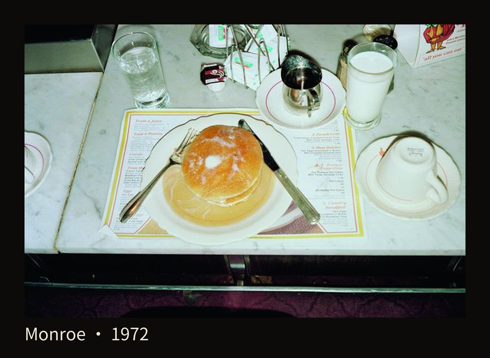
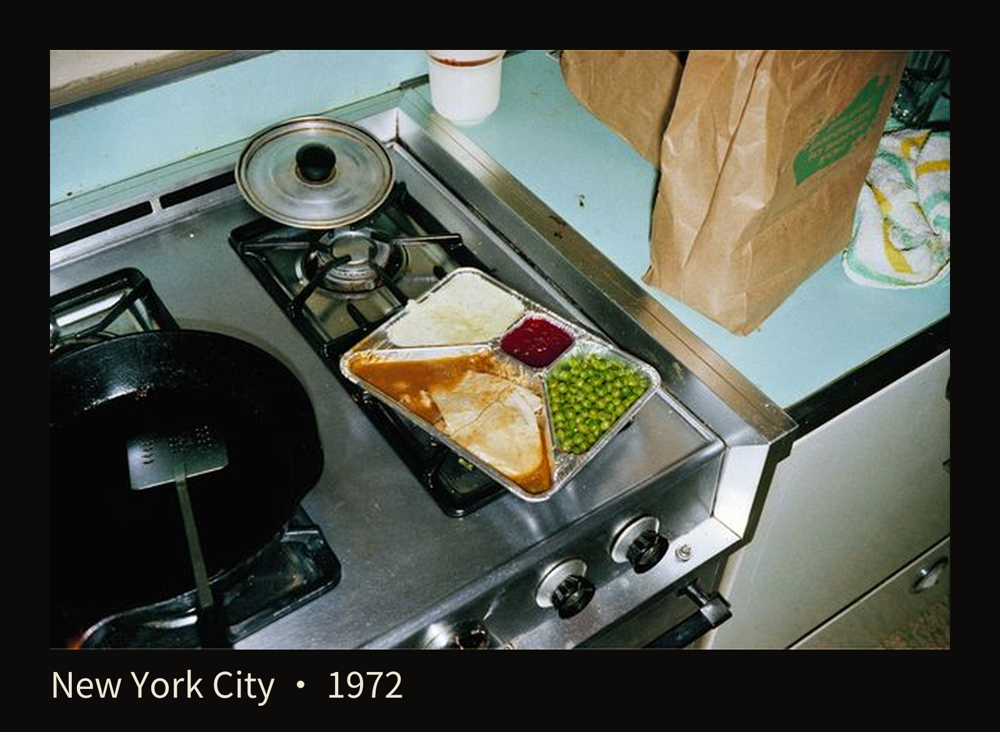
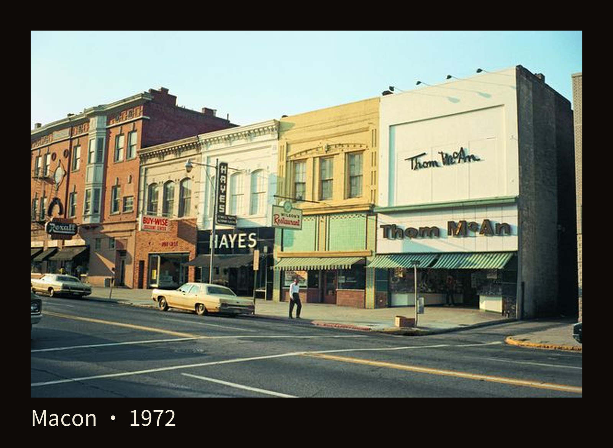
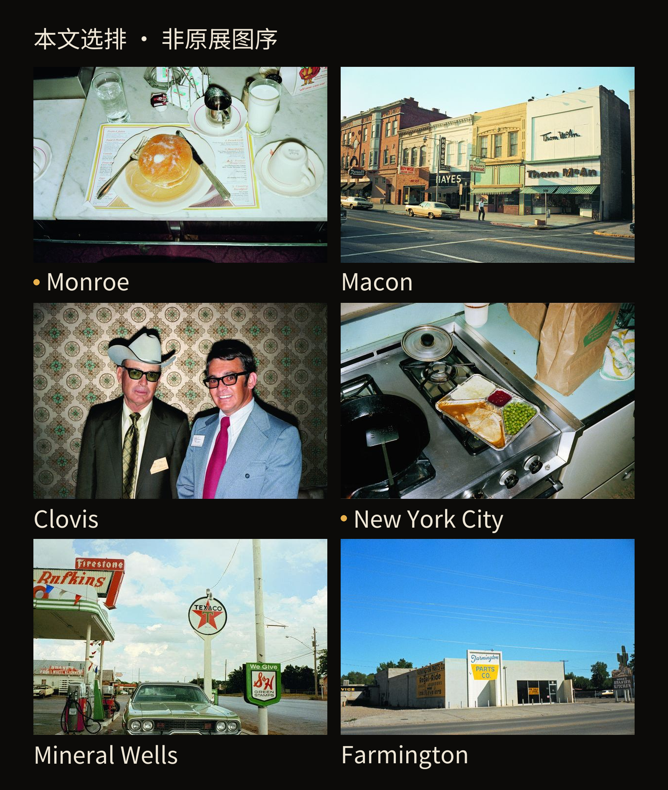
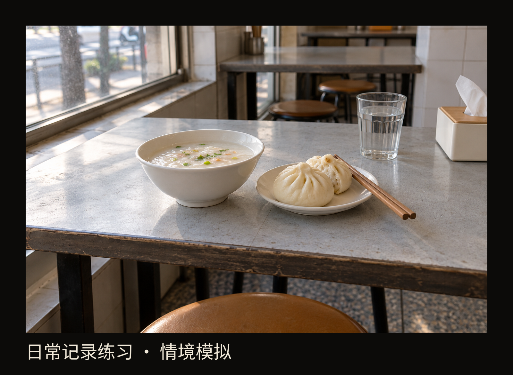

+++
title = "经典作品拆解 #21：American Surfaces"
description = "一顿饭、一间房和一段街面，可以在持续观看与反复出现中，积累成一件作品。"
date = 2026-10-20
tags = ["摄影", "经典作品", "Stephen Shore", "彩色摄影", "视觉日记", "组照"]
categories = ["摄影"]
series = ["经典作品拆解"]
showTableOfContents = true
draft = false
+++

一顿饭、一间房和一段街面，可以在持续观看与反复出现中，积累成一件作品。

一盘薄饼摆在面前，左边是叉子，右边是餐刀，旁边有牛奶和倒扣的杯子。桌上还摆着其他餐具，连另一套餐具的一小部分也留在左侧边缘。第一眼看过去，你可能只想说：这不就是吃饭前拍的一张照片吗？

这份平常感，正好是我们进入斯蒂芬·肖尔（Stephen Shore）《American Surfaces》的地方。先让目光在餐盘之外多停一下。

*图 1｜《Monroe, Louisiana, June 1972》，Stephen Shore，1972年6月，选自《American Surfaces》。餐盘以外，杯子、纸餐垫和桌沿也留在画面里。来源：[Phillips 2020年肖尔访谈](https://www.phillips.com/article/57659925/photographs-stephen-shore-vanessa-hallett-interview-american-surfaces-phaidon)；作品版权 © Stephen Shore，原网页注明图像由303 Gallery提供。*

餐盘在画面中间，占了很容易辨认的位置；但照片给周围的东西也留了地方。纸餐垫铺在盘子下，刀叉斜着靠向盘沿，牛奶杯旁还有一只小金属壶。再往下，台面的边缘和下方较暗的区域一起进入画面，我们也大致知道了拍摄者面对这顿饭的位置。

我更愿意在这里多看一会儿的，是这些没有被单独挑出来展示的东西。薄饼的金黄、杯盘的白、台面微微偏冷的颜色挨在一起，让这顿饭带着一种具体的餐馆环境。它们没有为食物搭出干净背景，而是保留了“这一餐摆在这里”的样子。我们很容易从中找到自己的经验：坐下来，东西已经端到面前，目光先落在盘里，随后才看见周围。

当然，一张餐桌照片还不足以解释整个项目。真正让它逐渐长出意思的，是肖尔会在下一次吃饭时，再次留意面前的东西。

## 同样是吃饭，下一张留下了什么

换一张看。食物这回分装在铝箔餐盘里，餐盘放在炉灶上，旁边留着黑色锅具、锅盖，后方还有纸袋。它与上一张相隔几个月，也不在同一座城市；把它们放在这里，是为了比较肖尔怎样反复看待吃饭这件事。

*图 2｜《New York City, New York, September–October 1972》，Stephen Shore，1972年9—10月，选自《American Surfaces》。分格餐盘与炉灶、锅具、纸袋共同构成这一餐的环境。来源：[Phillips 2020年肖尔访谈](https://www.phillips.com/article/57659925/photographs-stephen-shore-vanessa-hallett-interview-american-surfaces-phaidon)；© Stephen Shore，原网页注明图像由303 Gallery提供。*

上一张的餐垫和杯盘，把我们带进餐馆的用餐位置；这一张的炉灶、锅和纸袋，让食物留在厨房里的日常操作之间。它们都没有交代一个完整故事，却各自留下了食物怎样被盛放、旁边是什么、吃饭需要哪些物件的线索。

只看其中一张，我们容易判断它是否好看。来回看两张，注意力就会转向另一件事：同样每天要做的事，换了地方，外观会怎样改变。白色圆盘变成银色分格餐盘，纸餐垫换成金属灶台，食物周围的关系也变了。**重复给了我们比较的机会，差异才慢慢显出来**。

肖尔的记录远不止饭菜。MoMA的项目资料把餐食、房间、床、电视、路过的街道和遇见的人，都列在他持续拍摄的对象里。1972年3月，他已开始拍摄日常生活；同年6—7月的美国南部旅程让这项记录继续展开，系列延续到1973年。[1]

这些对象贴着一个人的生活节奏：吃饭，出门，遇见别人，找到睡觉的地方。我们可以把这称为“视觉日记”——通过照片反复留下自己生活中所见的东西。这里的“日记”不保证每一刻都被保存，也不意味着任何一张都必须承担故事高潮。一次次回来拍，才让那些本来很容易略过的东西获得了分量。

## 颜色也住在普通物件里

从餐桌走到街上，肖尔仍然留意那些正在被使用的环境。下面这张摄于佐治亚州梅肯的街景里，一排店面靠着人行道展开。先别急着寻找特别的事件，看看招牌、墙面和遮阳篷的颜色怎样挨在一起。

*图 3｜《Macon, Georgia, June 1972》，Stephen Shore，1972年6月，选自《American Surfaces》。颜色分别附着在砖墙、招牌和条纹遮阳篷上，让街面的日常外观变得具体。来源：[Phillips 2020年肖尔访谈](https://www.phillips.com/article/57659925/photographs-stephen-shore-vanessa-hallett-interview-american-surfaces-phaidon)；© Stephen Shore，原网页注明图像由303 Gallery提供。*

左侧红褐色砖墙比较沉，中间的黄墙亮起来，右边更浅的门面又铺开一大片。条纹遮阳篷压在店名下方，把楼上的墙面和楼下的入口分开。车停在路旁，一个行人经过，建筑的大小也因此有了容易把握的参照。

我喜欢这些颜色都各有所属：它们是商店给自己选的外观，是店名占据的墙面，是给门口遮阴的篷布。顺着颜色看，我们读到的便不只是一组漂亮的色块，也是一条商业街怎样把自己呈现给来往的人。这里不需要替每家店补一段故事，照片已经留下了足够具体的观看起点。

回看餐桌，那里也有这样的外观选择：杯盘的形状、桌面的材质、食物的包装。把不同场景积累起来，我们才开始感到一个年代的生活面貌。肖尔在MoMA的口述中提到，他着迷于自己所处时代的色彩。[2] 对这组照片来说，颜色提供的正是这种具体信息；把它们统一调成一种怀旧色调，反而容易抹掉物件之间原有的差别。

题名里的“Surfaces”，也可以从这里理解：先认真看事物显露在眼前的表面。表面未必浅薄，它能留下生活怎样被布置、包装和使用的痕迹。由这些片段形成的美国图景，带着肖尔的路线与注意力；它的力量来自具体的所见，不需要代替整个国家作一份完整说明。

## 自然的观看，也有取舍

看过这些照片后，“像随手拍”这句话或许会变得更具体。餐盘在眼前，就把它拍下来；经过街面，就让门面和路边的东西一起进入照片。画面保留了人正在看东西时那种直接的感觉。

肖尔后来在MoMA的口述里，将自己当时的一种练习解释为给视野做一次心中的“截图”：在日常某个时刻停下来，留意自己正在看什么，以及观看本身是什么样子，再以这种经验作为拍照的参照。他希望照片像说话一样自然。[2] “截图”是后来帮助解释的方法比喻，我们不必把它理解成眼睛与相机真的能留下同一幅图像。

这种自然感背后，有一连串很明确的选择。总是留意饭菜，便会拍到别人不一定愿意保留的餐盘；愿意把桌沿和锅具留下，食物就继续属于它所在的环境。相机朝哪里、什么时候停下来、最后留下哪张，都影响我们看见的生活。

在2020年的访谈里，肖尔也解释过自己的编辑：他并不认为所有拍过的照片都必须收入作品，而会从同类题材里选择更能凝聚某种经验的画面。[3] 因此，学习这组作品时，值得带走的是持续留意与回头选择的耐心。拍得多，给判断提供了材料；选择哪些照片相互陪伴，才让这份材料逐渐形成自己的面貌。

## 小照片排在一起，作品才继续发生

照片怎样呈现，也延续着这种日常感。1972年秋，《American Surfaces》在纽约LIGHT Gallery展出。小幅彩色照片没有装框，也没有隔在玻璃后，而是直接贴上墙，排成三行网格。MoMA在2017年的回顾展中呼应了这一呈现方式。[1]

我们先用一组明确标注为本文选排的示意，想象视线怎样在小照片之间移动。它保留三行的排列关系，所选图片与次序服务于这里的比较，不复原1972年的展览。

*图 4｜《American Surfaces》选图排布示意。三行结构依据肖尔对首次展陈的说明；六张照片及其位置由本文选排，非1972年展览图序，亦非摄影书跨页。原作均为Stephen Shore，1972年；素材来源：[Phillips访谈](https://www.phillips.com/article/57659925/photographs-stephen-shore-vanessa-hallett-interview-american-surfaces-phaidon)，© Stephen Shore；展陈依据：[MoMA项目口述](https://www.moma.org/audio/playlist/45/717)。*

看单张时，我们容易把它当作一个需要独自成立的画面。在图4的本文选排中，先看左上角的餐桌，再移向第二行右侧的厨房：隔着街面和人物，又遇见了一顿饭。前面看过的杯盘和餐垫会跟着被想起，眼前炉灶上的分格餐盘也就多了一个可以比较的对象。

尺寸也参与了这种观看。小照片让人靠近，逐张辨认；退开一点，又会先看见一片片颜色和排列。没有厚重边框把每张照片隔成独立的单元，照片之间的联系就更容易进入视线。这里的“网格”很简单，就是让图片按行列并排；它既给杂多的生活片段一个共同位置，也保留了它们彼此不完全相同的样子。

肖尔后来回忆，1972年那家画廊中的作品通常是装裱好的黑白照片；他拿来的却是交给柯达冲印、直接贴上墙的彩色小照片。[4] 回到这个环境，便能理解它的特别之处：那些常见于日常相册的外观与普通题材，被作为一整件作品认真呈现。作品的分量开始由多张照片共同承担，观看者也可以在它们之间寻找生活反复出现的节奏。

这组作品后来又通过展览和书籍被重新观看。2005年，P.S.1举办了包含三百多张照片的《American Surfaces》展览，并介绍了同年由Phaidon出版的同名书。[5]

## 给今天的普通生活一个位置

读到这里，再回看开头那盘薄饼，它仍然很普通。现在我们多知道了一件事：它可以与另一顿饭、另一段街面发生联系。一个项目的起点，有时就是愿意再次看见自己每天都会经过的东西。

可以给自己一个很小的尝试：选一个普通工作日，只留意三类对象——吃的东西、停留的地方、路过的店面。各拍一两次，用手机就够。食物摆在哪里，椅子靠着什么，店面怎样面对街道，这些关系比寻找漂亮摆设更值得保留。比如下面这类再熟悉不过的早餐桌，就已经有东西可看。

*图 5｜当代日常记录练习：让早餐和它所在的桌面一起留下来。情境模拟，非肖尔原作或历史现场复原。*

晚上把照片放在一起，先按实际拍摄顺序看一遍。不要急着只挑最漂亮的一张，试着找出：哪类东西出现了两次？第二次出现时，有什么变化？有一张单看很平淡，却让旁边那张多了一层意思吗？再删掉一张，看看你对这一天的印象有没有变。这是一次小练习，不必照抄肖尔的展览，也不需要一天就拍成完整项目。

如果愿意继续，隔几天仍然留意这三类东西。你可能会发现自己总在同一种桌面前吃饭，或者每天经过的几家店，用着很不一样的颜色。先把这个发现留下，再决定要怎样拍下去。日常生活没有因此变得更戏剧化，我们只是开始看见它反复发生时的具体样子。

下一篇《William Eggleston’s Guide》，我们会更靠近颜色本身，看看它怎样成为照片的内容。

## 参考资料

[1] [MoMA，《Stephen Shore》回顾展新闻稿，2017年10月25日，第2页](https://www.press.moma.org/wp-content/files_mf/shore_expandedpressrelease_final_10.25.1751.pdf)：日常记录的起始、1972年旅程、LIGHT Gallery首次展出及三行呈现方式。用于项目与展陈史，未作为具体拍摄参数的依据。

[2] [Stephen Shore，MoMA项目口述《American Surfaces. 1972–73》](https://www.moma.org/audio/playlist/45/717)：视觉日记、自然观看、视野“截图”及时代色彩。正文为转述；口述配图是2017年印相，本篇三张细读图另取下列访谈页面，不混用印相记录。

[3] [Vanessa Hallett与Stephen Shore访谈，Phillips，2020年7月1日](https://www.phillips.com/article/57659925/photographs-stephen-shore-vanessa-hallett-interview-american-surfaces-phaidon)：本人对拍摄、重复题材及编辑取舍的回顾；同时提供本篇所看的原作复制图和题名日期。本文三张原图按阅读问题选择，不声称沿用摄影书图序。

[4] [Stephen Shore访谈，Phaidon：《I didn’t like getting criticism but it didn’t cause me to doubt what I was doing》](https://www.phaidon.com/en-us/blogs/phaidon-archive/interview-stephen-shore-i-didn-t-like-getting-criticism-but-it-didn-t-cause-me-to-doubt-what-i-was-doing)：1972年画廊环境、柯达冲印和呈现方式的作者回忆。

[5] [MoMA PS1，《Stephen Shore: American Surfaces》，2005年10月23日至2006年1月23日展览页](https://www.moma.org/calendar/exhibitions/4839)：后续展览与2005年Phaidon版出版的关联；2005仅指这里采用的出版记录，不用作所有同名版本的首次出版断言。
