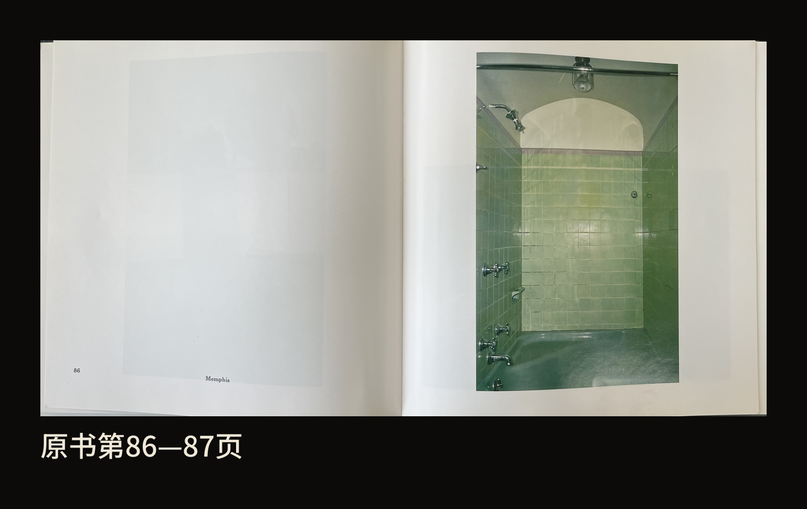
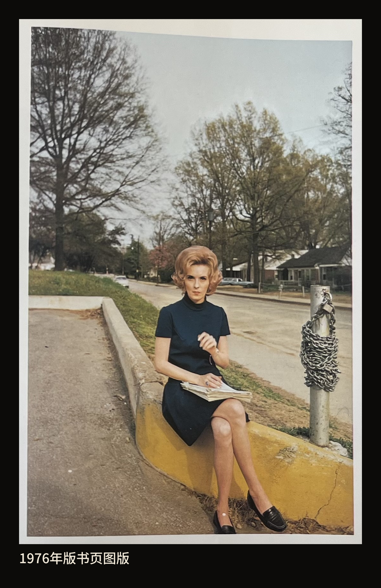
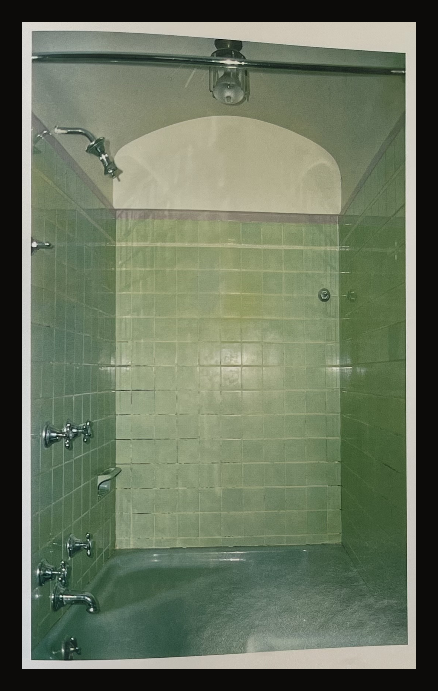
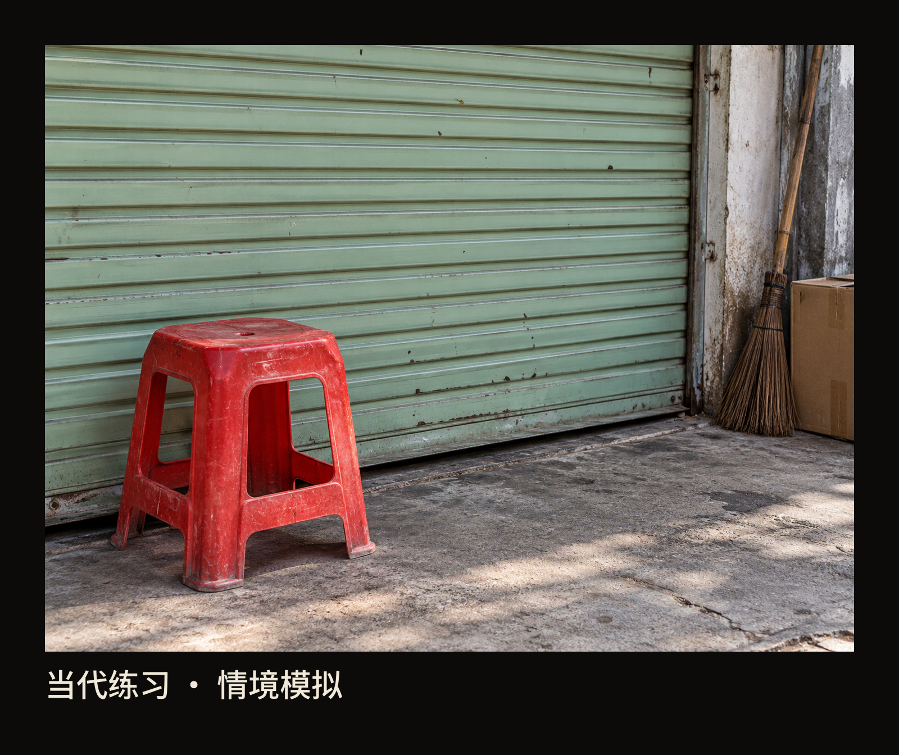

+++
title = "经典作品拆解 #22：William Eggleston’s Guide"
description = "颜色的面积、位置和依附的物件，会一起改变我们怎样看一张日常照片。"
date = 2026-10-26
tags = ["摄影", "经典作品", "William Eggleston", "彩色摄影", "日常题材", "摄影书"]
categories = ["摄影"]
series = ["经典作品拆解"]
showTableOfContents = true
draft = false
+++

{style="width: 720px; max-width: 100%; margin-left: auto; margin-right: auto;"}

颜色的面积、位置和依附的物件，会一起改变我们怎样看一张日常照片。

一位女子坐在路沿上，膝头放着几页纸。她一只手举在胸前，望向镜头。身后是住宅、树木和一条安静的街，旁边的柱子上缠着铁链。这样的场景并不难遇见：走到街边，替一个人拍张照，画面大概也会包含这些东西。

不过，先别急着把目光留在她脸上。她身下那一段刷成黄色的路沿，也值得看一会儿。

{style="width: 480px; max-width: 100%; margin-left: auto; margin-right: auto;"}

*图 1｜《Memphis》（孟菲斯，女子坐在路沿上），William Eggleston，约1969—1970年；收入1976年版《William Eggleston’s Guide》第38—39页跨页。黄色路沿从人物身下伸向右侧，把一处街道设施带到观看的前面。作品与书页观看来源：[Anders Wahlstedt Fine Art 的1976年版实物图](https://www.wahlstedtart.com/books/william-egglestons-guide-1976)；[D.A.P. 所刊单图](https://www.artbook.com/0870703781.html)。作品摄影：William Eggleston；书页实物摄影者未署名。*

## 黄色路沿怎样进入一张人物照片

这张照片选自威廉·埃格尔斯顿（William Eggleston）的《William Eggleston’s Guide》。先把书名和作者放在一边，试着在脑中把眼前的颜色换成深浅不同的灰：女子、路沿和铁链仍然在那里，脸与手也仍然值得看。只靠形状和明暗，我们已经可以读出一张人物照片。

再回到彩色。女子的衣服是很深的蓝，身下的路沿却是一片明确的黄。黄色在画面下方铺开，经过她坐着的位置，一直延伸到右侧。它有足够大的面积，和灰褐色路面、后方草地拉开区别。我会因此先在人物与路沿之间来回看，再沿着路沿向后寻找她身处的街道。

这里很有意思的地方，是黄色依附着一段很普通的路沿。它让人物坐的位置变得具体，也让街道参与了这张肖像。如果只盯着脸，把周围都当成可有可无的背景，就会漏掉这一层关系。

顺着黄色往右看，缠着铁链的柱子也没有被整理出画面。它与女子占着同一小片地方，粗重的链条、深蓝衣服、裸露的手臂和腿，各有不同的质地。照片里还留着大片树木与天空，人物并没有填满画面。我们既能靠近她，又一直知道她坐在户外，坐在一条仍向远处延伸的街边。

这些关系让普通的街头片刻有了自己的样子。至于她为什么坐在这里、抬手时在想什么，照片没有替我们回答。看见颜色怎样组织人物与环境，已经足够让这张照片多留住我们一会儿。

**颜色一旦改变了我们在画面里停在哪里、怎样把几样东西连起来，就已经参与了照片的内容**。 所以，刚才在脑中移去颜色，是为了辨认它承担了什么。我们不必据此给彩色和黑白排高下，也不能把某一次灰度转换当作作者原本会拍出的黑白照片。

## 同一种绿，可以占住整个房间

接着看书中的另一幅《Memphis》。这次，画面里没有人，是一个绿色的淋浴间。先看瓷砖怎样围出空间，再把目光移向水龙头和上方的浅色拱形区域。

{style="width: 480px; max-width: 100%; margin-left: auto; margin-right: auto;"}

*图 2｜《Memphis》（孟菲斯，绿色淋浴间），William Eggleston；1976年版《William Eggleston’s Guide》第86—87页中的书页图版。绿色从墙面延续到下方的浴缸，金属配件和浅色拱顶给这片颜色留下了停顿。单幅拍摄年在本次所用书页中未标明。来源：[Anders Wahlstedt Fine Art 的1976年版实物图](https://www.wahlstedtart.com/books/william-egglestons-guide-1976)。作品摄影：William Eggleston；书页实物摄影者未署名。*

上一张的黄色只占画面的一部分，这里的绿色却几乎把人包围起来。左右两侧墙面向里收，瓷砖接缝一排排通向后墙。后墙较亮，两侧和下方较暗；同属绿色的表面因此有了前后、转折和不同的受光状态。我们能看见一个可以走进去的地方，也会感到自己正对着一片铺展得很充分的颜色。

金属配件让视线暂时停下来。左侧的水龙头、上方的喷头，都是日常使用的物件；它们亮而细碎的反光，把周围大面积的绿色衬得更连续。视线再往上，浅色的拱形区域截住了绿色，头顶还留着一盏灯和横杆。颜色并没有把房间变成一张抽象色纸，空间的用途、材料和边界始终看得见。

我更愿意在这里慢一点，而不是立刻给绿色指定一种情绪。你也许觉得清凉，也许觉得这个没有人的地方有些滞重。无论是哪一种感受，都可以继续回到照片寻找原因：是绿占得太满，是光停在后墙上，还是那些金属配件让人意识到一个暂时空着、原本供人使用的空间？

与街边女子那张并看，颜色的作用就有了变化。黄色让人物与一段街道发生联系；绿色则成为我们进入房间时无法绕开的环境。两张都没有盛大的事件，却让一个坐下的位置、一处洗浴的空间，获得了足够具体的形貌。

这也是我理解“色彩作为内容”的方式：说出“黄”“绿”只是开始。它有多大，落在哪里，附着在什么东西上，与周围怎样相处，才会逐渐形成这幅照片特有的感受。

## 书页把这些普通地方放在一起

把视线从单幅图版稍稍退开，看看图3中的真实书页。

{style="width: 720px; max-width: 100%; margin-left: auto; margin-right: auto;"}

*图 3｜1976年版《William Eggleston’s Guide》第86—87页真实跨页。观察左页留白、下方地点文字与右页独幅图版的位置关系。来源：[Anders Wahlstedt Fine Art 的1976年版实物图](https://www.wahlstedtart.com/books/william-egglestons-guide-1976)。作品摄影：William Eggleston；书页实物摄影者未署名。*

右页是独幅照片，左页留下大块空白，只在下方写着地点。图1对应的跨页也采用这样的安排。书页没有用一段人物故事或事件说明，预先替我们决定怎样看；照片获得了一次相对独立的停留。

女子出现在第38—39页跨页，淋浴间在第86—87页。它们相隔许多页，这里把两张并读，是为了比较颜色与日常物件的关系，并非把它们当作原书相邻的两幅。仅从这两处，也能感到书所给予的观看待遇：街边的人与空着的淋浴间，都以一幅值得单独看的照片进入书中。人物出现时，周围物件仍然重要；人物离开时，物件和空间也仍然值得留下。

《William Eggleston’s Guide》由纽约现代艺术博物馆（MoMA）于1976年出版，收录48幅彩色图版，与同年的埃格尔斯顿展览相伴。约翰·萨考斯基（John Szarkowski）负责展览的选择和布置，并为书撰写文章。同期新闻稿把亲友、邻近住宅、街道、乡间道路和室内物件列入这批照片的题材，指向的是他在孟菲斯及周边接触的生活。[MoMA 1976年新闻稿](https://www.moma.org/documents/moma_press-release_326994.pdf)

因此，这里的“日常”有具体的位置和观看者。它不是一份试图平均介绍美国南方的材料清单。两张照片都叫《Memphis》，地点说明很简短；可黄路沿上的女子和绿色淋浴间带来的经验，几乎无法互相替代。通过这样的选择，一个地方逐渐有了拍摄者看见的样子，也保留着我们还不知道的生活。

上一篇《American Surfaces》让我们注意到，普通材料可以通过反复拍摄与成组展示积累起来。这一次，可以把观看的速度再放慢一点：停在一幅照片里，看看颜色怎样与具体的人、物和空间共同起作用。两件作品给我们的入口不同，也都让日常生活值得被认真看待。

## 1976年，受到重视的是什么

今天，手机拍下来的照片默认就是彩色。再说一本彩色摄影书很重要，似乎还缺一个理由。真正需要解释的是：这些街边人物、家用空间和普通物件，为什么值得用彩色照片如此郑重地呈现？

1976年的新闻稿已经提出了这个问题。萨考斯基讨论的，是颜色在画面内容中承担的作用。他用紫色领带、天空前的红色信号灯说明：当一种颜色变成灰色，即使形状仍在，它在构图中的分量和含义也会改变。我们刚才看到的黄路沿，正好提供了一个可以亲自进入的例子——街道设施的形状没有消失，但那段黄怎样与人物相接，是彩色观看里很具体的一件事。[MoMA 同期论述，第2页](https://www.moma.org/documents/moma_press-release_326994.pdf)

这场展览与这本书的重要性，可以由此理解：它们把一种从普通生活出发、让颜色参与个人观看的摄影，放进了博物馆展陈与出版的讨论中。它不需要靠“历史上第一次出现彩色摄影”来成立。MoMA早在1962年就举办过恩斯特·哈斯（Ernst Haas）的彩色摄影展；1976年新闻稿明确称为馆方首次的，是关于彩色摄影的出版物。[MoMA：1962年哈斯展览](https://www.moma.org/calendar/exhibitions/3432)

观看时也要分清手中的材料。书页、网页复制图和展厅里的照片，是不同的观看载体。1976年新闻稿记录，展览照片由实验室在埃格尔斯顿监督下制作；后来2002年的再版又从原始幻灯片重新分色制作。我们能借书页与可靠复制品讨论颜色的位置、面积和物件关系，屏幕上某一种绿的浓淡，却不足以让我们还原一张染料转印照片的全部效果。[D.A.P.：2002年版说明](https://www.artbook.com/0870703781.html)

所以，读这本书时，我更想记住那些关系。黄色没有离开路沿，绿色没有离开瓷砖；颜色让我们重新看见的，仍然是有人使用、经过和生活过的地方。

## 下次散步，先看看颜色落在什么上面

可以从家附近挑一处普通地方试一试：楼道、杂货店门口，或者一小段街道。先找到一片让你停下来的颜色，再看它属于什么物件，周围还有什么。

例如，下面这个当代练习场景里，一把红塑料凳放在浅绿色卷帘门前。先不要把它当成“红配绿”的配色题，看它离门有多近，旁边的扫帚和纸箱又怎样让我们认出这是一处日常使用的门口。

{style="width: 720px; max-width: 100%; margin-left: auto; margin-right: auto;"}

*图 4｜当代练习：店门前的红凳与浅绿色卷帘门。情境模拟，非埃格尔斯顿原作或历史现场复原。观察红色在画面中的面积，以及它与门、地面和生活物件的关系。*

拍摄时，先留一张把颜色和周围环境都交代清楚的照片。然后只调整站位或取景，让这片颜色在画面里占得多一点、少一点，或者更靠近另一件物品。这里改变的会包括物件之间的位置和遮挡，可以一起观察：哪一张让你更想看下去，原因落在哪一处关系上？

回看时，再把照片临时切到黑白，随后切回来。留意自己的注意力有没有移动：原先首先看见的红凳，是否变得与别的物件差不多显眼；恢复颜色后，它又怎样把视线带回门口。这个小尝试帮助我们发现自己为何按下快门，也可能让我们发现，有一张照片真正吸引人的其实是姿态或明暗。

最后，再回到开头那位坐在路沿上的女子。她依然在原处，黄路沿也依然是一段街道设施。但现在再看，我们或许愿意多给这片黄色一点时间，看它怎样经过一个人身边，把一条普通街道留在照片里。

下一篇《Early Color》，我们会跟随索尔·雷特（Saul Leiter），从遮挡、玻璃和街景间的缝隙继续看颜色。

## 作品与参考资料

- [1976年版《William Eggleston’s Guide》实物书页](https://www.wahlstedtart.com/books/william-egglestons-guide-1976)：本文核对第38—39、86—87页两处跨页，分析图版与留白；不据这两处推断全书连续叙事。
- [MoMA 1976年展览新闻稿](https://www.moma.org/documents/moma_press-release_326994.pdf)：48幅书中图版、展览约75件印相、萨考斯基的工作、同期色彩论述与印相制作记录。
- [MoMA 1976年展览清单](https://assets.moma.org/documents/moma_master-checklist_326993.pdf)：第1页《Memphis》“woman on curb”记录，约1969—1970年。
- [D.A.P.《William Eggleston’s Guide》](https://www.artbook.com/0870703781.html)：女子单图与2002年版重新分色说明。本文采用1976年版书页作为阅读对象，不混用再版的具体颜色表现。
- [MoMA：Ernst Haas: Color Photography，1962](https://www.moma.org/calendar/exhibitions/3432)：核对彩色摄影展览的历史范围。
