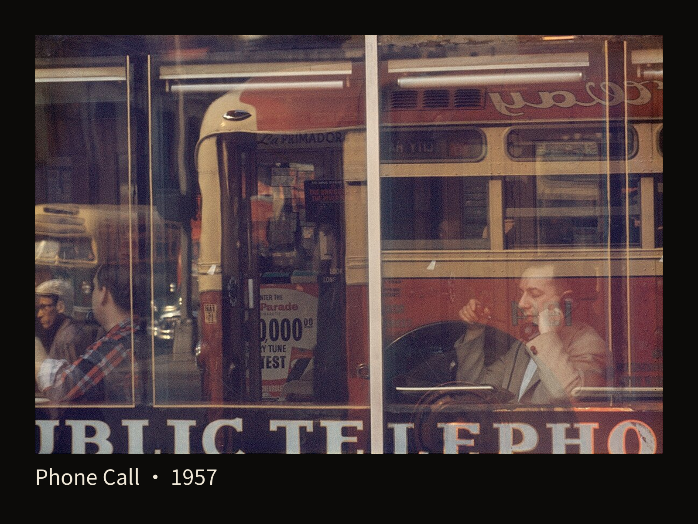
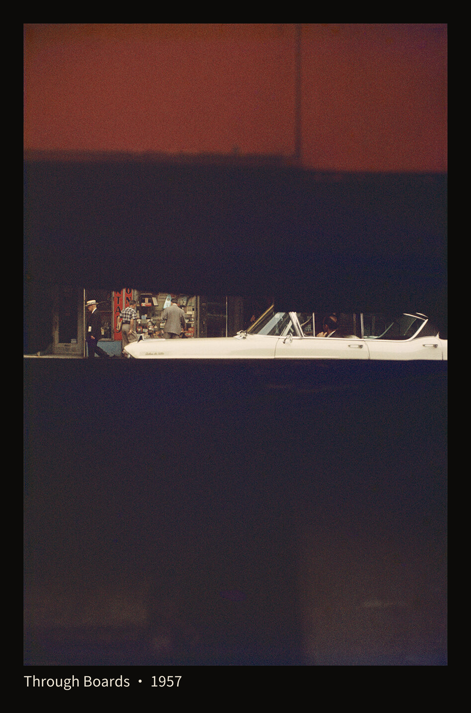
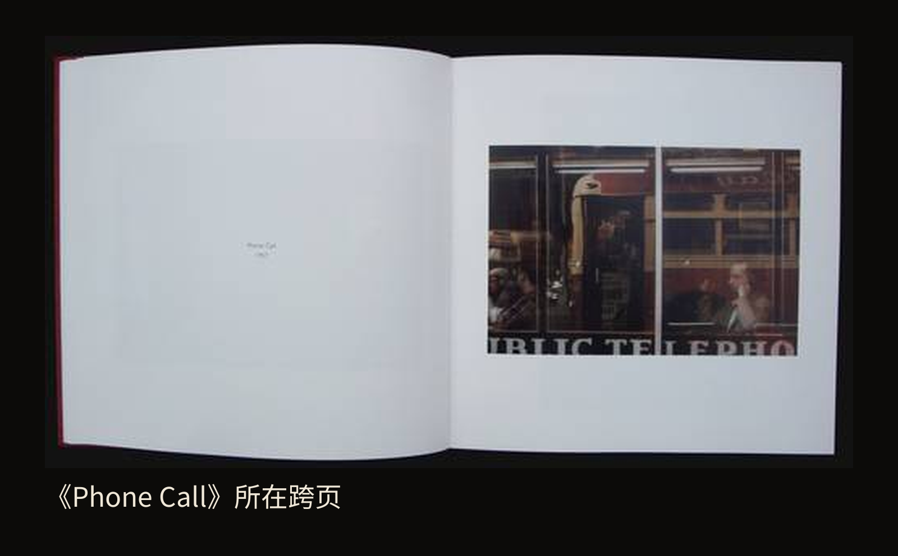

+++
title = "经典作品拆解 #23：Early Color（早期彩色）"
description = "遮挡和玻璃让城市只显露一部分，也让我们在辨认人物与颜色的过程中多停留一会儿。"
date = 2026-11-02
tags = ["摄影", "经典作品", "Saul Leiter", "彩色摄影", "街头摄影", "摄影书"]
categories = ["摄影"]
series = ["经典作品拆解"]
showTableOfContents = true
draft = false
+++

{style="width: 720px; max-width: 100%; margin-left: auto; margin-right: auto;"}

遮挡和玻璃让城市只显露一部分，也让我们在辨认人物与颜色的过程中多停留一会儿。

第一眼看到《Through Boards》，你可能会觉得：这张照片是不是被挡住得太多了？

上方是一大片暗红，下面接着深暗的区域；真正能认出街景的地方，只有画面中部的一条横缝。一辆白色汽车从那里横着伸过，左边露出几个人和店铺。街道还在，留给我们看的却不多。

这是索尔·莱特（Saul Leiter）的一幅彩色照片，也是他2006年摄影书《Early Color》的封面图像。我们先不急着把遮挡当成一种技巧，就沿着那条缝看一会儿。

{style="width: 480px; max-width: 100%; margin-left: auto; margin-right: auto;"}

*图 1｜《Through Boards》（隔着木板），Saul Leiter，1957年（据基金会作品页）。留意白色汽车与人物所在的横向缝隙，以及它上下的大面积遮挡。来源：[Saul Leiter Foundation 彩色作品页](https://www.saulleiterfoundation.org/color)；© Saul Leiter Foundation。*

## 一条缝，够我们看见多少

我会先被白色车身吸引。它在暗处显得很亮，横向延伸的长度，又把视线带向左边的人和店面。再停一下，可以分辨戴帽子的人、格纹衣服，以及背朝我们的灰色上衣。人物并没有被抹成几个抽象的点，他们还带着衣服、姿态和彼此的位置。

但目光走不了太远。往上是遮挡，往下也是遮挡，车轮和更完整的街面都没有显露。我们刚刚认出一些东西，又碰到了画面的限制。

有意思的地方就在这两种感受之间：那条缝里的细节足以让街道活起来，周围的大块暗色又使它显得遥远。我会有一种隔着近处东西向外张望的感觉。你也可能更在意那辆白车，觉得它像一条突然亮起来的横线。这两种看法都可以从眼前的关系出发。

如果只盯着可辨认的街景，上下的遮挡很容易被当成多余部分。把目光稍稍退开，暗红、深暗与白色车身的面积差异才会进入观看：上面有一大块颜色，下面有一小条具体生活。白车之所以这么醒目，也与它周围留了这么多暗处有关。

因此，要把这张照片的经验带走，先得认清它留下的东西。仅仅把镜头挡住，并不会自动得到同样的关系。莱特的画面里仍有一条可以追踪的亮车身，有能够辨认的人，也有足以提示街道的店面。我们有地方开始看，又无法一次看完。

这也让上一篇的颜色问题向前走了一步。颜色仍然落在具体的东西上，却有些东西只让我们看见颜色和大致边缘。那块暗红不必先被解释得一清二楚，已经在影响我们怎样看那辆车。

## 玻璃让两处地方叠在一起

到了《Phone Call》，阻挡视线的东西换了。画面没有留出一条干净的缝，反而让车辆、窗框、文字和人物挤进同一片玻璃。

先找右下方的人。他把听筒贴近耳边，手和脸还有足够清楚的轮廓。认出这个动作以后，周围那些互相穿插的颜色便有了一个可以返回的地方。

{style="width: 720px; max-width: 100%; margin-left: auto; margin-right: auto;"}

*图 2｜《Phone Call》（打电话），Saul Leiter，1957年。右下方的听筒和手势让人物可辨，红黄车辆影像又与他叠在同一片玻璃中。按[Saul Leiter Foundation 发布版本](https://www.saulleiterfoundation.org/color)完整呈现；© Saul Leiter Foundation。*

再往上看，红黄相间的车辆占着很大的面积，车窗的横线穿过画面；中间较亮的竖框把左右分开，底部的大字又形成一条横向边界。人物被放在这些横线、竖线和字母之间，脸旁仍能看见别的影像。

我们知道有人在打电话，却不容易一下理顺玻璃两侧所有物件的位置。可见的东西很多，空间反而没有因此完全交代清楚。这里的玻璃同时让我们向里看，也把另一处景象带进来。透过与反射叠在一起，观看便需要在不同线索之间来回走。

我喜欢的是，右下的人并没有被这层叠影彻底淹没。听筒贴着脸，手势仍然明确；红黄车辆的影像则把这次打电话的片刻与街上的颜色连在一起。我们能认出一个日常动作，却听不到谈话，也无从仅凭这张脸判断他的心情。画面留住的是动作与环境相遇的样子。

再回头看《Through Boards》，两张照片的区别就具体了。木板之间的缝把可见的街道压缩到一小块地方；玻璃则让不在同一处的景物相互叠合。一张通过挡住一些东西来组织观看，另一张把更多影像带到人物周围。

它们又有一个相近之处：**不确定的地方旁边，都还留着可以辨认的线索**。白车和人物、听筒和手，帮助我们进入画面。正因为还有这些东西可看，那些含糊的部分才值得继续辨认。

在拍摄时，这是一种很具体的取舍。若最想留下的是一个清楚的动作，就需要看看遮挡有没有切断关键连接；若吸引你的是人物与周围景物互相渗入的感觉，玻璃上的影像也可能是照片的重要部分。决定去留之前，先看它改变了什么。

## 把照片放回书页

两幅单图让我们看见了不同的入口。再把《Phone Call》放回《Early Color》的书页，观看距离又会变一次。

这本书由Steidl于2006年首次出版，Martin Harrison负责前言和设计。出版社列出的开本为20×20厘米、176页，是一本可以拿近了看的方形小书。这里采用的实物书页照片来自2012年Parka Blogs书评所展示的再版，不把它当成2006年初版的实物记录。[Steidl书目资料](https://steidl.de/Books/Early-Color-2936435359.html)

{style="width: 720px; max-width: 100%; margin-left: auto; margin-right: auto;"}

*图 3｜《Early Color》中《Phone Call》所在的真实跨页，2012年书评展示的再版书页。右页横幅图版与左页短文字之间留有大片空白。书页照片来源：[Parka Blogs，Robin Benson，2012年11月24日书评](https://www.parkablogs.com/index.php/content/book-review-saul-leiter-early-color)；书中摄影作品 © Saul Leiter Foundation。*

看看右页：刚才那张充满叠影的照片，现在被四周的白纸托着。左页只有很短的文字，和图版之间隔着留白与书脊。照片里的线条很密，书页外面的空间却比较安静。

这种安排让我更容易先面对整张图，再靠近寻找打电话的人。阅读不需要从玻璃里的每个字开始，也没有一段很长的解释挡在照片前面。照片中的含糊保留着，书页给了它一个相对清楚的边界。

这只是眼前一处跨页能支持的观察，不能据此断定整本书的翻页节奏。但它提醒我们，网上铺满屏幕的单图与书中的图版，会把同一张照片带到不同的观看距离。既可以放大看听筒与手，也可以退回来，看看这张复杂的街景怎样安放在纸上。

## 拍得早，成为一本书却很晚

《Early Color》还有一层值得留意的时间关系。刚才看的两幅作品，基金会作品页都标为1957年；它们成为这本书的一部分，则到了2006年。把这两个时间放在一起，我们才不会把一本晚年出版的摄影集，当成拍摄当时就已经广泛流传的书。

莱特约在1948年开始使用彩色幻灯片。他的彩色作品在1950年代已有展览和展示机会：基金会年表记有1954年的群展、1955年的个展，以及1957年斯泰肯在MoMA幻灯讲座中展示其彩色照片的记录。因此，早期作品并非一直无人见过。[Saul Leiter Foundation 年表](https://www.saulleiterfoundation.org/chronology)

后来把这些照片带到更多读者面前的，是另一段工作。基金会传记记述，画廊持续展出作品，出版计划几经延迟，最后由Steidl推出这本摄影集；出版之后，画廊收到许多此前并不了解莱特的人打来的询问。2006年，他在密尔沃基美术馆举办了个人博物馆展览，2008年又来到巴黎的亨利·卡蒂埃-布列松基金会。[基金会传记](https://www.saulleiterfoundation.org/biography)

这段时间差使《Early Color》的重要性变得具体：散在早年拍摄中的观看方式，经过编辑和出版，成为可以反复翻看、彼此对照的一本书。读者得以发现，城市还可以这样进入照片——透过缝隙、隔着玻璃，只交代足以让人开始观看的一部分。

重看这两幅照片时，我更在意它们到今天仍然提出的选择：一张街景可以让我们认出生活，也可以把部分空间关系留在尚未看清的地方。

## 下次遇见一扇玻璃

可以从熟悉的街边橱窗试一次。先找到里面一件你确实想留下的东西，比如柜台边一只白杯。看看杯子以外，玻璃上还映着什么：经过的车辆、一块招牌，或对面的建筑。

先拍下当前的关系，再小幅横移，观察倒影和窗框怎样从杯子旁边经过。不要急着套上某种朦胧滤镜，先在现场找一处变化：杯沿还能不能认出来，倒影是否给它带来新的联系，还是已经把你想看的东西完全盖住。手机就可以做这次观察。

回看两张时，也不用选“遮得更多”的那张。试着说清自己喜欢哪一种关系：一眼就能认出的杯子，还是需要穿过一层街景才发现的杯子。若后一张只剩杂乱，没有值得寻找的具体东西，继续换一点位置也很自然。

然后再看一次《Through Boards》里那辆白车。它周围的暗处没有替我们说明整条街，却使那一小段街景变得难以忽略。我们可以从这里带走一个拍摄时的念头：眼前有东西挡着时，先停一下，看看被留下的那部分，是否已经足够让一张照片开始。

## 参考资料

- [Saul Leiter Foundation：Color photographs](https://www.saulleiterfoundation.org/color)。两幅原作的发布版本、题名及本篇采用的1957年标注。
- [Steidl：《Early Color》](https://steidl.de/Books/Early-Color-2936435359.html)。2006年首版、Martin Harrison前言与设计、开本、页数及ISBN 978-3-86521-139-2。
- [Saul Leiter Foundation：Chronology](https://www.saulleiterfoundation.org/chronology)。早期彩色实践、1950年代展示与2006年成书。
- [Saul Leiter Foundation：Biography](https://www.saulleiterfoundation.org/biography)。封面作品身份、出版经过与后来的传播。
- [Robin Benson：Book Review: Saul Leiter: Early Color，Parka Blogs，2012-11-24](https://www.parkablogs.com/index.php/content/book-review-saul-leiter-early-color)。本文所用《Phone Call》跨页的实物展示与再版语境；不据此证明全书图序或各版颜色完全一致。
