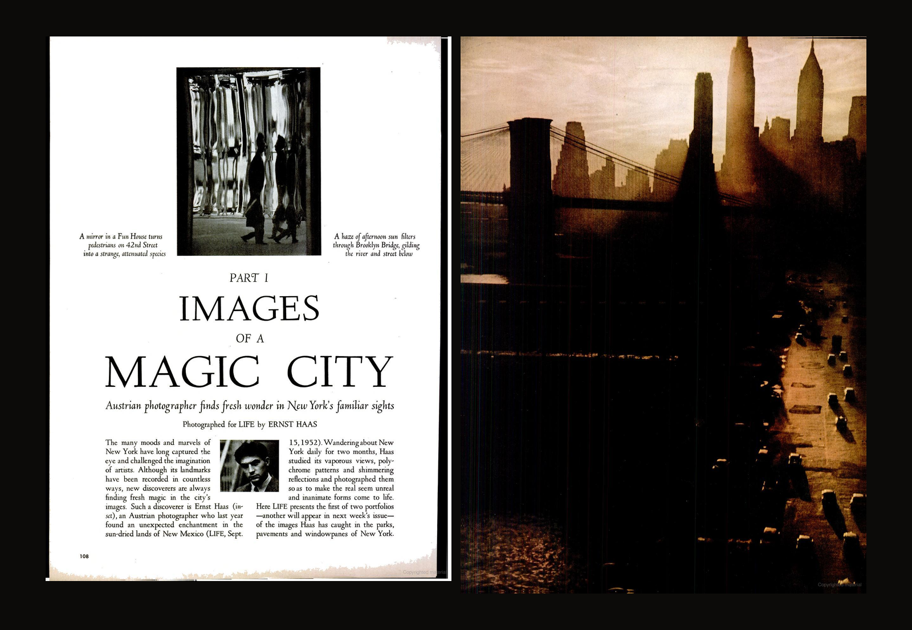
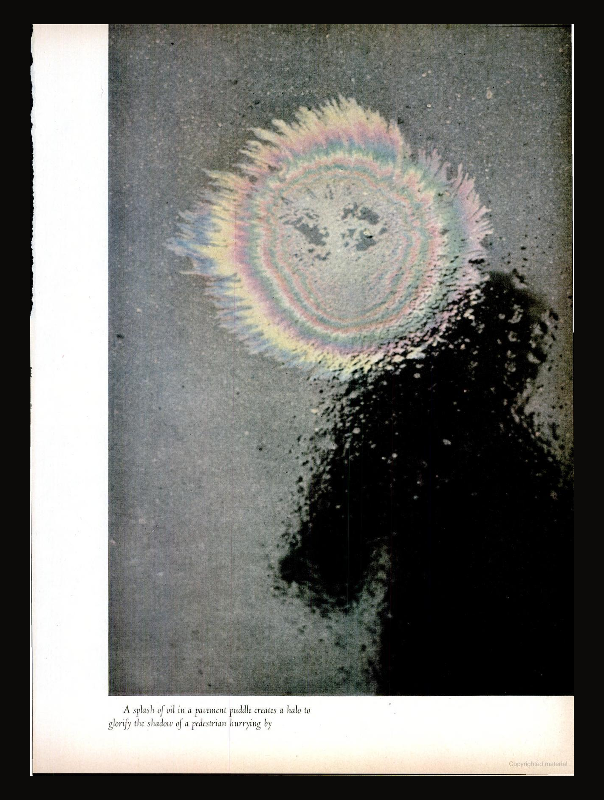
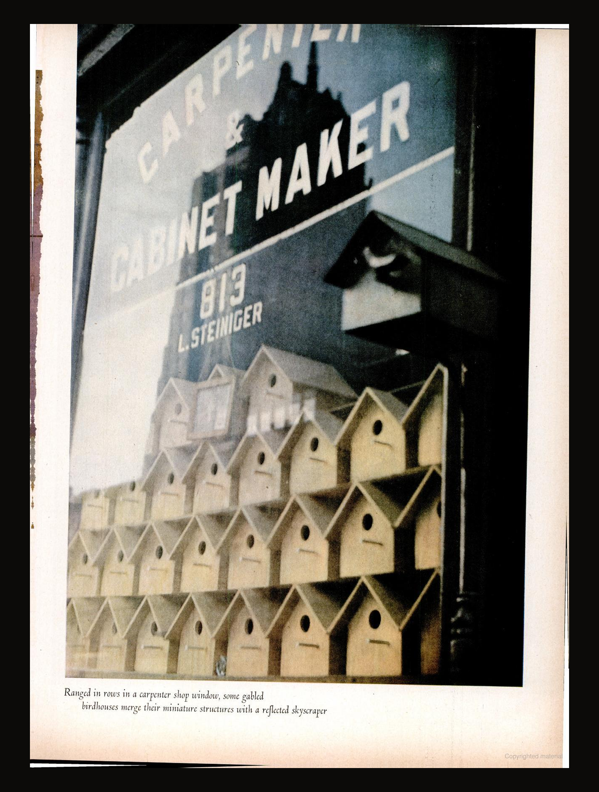
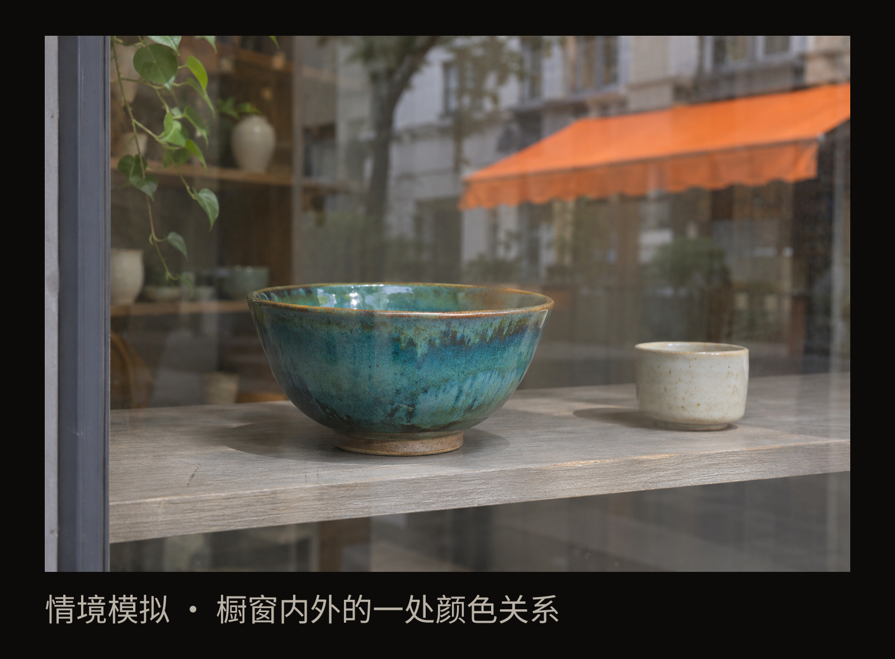

+++
title = "经典作品拆解 #24：纽约的色彩与倒影"
description = "哈斯用颜色与倒影，让普通街景中容易忽略的联系成为照片的主角。"
date = 2026-11-09
tags = ["摄影", "经典作品", "Ernst Haas", "彩色摄影", "街头摄影", "LIFE"]
categories = ["摄影"]
series = ["经典作品拆解"]
showTableOfContents = true
draft = false
+++

{style="width: 720px; max-width: 100%; margin-left: auto; margin-right: auto;"}

哈斯用颜色与倒影，让普通街景中容易忽略的联系成为照片的主角。

画面上方有一圈淡淡的粉、绿和黄色，边缘散开，像一朵还没长匀的花。它周围是灰色路面，右下方伸进来一大片人的暗影。这是散步时可能直接绕开的积水，却让我们停下来，想看清那圈颜色与人影之间有什么。

我们来看哈斯的这组纽约照片，就是想知道：熟悉的城市，怎样还能拍出意外的发现？这里，颜色让脚边的油膜成为主角，玻璃让店内的小鸟屋与街外的高楼同框。这些发现接连出现，慢慢构成了他眼中的城市。

{style="width: 560px; max-width: 100%; margin-left: auto; margin-right: auto;"}

*图 1｜路面积水中的油膜与行人影子，Ernst Haas，发表于 LIFE 1953 年 9 月 14 日纽约专题。先看彩色环带与人影头部的位置，再体会原刊图注所说的“光环”。采用原刊扫描整页，保留刊物图注；来源：[Google Books 原刊定位 PA113](https://books.google.com/books?id=F0gEAAAAMBAJ&pg=PA113)。此处中文为画面描述，不作独立作品题名。*

## 一圈油膜，怎样成了行人的光环

这张照片来自恩斯特·哈斯（Ernst Haas）的纽约彩色专题《Images of a Magic City》。LIFE 将它分两期刊出，日期是 1953 年 9 月 14 日和 21 日；中文这里称作“纽约的色彩与倒影”。我们看的对象，是这两期杂志中的照片与编排。

原刊图注把那圈颜色说明为路面积水上的油膜，把暗影认作匆匆经过的行人，还给出一个很贴切的联想：油膜像一道“光环”。顺着这句话再看，彩色环带就在影子头部附近，平常可能被当作污迹的东西，忽然像是在为一个路过的人发光。[1953 年 9 月 14 日原刊](https://books.google.com/books?id=F0gEAAAAMBAJ&pg=PA113)

这个变化有意思的地方，是两样很普通的东西碰到一起，带出了近乎奇幻的意味。油膜仍是油膜，人也只留下模糊的暗影；我们却会借着环带的位置，把它们看成一次带着光环的经过。

再看看颜色怎样帮忙。粉、绿和黄色并不浓烈，而是沿着不齐的边缘变换，旁边的暗影则是一大片低沉的色调。浅色环带因此容易先被看见，人的轮廓又让它有了可以呼应的对象。灰色路面留出的空隙，使两者都能被认出来，我们的眼睛也有余地在它们之间往返。

**颜色让普通路面有了成为主体的理由，环带与人影的位置又把注意变成了联想**。 这张照片值得留下，便不只因为积水里有一点漂亮颜色：那点颜色使一次匆匆经过变得有些奇妙。我们认不出行人的脸，却记住了脚边发生的这一幕。

## 玻璃把两种建筑放在一起

把目光从地面抬起来，专题中还有一扇木工店的橱窗。

下半部摆着一排排浅色小鸟屋，尖屋顶，正面各有一个圆孔。上方有店铺的英文招牌，玻璃里还叠着一栋高楼的暗色轮廓。先顺着小屋顶一层层往上看，再去找那栋大楼。

{style="width: 560px; max-width: 100%; margin-left: auto; margin-right: auto;"}

*图 2｜木工店橱窗中的鸟屋与高楼倒影，Ernst Haas，LIFE 1953 年 9 月 14 日纽约专题。玻璃让店内鸟屋与街外高楼同框，相似的建筑形状带出大小相映的趣味，浅色陈列与暗色倒影仍可分别辨认。采用原刊扫描整页；来源：[Google Books 原刊定位 PA123](https://books.google.com/books?id=F0gEAAAAMBAJ&pg=PA123)。中文为画面描述。*

小鸟屋让人很容易想起真正的房子：有屋顶，有入口，还一层层排列。高楼则以倒影出现，暗色轮廓叠在玻璃上的字母后面。一边是可以摆进店里的小屋，一边是街外高耸的建筑；玻璃把它们放进同一画面，才有了两种尺度的城市碰到一起的趣味。原刊图注也提示读者，把鸟屋的微型建筑与摩天楼的反射放在一起看。[原刊橱窗页](https://books.google.com/books?id=F0gEAAAAMBAJ&pg=PA123)

试着先只看下方：这些浅色小屋是木工店里的陈列。再把上方的高楼纳入视线，成排的尖屋顶便像一片缩小的街区，与那栋真正的城市建筑互相映照。让联想发生的，既有屋顶与楼体的形状，也有它们在画面中的上下位置。店内与街外原本分开的东西，在这里可以被一起比较。

颜色帮助我们分清这些层次。鸟屋带着浅黄、米白的色调，玻璃上方偏蓝灰，高楼倒影更暗。眼睛先认出近处的小屋，再发现它们上方还有另一个空间。中间的招牌文字又提醒我们，这仍是一家真实店铺：文字属于玻璃表面，后面的陈列与映回来的高楼在这里相遇。

把几种作用分开看，照片就更清楚了：反射让店内外的事物同框，取景保留了它们可比较的位置；颜色让不同层次容易辨认，建筑的相似形状则带出大小相映的趣味。回想刚才的积水，油膜也不是只靠颜色取胜，它还需要那个恰好相邻的人影。哈斯留意的这些日常表面，让本来各过各的事物短暂地有了共同的样子。

## 这些局部，怎样成为一座城市

为什么要这样看纽约？原刊开篇提出的背景很直接：这座城市的地标早已被反复拍摄，哈斯要从熟悉的景象中发现新的奇妙之处。开篇文字还记载，他连续两个月每天在纽约行走，观察城市的景色、色彩纹样与闪动的反射。这些脚边和窗前的发现，有持续观看作支撑。[第一期开篇](https://books.google.com/books?id=F0gEAAAAMBAJ&pg=PA108)

带着这个背景看开篇跨页：左页上方是一幅变形镜中的行人小图，下方才是大标题；右页则大幅铺开桥、楼群、道路和带着暖色的光。让眼睛从左边被拉长的小人影移到右边的城市，两种尺度从一开始就被放在一起。

{style="width: 720px; max-width: 100%; margin-left: auto; margin-right: auto;"}

*图 3｜《Images of a Magic City》第一期开篇跨页，LIFE，1953 年 9 月 14 日；摄影 Ernst Haas。左侧小幅镜中行人与右侧大幅城市景观共同进入纽约专题，让细小发现与宏观景观彼此联系。按原刊左右顺序并置两页，不重排图像；来源：[开篇左页](https://books.google.com/books?id=F0gEAAAAMBAJ&pg=PA108)、[开篇右页](https://books.google.com/books?id=F0gEAAAAMBAJ&pg=PA109)。*

大幅景观让人认出纽约的桥、道路与楼群，小幅镜像则让一个平常经过的行人变得陌生。它们共同进入城市专题，提示我们：认识一座城市，也可以从它怎样被镜面改变开始。接下来再遇到油膜与人影，那片普通路面便接上了开篇的问题——熟悉的地方，还有什么是平常没有留意的？

这样的发现并没有停在一张照片里。第一期从油膜走到鸟屋橱窗，后面又出现水中金黄色的建筑倒影：人的经过可以留在地面，高楼也可以落到橱窗与水里。第二期继续沿着建筑表面、地面和玻璃展开，窗外的街道又叠进店铺的陈列。对象在变，反复发生的事情却能被认出来：摄影者借着颜色、倒影和取景，把城市中相隔的东西带到眼前，发现它们之间出人意料的呼应。[1953 年 9 月 21 日原刊](https://books.google.com/books?id=XUIEAAAAMBAJ&pg=PA116)

把它们连着看，我们逐渐认识了哈斯选择拍摄对象的眼光。读者会开始主动寻找：这里的颜色把我引向了什么？这个表面又让哪两样东西相遇？油膜与橱窗由此成为一种能够继续展开的城市观看，单张照片的趣味累积成了整组作品的表达。

这也是把它放回 LIFE 两期专题中阅读的意义。不同尺度的照片、先后顺序与相邻文字，让这些发现成为大众杂志里连续展开的一次城市观看。照片提供了这些发现，刊物编排又安排了我们遇到它们的节奏；这里看到的版面效果，包含编辑工作的作用。[Ernst Haas Estate 刊物目录](https://ernst-haas.com/magazine-articles/)

这组作品值得我们今天再看，是因为它让“什么值得拍”有了更具体的答案。一片污迹可以因颜色与位置变成行人的光环，一扇商店橱窗可以容下大小两种建筑。城市里那些通常被忽略的表面，因而获得了和桥梁、楼群一起讲述纽约的分量。

## 下次散步，看看什么会在橱窗里相遇

可以把这次尝试缩小到一扇普通橱窗。先挑一件隔着玻璃仍能认出的物品，例如一只蓝绿色的碗，再看窗外映进来了什么：对面遮阳篷的一片橙色、树的轮廓，或者刚经过的车。

别急着消掉全部反光。稍微移一点位置，看看那片颜色落在碗的旁边、上方或正前方时，碗与街道的关系怎样改变。留意的重点是：两个空间能不能同时被看见，又是否值得放在一起。

{style="width: 720px; max-width: 100%; margin-left: auto; margin-right: auto;"}

*图 4｜当代橱窗观察练习，AI 情境模拟，非哈斯原作或历史现场复原。玻璃后的蓝绿色陶碗与街道映入的橙色遮阳篷同时可见，供读者尝试观察颜色与空间的关系。*

回看照片时，试着用一句具体的话说清为什么留下它：“橙色映在蓝绿色碗的上方，让碗像是与街道分享了一块空间。”如果只能说“颜色很漂亮”，可以再回到现场，看看是不是还缺少一个位置、边缘或大小上的联系。

手机就能做这个尝试。未必每扇玻璃都适合，也不必把反射留得越多越好。若所有东西叠在一起只剩杂乱，就换一个位置，让你最初感兴趣的两样东西重新有机会被认出来。

下次散步，选择拍摄对象时，我们就多了一条依据：眼前有没有两样东西，因为颜色、形状或位置，放在一起比单独看更有意思？一扇普通橱窗、一片脚边的积水，都可能值得为此停下来。

再回到开头，那圈油膜之所以留在记忆里，是它让匆匆经过的人仿佛带上了光环。这样的发现接连发生，我们便能从熟悉的纽约里，认出哈斯观看它的方式。

下一篇会从哈斯的城市观看，走向 Joel Meyerowitz 的《Cape Light》，看摄影者在一个地方持续停留时，光怎样慢慢成为作品的主题。

## 参考资料

- [LIFE，1953 年 9 月 14 日，Google Books 原刊](https://books.google.com/books?id=F0gEAAAAMBAJ&pg=PA108)：第一期照片、开篇文字及实际编排；本文重点看油膜、鸟屋橱窗与开篇跨页。
- [LIFE，1953 年 9 月 21 日，Google Books 原刊](https://books.google.com/books?id=XUIEAAAAMBAJ&pg=PA116)：第二期照片、开篇文字及延续的观看关系。
- [Ernst Haas Estate：Magazine Articles](https://ernst-haas.com/magazine-articles/)：核对专题正式题名、两期日期及美国版与国际版的区别。
- [Ernst Haas Estate：Chronology](https://ernst-haas.com/chronology/)：1953 年纽约专题的发表背景；1958 年运动专题为另一作品。
