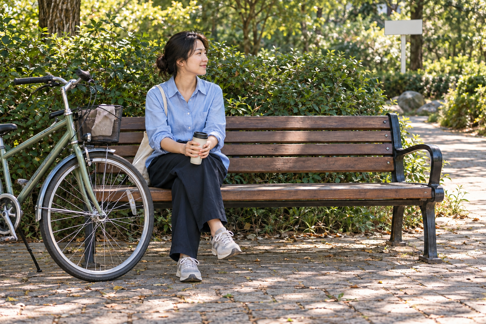
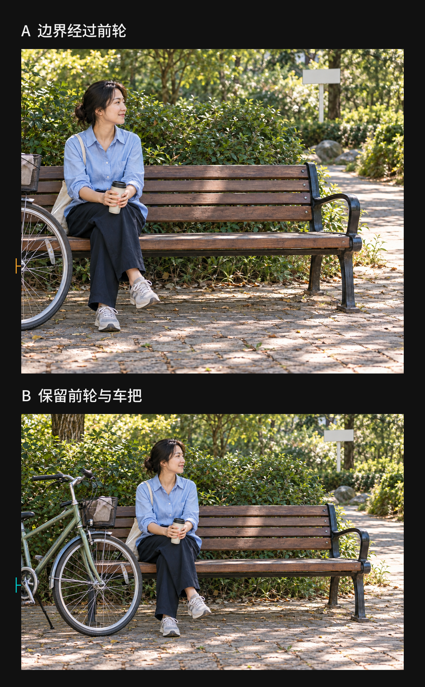
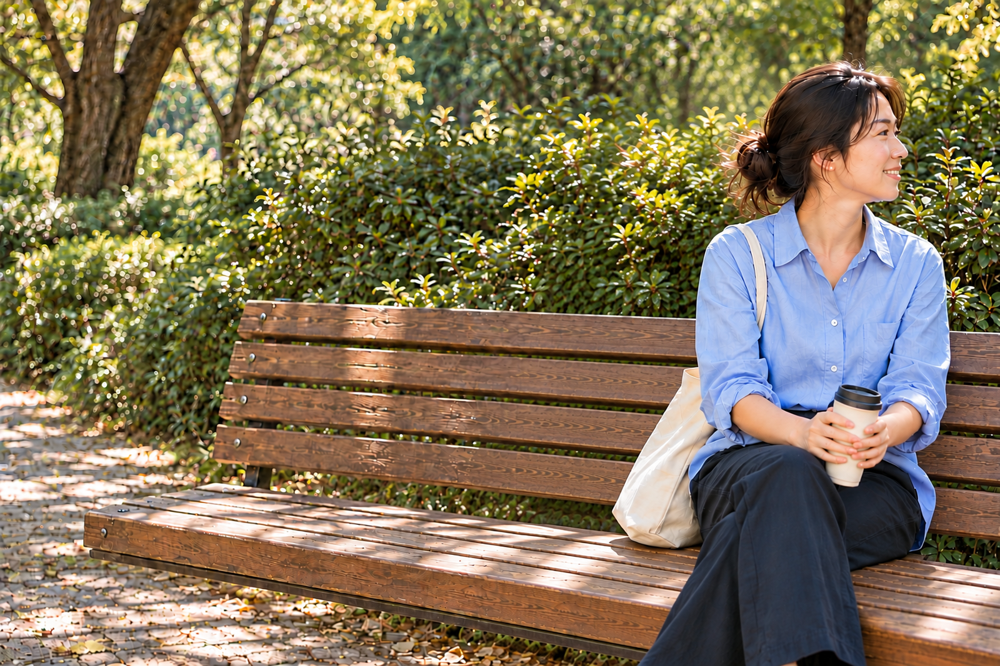
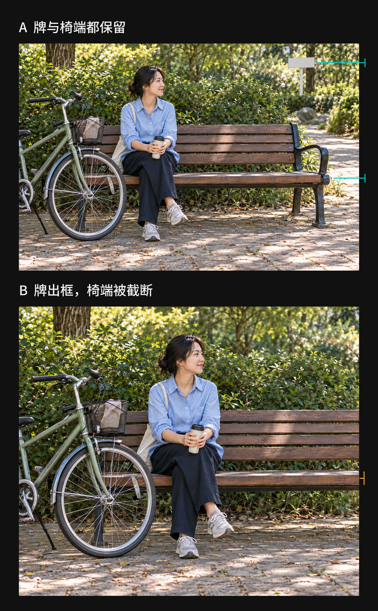

+++
title = "2-10 画面边缘：哪些取舍会改变一张照片？"
description = "从公园里的自行车、侧脸、长椅和亮牌出发，看清边框截掉的信息、指向画外的关系，以及保留与裁切的代价。"
date = 2026-10-22
tags = ["摄影", "构图", "画面边缘", "画外空间", "裁切"]
categories = ["摄影"]
series = ["主线"]
showTableOfContents = true
draft = false
+++

看清画框截掉了什么、留下了什么，在完整与延伸之间作出有理由的选择。

想象一个晴朗的下午，你和朋友走进附近的公园。她在长椅上坐下来，把水杯放在膝上，转头看向小路。树荫落在衣服上，身后的灌木有深浅不同的绿。你想留下的，就是散步途中这会儿松弛的样子。

照片里，她的神情和光线都很好。再看一会儿，左边却露着一截自行车，右上方还有一块很亮的指示牌。长椅的右端仍完整地留在画内，朋友身旁还有一段空位。几处边缘带来的感觉并不相同：自行车让你犹豫要不要多收进来一点，指示牌让你想把它挪出去，她身旁那段空着的座面又让你有些舍不得。

我们就从这里看起。先不急着把四边清空，看看这些东西各自在照片里做了什么。

*图 1｜先看长椅上的朋友，再留意左侧的自行车、右侧的椅端和浅色牌。它们都靠近画边，却未必承担同一种作用。（情境模拟）*

## 先看清，画框从哪里切了过去

现场的自行车是一整辆，照片只留下了前半部。我们仍可以从车轮、前叉和车把辨认它，知道车身还在画外。画框没有把它变成一件新的物品，却决定了读者能凭哪些部分认出它，以及它和朋友、长椅还有多少联系。这种被画框截去一部分的情况，就是**轮廓截断**。

“没有拍全”本身还不足以决定要不要改。比如，你原本就想交代两个人骑车来公园歇脚，那么半辆自行车可能已经够用：它让长椅旁的停留有了来由，也没有占去太多地方。可如果左边只剩一小段弯曲的黑线，车轮和前叉都认不出来，这一小块在照片里的作用就很不同了。读者也许只能看到一个突兀的碎片，无法把它和这次休息联系起来。

试着把同一张画面左侧的边界往里收一点，让它经过前轮；再退回来，把前轮和车把留完整。先看车的形状，再看朋友在整张照片里的份量。

*图 2｜A 的左边框经过前轮，B 保留了完整前轮和车把。两版来自同一模拟底图，只改变左侧裁切边界；同宽显示时，A 中的人物也会变大。（裁切效果示意）*

保留较多车身的一版，能更容易交代“骑车来这里”；收紧的一版，人物占据的相对份量会增加，但自行车的信息也少了。我们改变的是取景范围，所以两件事会一起发生。判断时不能只说“车轮完整了”，还要看看为了它增加的那片空间，是否值得留在照片里。

有时，最合适的第三种选择是继续调整取景，让自行车完全离开。照片就更集中在朋友的表情和树荫上。可这也意味着，骑行的线索消失了。三种取舍不必排出固定名次，先想想你喜欢这个下午的哪一部分，选择就会具体起来。

人物靠近边框时，也可以这样看。假如朋友的手正在拧杯盖，底边刚好把手和杯盖切掉，剩下的姿态就不容易说明她在做什么。把取景向下放一点，给动作留出位置，会比记住一张“身体哪里能切”的表更直接。若你拍的是她转头时的表情，杯子又没有参与表达，取一个更近的景别也完全说得通。

这里要保住的，是这张照片值得看的内容。完整的身体未必是它的重点，清楚的动作却可能是。我们沿轮廓看到画框时，可以多停一下：现在留下的部分，够不够把我在意的事说清楚？

下次路过停着自行车的长椅，可以站在同一个地方，稍微改变相机朝向，各拍一张车身保留较多和较少的版本。回看时既观察自行车是否容易辨认，也看看人物的位置有没有被挤得不舒服。这是尝试两种取舍，不需要把所有相机参数重新设置一遍。

## 留一点画外，让这一刻继续下去

自行车让我们注意到“缺了哪一部分”，朋友转头的方向又带来另一种关系。她的身体还在画面里，目光却朝向画框之外。即使看不见那边的人或事，我们仍能从头部和身体的朝向察觉：这一刻可能与照片之外有关。

不妨把公园里的场景往前想一点。朋友听见有人喊她，坐在长椅右端，转头微笑。你拍下这一刻，她的脸离右边框很近，长椅的座面也从右边延伸出去。照片留下了回应的表情，却没有告诉我们她在回应谁。看图时，你可能会想顺着她的朝向再看一点。

*图 3｜她的脸朝向右侧画外，肩膀的转动与微笑留下了回应的线索。照片没有交代她在看谁，这份未交代完的关系也是一种取舍。（情境模拟）*

这样的取景让现场显得尚未结束。**画外空间**虽然没有被拍到，画面内的朝向和截断仍给它留下了线索。我们可以把这种让关系向画框外继续的安排，理解为较开放的取景。

如果这次想记录的是两个人见面的开心，把被回应的人也拍进来，关系就交代得更具体；如果喜欢的是那一下转头，留下一点不知道她在看谁的余地，也有自己的意思。开放的取景保留了一个未交代完的关系，较收拢的取景则更容易让人围绕画内已有的内容停留。它们提供的信息和感受不同。

当然，画框切过去并不会自动产生有趣的延伸。若头部朝向看不清，只剩脸旁一条很窄的空隙，你也可能只是觉得人物被挤住了。回看图 3 时，可以留意她的侧脸和转动的肩膀：正是这些可见的动作，让“画外还有事情”有了依据。换一张动作不明确的照片，同样的位置就未必带来相同感受。

再看长椅，连续的木条让人认得出座面仍在画外延伸。小路通向右侧，也可能让这次休息带着“还要继续走”的感觉。若更想留下树下一个安稳的小角落，可以重新取景，让椅端或树干在边缘附近收住画面，再看朋友是否仍在你喜欢的光里。

## 那块亮牌，是干扰还是公园的一部分

回到开头，右上方还有一块浅色指示牌。它没有碰到朋友，也没有挡住她的表情，却可能让你看照片时几次注意到那里。牌面比周围灌木亮，边界又清楚，这些差异足以让它显眼；不必先假定“只要在边上，就一定更抢眼”。

把目光移到牌上，我们又遇到一个内容选择。如果牌面能交代公园的位置，或者朋友正在指着它讨论路线，它就有理由留在画面里。若照片只露出一角白色，既读不到信息，也看不出朋友和它有什么关系，那么为了保留这个休息的瞬间，减少这一处竞争就值得试试。

你可以把相机稍稍转向另一侧，让牌离开取景范围。不过，人物也会随之换位置，另一边可能收入新的东西。看完牌有没有出去，还得回到朋友身上，看这次调整是否让她靠边太近，或失去了原来舒服的树荫。

如果问题是牌与人物挨得太近，挪动身体、换个站位，还可能改变近处人物与远处牌子的相对位置。现场移步和事后裁掉一条边，能做到的事并不一样：裁切可以排除画面外侧的内容，却不能显露拍摄时被人物挡住的背景。先认出自己要改变的是取景范围，还是前后物体的关系，会更容易找到合适的动作。

遇到的是短暂经过的人或车辆，等待也可能有用。白衣路人走出边框以后，再拍一张，边角会少一块亮色。但朋友的表情和动作也可能变了。如果她刚才那个笑容最值得留下，带着路人的那张仍可能是你最终喜欢的一张。边缘值得留意，抓住这一刻同样值得。

几种动作都有代价，我们可以先试最容易做到的一种，再根据变化决定要不要继续。为了处理一块不重要的牌，把原本喜欢的人物和光线都放弃了，就该停下来重新看整张照片。

## 裁掉以后，再看一遍新出现的四条边

回到相册，调整边缘最顺手的办法往往是裁切。普通裁切从已经记录的照片里选出一块保留区域，区域以外的内容不再出现在成片中。[Adobe 的裁切说明](https://www.adobe.com/us/learn/lightroom-cc/web/straightening-photos)也把排除边缘的无关内容列为它的一项用途。

现在把公园照片右边收进来，直到浅色牌完全离开。先别急着保存，再沿新的右边框往下看：原先完整的长椅端头，也可能一起被裁掉了。

*图 4｜A 保留浅色牌和完整椅端，B 只收进右边界，牌离开了，椅端也被切掉了。去掉一处干扰后，新边缘仍需要重新判断。（同一模拟底图的裁切对照）*

牌不见了，长椅却从新的右边框延伸出去。假如你想让人物和长椅组成一个收拢的小场景，这次裁切并没有只带来收益；假如你喜欢长椅继续向画外伸展的感觉，这个变化又未必需要修正。刚才只是想去掉一块亮色，实际却同时改变了照片交代空间的方式。

还有一种容易忽略的变化：像这样从侧边收窄画面后，把裁后的照片和原图按相同宽度显示，保留下来的人物会显得更大。你喜欢裁后版本，也许既因为亮牌消失了，也因为人物更突出。这些都是裁切的结果。比较时把原因说具体，比把所有改善都归给“边缘更干净”更有帮助。

现在可以做一次很小的尝试。找一张你喜欢、却对某处边缘有点犹豫的旧照片，保留原片，另存一个轻裁版本。先写下这一次想处理哪一处，再只围绕它调整。并排看两张时，看看原先的困扰有没有减轻，也找出一个随之失去的东西：一段动作、一个环境线索，或者人物与边框之间原本舒服的距离。

最后，从任意一个角开始，沿四条边慢慢看一圈。注意被切到的轮廓能否理解，人物和线条向哪里延伸，亮色或碎片有没有参与照片的内容。看完再回到整张照片，选出更接近你原本心意的一版。无需数出“问题”最多的那张，也不必每处都修改。

下次在公园举起相机，朋友仍然是最值得看的部分。只是按下快门前，我们还能多看见她周围的几处关系：自行车留下多少，长椅在哪里结束，她转头望向的地方要不要交代。四条边由此成为这张照片的一部分。拍下来的依然是那个下午，而你已经更清楚，想把怎样的一个下午留下来。

