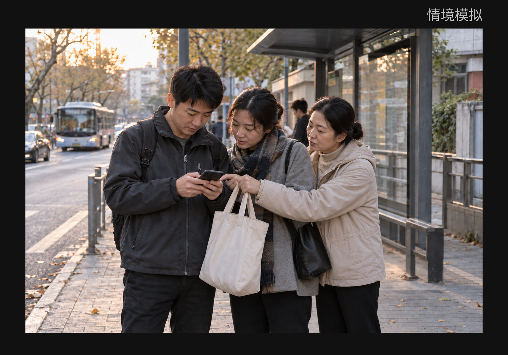
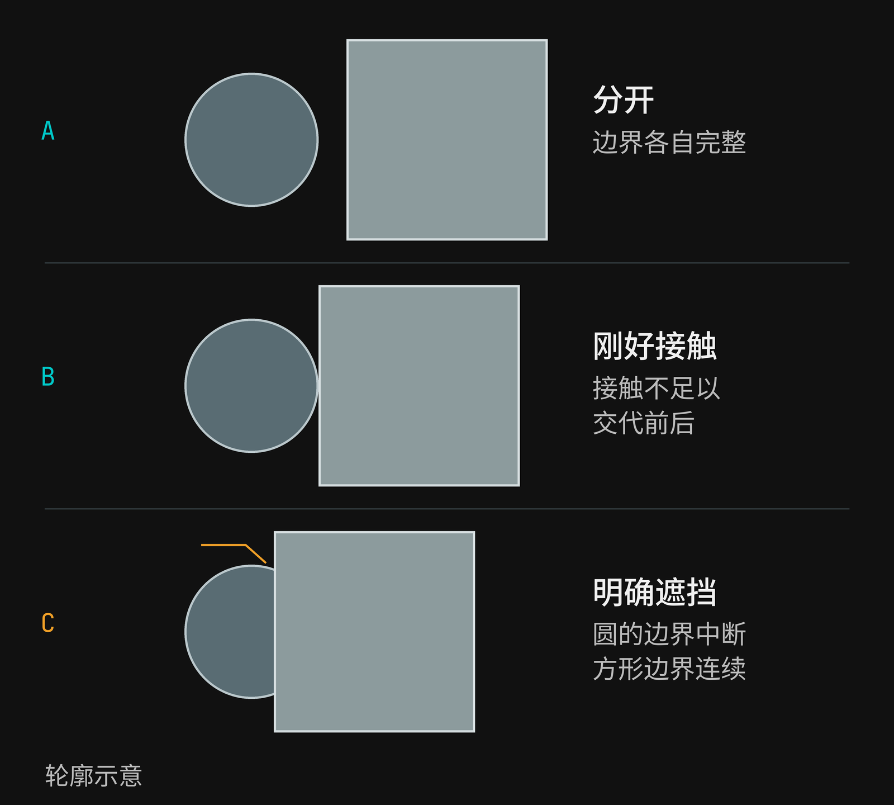
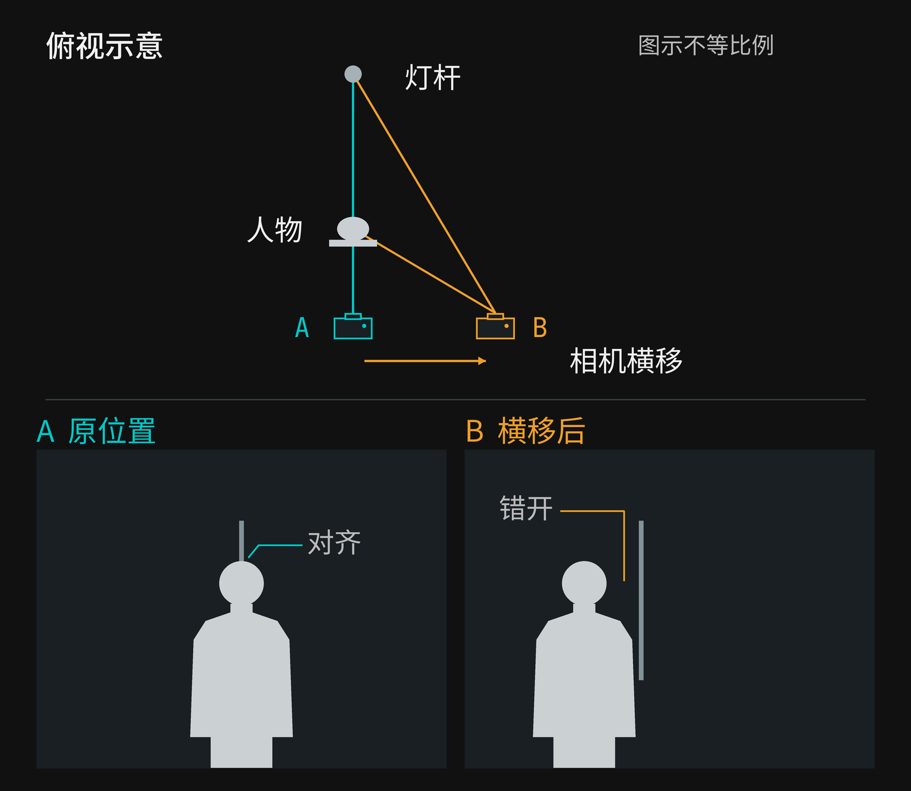
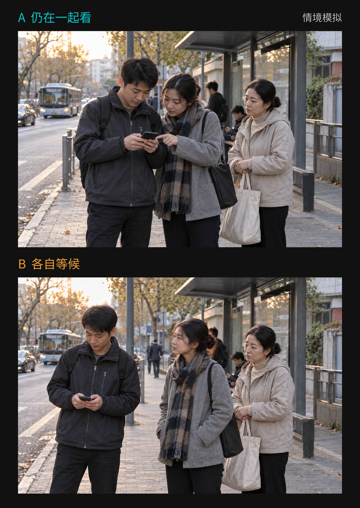

+++
title = "2-11 相切与重叠：画面关系为什么变得含糊？"
description = "从街角等车的场景出发，辨认相切、遮挡与轮廓错接，比较移动机位和等待如何改变画面关系，以及清楚与联系之间的取舍。"
date = 2026-10-30
tags = ["摄影", "构图", "相切", "重叠", "遮挡", "机位"]
categories = ["摄影"]
series = ["主线"]
showTableOfContents = true
draft = false
+++

看清轮廓属于谁，再决定用微小移动或等待澄清关系，或保留重叠带来的意味。

想象你在街角等车。站台旁，两个人凑在一起看手机，后面还有一位拎着布袋的乘客。车还没来，一人抬起手指向屏幕，另一人稍稍低头。你想拍的，是他们一起等候的这一小会儿。

回看照片，那根原本在远处的灯杆却接到了一个人的头顶；两个人伸出的手挤在一处，布袋的提手又从旁边穿过。你记得现场谁拿着什么，照片却没有把这些关系交代得同样清楚。

第一反应也许是让背景再虚一点。但先别急着换设置：灯杆与头部怎样接上，两只手在哪里失去区别，是两处具体的关系。找到含糊发生的位置，才知道该移动、等待，还是让它留在照片里。

*图1｜街角等车：头顶与远处灯杆接在一处，手、袖口与布袋提手也挤到一起。先找到影响你理解动作的局部，再决定是否改变。情境模拟。*

## 先找到轮廓接错的那一小处

先看头顶。灯杆明明立在人物后面，照片里却只剩下一根竖线从头发上方伸出来。人和灯杆并没有在现场相连，它们只是从这个拍摄位置看过去，刚好落在同一处。

我们平时说的“相切”，常常是在描述这样的画面接触：两个形状的边缘恰好碰到，或贴得近到难以分开。这里不要求它们满足数学上的精确切点。两张侧脸的轮廓轻轻碰上，远处屋檐的横线接到肩膀，都可能带来类似的停顿。

头顶接灯杆还稍有不同。杆子下段可能已经被头部挡住，只留下上段沿着头顶向外延伸。因此它未必是纯粹的相切，也可能是遮挡与轮廓接续共同造成的错接。我们不必急着给整张照片贴标签，先指认这一点：哪里让本来分开的东西，看起来像长在了一起？

试着用目光沿头顶走一遍，再沿灯杆走回来。如果到了交接处，你需要借助“我知道灯杆本来在哪里”才能把它们分开，这里就值得多看一眼。另一处则是两人的手：沿着袖口走到手腕，还能不能看出这只手接在哪条手臂上？若只能认出几根手指，却不能把它们接回各自的身体，含糊就落在了动作归属上。

这两种停顿影响的东西并不一样。头顶的竖线可能只是引人发笑的小插曲；伸向手机的手若辨不清，就会妨碍我们理解两个人正在做什么。如果你最想留下他们一起看屏幕的样子，后者更值得优先处理。

所以检查轮廓时，不用从左到右清理所有接触。先回到想拍的东西，找到那一处会让人把关系读偏、或读不下去的连接。它可能只占画面很小一块，却正好位于这个瞬间最有意思的地方。

## 遮住一部分，关系也可以更清楚

把目光从手移到两个人的肩膀。前面的人挡住了后面的一小部分上臂，后者的肩线走到这里便停下，前者的轮廓却还连贯。即使没有看见完整的两具身体，我们仍可能读出谁在前、谁在后。

这就是遮挡能够提供的信息：靠前的物体挡住了后面的部分，留下的轮廓中断，反而帮助我们辨认前后。轮廓的接续和交接是判断形状关系的线索，但不能单凭某一条线就保证所有场景都能读清。[Geisler 的视觉分组讲义](https://www.cns.nyu.edu/csh/csh06/PDFs/Geisler-cshl-06-wsg2.pdf)用简化图形说明了这类线索。

*图2｜分开、接触与遮挡。方形明确遮住圆形的一部分时，轮廓的中断提供了前后线索；这不等于所有照片都应该增加重叠。轮廓示意。*

图2把生活细节暂时拿掉，只留下圆形与方形。它们分开时，各自的边界完整；刚好碰到时，只有一个接触点，很难仅凭这一点判断前后；方形遮住圆形的一部分后，圆的轮廓在方形边缘处中断，方形边缘仍连续，前后便有了可用的依据。

这个例子解释了一件容易被忽略的事：**重叠得少，不一定比重叠得明确更容易读**。 一只手擦着另一人的袖口，可能让身体归属犹豫；手若明确横过袖子，腕部又连回自己的手臂，反倒有机会让动作更清楚。具体还要看颜色、明暗以及留下了多少可辨认的部分，不能靠把遮挡面积加大来保证结果。

回到等车的人群，我们需要的通常也不是看见每个人完整的轮廓。深色袖口与浅色手腕之间的一点区别、肩膀后露出的半张脸、手掌与手机之间的接触，都可能足够交代动作。衣服色调接近时，这些小线索尤其值得留意；两件深色外套叠成一块，边缘即使存在，也未必容易辨认。

可以把照片稍微缩小，再看一次。若放大时能追踪到的手腕，在你平时看照片的大小下又混进袖口，它对这张成品的帮助就很有限。这里不用数像素，只要看：我关心的那个动作，在实际观看时还成立吗？

当这条关系已经能读懂，就可以停下。后面的人露出一部分身体，可能正好让站台显得有人来往；两人的肩膀靠在一起，也可能让共同等候比各站一边更有意味。重叠有没有妨碍表达，需要连着这些具体内容一起判断。

## 挪一点，是改变它们相遇的方向

现在回到那根灯杆。假如人物暂时没动，你可以在安全的人行道范围内稍微向侧面移动，眼睛留在屏幕上，观察杆子与头部怎样错开。先试一个很小的动作，看看间隙往哪里出现，不用预先规定必须向左几步。

人在近处，灯杆在更远处。相机的位置改变以后，看向它们的方向发生了不同程度的变化，原先对齐的部分便可能分开。图3把这个过程简化成同一场景的两个机位：人物和杆子不动，相机横移，人物头部与背景杆在画面中的相对位置改变了。

*图3｜人物和杆子都没有动，相机横移后，它们在画面中的相对位置改变了。俯视图交代机位，下面两幅示意交代头顶与杆子的关系；移动幅度不是现场操作标准。*

这里真正起作用的是拍摄位置的变化。如果仍站在原地，只放大画面或事后裁切，接在头顶的那一处通常也只是一起被放大或留下；在两者都保留的区域里，它不会因此变成一条新的间隙。你当然可以把灯杆裁出画面，但那是另一种取舍，也可能把想留的头顶空间一起裁掉。

横移适合刚才的竖杆关系。若碰在肩膀上的是一条横向栏杆，轻微抬高或降低相机可能更值得试，因为这次想改变的是上下关系。先看哪一条边接上了，再选择动作，比见到重叠就一律侧身更有针对性。移动的效果还与前后距离有关，也不保证一次就找到合适位置。

尼康的[《Composing Photographs》](https://www.nikonusa.com/learn-and-explore/c/tips-and-techniques/composing-photographs)同样把走动观察、改变拍摄角度列为处理主体与背景关系的办法。对眼前这张照片，我们还要多做半步：别只盯着刚刚分开的头顶，重新看一遍两个人。

也许灯杆离开了，后面那个人的脸却被挡得更多；也许两只手分开了，原先两人一起低头的紧凑关系也变松了。你移动的是看整个场景的位置，并不能只命令某一根杆子挪开。先比较得到的清楚与失去的联系，再决定是否留下这个机位。

背景虚化也可以让灯杆不那么抢眼，但它处理的是背景细节的可辨程度，并不会把两个物体的投影位置移开。若一个很亮的模糊光斑仍贴在脸旁，连接感可能还在；若两只重要的手就在相近距离，单靠虚化背景更难交代它们的归属。回到具体边缘看，比笼统要求“背景干净”更容易找到可做的改变。

## 留一点重叠，让那个瞬间还在

人群并不会一直等着我们调整机位。刚向旁边挪了一点，举着手机的人可能已经转过身。此时，等待动作变化有时比继续移动更合适。

假设你站在原位，留意指向屏幕的那只手。它从另一个人的袖口前抬起，腕部露出来，手指仍指着屏幕；两个人的身体依旧交叠，动作却多了一段可以追踪的连接。你等到的并不是所有轮廓都分开的时刻，只是那个重要关系更容易成立的一刻。

还可以再等：指向屏幕的手放下，两个人各自转开，肩膀之间终于出现了间隙。画面也许更整齐，但“一起看一件东西”的联系已经淡了。如果最初吸引你的就是那次共同低头，继续等待得到的清楚，未必值得交换掉这个动作。

*图4｜A 保留身体交叠，也保留一起看手机的动作；B 的轮廓分开了，共同观看的瞬间却已结束。两种可能的时刻，适合留下的内容不同。情境模拟。*

图4比较的是两种可能的瞬间。A 中身体仍有遮挡，手腕、手机和共同朝向却保留了联系；B 中两个人分开，形状更独立，但共同看屏幕的动作已经结束。它们不是拍摄优劣的排名。若想留下两位乘客各自等车的状态，B 完全可以有自己的理由；若想留下他们短暂的交流，我更愿意保留 A 中的交叠。

照片里的靠近，也不足以证明人物真实的关系。肩膀相接可以让画面显得亲近，却不能据此断定两人是伴侣或朋友。同样，一群人的轮廓彼此遮挡，可以加强这张照片的拥挤感，而我们仍要靠更多现场信息，才知道当时究竟发生了什么。

这给选片留下了一个比较实际的尺度：需要清楚到什么程度，才足够支持我想让人看到的事？拍大家一起看手机，至少让人看懂目光、手和屏幕的关系；拍车到站时人群同时转身，未必需要让每一只手都独立出来。让什么保留含糊，也应该能在照片里找到理由。

下次回看自己的照片，可以找一张有两个人或两件物体交叠的，先遮住说明文字。沿着你最在意的一条轮廓走，试着把它接回所属的身体或物件；停住的地方，就是这次观察的起点。然后只提出一种改变：横移一点、改变高度，或等一个动作。说清它可能澄清什么，也可能失去什么。

如果想亲手试一遍，找两个不透明杯子，把它们一前一后放在桌上。从一个杯沿刚好接到另一个杯身的位置开始，小幅横移手机，保留两个杯子都在画面里，比较接触、明确遮挡和分开时的差别。再选一张你更喜欢的，说说是边界更清楚，还是两只杯子挨在一起更合你的心意。这个尝试用来观察关系变化，不需要把生活现场拍成严格实验。

回到开头的站台，我们想留下的仍然是那一小会儿共同等候。多看一眼头顶、手腕和屏幕，是为了让这份联系有机会被看见。轮廓可以分开，也可以继续交叠；只要你知道哪一处在帮助照片，哪一处让想说的事情变得含糊，按下快门就多了一点自己的把握。

