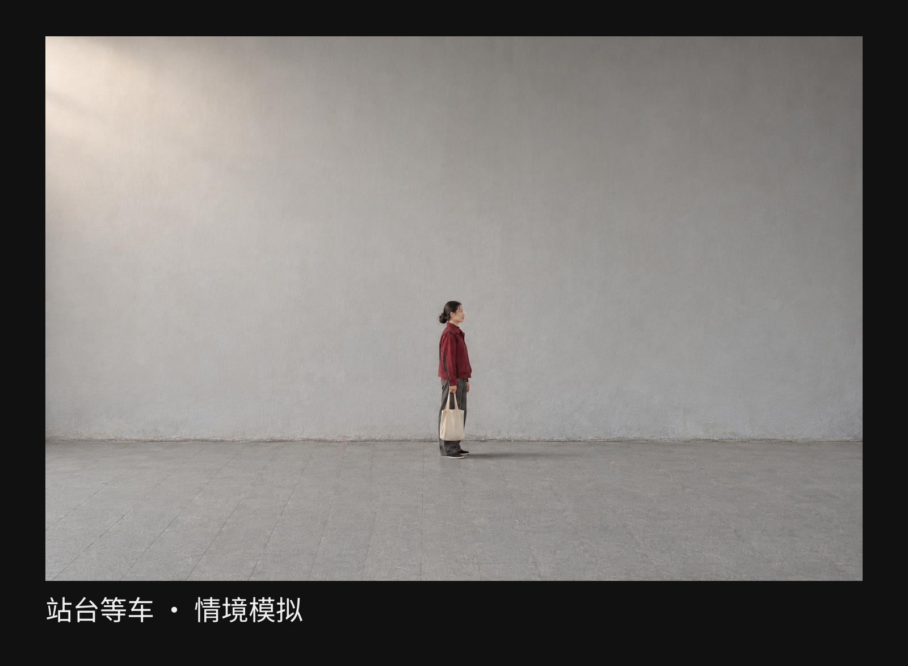
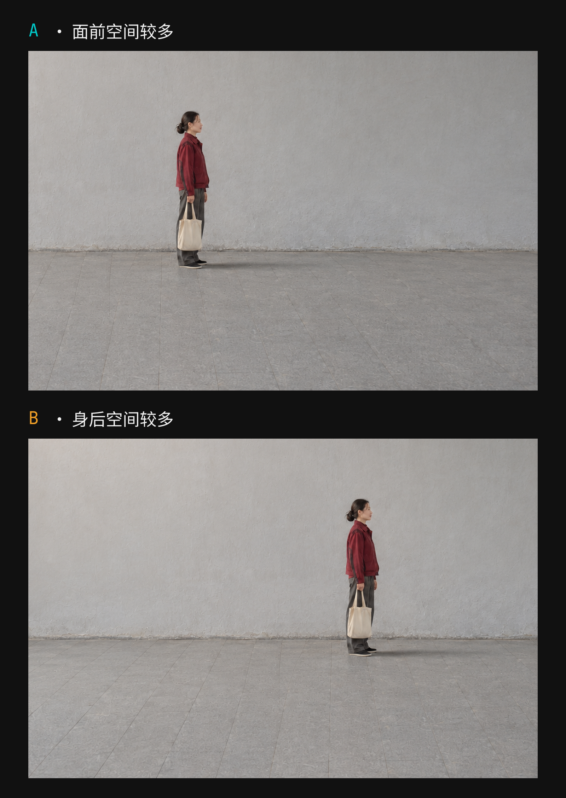
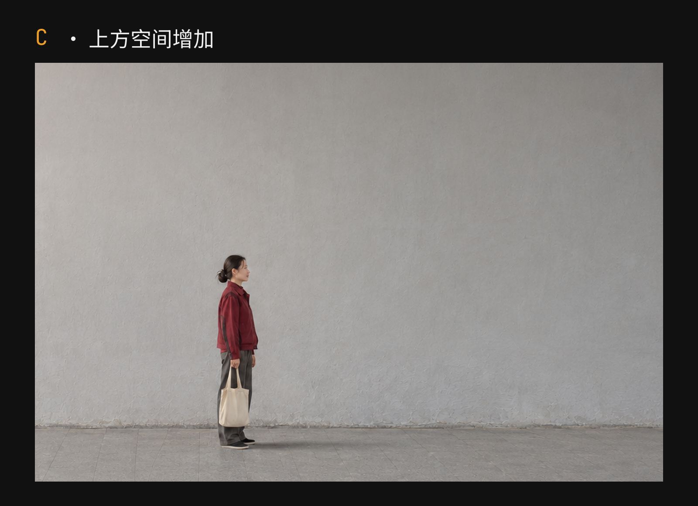

+++
title = "2-12 留白：空出来的地方怎样参与表达？"
description = "看人物周围的方向、比例与质地，判断一块空白给照片增加了什么。"
date = 2026-11-04
tags = ["摄影", "构图", "留白", "负空间", "裁切"]
categories = ["摄影"]
series = ["主线"]
showTableOfContents = true
draft = false
+++

看人物周围的方向、比例与质地，判断一块空白给照片增加了什么。

想象你和朋友在一处小站等车。朋友站在浅灰色的墙前，身上是一件暗红外套，一只手提着布袋，脸转向右边。车还没来，墙上有一片柔和的亮光，地面的接缝从脚边延伸出去。

你把相机举起来，没有急着走近。屏幕里的人不大，上方和两侧留着不少墙面。吸引你的也许正是这种关系：一个熟悉的人，暂时停在一片比身体大得多的地方。

可看久一点，又有些犹豫。朋友的动作会不会太小？这么多墙面，真的值得留吗？如果把人放大，细节应该更清楚，但等车时周围的那片空间，好像也会一起消失。

先别急着决定。我们沿着这一张照片，看看不同位置的空白分别留下了什么。

*图 1｜站台等车的情境模拟。人物、布袋与朝向可以辨认，周围保留较大面积的墙面和地面；先看你在意的是人物的动作，还是人与这片地方的关系。*

## 空白里也有墙面、光和距离

先把注意力从朋友的脸上挪开，看看旁边那块浅灰。它并不是什么都没有：墙的表面有细小起伏，左侧的光亮一些，往右慢慢暗下去；下面的石材与墙面又有不同的纹理。只是与外套、脸和布袋相比，这里少了几个需要逐一辨认的物件。

摄影里常说的**留白，也叫负空间**，可以先从这种关系理解：主要人物或物件周围、之间，相对疏朗的区域，也被组织进了画面。它可以是灰墙、深色水面、天空或一段地面，不必是白色，也不必毫无纹理。富士的摄影教学资料同样提醒，负空间可以保留质地，甚至包含次要活动，并不等于绝对空无。[Using Negative Space](https://www.fujifilm-x.com/en-us/stories/advanced-month-1-composition-4-negative-space/)

这里的“相对”很要紧。我们把朋友当作主要观看对象，墙面便成了围绕她的空间；如果这次真正想拍的是墙上斑驳的光，人物也可能只是帮助我们感受那片光有多大。留白的角色，要和你正在看什么一起判断。

在这张照片里，浅灰墙面让暗红外套的轮廓容易分辨，也让人物与周围较少变化的区域形成对照。你可以顺着头肩看完整个人，再向外看。若把背景换成密集招牌，画面里就会多出文字、亮点和新的形状，等着被辨认。两种环境各有内容，这次吸引我们的，是人暂时停在一片疏朗空间里的样子。

墙面的细节也值得留下。低反差的刷痕、缓慢移动的明暗，会让这块地方像真实站台的一部分，而不是贴在人物后面的纯色色块。它们不一定要求我们停下来逐一看清，却能参与整张照片的气息。

反过来，若右上角恰好出现一块很亮的补漆，或者墙边切进半个大字，那块区域可能开始与你想看的人物竞争。这时可以稍改取景，或等光线变化，再看它是否还适合承担原来的作用。判断空白时，面积之外还要看其中有哪些差异；看上去物件少的地方，也可能十分醒目。

## 同样多的空间，放到哪一边

现在保留人物的姿势、光线和画面大小，只换一个取景范围。让朋友更多地站在画面左侧，她的右边便留下较长的一段墙面；再把取景框向另一边挪，她靠近右侧，较大的空处就到了身后。

下面两版从同一张底图裁出，画幅和放大倍率相同。先沿着她的脸朝向右边看，再留意视线多快碰到画面边界。

*图 2｜同一模拟底图的等尺寸裁切：A把较多空间留在人物面前，B留在身后。人物的姿态与显示大小不变，变化来自裁切框的水平位置；这不是两次移动机位的实拍。*

在A里，脸朝着的方向还有一段可见空间。我会顺着这个方向多看一会儿：那里还没出现车，也没有第二个人，但人物的朝向把这片墙面与她联系起来了。我们知道照片没有把她正在看的东西交代完整，同时还看见了她面前的一部分地方。

这种安排常被称为给视线留出空间。它有用，是因为画面中确实有一个可辨认的朝向，而那一侧又有地方容纳这层关系。若人正面看着镜头，我们就不宜仅凭左右空白，替她编出一个明确的注视对象。

B里，人物的朝向更快碰到右边界。较多墙面在她身后，面前发生的事则更多落到画外。我可能因此更在意右边还有什么，或者觉得她快要离开这一块画面。你也可能觉得她只是靠边站着，没必要读成离开。我们能确定的是朝向与边界的关系变了，人物的经历和心情并没有随裁框得到证明。

这正是两版值得一起保留的原因。如果你喜欢的是等车时向前望的片刻，A让面前的空处成为可看的部分；如果你想让画外正在发生的事情保留更多悬念，B也可能合适。选择可以来自想留下的关系，无须先给其中一版判错。

实际拍摄时，可以站在安全的位置，先试着轻转手机，改变取景的朝向。与此同时，屏幕里的边缘和背景也会变化，需要重新看一遍；这与上面在同一底图上移动裁框不是完全相同的操作。若只是想安静地观察留白方向，先用一张照片裁两版，反而更容易把注意力留在这件事上。

## 抬头多留一点，人与地方的关系也会变

左右比较之后，再看看上方。保持与A同样大的裁切框，把它向上挪：人物在成片中的大小不变，但位置更低，头顶的墙面增加，脚下的地面减少。双脚仍完整留在画内。

留白方向的变化，这次已经不是“她往哪里看”。上方的墙面更充分地出现，人物则靠近画面下部。我们开始有机会把身高与周围的墙面放在一起看。

*图 3｜C仍取自同一模拟底图，与图2的A使用同尺寸裁切框和同显示倍率，但裁框向上平移。头顶空间增加、脚下地面减少，人物保持完整；与A比较时，留意人与墙面上下范围的关系。*

我会更容易在C里感到墙面占据了很大的范围，人只是其中的一部分。不过，照片并没有测出墙有多高，墙顶也可能仍在画外。这里可以比较的是画面中的比例和位置：人的身体提供了一把熟悉的参照，让我们对周围空间有了感受。

再回看图1的宽取景，那里的人还更小。与图2的较紧裁切相比，更多墙面和地面进入画面，人物的显示大小、位置以及周围范围也一起变了。如果你原本想记住朋友此刻的细微表情，宽取景可能已经让你失去想看的东西；如果你在意一个人站在这片地方里的样子，那些多出来的空间就有理由留下。

这时可以把照片缩到平时实际观看的大小，而不是一直放大检查。脸上的细微变化也许已经看不清，提袋的动作和朝向却还在。问一问自己，这些还够不够表达最初想留下的片刻。人物占多少面积才算合适，要从这一步判断，无法由一个通用百分比替你决定。

“人小、空处多”也不会自动变成孤独。仍是这位朋友，如果我们知道她刚和你说完笑话，照片就可能带着轻松的停顿；对不了解现场的人，那片空间又可能显得疏离。人物姿态、光线、场景线索和观看者的经验会共同参与理解。文章可以说我从哪些关系感到安静，却不能据此说她当时一定寂寞。

拍摄时，留白值得争取的，是一种你确实在意的联系。比如墙面缓慢的明暗让人愿意多停留，人物的朝向把空处接向画外，身体的大小让建筑显得更有分量。若扩大取景只让你关心的动作越来越难认，周围又没有增加值得看的东西，收紧一点就有理由。

## 带着一个具体东西，试着空出周围

你可以先从已有照片试起。找一张人物或物件周围还有余地的照片，保留原片，另做三个副本。前两版用同样大小的裁框，把较多空间分别放到对象面前和身后；第三版再调整上下位置，或改变裁框大小，比较另一种人与环境的比例。一次看一种变化，不必把每个版本都修到“最好看”。

并排看时，先用具体关系描述差别。例如：“这一版在脸朝向的右边留下更多墙面”“这一版让我更先注意整个人站在哪里”。然后再说喜欢哪一张。若只剩“更高级”“更有氛围”，可以回到照片中找找，究竟是哪一块空间在支持这个感受。

也可以在下次散步时做一次很小的现场尝试。找一段有细微光影的墙，请同行的朋友站在前面，或用墙边已有的自行车作观察对象。从公共通行区域取景，不用为了模仿文章跑到站台边缘。先拍下当前关系，再轻转相机给一侧多留一点地方；把两张缩到手机屏幕上，比较主体还能认出什么，新增的墙面又带来了什么。

如果吸引你的是墙的纹理，就让它保留到能感觉出来的程度；如果吸引你的是朋友抬头的动作，就看看上方空间有没有接住这个朝向。需要兼顾的事情可以很少，这次只找一个你愿意保留的关系就够了。

再想起开头等车的朋友。现在决定是否走近，不只是看人物有没有填满画面。你已经可以先看右侧那段墙、头顶的光和脚边的地面，想一想它们带来了什么关系，再看人物还保留了哪些重要细节。**把这两件事放在一起，决定留多少、留在哪边**，就有了自己的理由。

## 参考资料

- [FUJIFILM X Stories：Using Negative Space](https://www.fujifilm-x.com/en-us/stories/advanced-month-1-composition-4-negative-space/)。用于核对负空间不必完全空白、可有质地，以及回看旧图尝试裁切的基本概念；本文的站台情境和各版观看判断为教学设计，不借来源替审美选择下定论。
- [Nikon：Composing Photographs](https://www.nikonusa.com/learn-and-explore/c/tips-and-techniques/composing-photographs)。以实际取景变化讨论主体、周围水面和背景关系，作为观察周围空间的延伸阅读；本文未使用其中照片，也不把变焦等同于移动机位。

