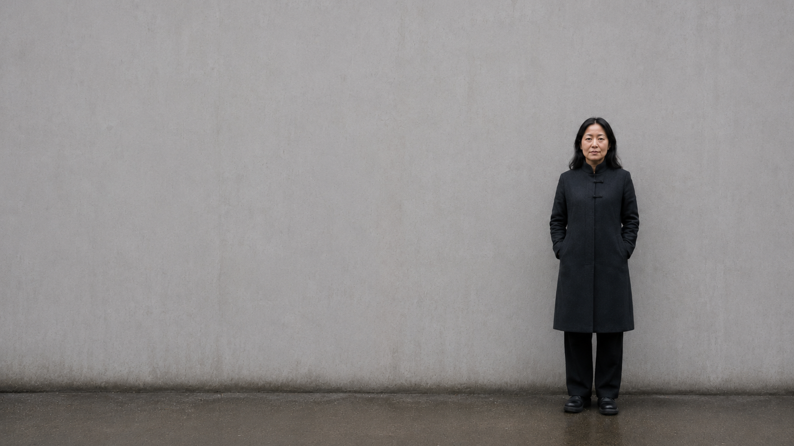
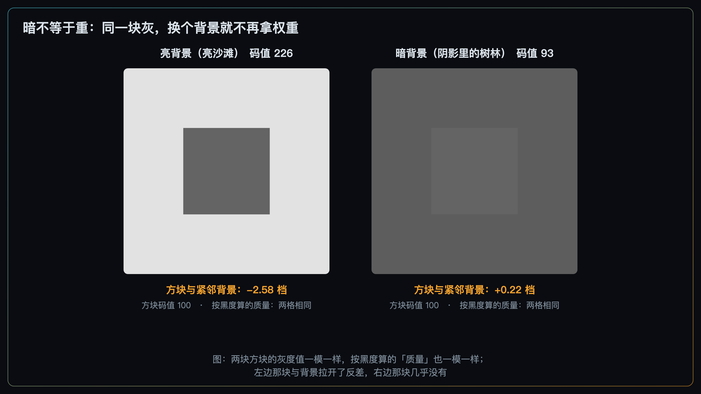
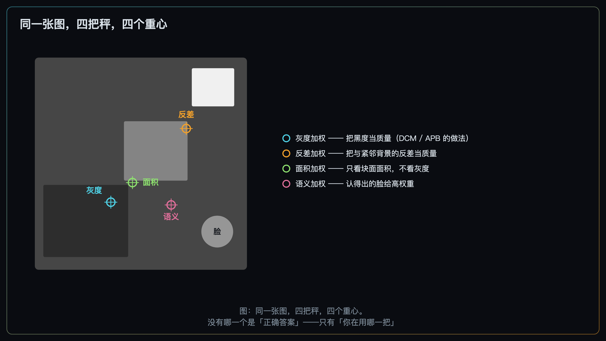
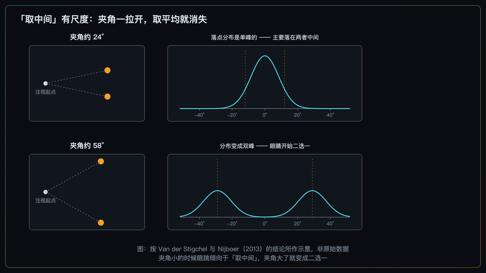
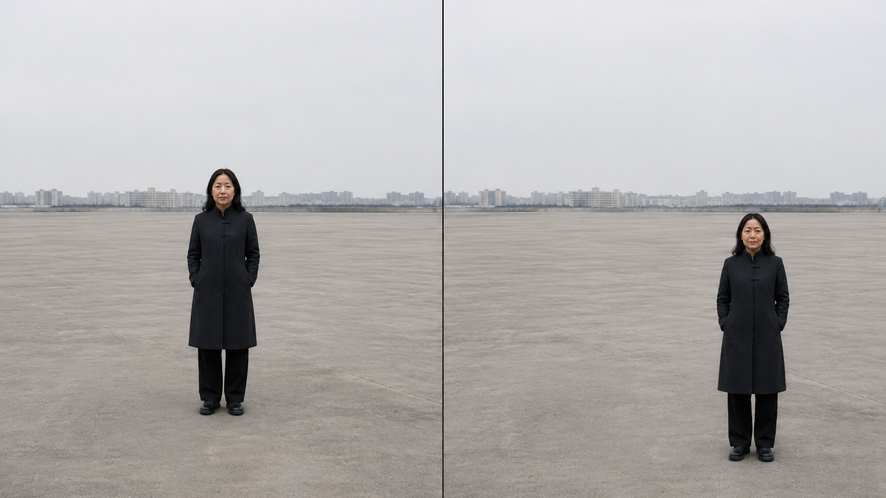

+++
title = "2-7 几何骨架 2：平衡的物理学——视重、重心与力矩"
description = "平衡不是把两边配平，而是让权重落在你要它落的位置上——杠杆是记法，不是定律。"
date = 2026-09-09
tags = ["摄影", "构图", "视重", "重心", "平衡", "中心偏置", "视知觉"]
categories = ["摄影"]
series = ["主线"]
showTableOfContents = true
+++



> 平衡不是把两边配平，而是让权重落在你要它落的位置上——杠杆是记法，不是定律。

你拍了一张还不错的照片。主体在右边，占了大概三分之一，左边一大片是空的墙。看第一眼就觉得「往右倒」，于是你回过头去补：等一个人走进左边，或者往左挪一点把那盏路灯框进来。补完再看——照片没变好，反而变成了两样东西在互相抢，谁也不像主角。

「往右倒」这个感觉是真的，但它顺手给出的那个处方——往左边加点东西——经常不解决问题。因为「平衡」这个词把两件事捆在了一起：一件是**每一块东西自身有多显眼**，另一件是**它们分别落在画框的哪儿**。我们在 #2-2 已经把前一件拆透了：就明度这一层而言，视觉权重不取决于绝对的亮或暗，而主要取决于一块区域与紧邻周围的反差。后一件到现在为止一直没讲：同一个主体、同样的反差，摆在正中间和摆在右下角，观众的读法完全不同。

往左边加一盏路灯，确实改变了整张画面的权重分布——**它新增了一份落在另一侧的权重**，注意力结构跟着重排。这正是「配重」有时真的管用的原因。它没有动的是**主体自己的位置**：主体还在右边三分之一处，离右边缘还是那么近，在观众第一跳里的处境一点没变。于是常见的结果是，你没有改善主体的处境，只是给它请来了一个竞争者。

这一篇把「位置」这一维补上，讲四件事：视重到底是什么、重心能不能真的算出来、位置的代价具体是什么、以及流传最广的那句「一个小亮点能抵一大片暗」，究竟能用到什么程度。

*图：第一眼就会觉得「往右倒」。问题是这个感觉接下来该怎么用*

## 一、视重不是物体的属性

先做一个可以在脑子里跑的实验。一张照片，主体不动、光不动、背景不动，你唯一做的事是把取景框往左平移一点，让主体从画面正中挪到右边三分之一处。#2-2 那三个旋钮——明度反差、局部对比、色彩强度——一个都没拧，主体与它紧邻背景的反差一档也没变。可是照片确实变了。

变的是什么？

摄影书给的答案是杠杆。这个类比不是随口打的比方，它在书里是被当成物理事实写的。上世纪三十年代的绘画教材里就有一句：好的构图取决于不等的质量在画面中心两侧的平衡，「关于构图可以写很多卷，而那不过是这条简单支点规则的展开」（Doust 1934，转引自 McManus 等 2011）。到了摄影，说法更直接：谈论画面里力的平衡时常用的类比都来自物理世界——重力、杠杆、重量、支点——「这些类比相当合理，因为眼与脑对平衡有真实、客观的反应，其运作方式与力学定律非常相似」（Freeman 2007《摄影师之眼》，同样转引自 McManus 等 2011）。

既然借了力学的词，就得按力学的分工来用，否则三个词会糊成一团。**在杠杆这个记法里，视重对应的是「重」那一半**——这块东西自身有多显眼，跟它站在哪儿无关；把它乘上离假想支点的距离，得到的才是**力矩**。

> 一块东西产生多大的「力矩感」，可以粗略记成：它自身有多显眼 × 它离那个假想支点有多远。这是那把杠杆的全部内容。

摄影里随口说的「这块东西很重」，多数时候说的其实是后者——你感觉到的从来不是孤立的显眼程度，而是「它显眼、并且正压在某个位置上」。这两半得拆开分别处理，这一节先处理前一半。

先把这把杠杆的身份说清楚，免得越用越当真：**画面上没有秤，没有支点，也没有单位。** 两块「重量」既不能相加，也不能互相换算；支点该摆在哪儿——几何中心？主体？——本身是你随手定的，换一个位置，同一张照片的「力矩」就是另一套数。

它唯一给你的东西是把「位置」请进讨论，并且给出一个能在取景器里做的动作。这个身份和 #2-3 的「注意力信噪比」、#2-6 的「方向场」是同一款：结构上像，量纲不通，无仪器可测。这笔账第四节回来算。

**视重不是某个物体的固有属性。** 它是下面三样合起来决定的「这块东西自身有多显眼」，前面几篇各自讲过：

- **与紧邻背景的反差**（#2-2）——就明度这一层而言，起作用的不是绝对亮度。雪地里的白婚纱不抢眼，暗巷里的白衬衫才抢眼；
- **块面的面积**（#2-5）——在最粗的尺度上，画面被读成几块连成一片的明暗区域，一块的大小本身就在拿权重；
- **语义上认不认得出**（#2-1 里那一层）——清晰的人脸、可读的文字、能辨认的人形，靠的是「被认出来」而不是「亮不亮」，而且很难只靠三个旋钮压下去。

位置是另一件事，它的作用方式和上面三样都不一样。**挪动取景框不会改变主体自身的任何一项特征**——反差没变，面积没变，是不是一张脸也没变；**但它确实改变这块东西实际拿到注视的概率**，因为观众的注视在画框里本来就不是均匀分布的。一盏很亮的路灯，摆在画面正中和贴着右边缘，它自身的三样特征一项都没动，可它被人看到的机会、以及它对整张照片做的事，完全不同。这一层具体怎么运作、要付什么代价，是第三节的正题。

### 顺手拆掉一句：暗不等于重

流传最广的配重说法是「大面积的暗块很重，可以压住对面的小亮点」。这句话在很多照片里碰巧成立，但它给的理由是错的，而错误的理由会把你带到错误的现场判断上。

暗块之所以有重量，不是因为它暗，是因为它与紧邻的周围拉开了反差、并且占了足够大的面积。同样一块深灰色的岩石，放在亮沙滩上是画面里最沉的一块；挪进阴影里的树林，它还是那么暗，但**由明度反差贡献的那部分权重已经大幅下降**。这条是 #2-2 的直接推论，不是新规矩。

要补一句，免得把它推过头：掉下去的只是明度那一份。如果这块暗东西还带着别的东西——一张认得出的脸、一个与周围色相拉得很开的色块、一片和背景完全不同的纹理——它照样可能显眼。上面那三样来源是**分头供货**的，明度这一路断了，另外两路不一定跟着断。

值得说的是，「越暗越重」这个简化并不只活在摄影教程里，它被直接写进了那些能算的量表。McManus、Stöver 与 Kim（2011）在计算图像重心时，把每个像素的「质量」定义为它的黑度——他们文中那个示例矩阵的注解写得很明白：255 等于黑等于重，0 等于白等于轻。另一套更早的平衡度量 APB（Wilson 与 Chatterjee，2005）同样假设像素越暗越重（这条转引自 Hübner 与 Fillinger 2019 的综述性描述）。

**「越暗越重」是这类机械平衡模型的一条操作性假设**——它的价值在于可计算：给定一张图，任何人都能算出同一个数。在浅底加深色元素的简单刺激里，它和视觉反差往往高度重合，因为那种画面里「暗」和「与背景反差大」根本是同一件事。但这些研究者并没有把它留在构造图里：McManus 等人的第一项研究直接算的就是 455 张真实的艺术摄影，Thömmes 与 Hübner（2018）更是把同一套方法用在了 679 张真实的建筑摄影上。

正因为它被推广到了真实照片，它的外部效度才需要谨慎看待。**一旦画面的背景本身就暗**——夜景、暗调静物、逆光剪影——按黑度算出的质量就会把那一大片暗背景记成很重的一块，而 #2-2 意义上的视觉权重并不在那儿。**所以计算出来的「质量」不能直接当成主观视觉权重来读**，它是一个定义清楚、可复现的指标，不是视觉系统的工作方式。

*图：两块方块的灰度值一模一样，按黑度算出的「质量」也一模一样；但左边那块与背景拉开了反差，右边那块几乎没有*

### 三种「重量」，别混在一起

到这里已经出现了三个都可以叫「重」的东西。它们在后面三节里各自还会出现，先分清楚，免得互相冒充：

- **像素质量**——DCM、APB 这类度量为了能计算而定义的黑度。它的好处是完全客观：同一张图，谁算都是同一个数。它不承诺自己等于任何知觉量；
- **视觉显著性与注视概率**——一块区域实际拿到注视的倾向。由 #2-2 的局部反差、#2-5 的块面面积、#2-1 的语义可辨认度，加上这一篇要讲的位置，共同决定；
- **主观平衡感与稳定感**——观众看完整张照片之后给出的判断，「这张稳不稳」「这张偏不偏」。

三者不能互换，而这不是理论洁癖：Hübner 与 Fillinger（2019）的结果正是三者对不上的直接证据——APB、DCM 这些客观度量与观众的主观评分在多数情况下关系很弱，而「平衡」「稳定」「喜欢」三个评分之间也不是同一个变量（第四节会给具体的数）。

**小结**：视重是「这块东西自身有多显眼」，由反差、面积、语义三路供货；你在画面里真正感觉到的那份分量，还得再乘上它站在哪儿——而那一半，从下一节开始算。

## 二、重心可以算，但先说清你拿什么当质量

上一节把「显眼」和「位置」拆开了。把它们乘起来再做一次平均，就得到那个所有平衡讨论都绕不开的概念：**重心**。

直觉上它很好懂：把画面里每一块「重量」按它所在的位置做一次加权平均，得到一个点。所有重量都堆在右边，这个点就偏右；两边差不多，它就落在中间附近。写出来就是最普通的那条加权平均式 \(\bar{x} = \sum_i m_i x_i / \sum_i m_i\)，把 \(m_i\) 换成你选的那种「质量」即可。

实证美学里真的有人这么算，而且给它起了名字：**DCM**（Deviation of the Center of "Mass"，重心相对画面几何中心的偏离）。做法就是上面那条式子，把每个像素的灰度当作它的质量，算出整张图的重心，再量它离几何中心有多远。偏离越小，这张图按定义就越「平衡」。

问题出在 \(m_i\) 上。

**你拿什么当质量，重心就往哪儿搬。** 用灰度当质量，一片大面积的暗背景会把重心拽过去；改用「与紧邻背景的反差」当质量，那片均匀的暗背景几乎不参与，重心立刻搬家；再改用块面面积、或者用语义权重（脸和文字算重、墙面算轻），你会得到第三个、第四个位置。四种算法都自洽，给出的答案却不一样。

这件事在模块 2 里已经出现过两次，口径一致：#2-4 说过分组是分层的，一张照片里「有几组」取决于你在哪个尺度上看；#2-5 说过眯眼之后「剩几块」同样取决于观看尺度与任务。现在轮到重心——**它不是照片的固有属性，是你选定一把秤之后才存在的量。** 谁要是告诉你「这张照片的重心在这儿」，先问他拿什么当的质量。

*图：同一张图，四把秤，四个重心。没有哪一个是「正确答案」——只有「你在用哪一把」*

那这套东西在真照片上到底有多准？有一项研究刚好做了这件事，数字值得原样记住。

Thömmes 与 Hübner（2018）抓了五位专业建筑摄影师在 Instagram 上发布的 679 张照片，另外拍了 52 张随机对照，用上面那类度量算出每张的平衡分，再拿它去预测点赞数。这 679 张按画面性质分成三组，三组给出了三种不同的答案：

**第一组，方向是对的。** 四位摄影师拍三维场景的那 435 张里，重心偏离越小的照片，点赞越多，回归结果显著，**解释掉的方差在 6% 到 14% 之间，最有结论力的那一项大约是 10%**。

**第二组，方向反过来。** 第五位摄影师把建筑立面拍成平面图案的那 132 张，偏离越大反而点赞越多。

**第三组，什么也没有。** 同一位摄影师另外 112 张不那么严格平面的照片，四项度量与点赞的相关全部不显著（p 值从 0.28 到 0.96），R² 在 0.000 到 0.011 之间。这一组最容易被漏掉，但它恰恰说明前两组的分歧不是「二选一」——**在相当一部分真实照片上，这套度量什么也预测不出来。**

作者据此提出，平衡与喜好之间可能不是单调关系，而是倒 U 形：太不平衡不行，过分平衡也可能因为太简单而失分。这个说法要按它原本的分量来读——**它是一个探索性的解释，不是本文的结论**：全样本的二次模型解释了约 3.6% 的方差，线性模型约 2.9%，前者只是数值上拟合得好一点，作者自己写明这是个有待进一步研究的起点。另外，专业照片确实比随机拍摄的对照更「平衡」，但作者写的是差距「不很明显、并非总是显著」——这句也得照原样转述。

一成的方差解释在实证美学里不算小，毕竟一张照片受欢迎与否要看内容、时机、账号、题材一大堆东西。但三组放在一起看，结论只能这么下：**这是一条真实存在、但很弱、而且强烈依赖画面类型的关系**，离「照着配平就好看」差得很远。

现场怎么用？沿用 #2-5 的眯眼法，在它后面加一问就够了：眯眼看完大形、确认剩下几块之后，再问一句「这几块主要压在哪一侧」。这是一个现场近似——和眯眼法、三秒测试是同一个身份，帮你把注意力拉到「分布」上，不是一台测量仪器。

**小结**：重心是可以算的，但它随你选的秤而变；它和「好照片」之间的关系真实存在，很弱，而且换一类画面就可能消失。

## 三、位置的代价：不是「感觉歪」，是三条可查的后果

前两节都在说位置是一个变量。这一节说清楚：把主体往边上挪，你具体付出了什么代价。

先解释一件事——为什么杠杆这个比喻用起来手感那么对？因为「往中间取平均」这件事，在眼动里是真的存在的，只不过尺度完全不是整张照片。

Findlay（1982）做过四个实验：让眼睛去看周边视野里的两个目标，当这两个目标离得足够近，眼跳**往往会落在两者之间**，而不是落在其中任何一个上。这是一个统计分布上的倾向，不是每一次都如此。他的原话是这可以「宽松地描述为」眼跳指向了目标构型的重心；同时他也写清楚了两条偏差——实际落点一般比几何重心更靠近距离较近的那个目标，而且这个效应在**短潜伏期**的眼跳里最明显，来得急的那一跳最像取平均。这个现象后来被叫做**全局效应**。

这听起来简直就是杠杆的实验证据。但它的适用范围被后来的工作量清楚了：Van der Stigchel 与 Nijboer（2013）系统改变目标与干扰项之间的角度，发现**只有在夹角大约 35° 以内，落点分布才是单峰的**——也就是主要落在两者中间；夹角超过 45° 之后，分布变成双峰，眼睛开始二选一，要么看这个要么看那个，而且从平均到二选一是线性过渡的。换句话说，随着两个目标拉开，这种取平均的效应会迅速减弱直至消失。

> 「取重心」是单次眼跳在小范围内做的平均，不是观众对整张照片做的运算。把它放大到整个画框，是外推，不是引用。

这条边界必须自己先划清楚，否则很容易拿一篇正经论文去论证一个它根本没说的结论。全局效应能解释的是**为什么杠杆的手感是对的**：在很小的范围里，视觉系统确实倾向于向若干个吸引点的中间落。它不能解释的是整张照片——观众不会在心里给你的画面算一次全图重心，然后判断它偏了多少。

那么在整张照片这个尺度上，位置究竟改变了什么？两件事，都很具体。

### 代价一：靠近中心，等于免费拿到第一跳

观众的注视强烈偏向画面中心。这不是「大家都爱把主体放中间」造成的错觉——Tatler（2007）专门分析过这个中心偏置，它无法仅仅用画面特征的分布来解释。#2-6 里我们已经把它标成这套说法最大的混淆项，这里继续守着。同时也守住它的边界：**这是在屏幕上看图的实验里观察到的统计倾向，不是「每张照片的第一次注视必定落在中心」**。

从预算的角度看，中心偏置是一份**免费的第一跳**。主体放在中心附近，观众的第一次注视大概率就在它身上或它旁边，你什么都不用做。把主体推到三分点、推到边角，等于主动放弃这份免费——**这不是禁忌，是明码标价的代价**。放弃之后你得用别的东西把它买回来：更大的反差（#2-2）、更独立的块面（#2-5）、更明确的方向指向（#2-6），或者干脆让它是画面里唯一一张脸。

这也正是第一节那句话的落点：挪动位置不会让主体自身变得更显眼或更不显眼，它改的是主体在这份不均匀分布里占了哪个位置。很多「主体挪到三分点反而更别扭」的照片，问题就出在只付了搬迁费、没付赎回费：主体离开了中心，自身权重却没跟上，于是第一跳仍然落在画面中央那片空墙上，观众要找第二次才找到人。

### 代价二：靠近边缘，泄漏的概率上升

第二件事在 #2-1 就命过名、在 #2-3 升成了上位概念：**权重泄漏**——注意力预算流向了不服务于主题的元素，其中一支是往画外走的那一支。一块高权重的东西离边缘越近，把注意力顺出去的概率就越高。四条边具体怎么封口、边上的亮块和出框的线怎么处理，是 #2-10 的正题，这里只把这笔账记上：**离边越近，泄漏的风险越大，这是位置的第二项定价。**

两项代价合起来，「不平衡」这个模糊的感觉就能翻译成三条可以逐条检查的东西：

1. **入口与主体错位**——第一跳落到了别处（#2-1 里的入口点）。缩略图扫一眼，先看到的不是你想让人先看到的那个；
2. **早退**——预算全压在一侧，另一侧大片区域没有任何可读的内容，观众的注视还没用完就走了。这正是开头那张照片给人的感觉：不是「歪」，是右边看完了、左边没得看；
3. **泄漏**——预算被靠边的块顺出画框。

请注意这三条都不是「看起来歪」。**它们是可查的**：第一条看缩略图，第二条看有没有一整片区域完全没内容，第三条看四条边附近有没有高权重的东西。

### 但不稳定本身不是错

必须当场把这个阀门装上，不能留到文末：**把主体压进一角、留出大片空白，本来就是做孤立感、压迫感、失衡感的常规手段。** 一个人贴着画面下缘、头顶留出大片空天，读起来就是被环境压着；主体贴边而空白在它背后，读起来就是被推出去。这些都是有效的照片，它们没有「配平」，也不需要。（至于「给人物的朝向和运动方向留出多少空间」这个具体做法，属于负空间的题目，留 #2-12。）

所以这一节给的从来不是「要平衡」这条要求，而是一个问题：**你付的这两笔代价，换回来的是不是你想要的东西？** 答得上来就没问题；答不上来，才轮到去查上面那三条。

*图：夹角小的时候眼跳倾向于「取中间」，夹角大了就变成二选一。杠杆手感的来源，和它的适用范围，都在这张图里。按 Van der Stigchel 与 Nijboer（2013）的结论所作示意，非重绘其原始数据*

### 怎么拧

改摆位用的手段，你已经全部见过——还是 #2-3 那张按性价比排过序的阶梯：机位、拍摄距离与取景、等、前景遮挡。#2-2 用它们拧单点权重，#2-4 用它们拧分组边界，#2-5 用它们拧块面布局，#2-6 用它们拧方向的分布；这一次拧的是**权重在画框里的落点**：

- **机位左右挪一步**，改的是主体与背景块的相对位置——同样一个人，往左挪两步拍，他就从「压在暗门框上」变成「站在亮墙前」，块面关系整个重排；
- **取景范围**决定主体离哪条边有多近，也就决定了泄漏的风险有多高。这里守住全局口径：**透视只由相机位置和拍摄距离决定，焦段改变的是取景范围**——换个焦距不会改变主体与背景的比例关系，改变的是你把哪些东西留在框里；
- **等**，等一个人走进空着的那一侧，或者等那一侧的光沉下去。时间维度上的配重是免费的；
- **前景遮挡**，用来吃掉一侧过重的块——一根近处的柱子、一片虚化的枝叶，挡住的部分就不再拿权重。

后期端要说清楚一件事：**在不做合成与对象移动的常规后期里，主体与环境的相对位置基本改不了。** 加深减淡能改的是权重（而且是 #2-2 里「大尺度明暗关系」那一半），它不会把一个东西挪到别处去。真正能改变主体相对画框位置的常规手段只有裁切，而裁切是一次彻底的二次调度——它同时改写入口、主体的相对位置和四条边的关系，留 #2-15 专门讲。至于合成、对象移动、生成式填充，那是把画面重新造一遍，不在本篇讨论的取景决策之内。

**小结**：位置的代价是两笔明码标价的账——放弃免费的第一跳，和提高泄漏的风险；「不平衡」的可查表现是入口错位、早退、泄漏，不是「感觉歪」。

## 四、「小亮点抵大暗块」能用到什么程度

现在可以回来算总账了。杠杆这个类比给了我们「位置」这一维，很有用。但它同时还偷偷塞进来一个更强的承诺：**画面里的重量是可以互相换算的**——一个小而很亮的点，可以抵掉对面一大片略暗的块，就像天平上小砝码放得远一点就能压住大砝码。

这个承诺经得起检验吗？有人认真查过。

McManus、Stöver 与 Kim（2011）做了五项研究，专门检验平衡理论的物理化版本。结论两面都有，得给全。

**支持的一面。** 他们收集了 455 张公认质量的艺术摄影，用灰度当质量算出每张的重心，看它落在哪儿。如果把「重心落在画面的水平轴、垂直轴或对角线 ±0.5% 画幅以内」算作在轴上，那么艺术摄影里有 **46.6%** 达标，而 595 张随机拍摄的对照是 **39.7%**，差异统计显著；重心到轴的平均距离也确实更小。参与者自己动手裁的照片，同样比随机裁切更靠近轴。还有一项更有意思：他们用伽马坡道把原图的重心悄悄挪动一点点，做成对比较，结果多数情况下参与者——尤其是专家——**更偏好那张没被改动的原图**，尽管两张之间的差别很细微。两张图的内容、尤其是象征意义几乎完全相同，所以这份偏好只能来自形式与构图属性。「构图这件事确实存在、确实在起作用」，这几项都支持。

**不支持的一面，而且更关键。** 一旦把比较从「不同照片之间」换成「同一张照片内部」，支持就没了。用伽马坡道把同一张图的重心搬到轴上、或者搬离轴，让人二选一，结果不支持「重心在轴上更好」；换成比较相邻的两种裁法（他们称为蛛网实验），同样不支持。

最狠的是第五项。他们直接复现了这套理论建议的做法：给你两个黑色圆盘，你拿一个取景框在上面挪，挪到「看起来平衡」为止。用最接近原始理论描述的那组刺激时，参与者放的位置确实和理论预期一致——框心落在两个圆盘正中间。然后他们开始改变量：把一个圆盘变大、把一个圆盘变浅、在背后加上灰阶渐变的背景。按任何一种配重理论，框都应该往更大更重的那个圆盘偏过去。

**结果是，框放的位置几乎没变。** 作者写得很直白：这对「任何把灰度在全图上做积分的简单平衡理论」都构成问题。

这项结论的适用范围要说清楚：它用的是抽象的两圆盘刺激加放画框的任务，不是照片。它反驳的是「按灰度算总账」这一类模型，不能直接推成「照片里位置无所谓」——上一节那两笔代价是另一回事，依然成立。

还有一层错位在观众那边，也正是第一节那三层「重量」对不上的证据。Hübner 与 Fillinger（2019）用一套审美敏感度测验里的 42 张非具象灰度图做了两个实验（第一个 52 人、第二个 104 人），发现**观众嘴里的「平衡」会随画面类型换意思**：面对只有单个元素的图，他们按力学意义上的平衡来判；面对多元素和动态图案，他们更多是在判**稳不稳**。两个概念相关但远不等同，评分之间只共享大约 36% 的方差。更值得记住的是那组反直觉的关系——被评为最稳的单元素图恰恰最不受喜欢，被评为最不稳的动态图案反而最受喜欢；只有在多元素那一档里，「平衡 / 稳」和「喜欢」才是正相关。而 DCM、APB 这些客观度量，在这批图上多数情况下和观众的评分对不上：**像素质量、注视概率、主观平衡感，三层各说各的。**

把这些放在一起，可以给杠杆这个类比一个准确的身份：

> 力矩是一个记法，不是一个评分器。它的用处是逼你把位置当成变量，并且给出一个能在取景器里做的动作；它不能给你的照片算出一个分数。

具体到那句「小亮点抵大暗块」，两条限制得记住：

**第一，不排优先级，也不加总打分。** 这条纪律从 #2-2 的三个旋钮开始，#2-4 的分组法则、#2-6 的线强度都守着同一条：这些因素之间没有一套定量的合成规则可以把它们折算成一个数。能说的只是「两边都不够时它立不住」，不能说「左边 7 分右边 6 分所以偏了」。

**第二，面积和强度不可通约。** #2-2 讲过尺度依赖：一个小而反差极高的点和一大片略高反差的块，在不同的尺度上各自拿分。既然不在同一把尺子上，它们之间就没有换算率。所以「一个小亮点能抵一大片暗」只能当现场直觉用——它提醒你「小东西也可能很重」，这没错；但你没法算出「多小的亮点抵多大的暗块」，因为这个换算率不存在。

*图：同一个人、同一处光、同样的反差，只改了他在画框里的位置。左幅安定，右幅紧张——这两种都是有效的照片，区别只在你要哪一种*

### 什么时候别信这套判据

和前几篇一样，这是一份检查清单，不是审美定律。有三类照片会让它整套失效。

**正面对称构图与仪式性肖像。** 配平就是目的本身——纪念碑正面、教堂中殿、证件式的正面肖像。这类照片你去问「重心偏了没有」，问题本身就是多余的。

**刻意失衡的纪实与街头。** 倾斜的地平线、压在角上的主体、大片什么都没有的空白，本来就是内容的一部分。用「早退」去诊断它，只会诊断出一个不存在的病。

**重复图案与纹理摄影。** 没有主体可以摆位，谈不上位置分配——这一类从 #2-1 一路到 #2-6 都在反例组里，这次也一样。

碰上这三类照片，判据会误判；这时候该被怀疑的是判据，不是照片。

最后重复全篇的口径。这里所有说法都是概率性的——「更容易」「偏向」「通常」，没有一句是「必然」。而且任务凌驾于这一切：观众带着什么问题来看这张照片，会改变他先看哪儿、看多久，这一层你只能预判，改不了。

## 拍摄行动点

三个独立的小实验，今天就能做。每个只动一个变量，做之前别预设结果。

1. **只挪位置。** 架上三脚架，**相机切 M 档、或者用 AE-L 锁定曝光，白平衡固定，焦距固定**，找一个不会动的主体，只改它在画框里的位置，拍三张：居中、三分点、贴边。回来把三张缩到缩略图大小并排看，看哪一版你的眼睛第一下就落在主体上。这一步是在给自己称一称「免费的第一跳」到底值多少。
2. **换三把秤。** 挑一张你自己拍的、觉得「有点偏」的照片，导出三个版本：原图；转黑白（**必须固定同一套转换配置**，通道混合器一动明暗关系就重排，这条 #2-2 和 #2-5 都强调过）；高斯模糊到只剩大形。对着三个版本分别问同一句话——「块面主要压在哪一侧」。三个答案一致，说明这张图的重心结构很稳；不一致，那就知道自己刚才是拿哪把秤在判断了。
3. **配重。** 主体的位置保持不动，只在另一侧加入或去掉一个次要的块：等一个人走进来、开一扇门、或者用前景遮挡把它切掉。拍前后各一张，回来只问一个问题——它是补上了那一侧，还是变成了第二个在抢的东西？这一条直接接 #2-3 的竞争性泄漏，也正是开头那张照片翻车的地方。

## 收尾

读完这篇，有一个处方应该换掉了：「这张照片不平衡，往轻的那边加点东西。」

它不是完全没用——往一侧加一份权重，确实重排了整张画面的注意结构，有时真能救回来。它的问题是**只动了分布，没动主体自己的处境**：主体还站在原来那个位置上，离边还是那么近，第一跳里的待遇一点没变；而新来的那一块，很可能不是配重，是竞争者。

拆开之后是两件独立的事：一块东西自身有多显眼（#2-2 已经讲透，本篇只是接过来用），和它站在画框的哪儿（这一篇）。挪位置不会改变主体自身的反差、面积和语义，但它改变主体实际拿到注视的机会——而这一维有明码标价的代价：放弃中心偏置给的那份免费第一跳、提高靠边泄漏的风险。它的可查表现是入口错位、早退、泄漏，不是「看着歪」。至于杠杆和力矩，它们是很好的记法：逼你把位置当变量，逼你在取景器里挪一步。它们不是评分器，画面里也没有可以互相换算的重量。

不过到这里为止，我们一直在把画面当成一块平板：块面有大小、有明暗、有位置，全都在同一个平面上。可你按下的每一张照片，都是三维世界在一块平面上的投影。那些块面的大小和相对位置，一开始就是被机位和拍摄距离决定的——你往前走两步，前景的块立刻变大，背景的块几乎不动，整个配重关系自己就重排了。下一篇 #2-8「透视投影：把构图从 2D 拉回 3D」，把这块平板重新拉回三维。

## 参考资料

- Findlay, J. M. (1982). Global visual processing for saccadic eye movements. *Vision Research*, 22, 1033–1045.
- Van der Stigchel, S., & Nijboer, T. C. W. (2013). How global is the global effect? The spatial characteristics of saccade averaging. *Vision Research*, 84, 6–15.
- McManus, I. C., Stöver, K., & Kim, D. (2011). Arnheim's Gestalt theory of visual balance: Examining the compositional structure of art photographs and abstract images. *i-Perception*, 2(6), 615–647.
- Thömmes, K., & Hübner, R. (2018). Instagram Likes for architectural photos can be predicted by quantitative balance measures and curvature. *Frontiers in Psychology*, 9, 1050.
- Hübner, R., & Fillinger, M. G. (2019). Perceptual balance, stability, and aesthetic appreciation: Their relations depend on the picture type. *i-Perception*, 10(3), 1–17.
- Wilson, A., & Chatterjee, A. (2005). The assessment of preference for balance: Introducing a new test. *Empirical Studies of the Arts*, 23.（本篇未直接查阅原文，APB 的加权假设转引自 Hübner 与 Fillinger 2019）
- Tatler, B. W. (2007). The central fixation bias in scene viewing: Selecting an optimal viewing position independently of motor biases and image feature distributions. *Journal of Vision*, 7(14):4.
- Arnheim, R. (1974). *Art and Visual Perception: A Psychology of the Creative Eye* (new version). University of California Press.
- Doust, L. A. (1934). *The Doust Art Manuals*；Freeman, M. (2007). *The Photographer's Eye*. 两处教学侧原话均转引自 McManus 等（2011），本篇未直接查阅原书。
