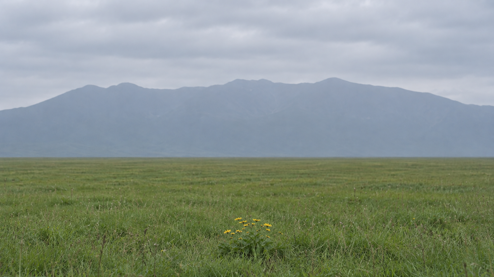
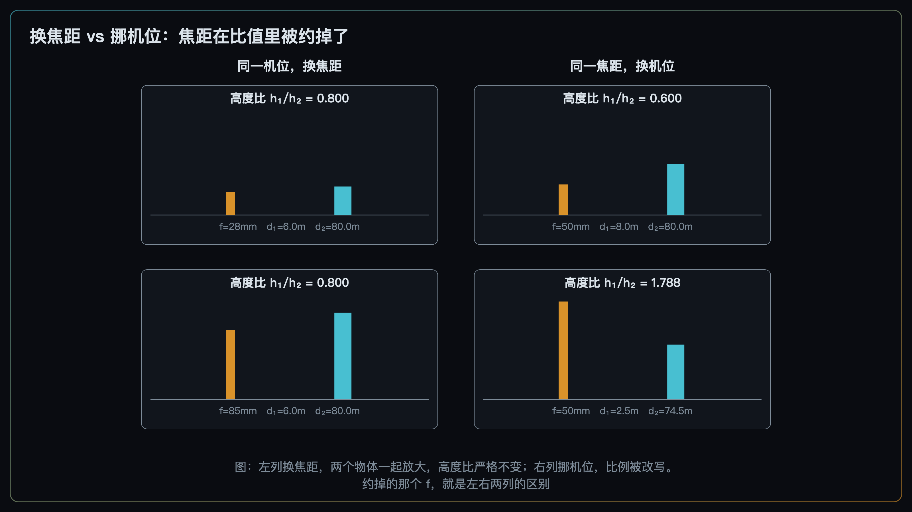
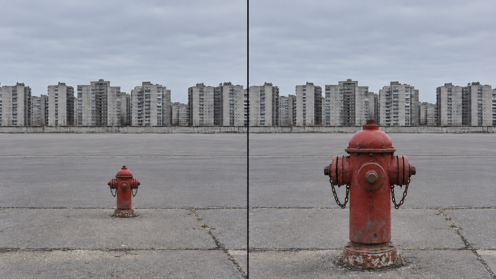
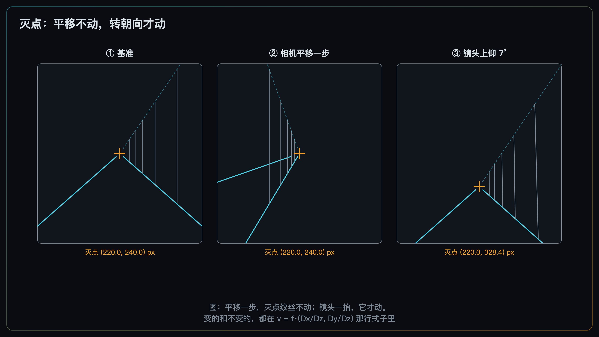
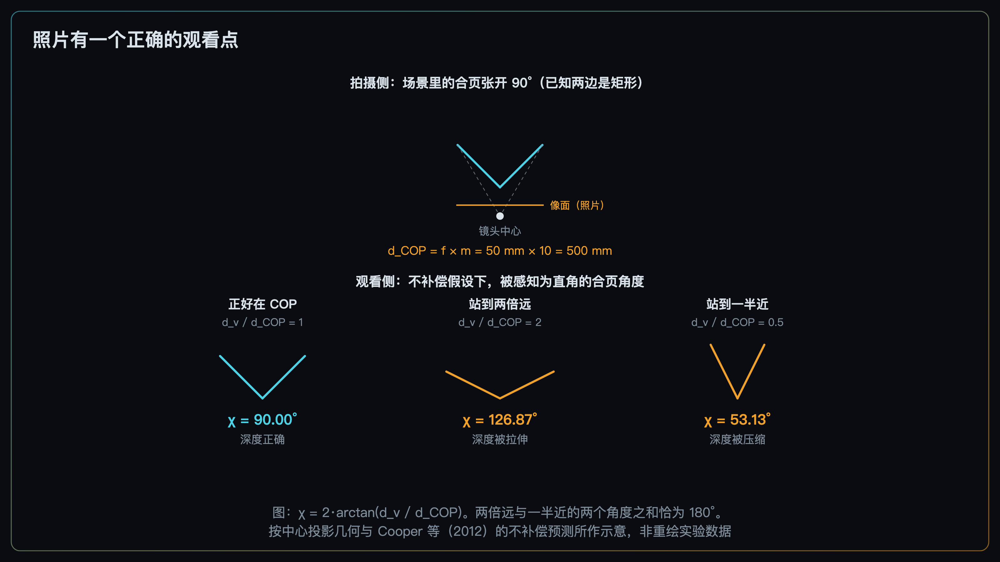

+++
title = "2-8 透视投影：把构图从 2D 拉回 3D"
description = "前后景的大小关系只由你站在哪儿决定；焦距改的是取景范围，不是这个关系。"
date = 2026-09-16
tags = ["摄影", "构图", "透视", "投影", "灭点", "机位", "焦距"]
categories = ["摄影"]
series = ["主线"]
showTableOfContents = true
+++



> 前后景的大小关系只由你站在哪儿决定；焦距改的是取景范围，不是这个关系。

你在山脚下看到一丛花，花后面是那座山。眼睛里的关系很好——花是主角，山在后面撑着场。举起相机拍下来，花小得像个装饰，山也塌成一片背景。

你换上长焦，想把山「拉近」。山确实变大了。可花也跟着变大，而且是同一个倍数。两者的关系一点没变。

这件事值得停下来想一下：**你想改的是花和山的大小关系，而焦距根本不管这件事。** 能改它的只有一件事——你站在哪儿。

前面七篇，我们一直把画面当成一块平板：权重有强弱（#2-2）、元素被读成几组（#2-4）、块面有大小（#2-5）、方向有走势（#2-6）、位置有代价（#2-7）。这些全是二维量。可你按下的每一张照片，都是三维世界经过一次投影之后的结果——那些二维量，是投影完成之后才有的东西。这一篇把平板重新拉回三维，讲清楚它们是从哪儿来的。

四件事：投影这一步丢掉了什么、为什么相对大小只由机位决定、灭点为什么不跟着你走、以及照片其实有一个「正确的观看点」。

*图：现场看着有层次，拍下来却平了。差的那件事，在按快门之前就定了*

## 一、投影这一步，丢掉的到底是什么

先把模型摆出来，这一篇只需要这一个。

相机把三维空间里的一个点，沿着它和镜头中心的连线，投到传感器平面上。这条关系可以写成一行：

$$
x = f \cdot \frac{X}{Z}
$$

翻译成人话：**画面上的大小 ＝ 真实大小 ÷ 距离，再乘上一个由焦距决定的统一倍数。** 分子是物体本身有多大，分母是它离你多远，前面那个 \(f\) 对画面里所有东西一视同仁。

这一步把三维压成了二维，**丢掉的是深度那一维** \(Z\)——而且是真的丢了：单靠一张照片，你没法唯一地把 \(Z\) 反推回来。

在往下讲之前，先把这一篇的模型边界钉死，后面所有结论都在这个框里成立：

> **本篇采用理想的针孔（直线校正）中心投影模型**：忽略镜头畸变，主点取在画面中心，所有距离 \(d\) 一律指**相机坐标系里沿光轴的深度** \(Z\)，不是眼睛到物体的欧式距离。真实镜头的畸变、鱼眼等特殊投影、非平面显示都会带来额外偏差，本篇不处理。另外，下面讲「相对大小只由机位决定」时，比较的是**同一场景、相机朝向固定**的情形——完整模型里旋转同样会改变各点的相机坐标，只是它不产生新的前后视差。

丢掉 \(Z\) 的后果，不是「照片里看不出远近」——照片当然看得出远近，靠的是遮挡、空气透视、明暗梯度、纹理疏密那一整套线索，那是 #2-13 的正题，这里不展开。

真正的后果是另一件事：**深度本身虽然丢了，但深度关系会在二维投影里留下几类线索。**

- **大小差**——同样大的两个东西，远的那个在画面上更小；
- **位置差**——三维里的高低前后，落成画面上的二维坐标；
- **遮挡关系**——谁挡住谁，取决于它们跟你的连线怎么排。

这三样，恰好就是前面七篇一直在调度的量。#2-5 的块面有多大、#2-7 的东西落在画框哪一侧、#2-4 里两个元素会不会被读成一组——它们的取值，在投影这一步就已经被写死了。

> 构图不是在一块平板上摆东西，是在选一次投影。摆的动作发生在你站定之后；选投影的动作，发生在你站定的那一刻。

**小结**：深度这一维在投影里被丢掉了，但深度关系会以大小、位置和遮挡的形式留下线索——而留下什么样的线索，由你站在哪儿决定。

## 二、相对大小只由机位决定

现在回到开头那丛花。

把上面那行式子用在两个物体上。物体一高 \(S_1\)、深度 \(d_1\)，物体二高 \(S_2\)、深度 \(d_2\)。对**大致正对相机、且自身厚度相对于距离不大**的物体，它们在画面上的高度可以近似写成 \(f S_1 / d_1\) 和 \(f S_2 / d_2\)（\(d\) 按上面说好的，是沿光轴的深度）。两者相除：

$$
\frac{h_1}{h_2} = \frac{S_1}{S_2} \cdot \frac{d_2}{d_1}
$$

**焦距在这个比值里被约掉了。**

这就是第零章那条术语口径的来源，也是本账号所有文章里「透视只由相机位置和拍摄距离决定」这句话的出处。它不是一条约定，是一次约分的结果。三条推论，都值得单独记住。

**第一，换焦距＝两个物体等比放大，比例不变。** 长焦把山拉大了 3 倍，也把花拉大了 3 倍。你改变的是取景范围——画面里装得下多少东西；你没有改变装进来的这些东西彼此之间的关系。第零章把这件事叫做「视角与裁切」：由焦距和感光元件尺寸共同决定，不改透视。

**第二，挪机位＝两个距离不同步地变，比例才变。** 你往花那边走两步，\(d_1\) 从 4 米变成 2 米，\(d_2\) 从 2000 米变成 1998 米。前者减半，后者几乎没动。花在画面上翻倍，山纹丝不动——两者的关系就此改写。

**第三，真正的自变量是距离比，不是绝对距离。** 这一条最容易被忽略，但它决定了「挪一步」在什么场景下有用、在什么场景下白挪。

拿具体数字算一遍。假设前景在 2 米处、背景在 50 米处，你向前走 1 米：

- 前景：2 米 → 1 米，距离减半，投影尺寸**翻倍**；
- 背景：50 米 → 49 米，投影尺寸只放大约 2%，肉眼基本看不出来。

一步之间，前景与背景的大小比被改写了将近一倍。

同样这一步，换个场景——前景在 30 米、背景在 50 米——结果完全不同：两者分别放大约 3.4% 和 2.0%，**比例只改变了约 1.4%**，等于什么也没发生。

**同一个动作，在有近景的场景里是决定性的，在全是远景的场景里近乎无效。** 差别不在你走了多远，而在你走的这一米，占了前景距离的多大一份。

这正是 #2-7 收尾那句话的算式版本：往前走两步，前景的块立刻变大、背景的块几乎不动，整个配重关系自己就重排了。它成立的前提是，你面前真的有一个「近」的东西。

*图：左列换焦距，两个物体一起放大，高度比严格不变；右列挪机位，比例被改写。约掉的那个 f，就是左右两列的区别*

这里可以直接推出一条很有操作价值的结论：**在同一个机位上，用长焦拍，等价于用广角拍完再裁切放大。** 两张照片的透视完全相同——因为机位没变，所有的 \(d\) 都没变，比值自然一样。它们的差别在别处：分辨率、噪声、景深、镜头像差、以及你有没有在现场就看清楚。几何上，它们是同一张照片。

这条拆掉的是「长焦有压缩效果」这个说法里最硬的那一块：**只要机位不动，换焦距就改不了任何比例关系**。

但要小心别把这条推过头。现实里换焦段通常伴随着换机位——你上了长焦，多半是为了拍远处的东西而往后退；你上了广角，多半是为了收进更多而往前凑。**机位一动，几何就不再等价了**，那属于第二条推论，不属于这一条。所以「压缩感」至少有两层：一层在拍摄端（为了同框而改了机位），一层在观看端（本篇第四节要讲的）。把这两层拆开是 #2-9 的正题，这里先把门放在这儿。

*图：同一条街、同一支镜头，只是往前走了两步。前景的消防栓大了一圈，背景的楼几乎没动——严格说背景也放大了约 2%，远低于肉眼可辨的阈值*

**小结**：焦距改取景范围，机位改比例关系；而机位这个旋钮好不好使，取决于你面前有没有一个足够近的东西。

## 三、灭点不跟着你走

平行线在照片上会汇聚，这件事人人都见过。为什么会汇聚，从上面那行式子直接就能看出来。

取一族方向相同的平行线。沿着其中任意一条往远处走，点的坐标是起点加上方向的若干倍。代进 \(x = f X / Z\)，让距离趋于无穷——起点的贡献被越推越小，最后只剩下方向那一项。于是所有平行线，不管起点在哪儿，都收敛到同一个点。这个点就是**灭点**。

写出来是这样：

$$
v = f \cdot \left( \frac{D_x}{D_z}, \; \frac{D_y}{D_z} \right)
$$

\(D\) 是这族线在相机坐标系里的方向，等于相机的旋转作用在它的真实方向上。

这里有一个必须一起记住的例外：式子的分母是 \(D_z\)。**如果这族线正好平行于像平面（\(D_z = 0\)），分母为零，灭点在无穷远——它们在照片上仍然保持平行，不汇聚。** 这不是特例中的特例，下面马上会用到它。

值得盯着这个式子看一会儿，因为它里面**没有平移项**。

> 相机平移不移动灭点，改变朝向才会。改焦距也会——但它改的是灭点离主点有多远（\(f\) 就在式子里），不是把它挪到别的方向去。

这条挺反直觉，但它和第二节是自洽的：平移改变的是各个物体的**距离**，所以改写了大小比例；平行线的**方向**不会因为你挪了一步就变，所以灭点不动。变的是哪些线进得了画面、从哪条边进来、在画面上铺开多大范围——不是它们最终收敛到哪儿。

换画幅是另一回事，容易和换焦距混起来。**同一支镜头、同一个机位与朝向，换一块更小的传感器，灭点在物理像面上的位置一点没变**；变的只是画框裁到哪儿，所以灭点相对于画框的位置看起来不同了，甚至可能被裁到画面外去。它改的是记录范围，不是投影。

这里要收紧一句我们自己在 #2-6 里写过的话。那一篇讲汇聚时说过「汇聚点落在画面哪个位置，除机位外还取决于相机朝向」。落点是对的——**朝向确实会移动灭点**；但「除机位外」说松了。准确的说法是：平移时灭点不动，能移动它的是朝向和焦距。

### 竖直线什么时候汇聚

上面这条最常用的地方是建筑。

把相机端平，竖直方向的那一族平行线正好平行于像平面——这就是刚才那个 \(D_z = 0\) 的情形，灭点在无穷远，它们在画面上保持平行，楼是直的。一旦你为了把楼顶收进画面而把镜头上仰，竖直方向就获得了纵深分量，\(D_z\) 不再为零，灭点从无穷远处移进来，于是竖直线开始汇聚——楼向后「倒」了。

这就是建筑摄影里「倒伏」的全部来源。**它是投影的正常结果，不是镜头的毛病。** 第零章把畸变定义为镜头的物理成像误差（桶形、枕形），与透视无关——倒伏不是畸变，桶形畸变也不是透视效应，两者不要互相指认。

### 遮挡：谁挡谁，也是机位说了算

投影还决定了第三样东西：谁在画面上挡住谁。

先说准确的版本。对两个**点**来说，它们和相机的连线重合，就投到画面上同一个位置。对有面积的真实物体，判据要换成角向轮廓：**两个物体在画面上重不重叠，取决于它们在相机视野里的角向轮廓有没有相交；而一旦相交，谁挡谁由沿这条视线的前后深度顺序决定。**

好在操作上的方向是同一个：你往旁边挪，两个物体的角向位置会发生相对变化——原本的重叠可能减弱、解除，也可能形成新的遮挡关系；挪多少才够，取决于它们各自有多大、离你多远。这件事同样**与焦距无关**——换镜头只会把整个画面等比放大，角向关系纹丝不动，不会让两个原本重叠的东西分开。

所以遮挡是可以在取景器里「排」的，而且用的是同一个旋钮：挪动机位，重叠关系跟着变。这是本篇给你的第二个可执行动作，和第二节的距离比并列。

两条边界要划清楚。遮挡同时也是一条深度线索——但深度线索的完整清单（遮挡、空气透视、明暗梯度、纹理疏密、前中后景的分层）是 #2-13 的正题，这里只讲它作为投影副产品的这一面。至于轮廓恰好续得上、两个东西粘成一个形的那些具体病症，是 #2-11 的图鉴，本篇只交代成因：**它们全是机位的函数。**

*图：平移一步，灭点纹丝不动；镜头一抬，它才动。变的和不变的，都在那行式子里*

**小结**：距离决定大小比例，朝向决定线往哪儿收，连线夹角决定谁挡谁——三件事都在按快门之前就定了。

## 四、照片有一个正确的观看点

最后一件事，是这套模型对**看照片的人**说的。

既然照片是从某个点投影出来的，那就存在一个位置：眼睛放在那儿，照片在视网膜上投出的像，和你当初在现场看到的一致。这个位置叫**投影中心**（center of projection，COP）。这里的「一致」是**在理想中心投影、单眼观看、无畸变、平面照片、均匀缩放的几何意义下**说的——和篇首那个模型边界是同一套前提。它离画面的距离等于焦距乘上放大倍率：

$$
d_{COP} = f \cdot m
$$

用 50 mm 拍、照片放大到 10 倍，COP 就在照片前方约 50 厘米处。

问题是，没有人这么看照片。手机举在手里的距离随手而定，展厅里你退到能看全整幅的地方，刷信息流时更是随便。**按几何推，照片应该处处看着变形才对。** 可我们并没有觉得。

这里要把「偏离」拆成两半，因为两半的答案是相反的。

**偏离观看方向——斜着看——基本能被补偿。** Vishwanath、Girshick 与 Banks（2005）测了从不同位置观看时被感知的物体形状：**在观察者能获得画面表面朝向的双眼信息时**，感知到的形状在相当宽的观看角度范围内近乎不变。更关键的是他们对机制的判定——这种不变性来自视觉系统**对画面这个平面本身朝向的估计**，而不是从画面内部的几何信息里推出来的。这两个限定都得带着：不是「怎么看都一样」，而是「有表面朝向线索时，斜着看基本不影响」。

**偏离观看距离——站得太近或太远——基本不被补偿。** Cooper 等人（2012）在综述既有工作时写明：多数研究发现人**不会**补偿错误的观看距离；也有研究报告过部分补偿（Yang 与 Kubovy 1999），所以这不是一个封死的结论，但主流证据指向「不补偿」。这里要补一个容易被跳过的前提：**光靠照片上的几个点加一个眼位，并不能唯一地反推出三维深度**——每个像点只定义了一条射线，物体可以落在这条射线上的无穷多个位置。要让几何给出确定的预测，必须额外加上结构假设。

Cooper 等人正是这么做的：他们的刺激是两块矩形平面拼成的「合页」，并且**明确告诉被试两边是矩形**。有了这个约束，在「完全不补偿」的假设下，被感知为 90° 的合页角度就有了闭式预测：它等于 \(2\arctan(d_v / d_{COP})\)，其中 \(d_v\) 是实际观看距离。代三个数进去：正好在 COP 上，得到 90°；站到两倍距离外，约 127°——观众把一个张得更开的角度当成了直角，也就是深度被拉伸了；站到一半距离，约 53°，深度被压缩。实验数据与这条「不补偿」预测高度一致。

换句话说：**拍摄距离先决定照片里实际留下了什么样的二维透视关系，观看距离再决定观众把这套二维关系解释成怎样的三维形状。** 偏离 COP 时，这层解释会产生额外的深度拉伸或压缩。

> 方向偏了，视觉系统替你兜住；距离偏了，它不兜。

这就是为什么构图可以不去操心观众从哪个角度看，却不能不操心你当初站在哪儿拍。也正是这条不对称，构成了下一篇的入口：既然距离偏差不被补偿，而 COP 距离又由焦距决定，那么焦距就通过「观众多半会站错位置」这条路径，间接地制造出了「压缩」和「夸张」的观感——尽管在拍摄端，几何上它什么也没改。那是 #2-9 的正题，这里只把门放在这儿。

*图：在「两边是矩形」这个结构约束下，几何才给得出唯一预测。站到两倍距离外，你会把 127° 当成直角——深度被拉伸了。按中心投影几何与 Cooper 等（2012）的不补偿预测所作示意，非重绘其实验数据*

### 什么时候别信这套判据

和前几篇一样，这是一份检查清单，不是审美定律。有三类照片会让本篇的两个旋钮失效。

**正对平面的题材。** 正对着墙面拍图案、翻拍、微距的平面题材——场景本身几乎没有深度差，所有东西的 \(d\) 都差不多（它仍然是中心投影，只是各点深度近似相等，所以尺度关系接近一致）。距离比恒等于一，挪一步改不了任何比例，遮挡也无从排起。这类照片的功夫全在别处。

**长焦远摄的大场景。** 所有物体都在几十米、几百米外，彼此的距离差相对于绝对距离小到可以忽略。第二节那个 30 米对 50 米的算例已经说明了：走一米，比例只动 1.4%。这时候机位这个旋钮的边际收益趋近于零，该动的是等光、等云、等一个人走进来。

**重复图案与纹理摄影。** 从 #2-1 一路到 #2-7 都在反例组里，这次也一样——没有前后景之分，也就没有可调度的深度差。

碰上这三类，判据会误判；这时候该被怀疑的是判据，不是照片。

最后把口径说清楚，因为这一篇和前面几篇不一样。

前七篇讲的是注意力，那些结论是统计性的——「通常」「更容易」，从来不是「必然」。**本篇第一到第三节讲的是几何**：焦距被约掉、灭点对平移不变、遮挡由角向轮廓与深度顺序决定，这些在篇首声明的那个理想投影模型下是确定的关系，不是倾向。它们的边界不在「有没有例外」，而在**模型本身**——真实镜头有畸变，鱼眼这类特殊投影根本不遵守直线校正的假设，弯曲屏幕上的照片也不再是平面投影。

只有第四节例外：那一节讲的是人怎么看照片，属于知觉，「基本能补偿」「基本不补偿」都是统计意义上的说法。

### 顺便说清楚：这一篇拧的是哪个旋钮

从 #2-3 起，我们一直在用同一张按性价比排过序的阶梯：机位 ＞ 拍摄距离与取景 ＞ 等 ＞ 光与前景遮挡 ＞ 景深 ＞ 后期局部 ＞ 裁切。#2-2 用它拧单点权重，#2-4 拧分组边界，#2-5 拧块面布局，#2-6 拧方向分布，#2-7 拧权重的落点。

这一篇没有新增动作，它解释的是**为什么机位排在最前面、为什么它「后期不可替代」**：因为机位和拍摄距离改的是投影本身，而权重、分组、块面、方向、位置，全都是投影完成之后才谈得上的量。你在后期能做的所有事，都发生在 \(Z\) 已经被丢掉之后。

顺带把裁切的位置也说准：裁切改变的是取景范围，等价于换一个更长的焦距，**它不改透视**——这条 #2-15 会展开。至于合成、对象移动这类把画面重新造一遍的操作，不在取景决策之内。

## 拍摄行动点

三个独立的小实验，今天就能做。每个只动一个变量，做之前别预设结果。

1. **裁切等于长焦。** 站定一个位置不动，先用广角拍一张，再换长焦拍一张。回来把广角那张裁到和长焦一样的视野，两张并排比。看前景和背景的大小比例有没有变化。**相机切 M 档或用 AE-L 锁定曝光，白平衡固定**，免得两张的明暗差异干扰判断。
2. **两步。** 找一个有明确前景和远景的场景（路边的栏杆 + 远处的楼就行），沿着视线方向前后各走两步，拍三张。回来看两件事：前景和背景的相对大小怎么变了，以及有没有哪两样东西的遮挡关系换了。
3. **灭点不跟着你走。** 对着一条走廊或一排栏杆，原地拍一张；向左平移一步，再拍一张；回到原位，把镜头往上抬一点，拍第三张。三张并排，看那个汇聚点什么时候动、什么时候不动。这一条是用来把第三节那行式子变成手上的感觉的。

    **中间那一步最容易做废**：人往左走完，会下意识把镜头重新对准走廊——那等于转了朝向，灭点当然会跟着动，实验就白做了。打开网格线或电子水平仪，保证平移前后左右和俯仰都不变，只有身体平移，这一条才成立。

## 收尾

读完这篇，有一个动作应该换掉了：**想改前后景的关系时，第一反应去转变焦环。**

变焦环改的是取景范围——画面里装得下多少东西。它对装进来的这些东西彼此之间的比例，一点办法也没有，因为焦距在那个比值里被约掉了。真正管这件事的是你的两条腿：距离比一变，大小关系、遮挡关系跟着全变。而灭点又是另一回事——它不跟着你的平移走，只听朝向和焦距的。

这三样加起来，就是「构图不只是裁切」的确切含义：**你按快门的那一刻，是在三维世界里选了一个点和一个方向；画面上后来能谈的一切，都是这次选择的结果。**

不过还有一个尾巴没收。只要你拍过人像就知道，用 24 mm 凑近拍和用 85 mm 退开拍，出来的脸完全是两回事。这件事得拆成两层，而且两层都真的存在：

- **拍摄端**：为了让脸在画面里一样大，上 24 mm 就得凑近、上 85 mm 就得退远——**机位已经变了**。鼻子、眼睛、耳朵这些处在不同深度的点，距离比跟着变，脸的投影比例本来就不一样。这一层归第二节管，和焦距没关系，是机位干的；
- **观看端**：在此之上，观众多半不会站在 COP 上看这张照片，而距离偏差又不被补偿——于是深度上的「夸张」或「压缩」被进一步放大。这一层归第四节管。

这两层不是两个各自独立、相加起来的效果，而是一条因果链：**拍摄距离先决定照片里实际留下了什么样的二维透视关系（每一张都是几何上正确的中心投影，只是彼此不同）；观看距离再决定观众把这套二维关系解释成怎样的三维形状。** 偏离 COP 而又不补偿，这层解释就产生了深度上的拉伸或压缩。两头都不是「焦距直接改变了透视」。把这两层拆开、说清各自占多大分量，是下一篇 #2-9「焦段与『压缩感』的真相：不是镜头魔法，是距离与取景策略」的正题。

## 参考资料

- Cooper, E. A., Piazza, E. A., & Banks, M. S. (2012). The perceptual basis of common photographic practice. *Journal of Vision*, 12(5):8, 1–14.
- Vishwanath, D., Girshick, A. R., & Banks, M. S. (2005). Why pictures look right when viewed from the wrong place. *Nature Neuroscience*, 8(10), 1401–1410.
- Hartley, R., & Zisserman, A. (2004). *Multiple View Geometry in Computer Vision* (2nd ed.). Cambridge University Press.（灭点与相机旋转的关系）
- Smith, O. W., & Gruber, H. (1958) 一线关于「不补偿观看距离」的工作，以及 Yang, T., & Kubovy, M. (1999) 关于部分补偿的报告，均**转引自 Cooper 等（2012）的综述**，本篇未直接查阅原文。
