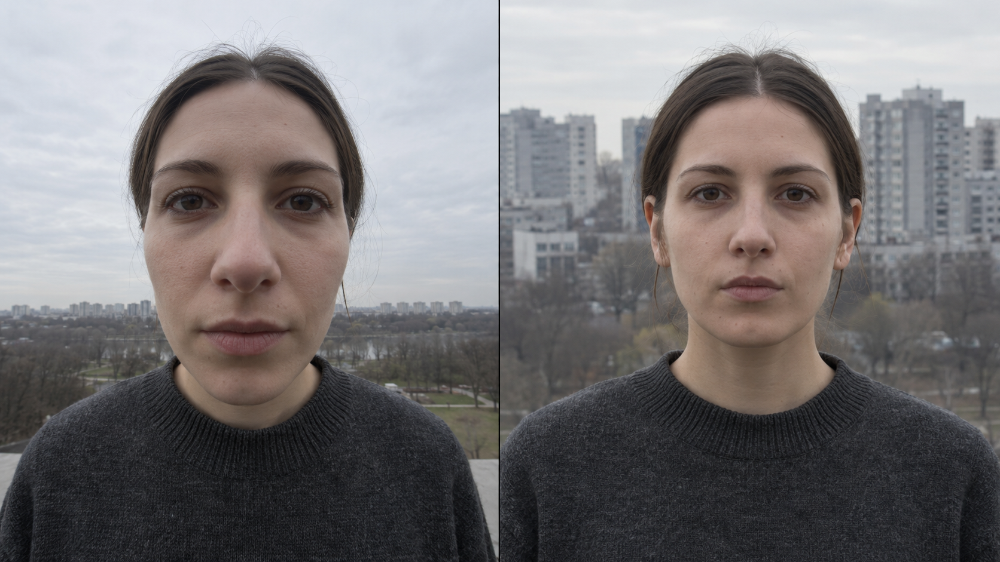
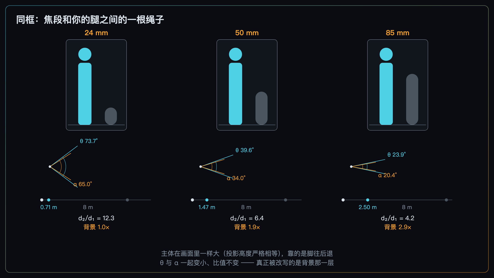
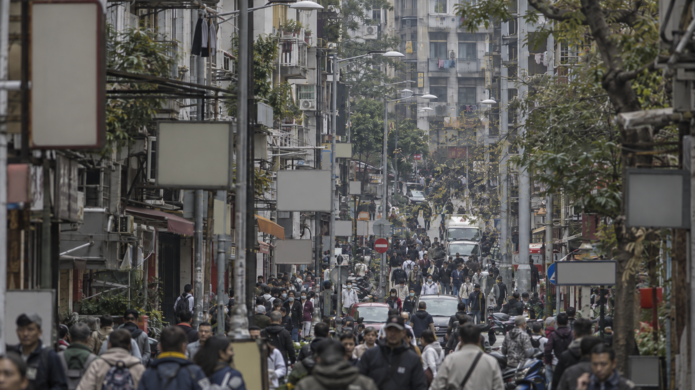
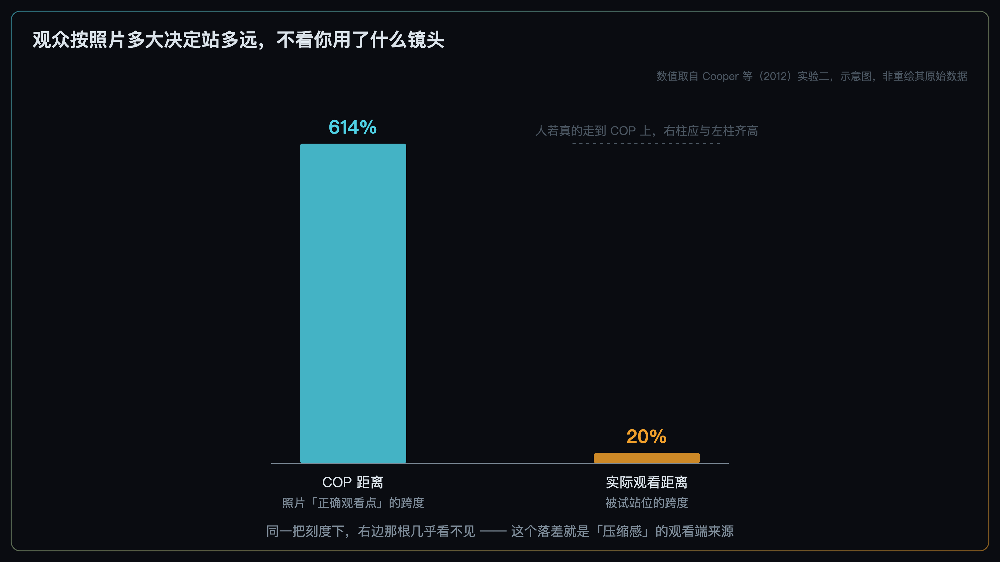
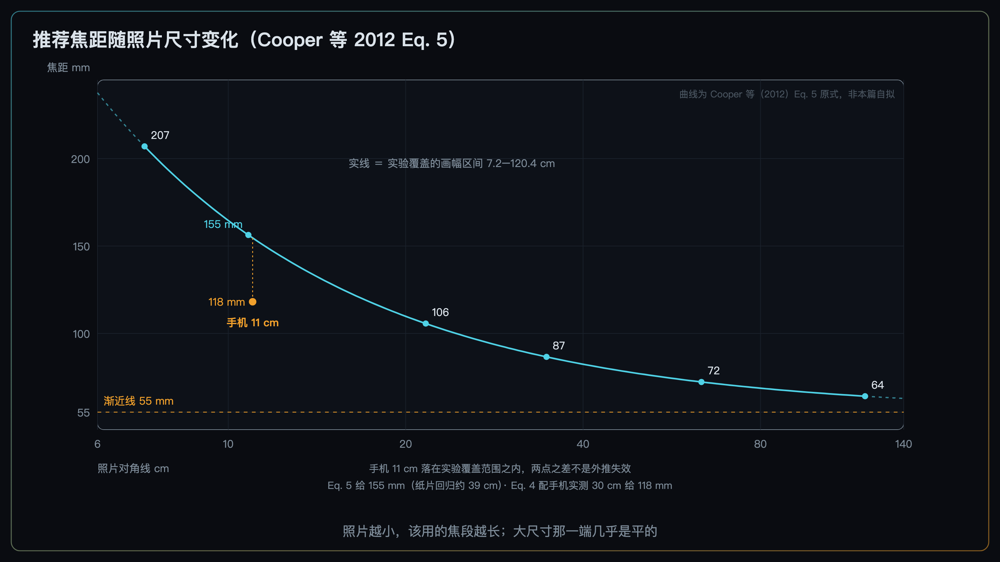

+++
title = "2-9 焦段与「压缩感」的真相：不是镜头魔法，是距离与取景策略"
description = "压缩感不是镜头的效果——焦段先绑走你的拍摄距离，再绑走照片的正确观看点。"
date = 2026-09-20
tags = ["摄影", "构图", "焦距", "透视", "压缩感", "观看距离", "人像"]
categories = ["摄影"]
series = ["主线"]
showTableOfContents = true
+++



> 压缩感不是镜头的效果——焦段先绑走你的拍摄距离，再绑走照片的正确观看点。

拍人像的人都知道这件事：用 24 mm 凑到跟前拍，和用 85 mm 退开几步拍，出来的脸完全是两回事。前者鼻子突出、脸颊收窄，整张脸像被往前推了一把；后者五官平实，背景明显变大、压到人身后。（背景糊不糊是另一回事，那归光圈和景深管，本篇一概不碰。）于是「85 mm 是人像头」「广角会把脸拍变形」成了常识。

可上一篇 #2-8「透视投影：把构图从 2D 拉回 3D」刚刚证明过一件相反的事：**站在同一个地方，换焦距改变不了画面里任何两个东西的大小比例。** 焦距在那个比值里被约掉了，长焦拍等于广角拍完再裁切放大，几何上是同一张照片。

两件事都是真的。那么这两张脸的差别，到底是从哪儿冒出来的？

答案是两条路，而且都不是「镜头改变了透视」。**第一条在拍摄端**：为了让脸在画面里一样大，你换镜头的时候，脚也跟着动了——是「同框」这个需求把距离绑在了焦距上。**第二条在观看端**：焦距和最终输出尺寸一起决定了这张照片的正确观看点，而看照片的人只根据照片有多大来决定站多远，从来不看你用了什么镜头。

这两条路上，照片本身始终是几何上正确的中心投影。Cooper、Piazza 与 Banks 在 2012 年那篇论文里把这件事说得很直接：人们管这类效果叫「透视畸变」（perspective distortion），好像是投影出了错——可**这些效果恰恰是在投影完全正确的时候发生的**。

这一篇把这两条路拆开，各自走一遍。

*图：同一个人，同样大的脸。差别不在镜头的「性格」，在这两张之间你走了多远*

## 一、同框，是焦段和你的腿之间的一根绳子

先看第一条路。

你换镜头，通常不是为了让主体变大变小——是为了让它**刚好那么大**。拍半身像，脸就该占画面那么多；换了 85 mm 还站在原地，脸就顶出画框了，你必然要往后退。

> 变焦环和你的两条腿之间，拴着一根看不见的绳子。只要你坚持「主体在画面里要这么大」，拧变焦环的那只手就会把腿一起拽走。

把这句话写成式子。#2-8 里那个小孔关系说，主体在画面上的高度是 \( h_1 = f S_1 / d_1 \)。现在加一个约束：\( h_1 \) 是常数（主体同框），\( S_1 \) 也是常数（人就那么高）。于是：

$$
d_1 = \frac{S_1}{h_1} \cdot f
$$

**拍摄距离和焦距成正比。** 这是本篇唯一的新式子，剩下的全是它的后果。

代进真实数字看看有多大。拍半身像，取主体高约 0.9 m、在全画幅竖构图里占画面高度的 85%：

| 焦距 | 你得站在哪儿 |
| --- | --- |
| 24 mm | 约 0.71 m |
| 35 mm | 约 1.03 m |
| 50 mm | 约 1.47 m |
| 85 mm | 约 2.50 m |
| 135 mm | 约 3.97 m |

从 24 mm 换到 85 mm，你后退了将近 1.8 米。**这一米八，才是那两张脸不一样的原因。** 鼻尖和耳朵之间大约差 11 cm 的深度，这个数在两张照片里是一样的——变的是它占拍摄距离的多少。站在 0.71 m 处，这 11 cm 占了拍摄距离的一成半，耳朵因此比鼻尖小了约 13.5%；退到 2.5 m，同样的 11 cm 只占 4%，落差降到约 4.2%，不到原来的三分之一。五官就是这样平下去的。

因果链要按顺序读：**焦段 → 拍摄距离 → 距离比 → 画面上的比例。** 焦段站在链条最前面，但它改的是链条第二环。**绑这根绳子的是「同框」这个需求，不是镜头。**

怎么证明绳子才是关键？剪断它就行。**站定不动**，换焦距，回来把广角那张裁到和长焦同视野——这正是 #2-8 的推论，两张照片的比例关系完全一致，所谓压缩感一点没有。绳子一断，焦段和压缩感立刻脱钩。

电影里有个专门玩这根绳子的镜头，叫**推轨变焦**（dolly zoom）：一边推近机位一边往广角端变，或者反过来，让主体在画面里的大小始终不变。观众看到的是主体钉在原地、背景往前扑或者往后退。它把 \( f \) 和 \( d \) 绑成一根轴同步转，效果强到像特效——而 Cooper 等人给论文配的那段厨房推轨变焦影片里特意写明：这些帧**全都是同一个三维模型的正确透视投影**，只是彼此不同。

Cooper 等人研究人脸时也用了同一根绳子。他们拍了 16 mm、22 mm、45 mm、216 mm 四档，**拍摄距离与焦距成正比**，好让被摄者的瞳距在画面上保持不变。结果是：短焦那张脸显得更圆、更往外凸，长焦那张显得更扁。这是他们对这组示例图的描述，不是一项独立的量化实验，但它把变量控制得很干净：四张照片里，**真正改变透视比例的是相机站的位置**；焦距同时跟着变，作用是把瞳距在画面上的尺寸维持住——也就是那根绳子的两头。

*图：主体在画面里一样大，是靠脚换来的。而脚一动，背景那一层就跟着重排*

**小结**：焦段本身改不了任何比例；改比例的是那根绳子另一头的距离。

## 二、画面上的「压缩」，是三样东西一起在变

绳子拽着你前后走，画面里究竟发生了什么？

拿 #2-8 的距离比来算。主体在 \( d_1 \)，背景在它后面 \( \Delta \) 米处，于是背景的深度是 \( d_2 = d_1 + \Delta \)，两者的距离比：

$$
\frac{d_2}{d_1} = 1 + \frac{\Delta}{d_1}
$$

这里有个容易被跳过的要点：\( \Delta \) **是场景给你的，不由你选。** 人站在离树八米的地方，这八米就摆在那儿。你能动的只有 \( d_1 \)——也就是绳子另一头那个量。

在主体同框的约束下，背景在画面上的高度正比于 \( S_2 \div (d_2/d_1) \)。距离比越接近 1，背景越大。还是那组数字，取 \( \Delta \) ＝ 8 m：

| 焦距 | 拍摄距离 | 距离比 | 背景在画面上的相对大小 |
| --- | --- | --- | --- |
| 24 mm | 0.71 m | 12.3 | 1.0 倍（基准） |
| 50 mm | 1.47 m | 6.4 | 1.9 倍 |
| 85 mm | 2.50 m | 4.2 | **2.9 倍** |

**同一棵树，在同样大小的人像背后，85 mm 那张里比 24 mm 那张里大了将近三倍。** 这就是「长焦把背景压过来」的全部内容——不是镜头把背景拉近了，是你退远之后，背景相对于主体的距离比缩小了。

这件事在画面上表现为三样，每一样都接得回前面几篇：

**第一，前景的主导权易手。** 广角凑近，离你最近的那个东西距离减半再减半，块面在画面上暴涨。#2-5 讲的大形布局、#2-7 讲的配重，都被这一步重写了一遍——不是你重新摆的，是你往前走的时候它自己变的。

**第二，纵深方向堆起来。** 沿着视线前后排开的一串东西（一排树、一队人、一层层的屋顶），当 \( d_2/d_1 \) 趋近 1 时，它们在画面上的尺寸互相靠拢——**这一步是几何，跑不掉**。接下来那一步要降一级说：尺寸拉平之后，它们的轮廓更容易叠在一起，画面读起来更密、更像一层而不是一前一后。这是**常见的视觉后果，不是几何必然**——会不会真的糊成一片，还取决于它们的横向位置、彼此的明暗差和色彩差。**长焦照片「密」的来源就在这儿**：不是元素变多了，是深度方向被折叠了。具体会撞出什么毛病（轮廓粘连、树长在头上）是 #2-11 的图鉴；深度线索的完整清单是 #2-13 的正题；这里只交代成因。

**第三，因此焦段是「图层权重比例」的调节器。** 前景、中景、背景各自在画面上占多大份额，可以靠焦段加走位来分配。但要记清楚它的工作方式：**它调的是二维的份额，而机制在三维的距离比。**

这就带出本篇最有操作价值的一条，它要求你把常规的决策顺序倒过来：

> 先想清楚你要的前后景比例，那决定了你站多远；再由「主体要占多大」倒推该用多长的焦距。**焦距是因变量，不是自变量。**

习惯的做法是先挑镜头再找位置，那等于让因变量替你做主。反过来做，你才是在调那个真正起作用的量。

*图：长焦照片里那种「密」，是深度方向被折叠出来的，不是东西变多了*

**小结**：想改前后景的比例，动的是「站多远」；焦距只是你为了保住同框而被迫跟着动的那个量。

## 三、观众按照片多大决定站多远，从不看你用了什么镜头

到这儿，拍摄端这条路走完了。它全是几何，在 #2-8 声明的那个理想针孔投影模型下是确定的关系。

现在换到观看端。这一节开始，结论变成统计性的——讲的是人怎么看照片。

#2-8 立过三件事：照片有一个正确的观看点，它离画面的距离 \( d_{COP} = f \cdot m \)（焦距乘放大倍率）；人基本不补偿错误的观看距离；在「两边是矩形」这类结构约束下，被感知为直角的角度是 \( \chi = 2\arctan(d_v / d_{COP}) \)。

但 #2-8 留了个缺口没补：**实际观看距离** \( d_v \) **到底由什么决定？**

Cooper 等人的第二个实验专门回答了这个。他们把同一批场景用不同焦距拍出来、印成不同尺寸，让被试自己走到「最好的观看位置」，用激光测距仪量。结果干净得有点意外：

> 在放大倍率给定时，焦距对偏好观看距离**没有明显影响**；真正决定人站多远的是**照片有多大**。

有多干净？他们给了一个对比：在整套刺激里，COP 距离横跨了 **614%**；而被试的偏好观看距离只变化了 **20%**。如果人真的会走到 COP 上，这个数应该也是 614%。

原始数据里确实还留了一条小尾巴：焦距有一个「小但显著」的效应（那条回归的斜率是 0.1，\( p = 0.008 \)）。但作者专门做了一次控制分析——他们在实验里设过一个对照组，主体在画面里的大小不是靠换焦距、而是靠推拉机位改出来的。把两组放在一起做协方差分析，**换焦距和挪机位的效应没有显著差别**（\( p = 0.46 \)）。结论因此是：这点残留来自**画面中央那个主体变大变小**，而不是观众在追着 COP 走。

换句话说，这条尾巴不但没有削弱主线，反而把它钉得更死：就 COP 本身而言，观看距离基本不随它调整。

另一个值得记的数字是那条回归线的截距：**25 厘米**，正好是年轻成人最近的舒适观看距离。照片再小，人也凑不过去了。

这里要把实验的规模交代清楚，免得把结论读成铁律。这几个实验都不大：合页那个补偿实验是 **5 名年轻成人**，观看距离实验是 **8 人**，加上大画幅的后续实验 **11 人**。被试全是年轻人，看的是印在纸上的静态画面，绝大多数不知道实验假设。结论的方向很稳，但「人不补偿观看距离」说的是这些条件下的总体倾向，不是对每个人、每种观看场景都成立的定律。

把这两件事接起来，Cooper 等人的核心结论就出来了，而且它直接解释了开头那两张脸：

- **长焦照片会被从太近看。** 焦距长 → \( d_{COP} \) 大 → 而你只按照片大小站位，站得比 COP 近 → \( d_v/d_{COP} \) 小于 1 → 按不补偿的预测，深度被**压缩**；
- **广角照片会被从太远看。** 焦距短 → \( d_{COP} \) 小 → 你站得比 COP 远 → 比值大于 1 → 深度被**拉伸**。

回到开头那两张脸。第一节那一米八已经决定了照片里实际留下什么样的二维比例；观看这一步接着决定观众把这套比例解释成怎样的三维形状——短焦那张被从太远看，解释出来更凸更圆；长焦那张被从太近看，解释出来更扁。**两张照片本身都是正确的，没有任何一张是投影出了错。**

*图：照片的正确观看点跨了六倍多，人的实际站位几乎没动。这个落差就是「压缩感」的观看端来源*

### 那 50 mm 法则到底是怎么回事

「50 mm 接近人眼视角，所以最自然」——这个说法流传极广。Cooper 等人查了几本主流摄影教材，评价是：这类解释要么含糊，要么只是把现象换个说法重述一遍。

他们给的解释完全不同，而且落在观看端：**一个焦段之所以「自然」，是因为它配上常见的输出尺寸之后，算出的** \( d_{COP} \) **正好落在人本来就会站的那个距离上。** 不是在匹配人眼的视角，是在匹配人的看照片习惯。

那 50 mm 到底准不准？他们把实测的偏好观看距离代回去，给出了一条推荐焦距的公式（下一节要用，这里先记住结论）：**常见印张尺寸下算出来的推荐值，其实落在 60 到 90 mm 这一带，比 50 mm 长了一档。**

有个旁证正好对上。他们从 Flickr 抓了 3,930 张单反拍的照片，读 EXIF 里的 35 mm 等效焦距，**这组样本的中位数是 68 mm**。论文的评价是：68 mm 比教科书推荐的 50 mm 更接近他们模型算出的推荐值。所以准确的说法不是「50 mm 法则被证实了」，而是：**它方向对、量偏短**——而这组照片的中位数，比那条法则更贴近模型。

最后是一条必须说的限定，免得把「不补偿」当成定律。实验数据与「完全不补偿」的预测高度一致，但存在系统性的小偏差：被试设定的角度普遍比预测值略小一点，也就是**知觉比纯几何算出来的更扁一些**。作者把这归因于画面自身的平面性线索——双眼视差和调焦线索一直在提醒你「这是一张平的纸」，多少把知觉往回拽了一点。所以「完全不补偿」是一个好用的近似，不是精确定律。

**小结**：焦距连同输出尺寸一起，通过 \( d_{COP} \) 定下照片该被怎么看；而观众只按照片多大决定站多远。这个错位，就是观看端那一层的全部机制。

## 四、于是有一条给自媒体的推论：手机上该用更长的焦段

上面那条机制有个直接后果，而且和很多人的日常直接相关。

\( d_{COP} = f \cdot m \) 里的 \( m \) 是放大倍率——照片对角线除以传感器对角线。全画幅传感器对角线约 43 mm。一张竖构图照片在手机上大致占满屏幕宽度，对角线大概 11 cm（具体随机型和版式在 8 到 12 cm 之间浮动），于是 \( m \approx 2.5 \)。

用 50 mm 拍的这张照片，正确观看点在**距离屏幕约 12 厘米**的地方。

可人看手机的距离大约是 30 厘米。比值 \( d_v/d_{COP} \approx 2.4 \)，代进 #2-8 那条合页式子得到约 **134°**。

这个数的方向要读准，很容易搞反：它说的是**一个约 134° 的场景角度，才会被看成直角**——而不是「90° 被看成 134°」。论文的原话是，当观看距离大于 COP 距离时，被试会把一个**更大**的角度判定成 90°，这正是**深度被拉伸**的意思。

你在电脑上修得好好的一张照片，发到手机上看总觉得前景「冲」出来、空间散掉，这是原因之一。

Cooper 等人自己的表述是这么写的：**对移动设备的小屏幕，应当使用更长的焦距。**

那具体该多长？这件事不用猜，也不用自己反解——论文直接给了两条式子。

第一条是定义式：让 COP 距离正好等于人实际会站的距离，所需要的焦距是

$$
f_{rec} = 43.3 \cdot \frac{d_{pref}}{l_p}
$$

其中 \( l_p \) 是照片对角线，\( d_{pref} \) 是人实际偏好的观看距离（两者同单位），43.3 mm 是 35 mm 画幅的对角线长度。

第二条是把他们实测的那条偏好观看距离回归代进去的结果，也就是可以直接查的那条：

$$
f_{rec} = 55 + \frac{1096}{l_p}
$$

这里 \( l_p \) 以厘米计，\( f_{rec} \) 以毫米计（35 mm 等效）。下面这张表里的每一行，都是他们实验里真实印过的尺寸：

| 印张 | 对角线 | Eq. 5 推荐焦距（35 mm 等效） |
| --- | --- | --- |
| 6×4 cm（最小的一档） | 7.2 cm | 约 207 mm |
| 9×6 cm | 10.8 cm | 约 156 mm |
| 18×12 cm | 21.6 cm | 约 106 mm |
| 29×19 cm | 34.7 cm | 约 87 mm |
| 53×35 cm | 63.5 cm | 约 72 mm |
| 100×67 cm（最大的一档） | 120.4 cm | 约 64 mm |

两件事值得从这张表里读出来。

**第一，大尺寸这一端非常平。** 从 35 cm 一路放到 120 cm，推荐值只从 86 mm 落到 64 mm；再往大放也只是趋近 55 mm 这条渐近线。**输出尺寸在这一段怎么变，都不太影响该用什么焦段。**

**第二，这些数全都大于 50 mm。** 这里要如实点出一处不一致：论文正文写「35 cm 以上的印张，推荐焦距约 50 mm」，而按它自己给出的 Eq. 5，35 cm 处算出来是 86 mm。这两句话并不严格相符，本篇以式子算出的数为准。

有个旁证和式子这一边对得上：前面提过的那组 Flickr 照片，3,930 张单反作品的 35 mm 等效焦距中位数是 68 mm——比 50 mm 更靠近 Eq. 5 在常见尺寸上给出的值。（这只是一组样本的中位数，说不上代表整个摄影师群体，论文自己也只把它当作实践层面的旁证。）

那手机呢？11 cm 这个尺寸**并不需要外推**——它几乎正对着实验里 9×6 cm 那一档（对角 10.8 cm），整套刺激从 7.2 cm 一直覆盖到 120.4 cm。把 11 cm 代进 Eq. 5，得到 **155 mm**。

但这个数要配一句话才能用。Eq. 5 是从**纸质照片**的实测数据回归出来的，它内含了一个假设：这么大的照片，人会站在多远看。按那条回归，11 cm 的纸质照片对应的偏好观看距离约 **39 厘米**。而手机不是这么用的——论文自己引的那份测量说，人看手机大约在 **30 厘米**。

把 30 厘米代进定义式 Eq. 4：

$$
f_{rec} = 43.3 \times \frac{30}{11} \approx 118 \ \text{mm}
$$

所以 155 mm 和 118 mm 的差别，**不是外推失效，而是两种媒介的观看习惯不同**：同样大的一张东西，拿在手里的手机比摆在面前的纸片被凑得更近。要为手机交付，用后面这个数——**大约 120 mm**，而且它是个量级，不是刻度。

对本篇的结论来说，这个差别其实无关紧要：**两条路都远大于 50 mm，方向完全一致。**

规律因此很干脆：**照片越小，该用的焦段越长。** 6×4 cm 的小照片按这条式子要 200 mm 以上，一米宽的展墙降到 64 mm，再大也只趋近 55 mm。手机不是什么特例，它只是小。这和直觉正好相反——直觉会说小屏幕看不清细节，该用广角多装点东西。

还有第二条出路，不用换镜头。论文里提到：手机用户偏好把内容放大、裁切之后再看，而这么做会**提高** \( d_{COP} \)，效果类似于加长焦距，从而让内容看起来没那么拉伸。换句话说，**观看端这一层也可以靠交付尺寸和裁切来调**——裁切作为二次调度的完整讨论是 #2-15 的正题，这里只点出它在这条链上的位置。

反过来用同样成立。想要空间张开、前景冲出来的那种感觉（风光里的前景冲击、街头的临场感），就往反方向走：短焦、凑近、交付尺寸偏小。这不是「毛病」，是把同一条机制当工具使。

*图：照片越小，推荐焦段越长。手机那一档落在实验覆盖范围之内，两个并排的值差在观看习惯，不在外推*

### 什么时候别信这套判据

和前几篇一样，这是检查清单，不是审美定律。有四类情况会让本篇失效，而且失效的方式各不相同。

**场景本身没有前后深度差。** 正对着墙面拍图案、翻拍、微距的平面题材——\( \Delta \) 约等于零，距离比恒等于 1，换什么焦段画面关系都一样，「压缩感」根本无从谈起。（它仍然是中心投影，只是各点深度近似相等。）

**绳子根本没绑上。** 如果你不需要主体同框——站定不动换焦段，或者拍完回来裁——那么焦段和压缩感完全脱钩。这是 #2-8 的推论，也是本篇第一节那个反证。

**极远景。** 所有东西都在几十上百米外，\( \Delta/d_1 \) 已经趋近于零，距离比已经贴着 1 了。压缩感在这里是打满的状态，你再退也压不出更多——这和 #2-8 说的「机位这个旋钮边际收益趋零」是同一件事的两面。

**交付尺寸不可控。** 同一张照片同时进手机、网页和印张，第三、四节那一层你根本管不了。这时候诚实的做法是只管拍摄端，把观看端当成噪声——或者反过来，明确为主战场的那个尺寸去拍。

碰上这四类，判据会误判；该被怀疑的是判据。

最后把口径分清楚，因为这一篇横跨了两种。**第一、二节讲的是几何**：距离和焦距成正比、距离比决定背景放大多少——在 #2-8 声明的那个理想针孔模型下，这些是确定的关系，不是倾向，所以不该套「通常」「更容易」这类措辞。**第三、四节讲的是知觉**：人站多远、补不补偿、看起来扁还是圆，这些是统计意义上的说法，有个体差异，也有上面那条系统性偏差。两者不能混着讲。

### 顺便说清楚：这一篇拧的是哪个旋钮

从 #2-3 起我们一直在用同一张按性价比排过序的阶梯：机位 ＞ 拍摄距离与取景 ＞ 等 ＞ 光与前景遮挡 ＞ 景深 ＞ 后期局部 ＞ 裁切。

这一篇同样没有新增动作。#2-8 解释了**为什么**机位排在最前面（它改的是投影本身），这一篇给的是同一项的**读数**——你现在能在按快门之前估出来：退到 85 mm 该站的位置，会把背景放大到原来的几倍。旋钮还是那个旋钮，只是刻度盘上终于印上了数字。

几条边界顺手划清：各个焦段拍人像的安全工作距离、脸开始变形的临界距离，那是 #9-3 的表，本篇只讲机制不出表；景深、焦外结构和等效光圈属于 #3-5——注意它们和本篇讲的是两件事，背景虚不虚和背景多大，一个是光学一个是几何，别混在一起归因。

## 拍摄行动点

三个独立的小实验，今天就能做。每个只动一个变量，做之前别预设结果。

1. **同框三张。** 找一个人或者一个静物，背后要有明确的背景（一排树、一堵墙、一栋楼）。用 24 mm、50 mm、85 mm 各拍一张（手机就用 0.5×、1×、3×），**每次都前后走动，让主体在画面里一样大**。回来把三张并排，只看背景：它占了多少画面，离主体看上去有多近。**相机切 M 档或用 AE-L 锁定曝光，白平衡固定**，免得明暗差异干扰判断。

    **手机做这个实验要打个折扣**：0.5×、1×、3× 多数时候是在切换三颗不同的物理摄像头，各自带着不同的畸变校正、计算摄影和入瞳位置，严格说已经不止动了一个变量。手机能把方向演示出来，但要做干净的单变量对照，用同一台可换镜头相机、或者同一支变焦镜头。

2. **剪断绳子。** 还是这三个焦段，但这次**站定不动**，各拍一张。回来把广角那张裁到和长焦同视野。这一组应该看不出任何比例变化——如果看出来了，是你的脚动了。这条和 #2-8 的第一条行动点是同一个实验的两面：那一条证明「不变」，这一条证明「变」的原因不在镜头。
3. **两块屏。** 挑一张你自己拍的、前后景层次明确的照片，先在手机上看一眼，再投到电视上或者打印出来看一眼。注意空间感有没有变——尤其是前景的东西是不是在小屏幕上显得更「冲」。这是唯一一条不用出门的，但它测的是全篇最反直觉的那一层。

## 收尾

读完这篇，有一句口头禅应该退休了：**「长焦有压缩效果。」**

镜头没有这个功能。照片里也没有任何东西被压缩过——每一张都是几何上正确的中心投影。真正发生的是两件事，一件在你手上，一件在观众那儿：

- 你为了让主体同框而换镜头时，那根绳子把你的脚一起拽走了。距离一变，距离比跟着变，背景在画面上放大或缩小——这一层是几何，你可以精确地预估；
- 观众拿到这张照片，只按它有多大决定站多远，从不管你用了什么焦距。焦距长就被从太近看，焦距短就被从太远看，而这个偏差不会被补偿——这一层是知觉，你只能通过交付尺寸间接影响。

这两层不是叠在一起的两个效果，而是一条链上前后相接的两步：**拍摄距离先决定照片里实际留下了什么样的二维关系，观看距离再决定观众把这套关系读成怎样的三维形状。** 同一个焦距沿这条链走了一趟，两步的方向恰好一致——这就是为什么「压缩感」这么像镜头的固有属性：链条两头都指着同一个方向，看起来就像镜头里真的装着这个功能。

到这里，模块 2 的前半程走完了。从 #2-1 的注意力预算开始，我们一路把权重、分组、块面、方向、位置、投影、焦段拆成了可以调的量。它们有一个共同的前提：画面里那些东西，是被安排在一个有边界的矩形里的。

而那四条边，一直被当成不存在。下一篇 #2-10 就去看它们——四条边不是画面的终点，是注意力的逃逸口。你辛苦调度好的视线，常常在离开主体之后，顺着一条没封住的边就走掉了。

## 参考资料

- Cooper, E. A., Piazza, E. A., & Banks, M. S. (2012). The perceptual basis of common photographic practice. *Journal of Vision*, 12(5):8, 1–14.（本篇的主要依据，PDF 全文逐条核对：推荐焦距 Eq. 4 \( f_{rec} = 43.3 d_{pref}/l_p \) 与 Eq. 5 \( f_{rec} = 55 + 1096/l_p \)、实验二印张尺寸 6×4 / 9×6 / 18×12 / 29×19 / 39×26 cm 与后续的 53×35 / 73×49 / 100×67 cm、偏好观看距离基本只由照片尺寸决定、614% vs 20% 的对比、slope ＝ 0.1 的残留效应经协方差分析归因于主体尺寸而非 COP 距离（\( p \) ＝ 0.46）、回归截距 25 cm、Flickr 3,930 张中位数 68 mm、小屏幕应当使用更长焦距、以及「投影正确时效果仍然发生」这一论断。样本量：实验一 5 人，实验二 8 人 + 后续 11 人）
- Watt, S. J., Akeley, K., Ernst, M. O., & Banks, M. S. (2005). Focus cues affect perceived depth. *Journal of Vision*, 5(10):7.（Cooper 等用以解释系统性偏扁的画面平面性线索）
- Knoche, H., & Sasse, M. A. (2008) 关于手机约 30 cm 观看距离的测量，以及 Ray (2000) 关于最近舒适观看距离的数据，均**转引自 Cooper 等（2012）**，本篇未直接查阅原文。
- Perona, P. (2007) 关于焦距影响人像中被感知性格的工作，同为**转引自 Cooper 等（2012）**，本篇仅提及其存在，未展开。
